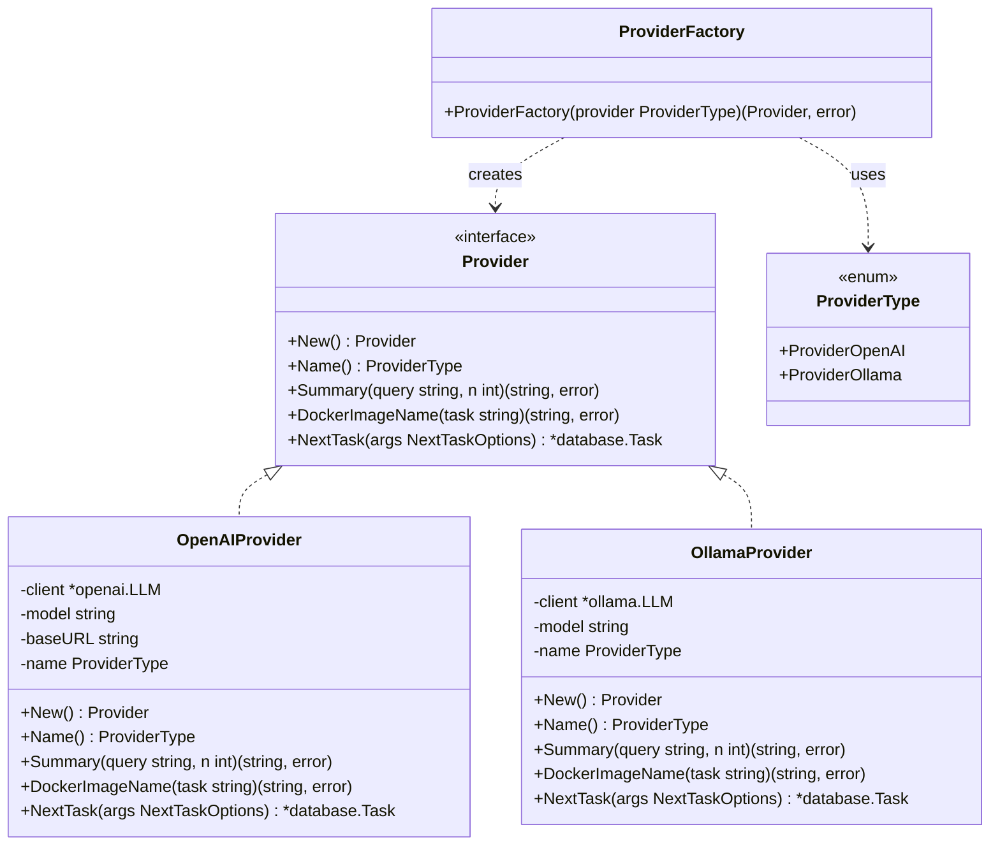
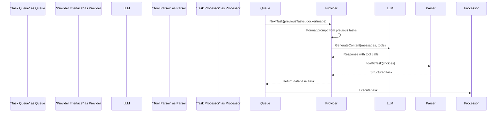
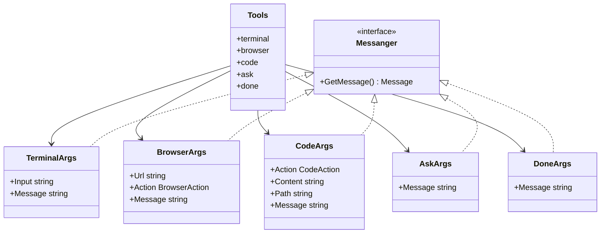
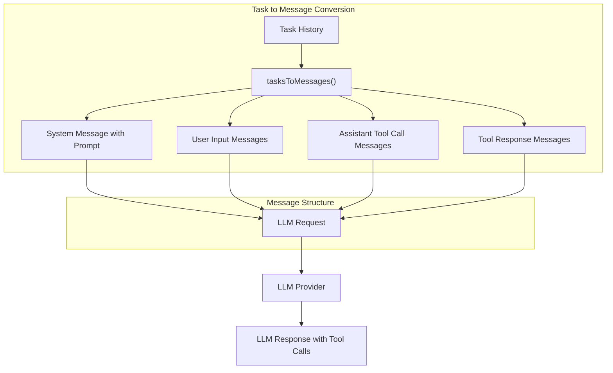
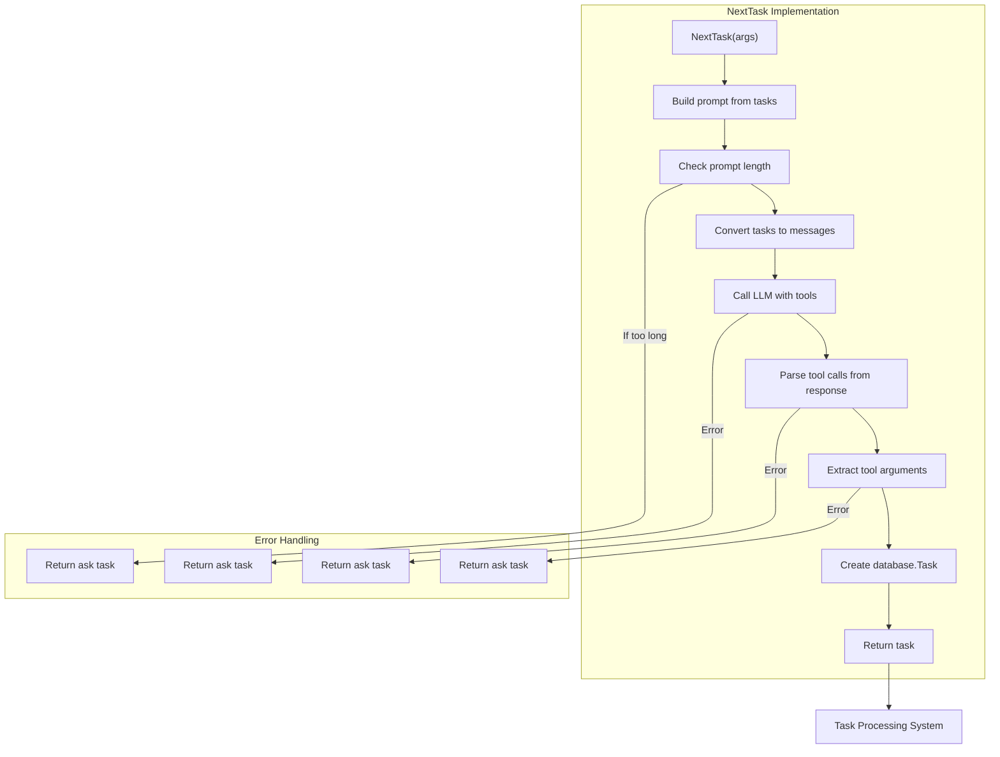
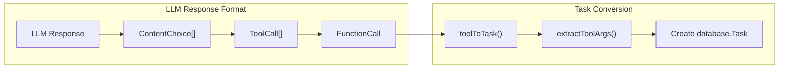
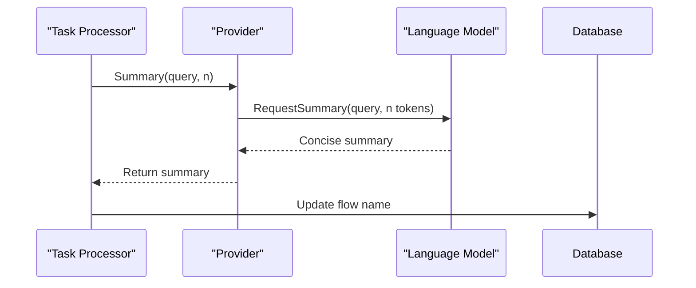
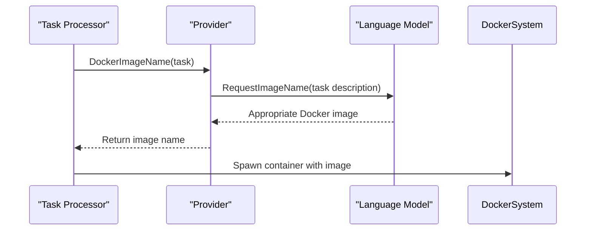
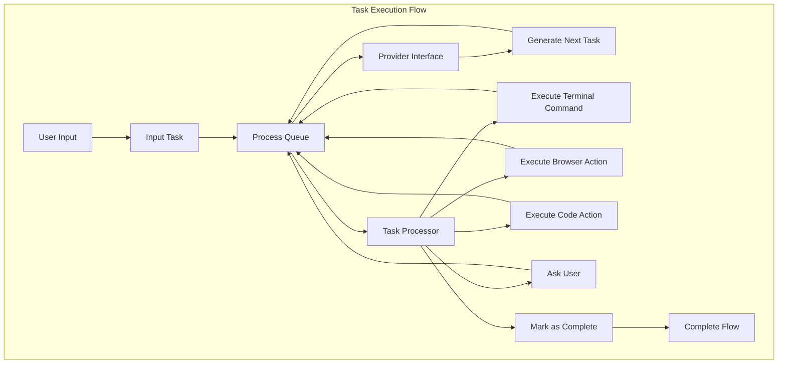

<!-- source: DeepWiki mcp.deepwiki.com · repo semanser/codel · page 3.2 Language Model Integration · fetched 2026-10-26 -->

# Language Model Integration

<details>
<summary>Relevant source files</summary>

The following files were used as context for generating this wiki page:

- [backend/executor/processor.go](backend/executor/processor.go)
- [backend/providers/openai.go](backend/providers/openai.go)
- [backend/providers/providers.go](backend/providers/providers.go)
- [backend/providers/types.go](backend/providers/types.go)

</details>


This document describes the architecture and implementation of language model (LLM) integration in Codel. It covers how Codel interfaces with different LLM providers, handles communication with these models, and converts LLM responses into executable tasks. For information about how these tasks are processed and executed, see [Task Processing System](#3.1).

## Provider Architecture

The language model integration in Codel follows a provider pattern that allows for multiple LLM backends while maintaining a consistent interface throughout the system.



### Provider Interface

The `Provider` interface defined in [backend/providers/providers.go:23-29]() is the central abstraction that enables Codel to work with different language model providers. It requires implementing the following methods:

- `New()`: Create a new instance of the provider
- `Name()`: Return the type of provider (OpenAI or Ollama)
- `Summary()`: Generate a concise summary of a text
- `DockerImageName()`: Determine an appropriate Docker image for a task
- `NextTask()`: Generate the next task for the AI agent to execute

Sources: [backend/providers/providers.go:23-29](), [backend/providers/providers.go:16-21](), [backend/providers/providers.go:79-88]()

### Provider Implementations

Codel currently supports two LLM providers:

1. **OpenAI Provider**: Integrates with OpenAI's models (like GPT-4) through their API
2. **Ollama Provider**: Connects to locally hosted Ollama models

The provider factory pattern instantiates the appropriate provider based on configuration:

```go
func ProviderFactory(provider ProviderType) (Provider, error) {
    switch provider {
    case ProviderOpenAI:
        return OpenAIProvider{}.New(), nil
    case ProviderOllama:
        return OllamaProvider{}.New(), nil
    default:
        return nil, fmt.Errorf("unknown provider: %s", provider)
    }
}
```

Sources: [backend/providers/providers.go:79-88](), [backend/providers/openai.go:16-104]()

## Language Model Communication

Codel uses a structured approach to communicate with language models, employing function/tool calling capabilities to receive structured responses that can be directly converted into executable tasks.



### Tool Definitions

The system defines a set of tools that the language model can invoke, each corresponding to a different action that the agent can perform:



These tools are defined in [backend/providers/providers.go:36-77]() and provide the language model with a structured interface to issue commands to the system. Each tool has a corresponding argument type in [backend/providers/types.go]() that implements the `Messanger` interface to extract the message component.

Sources: [backend/providers/providers.go:36-77](), [backend/providers/types.go:1-76]()

### Conversation Context Management

To maintain context across multiple interactions, Codel converts previous tasks to a format that can be included in prompts to the language model:



The `tasksToMessages` function in [backend/providers/providers.go:104-162]() converts a list of previous tasks into a structured conversation history that provides context for the language model.

Sources: [backend/providers/providers.go:104-162](), [backend/providers/openai.go:57-104]()

## Task Generation Process

The most critical function of the language model integration is generating the next task for the agent to execute, which is implemented in the `NextTask` method of each provider.



The implementation in OpenAI provider ([backend/providers/openai.go:57-104]()) illustrates this process:

1. Build a prompt using the task history and Docker image information
2. Check if the prompt is too long, and if so, return an "ask" task
3. Convert tasks to a message format for the language model
4. Call the language model with the defined tools
5. Parse the response to extract tool calls
6. Create and return a database task based on the tool call

Sources: [backend/providers/openai.go:57-104](), [backend/providers/providers.go:230-301]()

### Converting LLM Responses to Tasks

The response from the language model contains tool calls which need to be converted to executable tasks:



The `toolToTask` function in [backend/providers/providers.go:230-293]() handles this conversion, extracting the function name and arguments from the tool call and creating a corresponding task.

Sources: [backend/providers/providers.go:230-293](), [backend/providers/providers.go:295-301]()

## Specialized LLM Functions

Besides generating tasks, the language models are used for specialized functions:

### Task Summarization

The `Summary` method generates a concise description of the user's request, which is used for naming flows:



This is used in [backend/executor/processor.go:108-113]() when processing the first task in a flow to generate a descriptive name for the flow.

Sources: [backend/providers/openai.go:49-51](), [backend/executor/processor.go:108-113]()

### Docker Image Selection

The `DockerImageName` method asks the language model to select an appropriate Docker image for a given task:



This is used in [backend/executor/processor.go:114-118]() to determine the proper environment for executing the user's task.

Sources: [backend/providers/openai.go:53-55](), [backend/executor/processor.go:114-118]()

## Integration with Task Processing System

The language model integration connects with the task processing system to form a complete cycle of task generation and execution:



When the input task is processed in [backend/executor/processor.go:95-204](), the system uses the provider to determine the Docker image and generate a summary of the task. After each task is executed, the results are passed back to the language model via the task queue to generate the next task, forming a continuous loop until the flow is marked as complete.

Sources: [backend/executor/processor.go:95-204]()

## Error Handling

The language model integration includes robust error handling to ensure the system remains responsive even when the language model fails:

1. **Prompt Truncation**: If the prompt is too long, the system returns an "ask" task to get clarification from the user
2. **Model Errors**: If the language model returns an error, the system gracefully falls back to asking the user
3. **Parsing Errors**: If the response cannot be parsed, the system asks the user for guidance

This approach ensures that failures in the language model do not cause the entire system to fail, maintaining a good user experience.

Sources: [backend/providers/openai.go:69-72](), [backend/providers/openai.go:91-94](), [backend/providers/openai.go:97-101]()

## Summary

The language model integration in Codel is a sophisticated system that enables autonomous decision-making through:

1. A **Provider Interface** that abstracts different LLM backends (OpenAI, Ollama)
2. **Tool Definitions** that allow the model to issue structured commands
3. **Context Management** that maintains conversation history
4. **Task Generation** that converts model responses to executable tasks
5. **Specialized Functions** for task summarization and environment selection
6. **Robust Error Handling** that gracefully handles failures

This architecture allows Codel to leverage the capabilities of language models while maintaining a clean separation of concerns and allowing for future extensions to support additional LLM providers.

---

