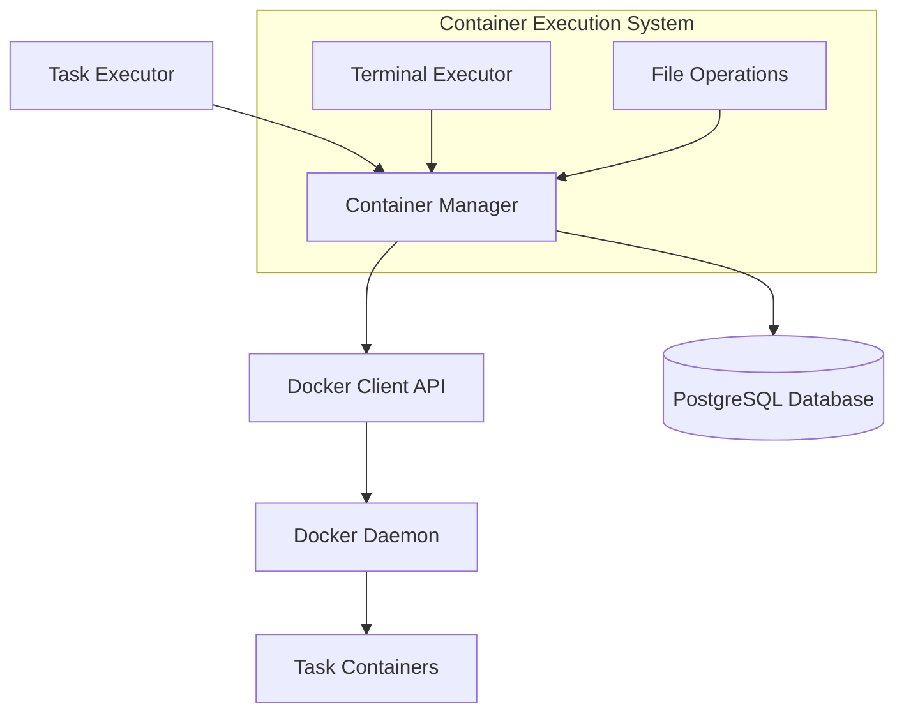
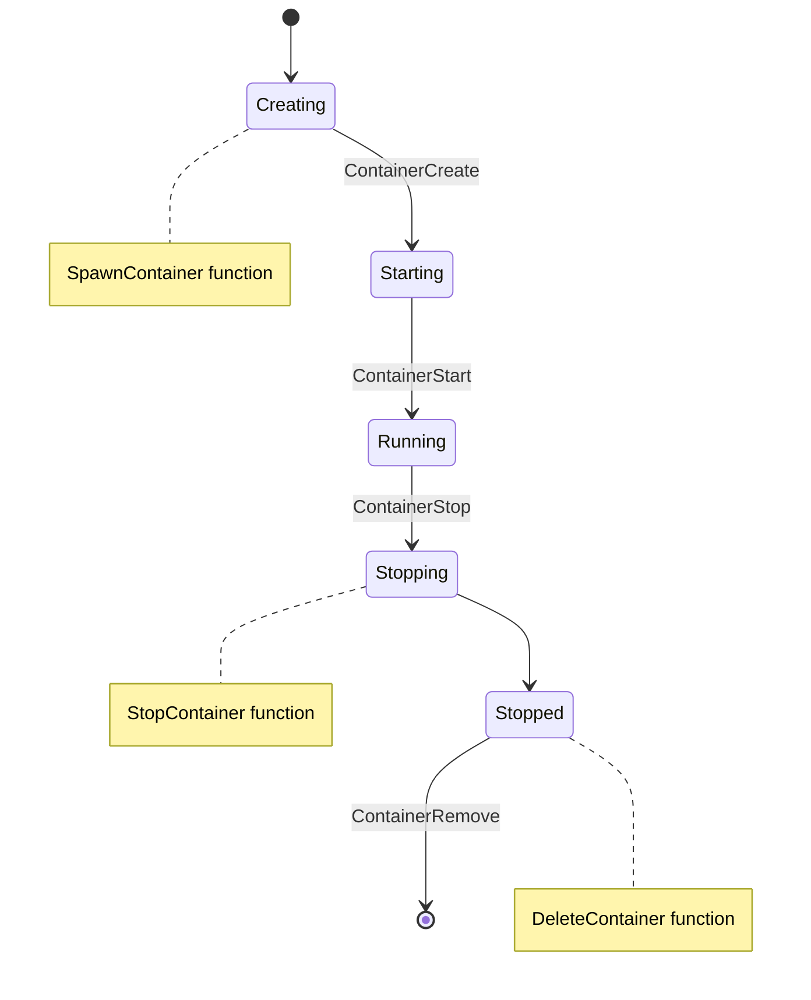
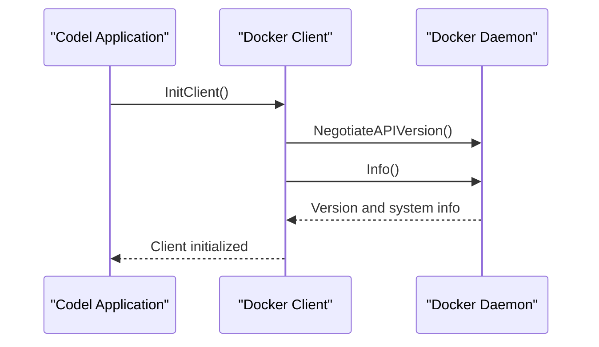
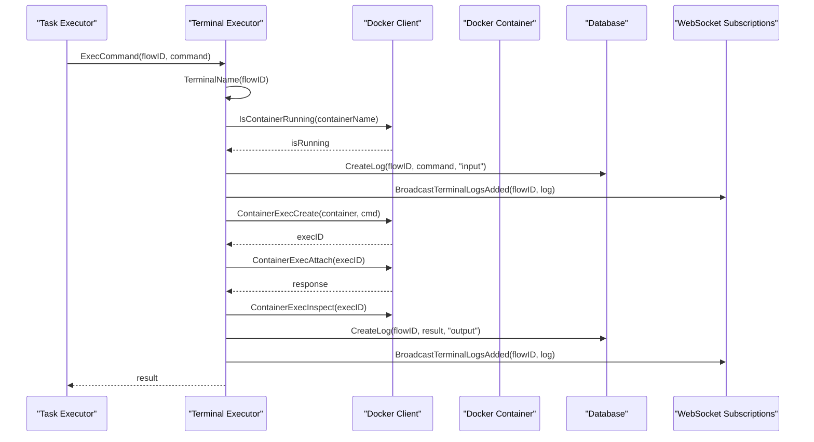
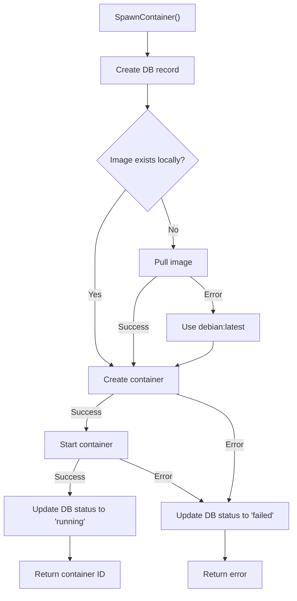
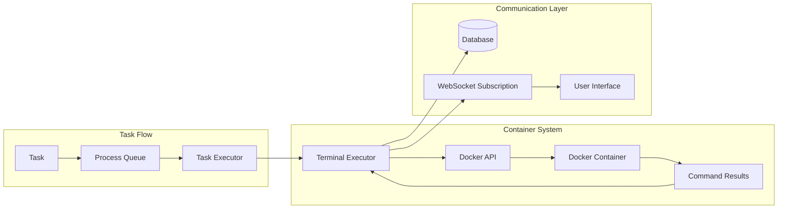
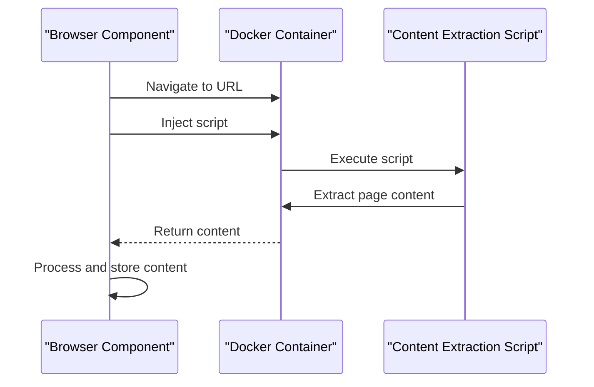

<!-- source: DeepWiki mcp.deepwiki.com · repo semanser/codel · page 3.3 Container Execution System · fetched 2026-10-26 -->

# Container Execution System

Relevant source files

The following files were used as context for generating this wiki page:

- [backend/assets/assets.go](backend/assets/assets.go)
- [backend/executor/container.go](backend/executor/container.go)
- [backend/executor/terminal.go](backend/executor/terminal.go)
- [backend/templates/scripts/content.js](backend/templates/scripts/content.js)

## Purpose and Scope

The Container Execution System is a core component of Codel that enables the execution of commands, management of terminal sessions, and browser interactions within isolated Docker containers. This system provides a secure sandboxed environment for AI agents to interact with various tools and applications without compromising the host system. 

This document covers the container lifecycle management, terminal session handling, and file operations within containers. For information about how tasks are processed and queued before execution, see [Task Processing System](#3.1). For details on browser-specific interactions, see [Browser Component](#5.2).

## System Architecture

The Container Execution System consists of several interconnected components that manage the lifecycle of Docker containers and facilitate command execution within them.

The Container Execution System interfaces with the Docker daemon through the Docker client API, managing containers that are used to execute tasks. The system stores container metadata in the PostgreSQL database and provides interfaces for terminal command execution and file operations.

Sources: [backend/executor/container.go:18-252](), [backend/executor/terminal.go:1-193]()

## Container Lifecycle Management

The Container Execution System manages the full lifecycle of Docker containers from creation to deletion.

### Container Initialization

The Docker client is initialized when the application starts:

The `InitClient` function establishes a connection to the Docker daemon and logs information about the Docker environment:

Sources: [backend/executor/container.go:24-43]()

### Container Creation

The `SpawnContainer` function creates a new container with specified configurations:

1. Creates a container record in the database with "starting" status
2. Checks if the required Docker image exists locally
3. Pulls the image if necessary, falling back to "debian:latest" if the pull fails
4. Creates and starts the container
5. Updates the container status in the database to "running" or "failed"

Sources: [backend/executor/container.go:45-147]()

### Container Management

The system provides several functions for managing existing containers:

- `StopContainer`: Stops a running container and updates its status in the database
- `DeleteContainer`: Stops and removes a container
- `IsContainerRunning`: Checks if a container is running
- `Cleanup`: Stops all running containers and sets all in-progress flows to "finished"

Sources: [backend/executor/container.go:149-252]()

## Terminal Execution

The Terminal Execution component allows Codel to run commands within containers and capture their output.

### Command Execution

The `ExecCommand` function executes commands in a container:

1. Generates a container name based on the flow ID
2. Verifies that the container is running
3. Logs the command input in the database
4. Creates an exec instance in the container
5. Attaches to the exec instance to capture output
6. Logs the command output
7. Broadcasts logs through WebSockets for real-time updates

Sources: [backend/executor/terminal.go:19-112]()

### File Operations

The `WriteFile` function writes file content to containers:

1. Verifies that the container is running
2. Logs the file content as input
3. Creates a TAR archive containing the file
4. Copies the archive to the container at the specified path
5. Logs the successful write operation

Sources: [backend/executor/terminal.go:114-189]()

## Container Naming and Identification

Containers are named using a consistent pattern and are associated with specific flows:

- Container names are generated using the `TerminalName` function: `codel-terminal-{flowID}`
- Each container is stored in the database with:
  - Database ID
  - Local Docker container ID
  - Name
  - Image
  - Status

Sources: [backend/executor/terminal.go:191-193](), [backend/executor/container.go:52-56]()

## Error Handling and Recovery

The Container Execution System includes several error handling mechanisms:

Key error handling strategies:

1. Deferred function in `SpawnContainer` to update container status
2. Fallback to "debian:latest" if the requested image cannot be pulled
3. Graceful handling of missing containers in `StopContainer`
4. Cleanup procedure that runs on application shutdown to stop all containers

Sources: [backend/executor/container.go:64-94](), [backend/executor/container.go:110-127]()

## Data Flow

This diagram illustrates the data flow for terminal command execution:

When a terminal command task is executed:

1. The command is sent to the Terminal Executor
2. The Terminal Executor identifies the appropriate container
3. The command is executed in the container via Docker Exec API
4. Results are captured and stored in the database
5. Real-time updates are broadcast through WebSocket subscriptions

Sources: [backend/executor/terminal.go:19-112](), [backend/executor/container.go:45-147]()

## Browser Integration

The Container Execution System also supports browser interactions within containers. JavaScript scripts are injected into web pages to extract content.

Content extraction is performed using embedded JavaScript templates that are injected into the browser environment within the container.

Sources: [backend/assets/assets.go:1-13](), [backend/templates/scripts/content.js:1-31]()

## Security Considerations

The Container Execution System enhances security through isolation:

1. Tasks run in separate Docker containers, isolated from the host system
2. Default image (debian:latest) is used as a fallback to ensure consistent behavior
3. Container lifecycle is managed to prevent resource leaks
4. File operations occur within the container's filesystem

By executing commands in isolated containers, the system prevents malicious or erroneous commands from affecting the host system or other containers.

Sources: [backend/executor/container.go:22-22](), [backend/executor/container.go:149-175]()

## Integration with Task Processing

The Container Execution System integrates with the [Task Processing System](#3.1) to execute tasks generated by the AI:

1. When a flow is created, a dedicated container is spawned
2. When terminal commands need to be executed, they are sent to the appropriate container
3. Results from command execution are returned to the Task Processing System
4. When a flow is completed or terminated, the container is stopped and removed

This integration allows the AI agent to interact with a consistent environment throughout the duration of a flow.

Sources: [backend/executor/container.go:45-147](), [backend/executor/terminal.go:19-112]()

---

