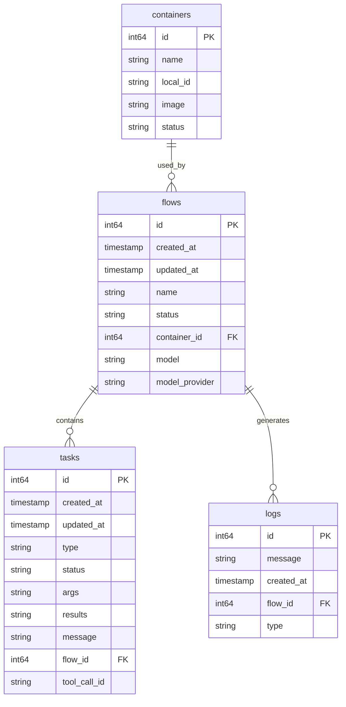
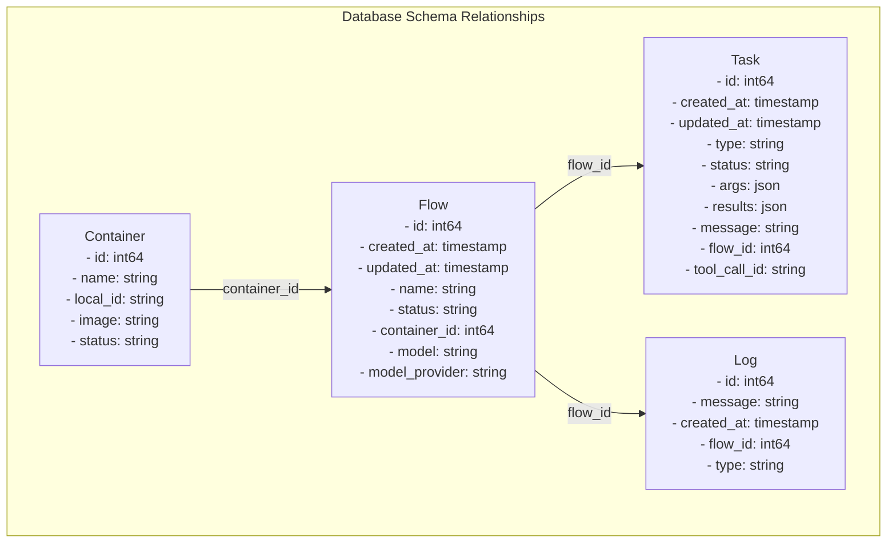
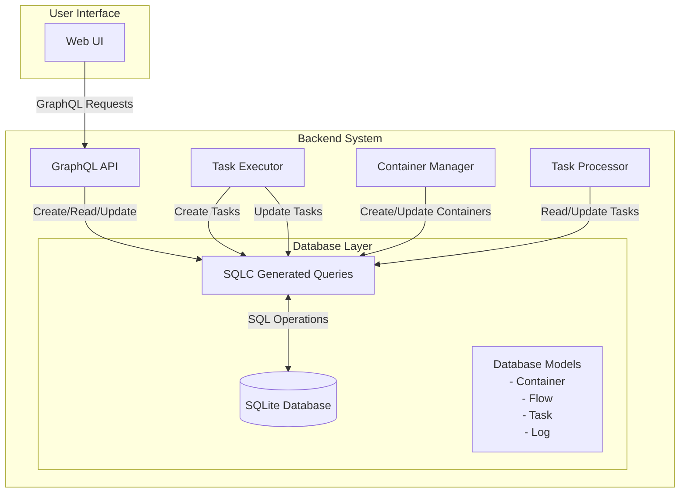

<!-- source: DeepWiki mcp.deepwiki.com · repo semanser/codel · page 4.1 Database Schema · fetched 2026-10-26 -->

# Database Schema

<details>
<summary>Relevant source files</summary>

The following files were used as context for generating this wiki page:

- [backend/database/containers.sql.go](backend/database/containers.sql.go)
- [backend/database/db.go](backend/database/db.go)
- [backend/database/flows.sql.go](backend/database/flows.sql.go)
- [backend/database/models.go](backend/database/models.go)
- [backend/database/tasks.sql.go](backend/database/tasks.sql.go)
- [backend/migrations/20240325154630_initial_migration.sql](backend/migrations/20240325154630_initial_migration.sql)
- [backend/migrations/20240328114536_tool_call_id_field.sql](backend/migrations/20240328114536_tool_call_id_field.sql)
- [backend/models/containers.sql](backend/models/containers.sql)
- [backend/models/flows.sql](backend/models/flows.sql)
- [backend/models/tasks.sql](backend/models/tasks.sql)
- [backend/sqlc.yml](backend/sqlc.yml)

</details>


This document details the database schema used in Codel, covering the structure and relationships of the core database tables. This schema serves as the foundation for storing flows, tasks, containers, and related data in the Codel system.

For information about the GraphQL API that interfaces with this database schema, see [GraphQL API](#4.2).

## Overview

Codel uses a SQLite database with four primary tables that form the backbone of its data layer:

1. **Containers** - Stores Docker container information
2. **Flows** - Stores autonomous task flow information and sessions
3. **Tasks** - Stores individual tasks that make up a flow
4. **Logs** - Stores system and execution logs

The schema follows a relational model where flows reference containers, and tasks reference flows.



Sources: [backend/migrations/20240325154630_initial_migration.sql](), [backend/database/models.go]()

## Table Definitions

### Containers Table

The Containers table tracks Docker containers created for task execution environments.

| Column   | Type    | Description                                | Default    |
|----------|---------|--------------------------------------------|------------|
| id       | INTEGER | Primary key                                | AUTOINCREMENT |
| name     | TEXT    | Container name                             | NULL       |
| local_id | TEXT    | Docker container ID                        | NULL       |
| image    | TEXT    | Docker image used                          | NULL       |
| status   | TEXT    | Container status (starting, running, etc.) | 'starting' |

Sources: [backend/migrations/20240325154630_initial_migration.sql:3-9](), [backend/database/models.go:12-18]()

### Flows Table

The Flows table represents autonomous task flows - the primary unit of work within Codel.

| Column         | Type      | Description                          | Default     |
|----------------|-----------|--------------------------------------|-------------|
| id             | INTEGER   | Primary key                          | AUTOINCREMENT |
| created_at     | TIMESTAMP | Creation timestamp                   | CURRENT_TIMESTAMP |
| updated_at     | TIMESTAMP | Last update timestamp                | CURRENT_TIMESTAMP |
| name           | TEXT      | Flow name                            | NULL        |
| status         | TEXT      | Flow status                          | NULL        |
| container_id   | INTEGER   | Foreign key to containers.id         | NULL        |
| model          | TEXT      | LLM model used for the flow          | NULL        |
| model_provider | TEXT      | Provider of the LLM (OpenAI/Ollama)  | NULL        |

Sources: [backend/migrations/20240325154630_initial_migration.sql:11-19](), [backend/database/models.go:20-29]()

### Tasks Table

The Tasks table stores individual tasks that are executed as part of a flow.

| Column       | Type      | Description                    | Default     |
|--------------|-----------|--------------------------------|-------------|
| id           | INTEGER   | Primary key                    | AUTOINCREMENT |
| created_at   | TIMESTAMP | Creation timestamp             | CURRENT_TIMESTAMP |
| updated_at   | TIMESTAMP | Last update timestamp          | CURRENT_TIMESTAMP |
| type         | TEXT      | Task type (terminal, browser, code, ask, done) | NULL |
| status       | TEXT      | Task status                    | NULL |
| args         | TEXT      | JSON-encoded task arguments    | '{}' |
| results      | TEXT      | JSON-encoded task results      | '{}' |
| message      | TEXT      | Human-readable task description| NULL |
| flow_id      | INTEGER   | Foreign key to flows.id        | NULL |
| tool_call_id | TEXT      | LLM tool call identifier       | NULL |

Sources: [backend/migrations/20240325154630_initial_migration.sql:21-32](), [backend/migrations/20240328114536_tool_call_id_field.sql:3](), [backend/database/models.go:39-50]()

### Logs Table

The Logs table captures various system and execution logs associated with flows.

| Column     | Type      | Description                    | Default     |
|------------|-----------|--------------------------------|-------------|
| id         | INTEGER   | Primary key                    | AUTOINCREMENT |
| message    | TEXT      | Log message content            | NOT NULL    |
| created_at | TIMESTAMP | Creation timestamp             | NOT NULL    |
| flow_id    | INTEGER   | Foreign key to flows.id        | NULL        |
| type       | TEXT      | Log type classifier            | NOT NULL    |

Sources: [backend/database/models.go:31-37]()

## Key Relationships



Sources: [backend/migrations/20240325154630_initial_migration.sql](), [backend/database/models.go]()

## Database Access Layer

Codel uses the sqlc tool to generate type-safe Go code for database access. The generated code includes structs matching the database tables and functions for querying and modifying the data.

### Query Interfaces

The database package provides query functions for each entity:

#### Container Queries
- `CreateContainer` - Creates a new container record
- `GetAllRunningContainers` - Retrieves all containers with 'running' status
- `UpdateContainerStatus` - Updates a container's status
- `UpdateContainerLocalId` - Updates a container's Docker local ID

Sources: [backend/models/containers.sql](), [backend/database/containers.sql.go]()

#### Flow Queries
- `CreateFlow` - Creates a new flow record
- `ReadAllFlows` - Retrieves all flows with container information
- `ReadFlow` - Retrieves a single flow with container details
- `UpdateFlowStatus` - Updates a flow's status
- `UpdateFlowName` - Updates a flow's name
- `UpdateFlowContainer` - Updates a flow's container reference

Sources: [backend/models/flows.sql](), [backend/database/flows.sql.go]()

#### Task Queries
- `CreateTask` - Creates a new task record
- `ReadTasksByFlowId` - Retrieves all tasks for a specific flow
- `UpdateTaskStatus` - Updates a task's status
- `UpdateTaskResults` - Updates a task's results
- `UpdateTaskToolCallId` - Updates a task's tool call ID

Sources: [backend/models/tasks.sql](), [backend/database/tasks.sql.go]()

## Database Usage in System Context



Sources: [backend/database/db.go](), [backend/database/models.go]()

## Transaction Management

The database package provides a `WithTx` method for transaction management:

```go
func (q *Queries) WithTx(tx *sql.Tx) *Queries {
    return &Queries{
        db: tx,
    }
}
```

This allows for atomic operations across multiple queries when needed.

Sources: [backend/database/db.go:27-31]()

## Database Migrations

Codel uses Goose for database migrations. Initial schema creation and subsequent modifications are managed through migration files:

1. Initial migration creating the core tables: [backend/migrations/20240325154630_initial_migration.sql]()
2. Tool call ID field addition: [backend/migrations/20240328114536_tool_call_id_field.sql]()

New migrations can be added to extend or modify the schema as the application evolves.

Sources: [backend/migrations/20240325154630_initial_migration.sql](), [backend/migrations/20240328114536_tool_call_id_field.sql]()

## JSON Data Storage

Several fields in the Tasks table (`args` and `results`) store JSON-encoded data. This allows for flexible storage of varied inputs and outputs while maintaining a fixed schema. The application code is responsible for properly serializing and deserializing this JSON data.

Sources: [backend/migrations/20240325154630_initial_migration.sql:27-28]()

---

