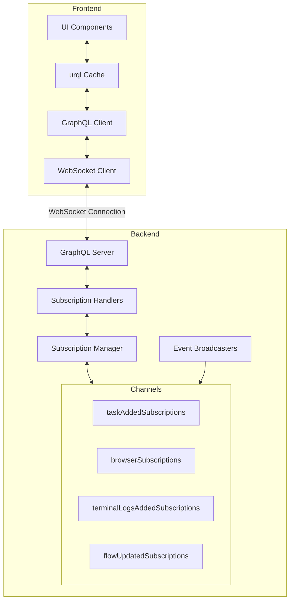
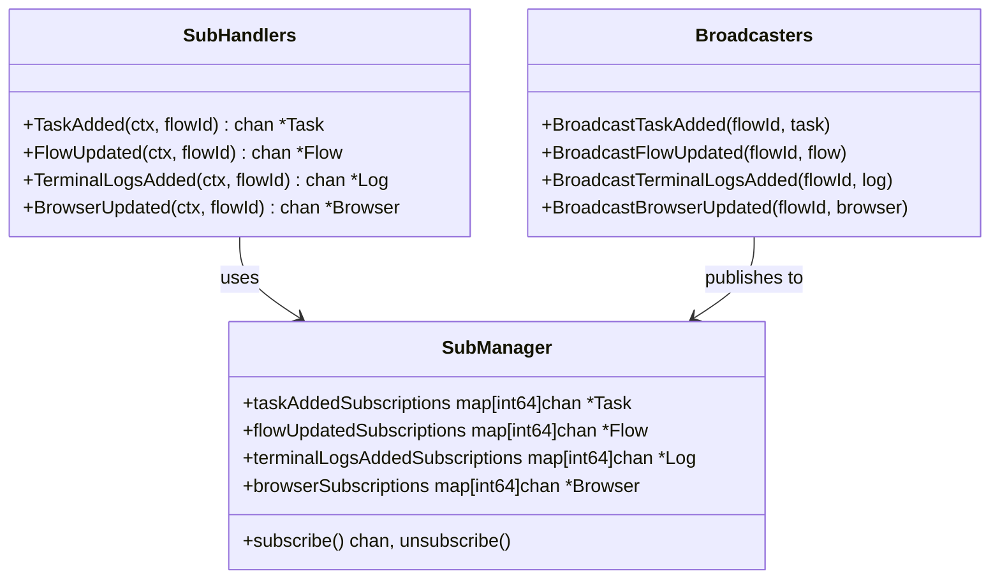
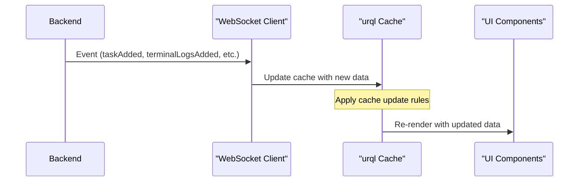
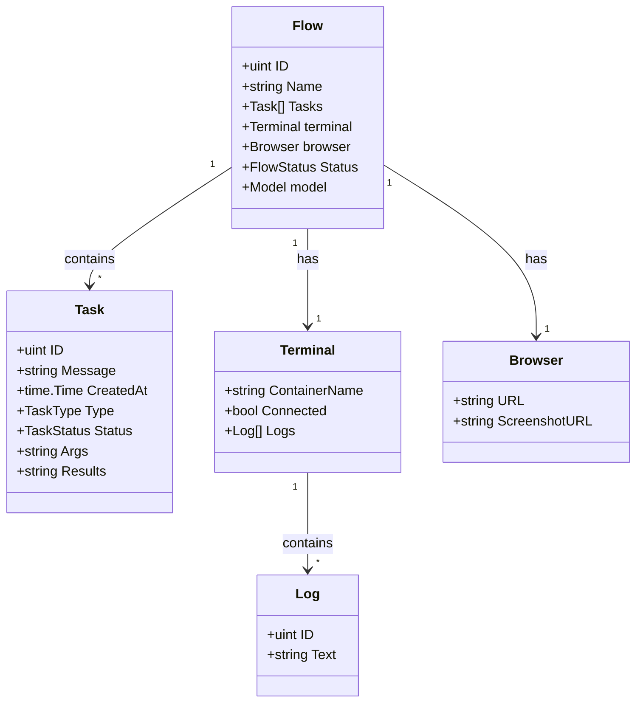
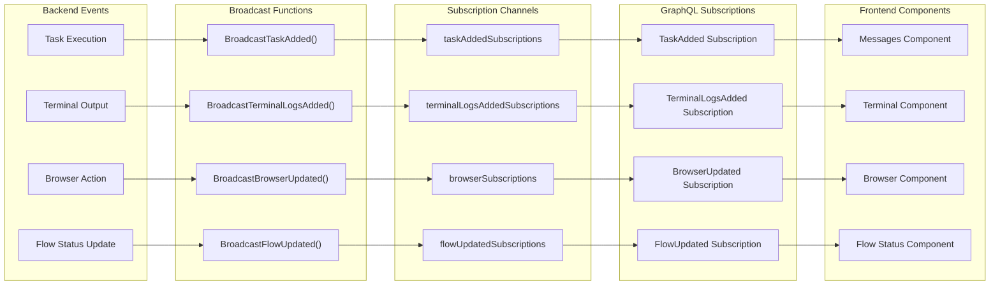

<!-- source: DeepWiki mcp.deepwiki.com · repo semanser/codel · page 4.3 Real-time Communication · fetched 2026-10-26 -->

# Real-time Communication

<details>
<summary>Relevant source files</summary>

The following files were used as context for generating this wiki page:

- [backend/graph/model/models_gen.go](backend/graph/model/models_gen.go)
- [backend/graph/subscriptions/broadcast.go](backend/graph/subscriptions/broadcast.go)
- [backend/graph/subscriptions/manager.go](backend/graph/subscriptions/manager.go)
- [backend/graph/subscriptions/subscriptions.go](backend/graph/subscriptions/subscriptions.go)
- [frontend/src/graphql.ts](frontend/src/graphql.ts)
- [frontend/src/layouts/AppLayout/AppLayout.graphql](frontend/src/layouts/AppLayout/AppLayout.graphql)
- [frontend/src/layouts/AppLayout/AppLayout.tsx](frontend/src/layouts/AppLayout/AppLayout.tsx)

</details>


## Purpose and Scope

This document explains Codel's real-time communication system, which enables live updates between the backend and frontend. The system uses GraphQL subscriptions and WebSockets to deliver instant updates for task additions, terminal output, browser changes, and flow status modifications without requiring page refreshes.

For information about the overall GraphQL API structure, see [GraphQL API](#4.2).

## Architecture Overview

Codel implements real-time communication using a subscription-based architecture with GraphQL as the transport layer and WebSockets as the underlying protocol. This enables bi-directional communication and instant updates to the UI when changes occur on the server.



**Real-time Communication Architecture**

Sources: [frontend/src/graphql.ts:73-101](), [backend/graph/subscriptions/manager.go:1-42](), [backend/graph/subscriptions/subscriptions.go:1-68]()

## Subscription System

### Backend Implementation

The backend subscription system consists of three main components:

1. **Subscription Manager**: Maintains maps of subscription channels and handles subscription lifecycle
2. **Subscription Handlers**: Provides methods for clients to subscribe to specific event types
3. **Event Broadcasters**: Publishes events to relevant subscription channels



**Backend Subscription System**

Sources: [backend/graph/subscriptions/manager.go:1-42](), [backend/graph/subscriptions/subscriptions.go:1-68](), [backend/graph/subscriptions/broadcast.go:1-29]()

#### Subscription Channel Management

The subscription manager maintains separate channel maps for each subscription type, indexed by flow ID:

```go
var (
    taskAddedSubscriptions         = make(map[int64]chan *gmodel.Task)
    flowUpdatedSubscriptions       = make(map[int64]chan *gmodel.Flow)
    terminalLogsAddedSubscriptions = make(map[int64]chan *gmodel.Log)
    browserSubscriptions           = make(map[int64]chan *gmodel.Browser)
)
```

It provides a generic `subscribe` function that creates a channel, registers it, and returns an unsubscribe function that handles cleanup:

```go
func subscribe[B any](flowID int64, subscriptions map[int64]chan B) (channel chan B, unsubscribe func())
```

Sources: [backend/graph/subscriptions/manager.go:7-42]()

#### Subscription Handlers

The subscription handlers take a context and flow ID, subscribe to the appropriate channel, and set up automatic unsubscription when the context is canceled:

```go
func TaskAdded(ctx context.Context, flowId int64) (<-chan *gmodel.Task, error)
func FlowUpdated(ctx context.Context, flowId int64) (<-chan *gmodel.Flow, error)
func TerminalLogsAdded(ctx context.Context, flowId int64) (<-chan *gmodel.Log, error)
func BrowserUpdated(ctx context.Context, flowId int64) (<-chan *gmodel.Browser, error)
```

Each handler follows a similar pattern:
1. Get a channel and unsubscribe function from the subscription manager
2. Start a goroutine that monitors the context and unsubscribes when it's done
3. Return the channel to the GraphQL resolver

Sources: [backend/graph/subscriptions/subscriptions.go:9-68]()

#### Event Broadcasters

The broadcasters are simple functions that send events to the appropriate subscription channels:

```go
func BroadcastTaskAdded(flowID int64, task *gmodel.Task)
func BroadcastFlowUpdated(flowID int64, flow *gmodel.Flow)
func BroadcastTerminalLogsAdded(flowID int64, flow *gmodel.Log)
func BroadcastBrowserUpdated(flowID int64, browser *gmodel.Browser)
```

These functions are called by various parts of the application when events occur that should be broadcast to subscribers.

Sources: [backend/graph/subscriptions/broadcast.go:1-29]()

### Frontend Implementation

The frontend uses the `urql` GraphQL client with subscription support to receive real-time updates from the backend.

#### WebSocket Client Setup

The frontend creates a WebSocket client that connects to the GraphQL endpoint:

```javascript
const wsClient = createWSClient({
  url: "ws://" + import.meta.env.VITE_API_URL + "/graphql",
});
```

Sources: [frontend/src/graphql.ts:73-75]()

#### GraphQL Client Configuration

The GraphQL client is configured with several exchanges, including the subscription exchange that forwards subscription requests to the WebSocket client:

```javascript
export const graphqlClient = createClient({
  url: window.location.origin + "/graphql",
  fetchOptions: {},
  exchanges: [
    devtoolsExchange,
    cache,
    fetchExchange,
    subscriptionExchange({
      forwardSubscription(request) {
        const input = { ...request, query: request.query || "" };
        return {
          subscribe(sink) {
            const unsubscribe = wsClient.subscribe(input, sink);
            
            wsClient.on("error", (error) => {
              console.error("The subscription errored:", error);
            });
            
            return { unsubscribe };
          },
        };
      },
    }),
  ],
});
```

Sources: [frontend/src/graphql.ts:77-101]()

#### Cache Updates for Real-time Data

The frontend uses the `cacheExchange` from `urql` to update the local cache when subscription events are received:



**Frontend Cache Update Flow**

Sources: [frontend/src/graphql.ts:8-71]()

The cache exchange defines update rules for different subscription events:

```javascript
updates: {
  Subscription: {
    browserUpdated: (result, _args, cache) => {
      const flowId = _args.flowId;
      const flowEntityKey = `Flow:${flowId}`;
      const browser = result.browserUpdated as Data;
      cache.link(flowEntityKey, "browser", browser as Data);
    },
    terminalLogsAdded: (result, _args, cache) => {
      const flowId = _args.flowId;
      const flowEntityKey = `Flow:${flowId}.terminal`;
      const logs = cache.resolve(flowEntityKey, "logs");
      const log = result.terminalLogsAdded as Data;

      if (Array.isArray(logs)) {
        logs.push(log);
        cache.link(flowEntityKey, "logs", logs as Data[]);
      }
    },
    taskAdded: (result, _args, cache) => {
      const flowId = _args.flowId;
      const flowEntityKey = `Flow:${flowId}`;
      const tasks = cache.resolve(flowEntityKey, "tasks");
      const task = result.taskAdded as Data;

      if (Array.isArray(tasks)) {
        tasks.push(task);
        cache.link(flowEntityKey, "tasks", tasks as Data[]);
      }
    },
  },
}
```

This ensures that when new data arrives via subscriptions, the UI components automatically re-render with the latest data.

Sources: [frontend/src/graphql.ts:36-65]()

## Subscription Types and Data Models

Codel's real-time communication system handles several types of events, each corresponding to a specific data model:

| Subscription Type | Data Model | Purpose |
|-------------------|------------|---------|
| `taskAdded` | `Task` | Notifies when a new task is added to a flow |
| `terminalLogsAdded` | `Log` | Delivers new terminal output in real-time |
| `browserUpdated` | `Browser` | Updates when the browser state changes |
| `flowUpdated` | `Flow` | Notifies when a flow's status changes |

The data models are defined in the GraphQL schema:



**Data Models for Real-time Communication**

Sources: [backend/graph/model/models_gen.go:12-60]()

## Event Flow and Integration

### Complete Event Flow

The complete event flow in the real-time communication system follows this pattern:



**Complete Event Flow**

Sources: [backend/graph/subscriptions/broadcast.go:1-29](), [backend/graph/subscriptions/subscriptions.go:1-68](), [frontend/src/graphql.ts:36-65]()

### Integration with UI Components

The real-time updates from subscriptions are automatically reflected in the UI through urql's cache exchange. When a subscription event is received:

1. The event data is passed to the appropriate update function in the cache exchange
2. The cache is updated with the new data
3. The UI components that depend on this data are automatically re-rendered

For example, when a new terminal log is received:

1. The backend calls `BroadcastTerminalLogsAdded` with the flow ID and log
2. The log is sent to the appropriate subscription channel
3. The GraphQL subscription receives the log via WebSocket
4. The cache exchange's `terminalLogsAdded` update function adds the log to the terminal logs array
5. The Terminal component re-renders to display the new log

This integration enables a seamless real-time user experience without requiring explicit handling of WebSocket events in the UI components.

Sources: [frontend/src/graphql.ts:8-71](), [frontend/src/layouts/AppLayout/AppLayout.tsx:1-32]()

## Summary

Codel's real-time communication system provides a robust foundation for delivering live updates to the user interface. By leveraging GraphQL subscriptions over WebSockets, it enables:

1. Real-time task updates
2. Live terminal output
3. Instant browser state changes
4. Flow status notifications

The system is built with a clean separation between the subscription management on the backend and the cache update logic on the frontend, making it both maintainable and efficient.

---

