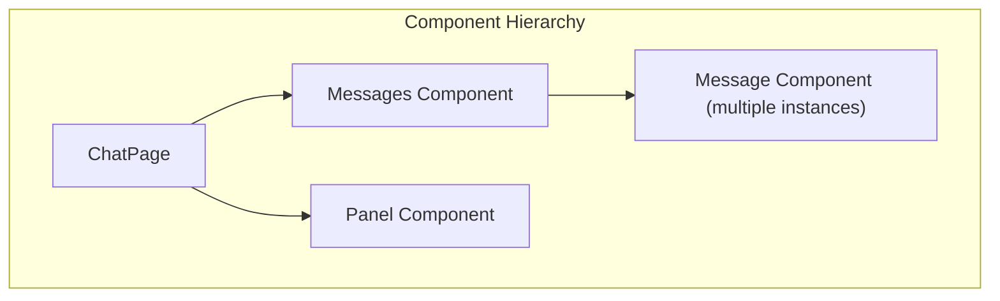
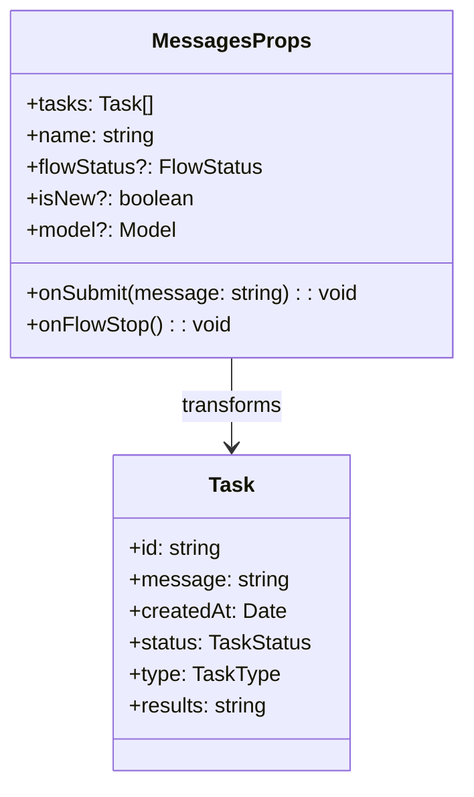
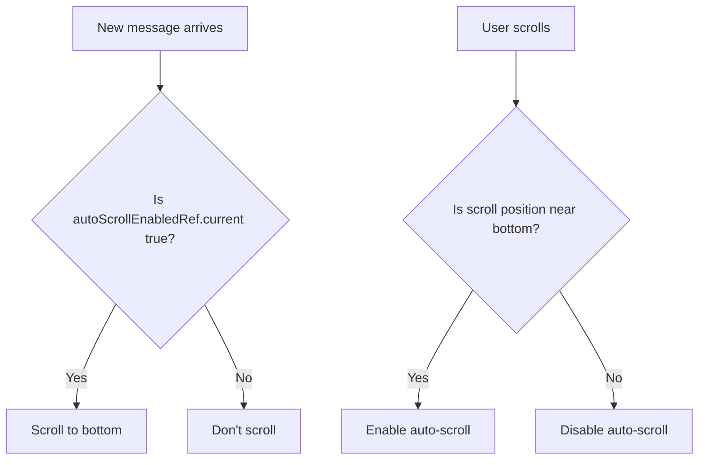
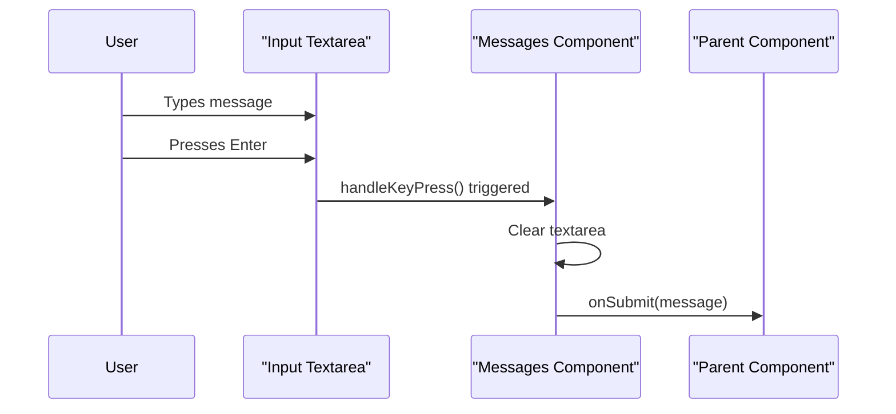
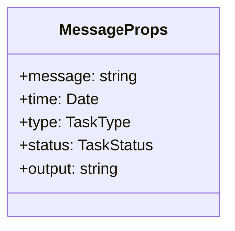
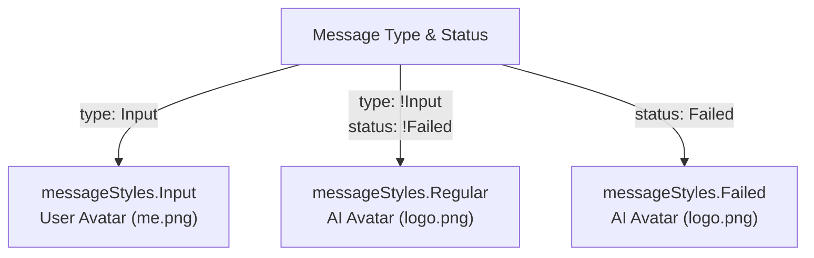
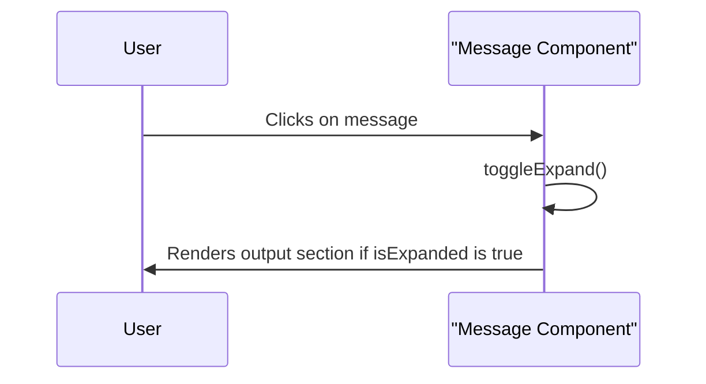
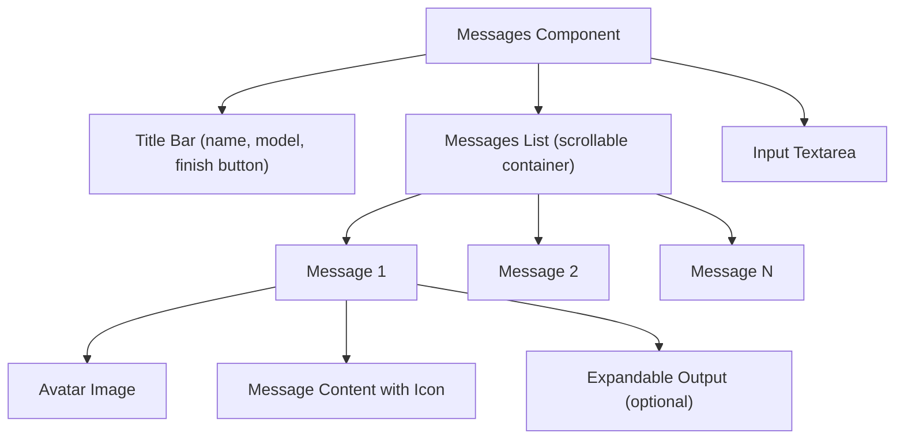
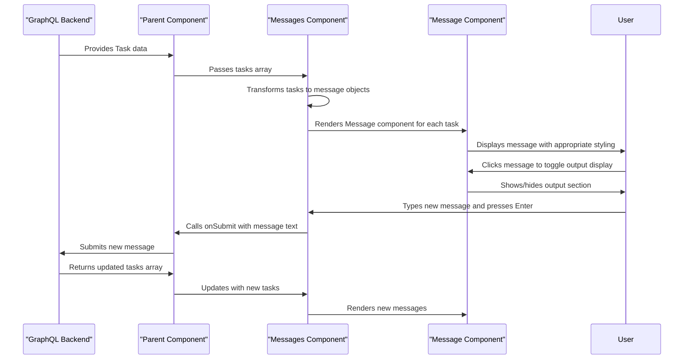
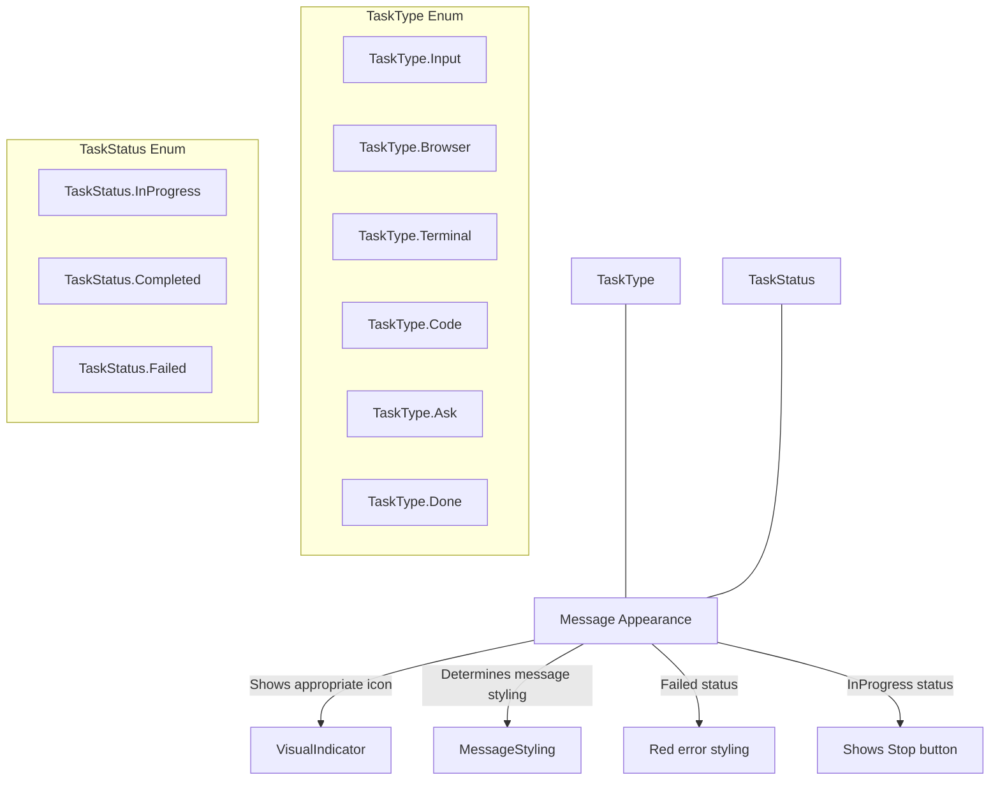

<!-- source: DeepWiki mcp.deepwiki.com · repo semanser/codel · page 5.3 Messages System · fetched 2026-10-26 -->

# Messages System

<details>
<summary>Relevant source files</summary>

The following files were used as context for generating this wiki page:

- [frontend/src/assets/logo.png](frontend/src/assets/logo.png)
- [frontend/src/assets/me.png](frontend/src/assets/me.png)
- [frontend/src/components/Messages/Message/Message.css.ts](frontend/src/components/Messages/Message/Message.css.ts)
- [frontend/src/components/Messages/Message/Message.tsx](frontend/src/components/Messages/Message/Message.tsx)
- [frontend/src/components/Messages/Messages.css.ts](frontend/src/components/Messages/Messages.css.ts)
- [frontend/src/components/Messages/Messages.tsx](frontend/src/components/Messages/Messages.tsx)
- [frontend/src/components/Panel/Panel.css.ts](frontend/src/components/Panel/Panel.css.ts)

</details>


This page documents the Messages System component of Codel, which displays and manages the conversation history between the user and the AI agent in the user interface. The Messages System handles rendering different types of task messages, displays appropriate visual indicators for task status, and provides user input capabilities.

## Component Overview

The Messages System consists of two primary React components that work together to display the conversation interface:



Sources: [frontend/src/components/Messages/Messages.tsx](), [frontend/src/components/Messages/Message/Message.tsx]()

## Messages Component Structure

The `Messages` component is the container that manages the list of messages and the user input field. It transforms task data from the backend into renderable message objects.

### Component Properties



Sources: [frontend/src/components/Messages/Messages.tsx:15-23]()

### Key Features

1. **Task Transformation**: Transforms GraphQL Task objects into message objects:

```
const messages = tasks.map((task) => ({
    id: task.id,
    message: task.message,
    time: task.createdAt,
    status: task.status,
    type: task.type,
    output: task.results,
}));
```

Sources: [frontend/src/components/Messages/Messages.tsx:34-42]()

2. **Auto-scrolling Behavior**: Implements intelligent auto-scrolling to follow new messages:



Sources: [frontend/src/components/Messages/Messages.tsx:59-88]()

3. **Input Handling**: Manages user input and submits messages:



Sources: [frontend/src/components/Messages/Messages.tsx:47-57]()

## Message Component

The `Message` component renders individual messages with appropriate styling based on message type and status.

### Component Properties



Sources: [frontend/src/components/Messages/Message/Message.tsx:21-27]()

### Message Types and Styling

The component handles different task types, each with its own icon and styling:

| Task Type | Icon Component | Description |
|-----------|---------------|-------------|
| `Input` | (User input) | User message with user avatar |
| `Browser` | `Icon.Browser` | Browser task |
| `Terminal` | `Icon.Terminal` | Terminal command |
| `Code` | `Icon.Code` | Code operation |
| `Ask` | `Icon.MessageQuestion` | Question to user |
| `Done` | `Icon.CheckCircle` | Task completion |

Sources: [frontend/src/components/Messages/Message/Message.tsx:89-111]()

The visual styling of messages is determined by their type and status:



Sources: [frontend/src/components/Messages/Message/Message.tsx:55-62](), [frontend/src/components/Messages/Message/Message.css.ts:43-75]()

### Expandable Output

Each message can be expanded to show detailed output/results:



Sources: [frontend/src/components/Messages/Message/Message.tsx:36-40](), [frontend/src/components/Messages/Message/Message.tsx:83]()

## Visual Layout

The Messages component has several distinct visual sections:



Sources: [frontend/src/components/Messages/Messages.tsx:92-126](), [frontend/src/components/Messages/Messages.css.ts:6-64]()

## Complete Data Flow

The following diagram illustrates the complete data flow through the Messages System:



Sources: [frontend/src/components/Messages/Messages.tsx](), [frontend/src/components/Messages/Message/Message.tsx]()

## Message Component CSS Structure

The Message component uses a set of CSS styles defined with vanilla-extract to create the visual appearance:

| CSS Class | Purpose | Source |
|-----------|---------|--------|
| `wrapperStyles` | Container for the entire message | [Message.css.ts:6-9]() |
| `avatarStyles` | Styling for avatar images | [Message.css.ts:11-14]() |
| `messageStyles.Input` | Styling for user input messages | [Message.css.ts:44-52]() |
| `messageStyles.Regular` | Styling for AI task messages | [Message.css.ts:53-63]() |
| `messageStyles.Failed` | Styling for failed task messages | [Message.css.ts:64-74]() |
| `outputStyles` | Styling for expanded output section | [Message.css.ts:108-121]() |

Sources: [frontend/src/components/Messages/Message/Message.css.ts]()

## Interaction with TaskStatus and TaskType

The Messages System visualizes different task types and statuses. The following shows how task types and statuses affect the message appearance:



Sources: [frontend/src/components/Messages/Message/Message.tsx:55-81]()

## Conclusion

The Messages System provides the primary interface for users to interact with the Codel AI agent. It displays conversation history with appropriate visual indicators for different task types and statuses, enables user input, and shows task results in an expandable format. The system's auto-scrolling behavior ensures new messages are visible while allowing users to browse previous messages.

---

