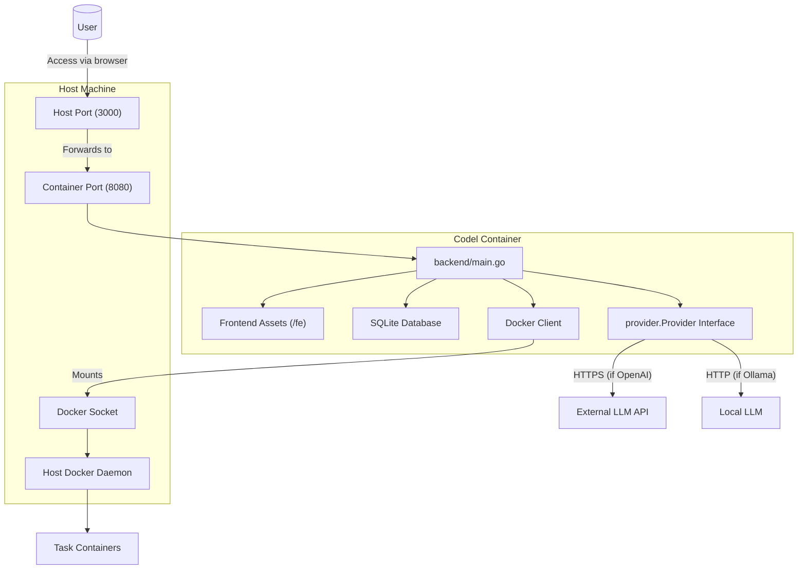
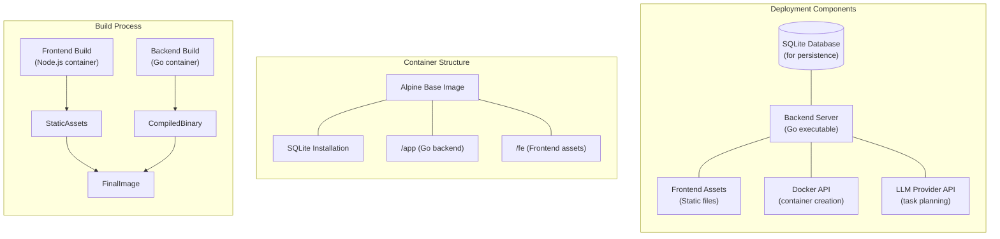
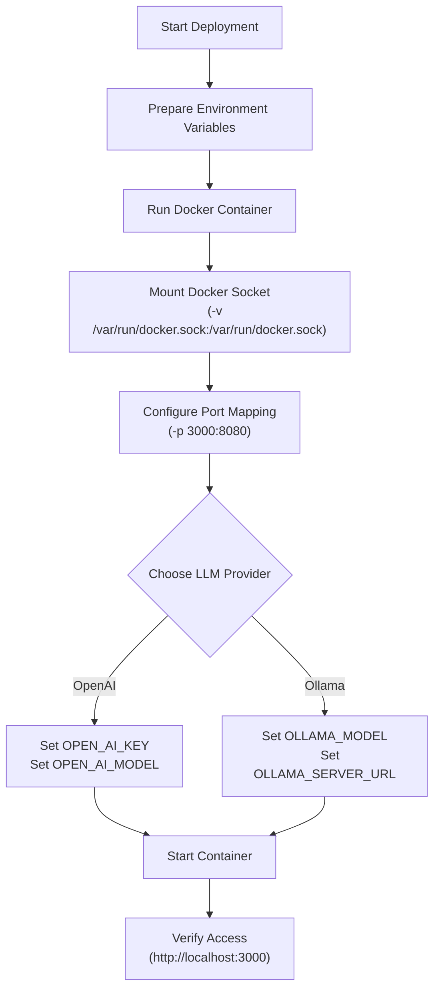

<!-- source: DeepWiki mcp.deepwiki.com · repo semanser/codel · page 6 Deployment · fetched 2026-10-26 -->

# Deployment

<details>
<summary>Relevant source files</summary>

The following files were used as context for generating this wiki page:

- [.dockerignore](.dockerignore)
- [.github/logo.png](.github/logo.png)
- [.gitignore](.gitignore)
- [DEVELOPMENT.md](DEVELOPMENT.md)
- [Dockerfile](Dockerfile)
- [README.md](README.md)
- [backend/.env.example](backend/.env.example)
- [backend/.gitignore](backend/.gitignore)
- [frontend/.env.example](frontend/.env.example)

</details>


This document covers the deployment of Codel, an autonomous AI agent system. It provides detailed instructions for containerized deployment, configuration options, and best practices for different environments. For information about the core systems that run within the deployed environment, see [Core Systems](#3).

## Deployment Overview

Codel is designed to be run as a Docker container, providing a secure, isolated environment for AI agent operations. The primary deployment method uses a pre-built Docker image available on GitHub Container Registry, requiring minimal setup while ensuring consistency across different environments.



Sources: [README.md:17-37](), [Dockerfile:1-43]()

## Basic Docker Deployment

The simplest way to deploy Codel is using the pre-built Docker image with the following command:

```bash
docker run \
  -e OPEN_AI_KEY=your_open_ai_key \
  -e OPEN_AI_MODEL=gpt-4-0125-preview \
  -e OLLAMA_MODEL=llama2 \
  -p 3000:8080 \
  -v /var/run/docker.sock:/var/run/docker.sock \
  ghcr.io/semanser/codel:latest
```

This command:
1. Sets required environment variables for LLM providers
2. Maps port 3000 on the host to port 8080 in the container
3. Mounts the Docker socket to enable container creation from within Codel
4. Uses the latest Codel image from GitHub Container Registry

After running this command, you can access Codel by navigating to `http://localhost:3000` in your browser.

Sources: [README.md:17-37]()

## Environment Variables Configuration

Codel's behavior can be customized through various environment variables:

| Variable | Description | Default | Required |
|----------|-------------|---------|----------|
| `OPEN_AI_KEY` | OpenAI API key | - | Yes, if using OpenAI |
| `OPEN_AI_MODEL` | OpenAI model name | gpt-4-0125-preview | No |
| `OPEN_AI_SERVER_URL` | Custom OpenAI-compatible server URL | https://api.openai.com/v1 | No |
| `OLLAMA_MODEL` | Ollama model name | - | Yes, if using Ollama |
| `OLLAMA_SERVER_URL` | Ollama server URL | host.docker.internal:11434 | No |
| `DATABASE_URL` | Database connection string | - | No |
| `PORT` | Server port inside container | 8080 | No |

Instead of passing environment variables directly in the Docker command, you can use an environment file:

```bash
docker run \
  --env-file ./my-codel.env \
  -p 3000:8080 \
  -v /var/run/docker.sock:/var/run/docker.sock \
  ghcr.io/semanser/codel:latest
```

Sources: [README.md:39-47](), [backend/.env.example:1-17]()

## Docker Socket Configuration

The Docker socket mount (`-v /var/run/docker.sock:/var/run/docker.sock`) is crucial as it allows Codel to create and manage containers for task execution. This is a key architectural feature that provides isolation for running tasks.

On macOS with Docker Desktop, the socket path might be different:
```bash
-v ~/Library/Containers/com.docker.docker/Data/docker.raw.sock:/var/run/docker.sock
```

Sources: [README.md:26-32](), [DEVELOPMENT.md:16]()

## Deployment Architecture Components



Sources: [Dockerfile:1-43]()

## Container Build Process

Codel uses a multi-stage Docker build process:

1. **Frontend Build Stage**:
   - Uses Node.js to build the React frontend
   - Generates TypeScript types from GraphQL schema
   - Creates optimized static assets

2. **Backend Build Stage**:
   - Compiles the Go backend with static linking
   - Creates a standalone executable

3. **Final Stage**:
   - Uses Alpine Linux as a minimal base
   - Includes only the compiled backend and frontend assets
   - Adds SQLite for database functionality

Sources: [Dockerfile:1-43]()

## Production Deployment Best Practices

For production deployments, consider these best practices:

1. **Environment Management**: Use environment files instead of passing sensitive values directly in Docker commands.

2. **Data Persistence**: Consider mounting a volume for the SQLite database to ensure data persistence across container restarts:
   ```bash
   -v /path/to/data:/data
   ```

3. **Resource Limits**: Set container resource limits to prevent resource exhaustion:
   ```bash
   --memory=2g --cpus=2
   ```

4. **Security Considerations**: The Docker socket provides significant access to the host. Ensure your host system is properly secured and consider additional Docker security options:
   ```bash
   --security-opt=no-new-privileges
   ```

5. **Logging**: Configure appropriate logging by setting up a logging driver:
   ```bash
   --log-driver=json-file --log-opt max-size=10m --log-opt max-file=3
   ```

## Deployment Configuration Flow



Sources: [README.md:24-37]()

## Development Environment Setup

For development purposes, you can set up Codel directly on your machine:

1. **Prerequisites**:
   - Golang for the backend
   - Node.js for the frontend
   - Docker for container management
   - PostgreSQL for the database (development mode only)

2. **Backend Setup**:
   - Create a `.env` file based on `.env.example`
   - Configure the PostgreSQL database connection
   - Configure the Docker host connection
   - Run with `go run .`

3. **Frontend Setup**:
   - Create a `.env.local` file with `VITE_API_URL` set to the backend address
   - Install dependencies with `yarn`
   - Start the development server with `yarn dev`

Sources: [DEVELOPMENT.md:1-41]()

## Troubleshooting

Common deployment issues and their solutions:

1. **Docker Socket Permission Issues**
   - Error: `permission denied while trying to connect to the Docker daemon socket`
   - Solution: Ensure the user has appropriate permissions to access the Docker socket

2. **LLM Provider Configuration Issues**
   - Error: `invalid api key provided` or `failed to connect to LLM provider`
   - Solution: Verify the environment variables for your chosen LLM provider are correctly set

3. **Port Conflicts**
   - Error: `Error starting container: port is already allocated`
   - Solution: Choose a different host port with `-p <different-port>:8080`

4. **Container Startup Failures**
   - Check logs with `docker logs <container-id>`
   - Ensure all required environment variables are properly set

## Related Documentation

- [Overview](#1) - For a high-level introduction to Codel's capabilities
- [Getting Started](#2) - For basic usage instructions after deployment
- [Core Systems](#3) - For details on how the internal systems work
- [Container Execution System](#3.3) - For specifics on how Codel manages Docker containers

---

