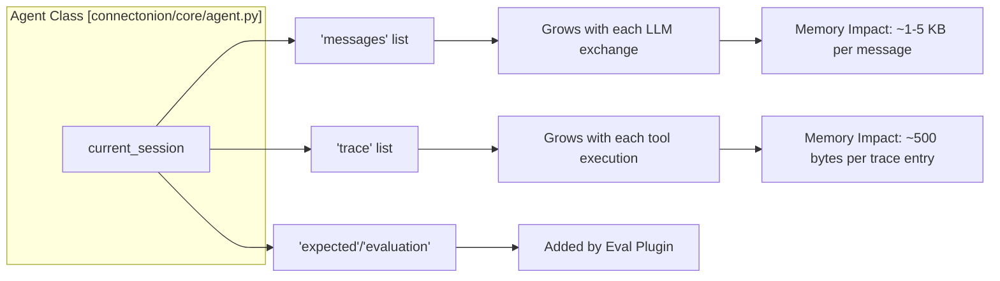
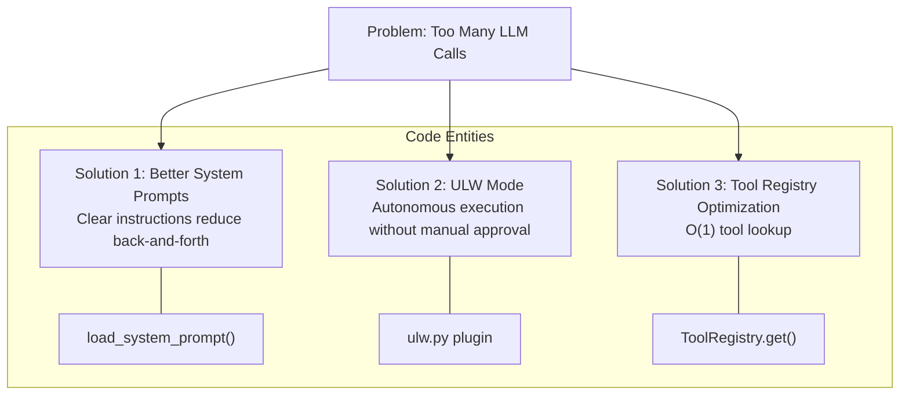

<!-- source: DeepWiki mcp.deepwiki.com · repo openonion/connectonion · page 11.2 Performance Issues · fetched 2026-10-26 -->

# Performance Issues

<details>
<summary>Relevant source files</summary>

The following files were used as context for generating this wiki page:

- [connectonion/cli/commands/ai_commands.py](connectonion/cli/commands/ai_commands.py)
- [connectonion/core/agent.py](connectonion/core/agent.py)
- [connectonion/core/tool_executor.py](connectonion/core/tool_executor.py)
- [connectonion/useful_plugins/eval.py](connectonion/useful_plugins/eval.py)
- [connectonion/useful_plugins/ulw.py](connectonion/useful_plugins/ulw.py)
- [tests/unit/test_agent.py](tests/unit/test_agent.py)

</details>


This page provides guidance for diagnosing and resolving performance problems in ConnectOnion agents. It covers response time issues, memory usage concerns, iteration limit problems, and optimization strategies.

For authentication-related slowdowns, see [Authentication Problems](#11.3). For general error troubleshooting, see [Common Errors](#11.1).

---

## Common Performance Symptoms

### Slow Response Times

Agent response times depend on several factors that can compound:

| Factor | Typical Impact | Location in Code |
|--------|---------------|------------------|
| LLM API latency | 500ms - 5s per call | [connectonion/core/llm.py:1-100]() |
| Tool execution | Variable (1ms - 10s+) | User-defined tools |
| Multiple iterations | Multiplies LLM calls | [connectonion/core/agent.py:5-10]() |
| Session logging | 10-50ms per turn | [connectonion/logger.py:1-50]() |
| Plugin overhead | 2 LLM calls (eval) | [connectonion/useful_plugins/eval.py:8-9]() |

**Tool Execution Timing:**
The `tool_executor` module automatically tracks execution time for every tool call in milliseconds, storing it in the session trace for analysis.

Sources: [connectonion/core/tool_executor.py:5-9](), [connectonion/core/agent.py:18-28]()

### Memory Growth

Agents maintain session state in memory, which can accumulate over long-running tasks. The `Agent` class stores session context including message history and execution traces.



Sources: [connectonion/core/agent.py:54-56](), [connectonion/core/tool_executor.py:119-128](), [connectonion/useful_plugins/eval.py:5-6]()

### Iteration Limit Exhaustion

When an agent reaches `max_iterations` (default: 100), it stops execution. This is controlled in the initialization and the execution loop.

```python
# connectonion/core/agent.py
self.max_iterations = max_iterations # Default 100 [line 52]
```

This indicates either:
- Task complexity exceeds iteration budget.
- Agent is stuck in a loop (LLM keeps calling the same tool).
- Tool results don't provide enough information for completion.

Sources: [connectonion/core/agent.py:42-52](), [connectonion/core/agent.py:5-10]()

---

## Diagnostic Tools

### Response Time Analysis

The `tool_executor` captures precise timing for every tool execution. This data is recorded in the `agent.current_session['trace']`.

```python
# Data structure recorded in connectonion/core/tool_executor.py:119-128
trace_entry = {
    "type": "tool_result",
    "name": tool_name,
    "status": "success",
    "timing_ms": 145, # Execution time in milliseconds
    "timestamp": 1715263920.123
}
```

### Plugin-Based Evaluation

The `eval` plugin can be used to diagnose if performance issues are leading to task failure. It runs an evaluation after completion to check if the agent's actions achieved the user's intent.

```python
from connectonion import Agent
from connectonion.useful_plugins import eval

# Evaluation happens AFTER completion to avoid blocking the main loop
agent = Agent("diagnostic_agent", plugins=[eval])
```

Sources: [connectonion/useful_plugins/eval.py:11-16](), [connectonion/useful_plugins/eval.py:114-121]()

---

## Performance Optimization Strategies

### Reducing LLM Calls

Each LLM call adds significant latency. Optimize by using specialized plugins or structured prompts.



**ULW Mode (Ultra Light Work):**
The `ulw` plugin allows agents to work autonomously for up to 100 turns without stopping for tool approvals, which significantly speeds up complex multi-step tasks.

Sources: [connectonion/useful_plugins/ulw.py:10-22](), [connectonion/core/agent.py:51-52](), [connectonion/core/tool_registry.py:8-10]()

### Optimizing Tool Execution

Tools are executed sequentially. If a tool is slow, it blocks the entire agent iteration.

**Agent Injection Optimization:**
ConnectOnion avoids using expensive `inspect.signature` calls during every tool execution. Instead, it uses a cached `_needs_agent` flag set during tool registration.

```python
# connectonion/core/tool_executor.py:101-103
# Agent injection uses cached _needs_agent flag instead of inspect.signature() for zero overhead
```

Sources: [connectonion/core/tool_executor.py:8-9](), [connectonion/core/tool_factory.py:1-20]()

### Logging Configuration for Performance

The `Logger` class handles terminal output, file logging, and YAML evaluations. In high-performance scenarios, console output can be suppressed.

```python
# connectonion/core/agent.py:44
# quiet=True suppresses console but keeps eval logging
agent = Agent(name="fast_agent", quiet=True)
```

Sources: [connectonion/core/agent.py:7-8](), [connectonion/core/agent.py:73-74]()

---

## Multi-Agent Performance

### Autonomous Mode (ULW)

When agents are hosted or running complex workflows, the `ulw_keep_working` handler manages turn-based checkpoints. This allows the agent to continue working until a `max_turns` limit is reached or the task is "genuinely complete".

```python
# connectonion/useful_plugins/ulw.py:96-107
@on_complete
def ulw_keep_working(agent: 'Agent') -> None:
    # If ULW mode and turns remaining, start another turn.
    # ...
```

Sources: [connectonion/useful_plugins/ulw.py:96-140]()

### Performance Checklist

When experiencing performance issues, check:

- [ ] **LLM Model**: Are you using a "flash" model for evaluation? (e.g., `co/gemini-2.5-flash` used in `eval.py` [line 75]).
- [ ] **Iteration Count**: Check if the agent is hitting the `max_iterations` limit (default 100).
- [ ] **Tool Logic**: Use the `timing_ms` in the session trace to identify slow tools.
- [ ] **ULW Mode**: For complex tasks, enable `ulw` plugin to skip tool approval overhead.
- [ ] **Logging**: Set `quiet=True` if terminal rendering is causing lag in remote environments.

Sources: [connectonion/useful_plugins/eval.py:73-78](), [connectonion/useful_plugins/ulw.py:32-40](), [connectonion/core/agent.py:42-52]()

---

