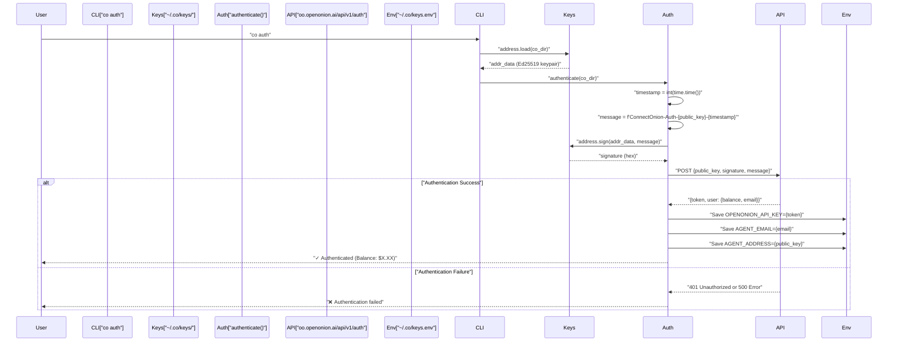

<!-- source: DeepWiki mcp.deepwiki.com · repo openonion/connectonion · page 11.3 Authentication Problems · fetched 2026-10-26 -->

# Authentication Problems

<details>
<summary>Relevant source files</summary>

The following files were used as context for generating this wiki page:

- [connectonion/address.py](connectonion/address.py)
- [connectonion/cli/commands/auth_commands.py](connectonion/cli/commands/auth_commands.py)
- [connectonion/cli/commands/create.py](connectonion/cli/commands/create.py)
- [connectonion/cli/commands/init.py](connectonion/cli/commands/init.py)
- [connectonion/cli/commands/project_cmd_lib.py](connectonion/cli/commands/project_cmd_lib.py)
- [connectonion/cli/commands/reset_commands.py](connectonion/cli/commands/reset_commands.py)
- [connectonion/cli/commands/status_commands.py](connectonion/cli/commands/status_commands.py)
- [docs/windows-support.md](docs/windows-support.md)
- [tests/unit/test_decorators.py](tests/unit/test_decorators.py)
- [tests/unit/test_email_functions.py](tests/unit/test_email_functions.py)
- [tests/unit/test_trust.py](tests/unit/test_trust.py)

</details>


## Purpose and Scope

This page covers troubleshooting authentication issues in ConnectOnion, including API key problems, OAuth failures, and managed key authentication errors. It provides diagnostics and solutions for authentication failures with LLM providers (OpenAI, Anthropic, Google) and the OpenOnion managed key service.

For configuring authentication in new projects, see [7.2 Authentication Commands](). For network-related authentication in multi-agent systems, see [5.3 Trust & Authentication]().

---

## Authentication Architecture Overview

ConnectOnion supports multiple authentication methods depending on which LLM provider is utilized. The framework manages these through environment variables and a global configuration directory located at `~/.co/`.

| Provider | Authentication Method | Environment Variable | Notes |
|----------|----------------------|---------------------|-------|
| OpenAI | API Key | `OPENAI_API_KEY` | Project or user keys (sk-proj-, sk-) |
| Anthropic | API Key | `ANTHROPIC_API_KEY` | Starts with sk-ant- |
| Google Gemini | API Key | `GEMINI_API_KEY` or `GOOGLE_API_KEY` | Starts with AIza |
| OpenOnion (co/) | JWT Token + Ed25519 Signature | `OPENONION_API_KEY` | Obtained via `co auth` |
| Google Services | OAuth2 | `GOOGLE_ACCESS_TOKEN`, `GOOGLE_REFRESH_TOKEN` | For Gmail tools |
| Microsoft Services | OAuth2 | `MICROSOFT_ACCESS_TOKEN`, `MICROSOFT_REFRESH_TOKEN` | For Outlook tools |

### Authentication Flow: OpenOnion Managed Keys

The OpenOnion managed key system uses Ed25519 signatures to verify agent identity and issue a JWT token.

**Managed Auth Logic Flow**

Sources: [connectonion/cli/commands/auth_commands.py:84-116](), [connectonion/cli/commands/auth_commands.py:134-156](), [connectonion/address.py:183-195]()

---

## Common Error Messages

### "❌ No agent keys found!"
**Error Location**: [connectonion/cli/commands/auth_commands.py:98-99]()

**Cause**: The `~/.co/keys/` directory is missing or doesn't contain the Ed25519 keypair (`agent.key`). This usually happens if `co init` was never run or the global config was manually deleted.

**Solutions**:
1. Run `co init` or `co create <project>` to generate a new identity [connectonion/cli/commands/init.py:61-71]().
2. If you have a 12-word seed phrase, use `co reset` and follow the recovery prompts [connectonion/cli/commands/reset_commands.py:85-98]().
3. Verify file existence: `ls -la ~/.co/keys/agent.key`.

**Related Code**: `address.load()` in [connectonion/address.py:183-195]()

---

### "❌ No API key found"
**Error Location**: [connectonion/cli/commands/status_commands.py:90-94]()

**Cause**: The framework cannot find `OPENONION_API_KEY` in the expected hierarchy.

**Key Lookup Priority**:
ConnectOnion searches for keys in this specific order:
1. Environment variables (e.g., `os.getenv("OPENONION_API_KEY")`) [connectonion/cli/commands/status_commands.py:34-37]()
2. Local project `.env` file [connectonion/cli/commands/status_commands.py:39-45]()
3. Global `~/.co/keys.env` file [connectonion/cli/commands/status_commands.py:47-53]()

**Resolution**:
- Run `co auth` to refresh the global token [connectonion/cli/commands/auth_commands.py:212-253]().
- If using a specific provider (OpenAI/Anthropic), ensure the key is exported: `export OPENAI_API_KEY=sk-...`

---

### "❌ Registration failed: Invalid signature"
**Cause**: The backend rejected the cryptographic signature.
1. **Clock Skew**: The backend verifies the `timestamp` in the message. If your system clock is off by more than 5 minutes, verification fails [connectonion/cli/commands/auth_commands.py:104-106]().
2. **Key Mismatch**: The private key in `agent.key` does not match the public key sent to the server.

**Resolution**:
- Sync your system clock using NTP.
- Run `co status` to see your current address and compare it with the keys in `~/.co/keys/` [connectonion/cli/commands/status_commands.py:145-146]().

---

### "❌ Authorization timed out"
**Error Location**: [connectonion/cli/commands/auth_commands.py:375-378]() (Google) and [connectonion/cli/commands/auth_commands.py:494-497]() (Microsoft).

**Cause**: OAuth flows for external tools (Gmail/Outlook) require browser interaction. The CLI polls the backend for completion but times out after 60 attempts (approx. 5 minutes).

**Resolution**:
- Ensure you complete the browser consent screen immediately after the URL is opened.
- Check if your firewall is blocking the callback from `oo.openonion.ai`.

---

## Provider-Specific Troubleshooting

### OpenOnion Managed Keys (co/ models)
When using models prefixed with `co/` (e.g., `co/gemini-2.5-pro`), the framework uses your `OPENONION_API_KEY`.

**Status Check**:
Use `co status` to verify balance and email activation.
```bash
co status
```
This command re-signs a message with your local key to fetch fresh account data from `https://oo.openonion.ai/api/v1/auth` [connectonion/cli/commands/status_commands.py:120-128]().

**Low Balance**:
If `user.get('balance_usd', 0) <= 0`, API calls will fail [connectonion/cli/commands/status_commands.py:161-162]().

### Windows-Specific Issues
ConnectOnion v0.3.5+ includes specific fixes for Windows authentication problems.

**Common Windows Failures (v0.3.4 and earlier)**:
- `UnicodeEncodeError`: Occurred when writing keys or `.env` files in paths with non-ASCII characters (e.g., `C:\Users\王小明\`) [docs/windows-support.md:19-26]().
- `NotImplementedError`: Occurred when the framework tried to use `chmod(0o600)` on Windows [docs/windows-support.md:48-52]().

**Windows Fixes**:
- Explicit UTF-8 encoding is now used for all file I/O: `encoding='utf-8'` [connectonion/address.py:161]().
- `chmod` is skipped on Windows platforms: `if sys.platform != 'win32':` [connectonion/address.py:155-156]().

Sources: [docs/windows-support.md:33-44](), [docs/windows-support.md:59-70]()

---

## Code Entity Map: Authentication System

The following diagram maps high-level authentication concepts to the specific code entities that implement them.

**Authentication Implementation Map**
```mermaid
graph TD
    subgraph "Identity Generation"
        ["address.generate()"] --> ["address.save()"]
        ["address.save()"] --> ["~/.co/keys/agent.key"]
        ["address.save()"] --> ["~/.co/keys/recovery.txt"]
    end

    subgraph "Credential Discovery"
        ["status_commands._load_api_key()"] --> ["os.getenv('OPENONION_API_KEY')"]
        ["status_commands._load_api_key()"] --> ["Path('.env')"]
        ["status_commands._load_api_key()"] --> ["Path('~/.co/keys.env')"]
    end

    subgraph "Network Authentication"
        ["auth_commands.authenticate()"] --> ["address.sign()"]
        ["address.sign()"] --> ["requests.post('/api/v1/auth')"]
        ["requests.post('/api/v1/auth')"] --> ["auth_commands._save_api_key_to_env()"]
    end

    subgraph "Key Identification"
        ["project_cmd_lib.detect_api_provider()"] --> ["Regex: sk-proj- (OpenAI)"]
        ["project_cmd_lib.detect_api_provider()"] --> ["Regex: sk-ant- (Anthropic)"]
        ["project_cmd_lib.detect_api_provider()"] --> ["Regex: AIza (Google)"]
    end
```
Sources: [connectonion/address.py:27-79](), [connectonion/address.py:135-164](), [connectonion/cli/commands/status_commands.py:23-55](), [connectonion/cli/commands/auth_commands.py:84-116](), [connectonion/cli/commands/project_cmd_lib.py:496-522]()

---

## Recovery Procedures

### Resetting Global Identity
If your keys are corrupted or you wish to start with a fresh account, use the `co reset` command.

**Destructive Reset Process**:
1. Deletes `~/.co/keys/`, `~/.co/config.toml`, and `~/.co/keys.env` [connectonion/cli/commands/reset_commands.py:64-79]().
2. Generates a new Ed25519 keypair and 12-word seed phrase [connectonion/cli/commands/reset_commands.py:85-98]().
3. Automatically triggers `authenticate()` to register the new identity [connectonion/cli/commands/reset_commands.py:133-135]().

**Warning**: Existing projects will still have the old `OPENONION_API_KEY` in their local `.env`. You must run `co init` in those directories to sync with the new global identity [connectonion/cli/commands/reset_commands.py:141-146]().

### Verification and Testing
To verify your authentication setup is working correctly:
1. Run `co status` to check the backend connection.
2. Check your `.env` file: `cat .env | grep OPENONION_API_KEY`.
3. Test a simple LLM call using the `co/` provider:
   ```python
   from connectonion import llm_do
   print(llm_do("Hello", model="co/gemini-2.5-pro"))
   ```

Sources: [connectonion/cli/commands/reset_commands.py:26-150](), [connectonion/cli/commands/status_commands.py:77-169]()

---

