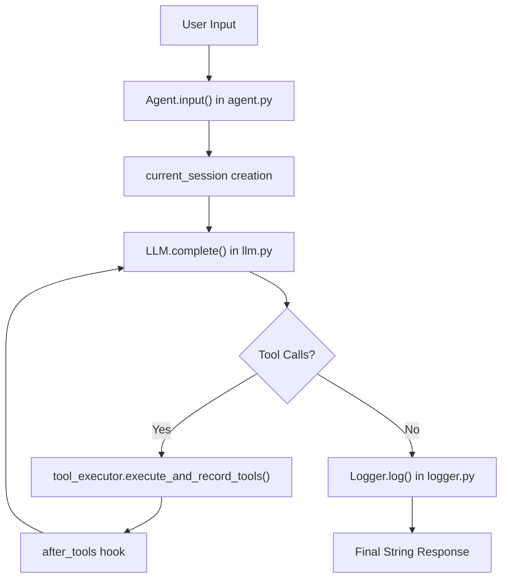
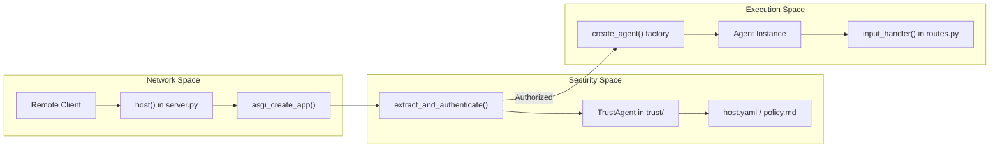

<!-- source: DeepWiki mcp.deepwiki.com · repo openonion/connectonion · page 12 Glossary · fetched 2026-10-26 -->

# Glossary

Relevant source files

The following files were used as context for generating this wiki page:

- [README.md](README.md)
- [VERSIONING.md](VERSIONING.md)
- [connectonion/__init__.py](connectonion/__init__.py)
- [connectonion/cli/browser_agent/__init__.py](connectonion/cli/browser_agent/__init__.py)
- [connectonion/cli/browser_agent/agent.py](connectonion/cli/browser_agent/agent.py)
- [connectonion/cli/co_ai/agent.py](connectonion/cli/co_ai/agent.py)
- [connectonion/cli/commands/browser_commands.py](connectonion/cli/commands/browser_commands.py)
- [connectonion/cli/main.py](connectonion/cli/main.py)
- [connectonion/core/agent.py](connectonion/core/agent.py)
- [connectonion/network/asgi/http.py](connectonion/network/asgi/http.py)
- [connectonion/network/host/config.py](connectonion/network/host/config.py)
- [connectonion/network/host/host.yaml](connectonion/network/host/host.yaml)
- [connectonion/network/host/routes.py](connectonion/network/host/routes.py)
- [connectonion/network/host/server.py](connectonion/network/host/server.py)
- [connectonion/useful_plugins/__init__.py](connectonion/useful_plugins/__init__.py)
- [connectonion/useful_plugins/skills.py](connectonion/useful_plugins/skills.py)
- [connectonion/useful_plugins/tool_approval/bash_parser.py](connectonion/useful_plugins/tool_approval/bash_parser.py)
- [connectonion/useful_tools/browser_tools/browser.py](connectonion/useful_tools/browser_tools/browser.py)
- [docs/README.md](docs/README.md)
- [docs/features/permissions.md](docs/features/permissions.md)
- [docs/network/host-config.md](docs/network/host-config.md)
- [docs/quickstart.md](docs/quickstart.md)
- [docs/templates/README.md](docs/templates/README.md)
- [docs/templates/meta-agent.md](docs/templates/meta-agent.md)
- [docs/templates/minimal.md](docs/templates/minimal.md)
- [docs/templates/playwright.md](docs/templates/playwright.md)
- [docs/templates/web-research.md](docs/templates/web-research.md)
- [docs/useful_plugins/tool_approval.md](docs/useful_plugins/tool_approval.md)
- [pyproject.toml](pyproject.toml)
- [tests/integration/test_config_permissions.py](tests/integration/test_config_permissions.py)
- [tests/unit/test_agent.py](tests/unit/test_agent.py)
- [tests/unit/test_asgi_http.py](tests/unit/test_asgi_http.py)
- [tests/unit/test_host_routes.py](tests/unit/test_host_routes.py)
- [tests/unit/test_skills.py](tests/unit/test_skills.py)
- [tests/unit/test_tool_approval.py](tests/unit/test_tool_approval.py)

This page provides definitions for codebase-specific terms, jargon, and architectural concepts used within the ConnectOnion framework. It serves as a technical reference for onboarding engineers to understand how natural language concepts map to specific code entities.

## Core Architectural Terms

### Agent
The central orchestrator that manages the interaction between a Large Language Model (LLM), a set of tools, and a persistent conversation session.
*   **Implementation**: Defined in the `Agent` class [connectonion/core/agent.py:31-31]().
*   **Data Flow**: The agent receives input via `.input()`, manages a `current_session` [connectonion/core/agent.py:55-55](), and enters an execution loop that alternates between LLM completion and tool execution [connectonion/core/agent.py:5-5]().

### Tool / ToolRegistry
A "Tool" is a Python function or class method wrapped with a JSON schema that allows an LLM to invoke it. The `ToolRegistry` manages these tools for an agent.
*   **Implementation**: `ToolRegistry` is in [connectonion/core/agent.py:112-112](). Functions are converted to tools via `create_tool_from_function` [connectonion/core/agent.py:128-128]().
*   **Access**: Tools can be accessed via attribute lookup, e.g., `agent.tools.shell` [connectonion/core/agent.py:7-7]().

### Session
A dictionary-based state object containing the conversation history (`messages`), execution metadata (`trace`), and permission states.
*   **Structure**: Contains `messages`, `trace`, `turn`, and `iteration` [connectonion/core/agent.py:5-6]().
*   **Persistence**: When hosted, sessions are stored in `SessionStorage` [connectonion/network/host/server.py:37-37]() and can be merged between client and server states [connectonion/network/host/routes.py:66-69]().

### Lifecycle Hooks / Events
Specific points in the agent's execution loop where external logic (plugins) can be injected.
*   **Key Hooks**: `before_llm`, `after_llm`, `before_tools`, `after_tools`, `on_error` [connectonion/core/agent.py:78-92]().
*   **Usage**: Plugins register handlers to these hooks to modify agent behavior without changing the core class [connectonion/core/agent.py:95-98]().

---

## Networking & Hosting Jargon

### Host
The process of exposing an `Agent` instance over an HTTP/WebSocket interface.
*   **Implementation**: Handled by the `host()` function [connectonion/network/host/server.py:5-7]().
*   **Isolation**: Uses a factory pattern to create a fresh `Agent` instance for every request to prevent state bleeding [connectonion/network/host/server.py:22-26]().

### Trust / TrustAgent
A security layer that evaluates whether a remote request or a tool execution should be permitted based on a policy.
*   **Implementation**: `TrustAgent` [connectonion/network/host/server.py:35-35]().
*   **Levels**: "open", "careful", and "strict" [connectonion/network/host/server.py:16-16]().
*   **Separation**: Trust enforcement happens at the host level, not inside the `Agent` itself [connectonion/network/host/server.py:12-13]().

### Relay / Announce
A P2P discovery system that allows agents to find and communicate with each other without static IP addresses.
*   **Function**: `announce()` registers an agent with a relay server [connectonion/__init__.py:119-119]().

---

## Technical Mapping: Natural Language to Code

The following diagrams bridge the gap between high-level concepts and the actual class/file names used in the codebase.

### Agent Execution Loop
This diagram shows how a user's request moves through the system components.

**Sources**: [connectonion/core/agent.py:5-9](), [connectonion/core/agent.py:26-27]()

### Hosting and Permission Flow
This diagram maps the networking and security concepts to their implementation entities.

**Sources**: [connectonion/network/host/server.py:5-9](), [connectonion/network/host/routes.py:27-29](), [connectonion/network/host/host.yaml:1-5]()

---

## Specialized Tools & Plugins

| Term | Definition | Code Pointer |
| :--- | :--- | :--- |
| **`co ai`** | A built-in coding assistant agent that uses the ConnectOnion framework to modify its own source code. | [connectonion/cli/co_ai/agent.py:5-32]() |
| **`xray`** | A debugging decorator that provides interactive inspection of tool calls and LLM prompts. | [connectonion/__init__.py:53-53]() |
| **`auto_compact`** | A plugin that automatically compresses the conversation context when it reaches 90% of the model's limit. | [connectonion/cli/co_ai/agent.py:49-49]() |
| **`ulw`** | "Ultra Light Work" - A plugin for autonomous, multi-turn task execution with continuation logic. | [connectonion/cli/co_ai/agent.py:49-49]() |
| **`skills`** | Reusable workflows (e.g., `/commit`) that inject temporary, scoped permissions into the session. | [connectonion/useful_plugins/skills.py]() |
| **`BrowserAutomation`** | A toolset using Playwright for natural language web interaction with persistent profiles. | [connectonion/useful_tools/browser_tools/browser.py:50-63]() |

---

## Permission Jargon

### Unified Permission Format
A standardized dictionary structure stored in `session['permissions']` that all security layers (Config, Skills, User) must follow.
*   **Fields**: `allowed`, `source`, `reason`, `when`, `expires` [docs/features/permissions.md:10-20]().

### Tool-Level Approval
A behavior where a user's manual approval of a tool (e.g., `bash`) grants permission for that tool for the remainder of the session, regardless of the specific arguments used.
*   **Contrast**: Config-based permissions (from `host.yaml`) are usually **Command-Specific** using the `when` field [docs/features/permissions.md:63-80]().

### Safe Tools
A hardcoded list of read-only tools (like `read_file`, `glob`, `grep`) that are automatically granted `source: safe` permissions with no expiration.
*   **Implementation**: Referenced in the unified permission logic [docs/features/permissions.md:28-31]().

**Sources**: [docs/features/permissions.md:1-80](), [connectonion/network/host/host.yaml:15-70]()