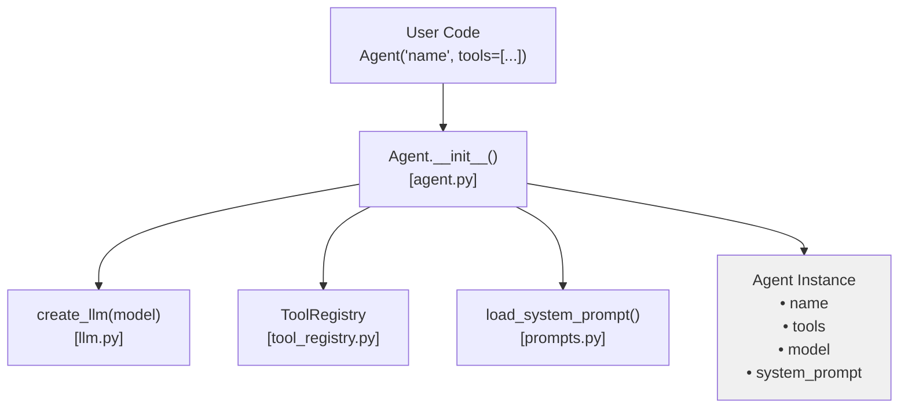

<!-- source: DeepWiki mcp.deepwiki.com · repo openonion/connectonion · page 2.2 Your First Agent · fetched 2026-10-26 -->

# Your First Agent

<details>
<summary>Relevant source files</summary>

The following files were used as context for generating this wiki page:

- [connectonion/cli/templates/coder/agent.py](connectonion/cli/templates/coder/agent.py)
- [connectonion/cli/templates/coder/prompt.md](connectonion/cli/templates/coder/prompt.md)
- [connectonion/cli/templates/minimal/agent.py](connectonion/cli/templates/minimal/agent.py)
- [connectonion/cli/templates/minimal/prompt.md](connectonion/cli/templates/minimal/prompt.md)
- [connectonion/cli/templates/web-research/agent.py](connectonion/cli/templates/web-research/agent.py)
- [connectonion/llm_do.py](connectonion/llm_do.py)
- [examples/minimal-agent/.co/config.toml](examples/minimal-agent/.co/config.toml)
- [examples/minimal-agent/.co/keys/DO_NOT_SHARE](examples/minimal-agent/.co/keys/DO_NOT_SHARE)
- [examples/minimal-agent/.co/keys/agent.key](examples/minimal-agent/.co/keys/agent.key)
- [examples/minimal-agent/.co/keys/recovery.txt](examples/minimal-agent/.co/keys/recovery.txt)
- [examples/minimal-agent/agent.py](examples/minimal-agent/agent.py)
- [examples/simple-agent/.gitignore](examples/simple-agent/.gitignore)
- [examples/simple-agent/README.md](examples/simple-agent/README.md)
- [examples/simple-agent/agent.py](examples/simple-agent/agent.py)
- [examples/simple-agent/agent_debug.py](examples/simple-agent/agent_debug.py)
- [examples/simple-agent/test_e2e.py](examples/simple-agent/test_e2e.py)
- [examples/simple-agent/test_network.py](examples/simple-agent/test_network.py)
- [examples/simple-agent/tests/test_api_integration.py](examples/simple-agent/tests/test_api_integration.py)
- [examples/simple-agent/tests/test_debug_features.py](examples/simple-agent/tests/test_debug_features.py)
- [examples/simple-agent/tests/test_models.py](examples/simple-agent/tests/test_models.py)

</details>


This page guides you through creating your first ConnectOnion agent in under 5 minutes. You'll learn how to define tools as Python functions, create an agent that can use them, and execute your first task using both standard execution and the interactive `auto_debug` mode.

For project scaffolding and CLI commands, see [Project Commands](#7.1). For detailed tool design patterns, see [Tools System](#3.3). For agent configuration options, see [Agent Architecture](#3.1).

---

## Minimal Working Agent

The simplest agent requires just three components: import the `Agent` class, define a tool function, and create an agent instance.

```python
from connectonion import Agent, xray

@xray
def hello_world(name: str = "World") -> str:
    """Simple greeting function.
    
    Args:
        name: Name to greet
    """
    return f"Hello, {name}! Welcome to ConnectOnion."

agent = Agent(
    name="minimal-agent",
    tools=[hello_world],
    model="co/gemini-2.5-pro"
)
```

Run it:

```python
result = agent.input("Say hello to Alice")
print(result)  # "Hello, Alice! Welcome to ConnectOnion."
```

**Sources:** [examples/minimal-agent/agent.py:40-66](), [connectonion/cli/templates/minimal/agent.py:7-16]()

---

## Agent Creation Flow

The following diagram shows how components connect when you create an `Agent` instance:



**Sources:** [connectonion/cli/templates/minimal/agent.py:7-13](), [connectonion/llm_do.py:32-41](), [connectonion/llm_do.py:165-168]()

---

## Adding Tools

Tools are regular Python functions. ConnectOnion automatically converts them to LLM-compatible tool schemas using type hints and docstrings.

### Function-Based Tools (Recommended)

```python
def search_web(query: str) -> str:
    """Search the web for information.
    
    Args:
        query: Search query
    """
    return f"Searching for: {query}"

def analyze_data(data: str, analysis_type: str = "summary") -> str:
    """Analyze extracted data.
    
    Args:
        data: Data to analyze
        analysis_type: Type of analysis (summary, sentiment)
    """
    # Use llm_do for a sub-task
    return llm_do(f"Analyze this: {data}", temperature=0.1)

agent = Agent(
    name="researcher",
    tools=[search_web, analyze_data]
)
```

The framework extracts:
- **Name**: `search_web` (function name)
- **Description**: First paragraph of docstring
- **Parameters**: From type hints (`str`, `int`, etc.)
- **Required fields**: Parameters without default values

**Sources:** [connectonion/cli/templates/web-research/agent.py:21-76](), [connectonion/llm_do.py:133-140]()

---

## Task Execution Flow

When you call `agent.input(prompt)`, the framework enters a loop of reasoning and tool execution.

```mermaid
sequenceDiagram
    participant User
    participant Agent["Agent.input()<br/>[agent.py]"]
    participant LLM["LLM Provider<br/>[llm.py]"]
    participant Tool["Tool Function<br/>(your code)"]
    
    User->>Agent: agent.input("Research AI trends")
    
    loop until task complete or max_iterations
        Agent->>LLM: complete(messages, tools)
        LLM-->>Agent: tool_call: search_web(query="AI trends")
        
        rect rgb(240, 240, 240)
            Note over Agent,Tool: Tool Execution
            Agent->>Tool: search_web("AI trends")
            Tool-->>Agent: "Found: Trend A, Trend B"
        end
        
        Agent->>LLM: complete(messages + tool_result)
        LLM-->>Agent: "The latest trends are..."
    end
    
    Agent-->>User: Final summary string
```

**Sources:** [connectonion/cli/templates/web-research/agent.py:105-118](), [connectonion/llm_do.py:52-60](), [connectonion/cli/templates/coder/agent.py:17-28]()

---

## Interactive Debugging with @xray

One of ConnectOnion's unique features is the `@xray` decorator and `auto_debug()` method. This allows you to pause execution at specific tools to inspect arguments and results.

```python
from connectonion import Agent, xray

@xray  # Marks this function as a breakpoint
def calculate(operation: str, a: int, b: int) -> int:
    """Perform a calculation."""
    if operation == "add": return a + b
    return 0

agent = Agent(name="math-bot", tools=[calculate])

# Use auto_debug instead of input for interactive mode
agent.auto_debug("What is 5 + 3?")
```

When the agent calls `calculate`, the terminal will display an interactive menu:
- **(c)ontinue**: Execute the tool and proceed.
- **(e)dit**: Modify the tool arguments before execution.
- **(q)uit**: Stop the agent immediately.

**Sources:** [examples/simple-agent/tests/test_debug_features.py:43-65](), [examples/simple-agent/tests/test_debug_features.py:110-138](), [examples/simple-agent/agent.py:10-20]()

---

## LLM-Do: The One-Shot Alternative

For simple tasks that don't require multiple steps or tool usage, use `llm_do()`. It is a stateless, single-round function.

```python
from connectonion import llm_do
from pydantic import BaseModel

class Person(BaseModel):
    name: str
    age: int

# Structured output
result = llm_do("John is 30 years old", output=Person)
print(result.name)  # "John"

# Simple string output
answer = llm_do("What is 2+2?", model="co/gemini-2.5-flash")
```

**Sources:** [connectonion/llm_do.py:105-114](), [connectonion/llm_do.py:13-30](), [connectonion/llm_do.py:52-60]()

---

## Agent Configuration

The `Agent` constructor accepts these key parameters:

| Parameter | Type | Default | Description |
|-----------|------|---------|-------------|
| `name` | `str` | Required | Unique identifier for logging |
| `tools` | `List[Callable]` | `[]` | Functions or class instances |
| `system_prompt` | `str \| Path` | `None` | Personality/instructions (file path or string) |
| `model` | `str` | `"co/gemini-2.5-flash"` | LLM model to use |
| `max_iterations` | `int` | `10` | Max tool calls per task |
| `plugins` | `List` | `[]` | Lifecycle hooks (e.g., `tool_approval`) |

Example with template configuration:

```python
from connectonion import Agent, bash, read_file, edit
from connectonion.useful_plugins import tool_approval

agent = Agent(
    name="coder",
    system_prompt="prompt.md", # Loads from local file
    tools=[bash, read_file, edit],
    plugins=[tool_approval],   # Requires user confirmation for every tool
    model="co/gemini-2.5-pro",
    max_iterations=50
)
```

**Sources:** [connectonion/cli/templates/minimal/agent.py:7-13](), [connectonion/cli/templates/coder/agent.py:4-10](), [connectonion/llm_do.py:137-140]()

---

## Authentication for Managed Keys

ConnectOnion provides managed API keys for several models (prefixed with `co/`).

1. Run `co auth` in your terminal to log in.
2. This creates a secure identity for your agent.
3. You can now use models like `co/gemini-2.5-pro` or `co/gpt-4o` without setting your own environment variables.

If you prefer using your own keys, set them in a `.env` file:
- `OPENAI_API_KEY`
- `ANTHROPIC_API_KEY`
- `GEMINI_API_KEY`

**Sources:** [connectonion/llm_do.py:98-101](), [examples/simple-agent/agent.py:54-68](), [examples/minimal-agent/agent.py:8-37]()

---

## Next Steps

Now that you have a working agent, explore:

- **[Project Structure](#2.3)**: Understanding the `.co/` directory and configuration files.
- **[Tools System](#3.3)**: Advanced tool patterns (class-based tools, stateful tools).
- **[LLM Integration](#3.2)**: Using different LLM providers and models.
- **[Interactive Debugging](#4.2)**: Deep dive into the `AutoDebugger` and `xray` mechanics.

**Sources:** [connectonion/llm_do.py:163-171](), [examples/simple-agent/tests/test_debug_features.py:27-37]()

---

