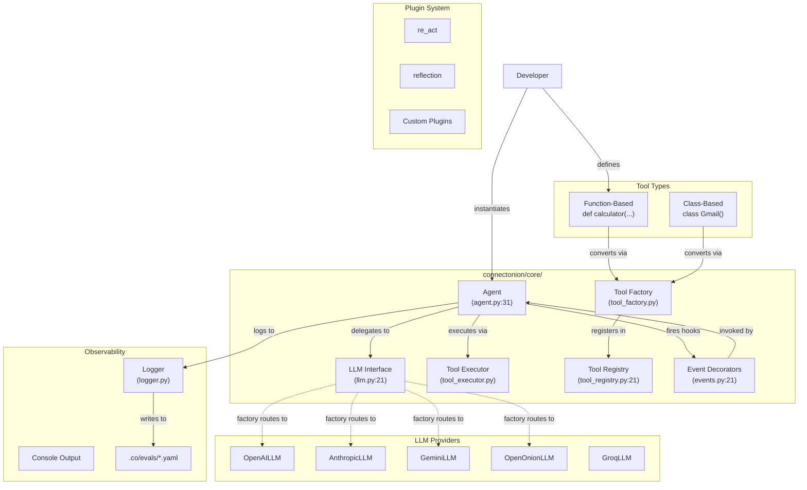
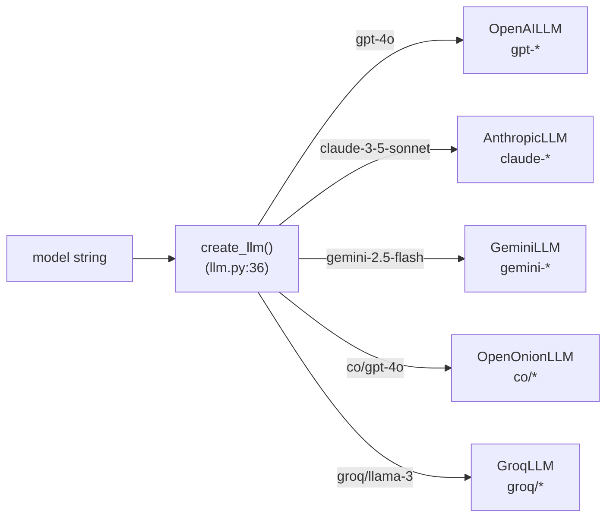
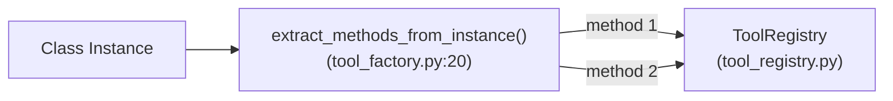

<!-- source: DeepWiki mcp.deepwiki.com · repo openonion/connectonion · page 3 Core Concepts · fetched 2026-10-26 -->

# Core Concepts

<details>
<summary>Relevant source files</summary>

The following files were used as context for generating this wiki page:

- [connectonion/core/__init__.py](connectonion/core/__init__.py)
- [connectonion/core/agent.py](connectonion/core/agent.py)
- [connectonion/core/events.py](connectonion/core/events.py)
- [connectonion/core/exceptions.py](connectonion/core/exceptions.py)
- [connectonion/core/llm.py](connectonion/core/llm.py)
- [docs/concepts/events.md](docs/concepts/events.md)
- [docs/concepts/models.md](docs/concepts/models.md)
- [tests/unit/test_agent.py](tests/unit/test_agent.py)
- [tests/unit/test_events.py](tests/unit/test_events.py)
- [tests/unit/test_groq_llm.py](tests/unit/test_groq_llm.py)

</details>


This page provides a technical overview of ConnectOnion's fundamental architecture and core components. It introduces the major subsystems that work together to create AI agents: **Agent**, **LLM**, **Tools**, **Events**, and **Plugins**.

For implementation details of each subsystem, see:
- Agent execution loop and session management: [Agent Architecture](#3.1)
- LLM provider routing and model selection: [LLM Integration](#3.2)
- Tool creation patterns and schema generation: [Tools System](#3.3)
- Lifecycle hooks and event handlers: [Event System](#3.4)
- Reusable behavior composition: [Plugin System](#3.5)
- Task delegation and cost optimization: [Sub-Agent System](#3.6)

---

## Framework Architecture Overview

ConnectOnion's architecture separates **capabilities** (tools) from **behaviors** (plugins), orchestrated by a central `Agent` class that communicates with `LLM` providers through a unified interface. All activity flows through an **Event System** that enables extensibility.

### System Architecture Diagram



**Sources:** [connectonion/core/__init__.py:1-70](), [connectonion/core/agent.py:31-150]()

---

## The Agent Class

The `Agent` class ([connectonion/core/agent.py:31]()) is the main orchestrator that coordinates LLM calls, tool execution, event firing, and logging. Each agent maintains a `current_session` dictionary with execution state.

### Key Responsibilities

| Responsibility | Implementation |
|---|---|
| **LLM Communication** | Calls `llm.complete()` with messages and tool schemas [connectonion/core/agent.py:5-6]() |
| **Tool Execution** | Delegates to `tool_executor.execute_and_record_tools()` [connectonion/core/agent.py:27]() |
| **Event Lifecycle** | Fires hooks such as `after_user_input`, `before_llm`, `after_tools` [connectonion/core/agent.py:78-92]() |
| **Session State** | Manages `messages`, `trace`, `turn`, `iteration` in `current_session` [connectonion/core/agent.py:5-6]() |
| **Logging** | Delegates to `Logger` for console output and file logging [connectonion/core/agent.py:73]() |

### Agent Constructor

```python
# [connectonion/core/agent.py:34-48]()
Agent(
    name: str,
    llm: Optional[LLM] = None,
    tools: Optional[Union[List[Callable], Callable, Any]] = None,
    system_prompt: Union[str, Path, None] = None,
    model: str = "co/gemini-2.5-pro",
    max_iterations: int = 100,
    log: Optional[Union[bool, str, Path]] = None,
    quiet: bool = False,
    plugins: Optional[List[List[EventHandler]]] = None,
    on_events: Optional[List[EventHandler]] = None
)
```

**Sources:** [connectonion/core/agent.py:31-150](), [tests/unit/test_agent.py:40-128]()

---

## LLM Integration

ConnectOnion provides a unified `LLM` interface ([connectonion/core/llm.py:21]()) that abstracts differences between providers. The factory function `create_llm(model, api_key)` routes model strings to the appropriate provider class.

### Model Routing Logic



### Managed Keys (`co/` prefix)

Models prefixed with `co/` use ConnectOnion's managed API keys through the `OpenOnionLLM` provider ([connectonion/core/llm.py:34]()). This allows usage without providing your own API keys after running `co auth`.

**Sources:** [connectonion/core/llm.py:1-130](), [docs/concepts/models.md:1-200]()

---

## Tools System

Tools define **what** an agent can do. ConnectOnion supports two patterns: **function-based** (stateless) and **class-based** (stateful).

### Function-Based Tools

Regular Python functions automatically convert to tools via `create_tool_from_function()` ([connectonion/core/tool_factory.py]()). Type hints become parameter schemas, and docstrings become descriptions.

```python
# [tests/unit/test_agent.py:22-31]()
def calculator(expression: str) -> str:
    """Performs a mathematical calculation and returns the result."""
    # Implementation...
```

### Class-Based Tools

Class instances with typed public methods are automatically discovered. Each method becomes a separate tool, sharing the instance state ([tests/unit/test_agent.py:96-129]()).



**Sources:** [connectonion/core/tool_factory.py:20](), [connectonion/core/tool_registry.py:21](), [tests/unit/test_agent.py:96-129]()

---

## Event System

The event system ([connectonion/core/events.py:2]()) provides lifecycle hooks that fire at specific points during agent execution. Plugins and custom handlers hook into these events to modify behavior.

### Lifecycle Hook Reference

| Event | When Fired | Use Case |
|---|---|---|
| `after_user_input` | After user prompt processed | Context injection [events.py:21]() |
| `before_llm` | Before LLM API call | Message preprocessing [events.py:84]() |
| `after_llm` | After LLM response received | Logging LLM calls [events.py:103]() |
| `before_tools` | Once before a batch of tools | Batch validation [events.py:151]() |
| `before_each_tool` | Before each individual tool | Approval prompts [events.py:124]() |
| `after_each_tool` | After each individual tool | Per-tool cleanup [events.py:179]() |
| `after_tools` | Once after all tools complete | Reflection [events.py:205]() |
| `on_error` | When tool execution fails | Error recovery [events.py:227]() |
| `on_complete` | After final response | Final summary [events.py:245]() |

**Sources:** [connectonion/core/events.py:1-250](), [docs/concepts/events.md:62-80](), [tests/unit/test_events.py:73-205]()

---

## Plugin System

Plugins are **lists of event handlers** that bundle reusable behaviors. They define **how** an agent thinks, such as implementing the ReAct pattern or self-reflection.

### Plugin Composition

```python
# [connectonion/core/agent.py:95-98]()
if plugins:
    for event_list in plugins:
        for event_func in event_list:
            self._register_event(event_func)
```

**Sources:** [connectonion/core/agent.py:95-98](), [docs/concepts/events.md:27-44]()

---

## Execution Flow: Component Interaction

This diagram shows how a user input flows through the agent execution loop.

```mermaid
sequenceDiagram
    participant User
    participant Agent["Agent<br/>(agent.py)"]
    participant Events["Event System<br/>(events.py)"]
    participant LLM["LLM Provider<br/>(llm.py)"]
    participant ToolExec["Tool Executor<br/>(tool_executor.py)"]
    
    User->>Agent: agent.input("task")
    Agent->>Events: fire(after_user_input)
    
    loop until no tool_calls or max_iterations
        Agent->>Events: fire(before_llm)
        Agent->>LLM: complete(messages, tools)
        LLM-->>Agent: response (text or tool_calls)
        Agent->>Events: fire(after_llm)
        
        alt has tool_calls
            Agent->>Events: fire(before_tools)
            Agent->>ToolExec: execute_and_record_tools()
            ToolExec-->>Agent: tool results
            Agent->>Events: fire(after_tools)
        end
    end
    
    Agent->>Events: fire(on_complete)
    Agent-->>User: final response
```

**Sources:** [connectonion/core/agent.py:5-10](), [docs/concepts/events.md:83-122]()

---

