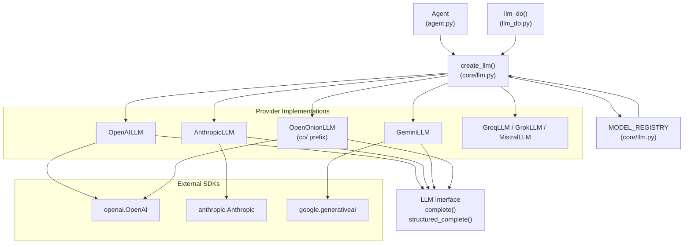

<!-- source: DeepWiki mcp.deepwiki.com · repo openonion/connectonion · page 3.2 LLM Integration · fetched 2026-10-26 -->

# LLM Integration

<details>
<summary>Relevant source files</summary>

The following files were used as context for generating this wiki page:

- [connectonion/cli/templates/coder/agent.py](connectonion/cli/templates/coder/agent.py)
- [connectonion/cli/templates/coder/prompt.md](connectonion/cli/templates/coder/prompt.md)
- [connectonion/cli/templates/minimal/agent.py](connectonion/cli/templates/minimal/agent.py)
- [connectonion/cli/templates/minimal/prompt.md](connectonion/cli/templates/minimal/prompt.md)
- [connectonion/cli/templates/web-research/agent.py](connectonion/cli/templates/web-research/agent.py)
- [connectonion/core/exceptions.py](connectonion/core/exceptions.py)
- [connectonion/core/llm.py](connectonion/core/llm.py)
- [connectonion/llm_do.py](connectonion/llm_do.py)
- [docs/concepts/models.md](docs/concepts/models.md)
- [tests/integration/test_llm.py](tests/integration/test_llm.py)
- [tests/integration/test_memory_integration.py](tests/integration/test_memory_integration.py)
- [tests/real_api/test_real_anthropic.py](tests/real_api/test_real_anthropic.py)
- [tests/real_api/test_real_openai.py](tests/real_api/test_real_openai.py)
- [tests/unit/test_env_autoload.py](tests/unit/test_env_autoload.py)
- [tests/unit/test_groq_llm.py](tests/unit/test_groq_llm.py)
- [tests/unit/test_llm_errors.py](tests/unit/test_llm_errors.py)
- [tests/unit/test_openonion_llm.py](tests/unit/test_openonion_llm.py)

</details>


## Purpose and Scope

This page covers ConnectOnion's LLM integration layer, including supported providers, model selection, the `llm_do()` function, and the managed keys system. ConnectOnion provides a unified abstraction that allows switching between frontier models from OpenAI, Anthropic, Google, and others with minimal configuration.

**What this page covers:**
- LLM provider abstraction and factory pattern via `create_llm()` [connectonion/core/llm.py:36-39]()
- Supported providers (OpenAI, Anthropic, Google Gemini, Groq, Grok, Mistral, OpenRouter, and OpenOnion) [connectonion/core/llm.py:13-15]()
- Model selection and registry system [connectonion/core/llm.py:1000-1100]()
- The `llm_do()` one-shot function for simple LLM calls [connectonion/llm_do.py:11-15]()
- Structured output with Pydantic models [connectonion/llm_do.py:47-48]()
- API key configuration and managed keys [connectonion/core/llm.py:99-105]()

**What this page does NOT cover:**
- Agent orchestration (see [Agent Architecture](3.1))
- Tool calling mechanics (see [Tools System](3.3))
- Multi-agent networking (see [Multi-Agent Networking](5))

**Sources:** [connectonion/core/llm.py:1-40](), [connectonion/llm_do.py:1-50]()

---

## LLM Provider Architecture

ConnectOnion implements a unified abstraction layer that allows agents to work with multiple LLM providers through a single interface. This design enables provider switching without code changes and supports both standard API keys and ConnectOnion's managed key system.

### Provider Abstraction Diagram



**Sources:** [connectonion/core/llm.py:17-40](), [connectonion/llm_do.py:62-81]()

### Core Components

| Component | File Location | Purpose |
|-----------|---------------|---------|
| `LLM` | [connectonion/core/llm.py:21-24]() | Abstract base class defining the provider contract |
| `create_llm()` | [connectonion/core/llm.py:36-39]() | Factory function that routes model names to provider classes |
| `MODEL_REGISTRY` | [connectonion/core/llm.py:1000-1100]() | Mapping of specific model strings to their provider type |
| `OpenOnionLLM` | [connectonion/core/llm.py:34]() | Managed keys implementation using a proxy endpoint |
| `llm_do()` | [connectonion/llm_do.py:132-140]() | One-shot function for stateless LLM interactions |

**Sources:** [connectonion/core/llm.py:21-40](), [connectonion/llm_do.py:11-15]()

---

## The LLM Interface

All provider implementations inherit from the `LLM` abstract base class. This ensures that regardless of the underlying API (REST, SDK, etc.), the framework interacts with them identically.

### Core Methods

| Method | Parameters | Returns | Purpose |
|--------|-----------|---------|---------|
| `complete()` | `messages: list`, `tools: list`, `**kwargs` | `LLMResponse` | Standard text generation with optional tool calling [connectonion/core/llm.py:65-69]() |
| `structured_complete()` | `messages: list`, `output_schema: Type[BaseModel]`, `**kwargs` | `BaseModel` | Generates response conforming to a Pydantic schema [connectonion/core/llm.py:72-76]() |

**Data Structures:**
- **`LLMResponse`**: A dataclass containing `content` (str), `tool_calls` (list), and `raw_response`. [connectonion/core/llm.py:69]()
- **`ToolCall`**: A dataclass containing `name`, `arguments` (dict), and `id`. [connectonion/core/llm.py:50]()

**Sources:** [connectonion/core/llm.py:49-77]()

---

## Supported Providers & Models

ConnectOnion supports a wide array of models, accessible either via your own API keys or managed `co/` keys.

### Managed Keys (OpenOnion)
Managed keys allow zero-setup access to frontier models. By running `co auth`, you authenticate your machine and can use models prefixed with `co/`.

- **Authentication**: Uses `OPENONION_API_KEY` (stored in `~/.co/config.toml`) [connectonion/core/llm.py:6-105]().
- **Default**: `llm_do()` defaults to `co/gemini-2.5-flash` [connectonion/llm_do.py:46]().
- **Models**: `co/gpt-4o`, `co/o4-mini`, `co/gemini-2.5-pro`, `co/claude-3-5-sonnet`, etc [docs/concepts/models.md:43-152]().

### Bring Your Own Keys (BYOK)
| Provider | Model Prefix / Examples | Env Variable |
|----------|-------------------------|--------------|
| **OpenAI** | `gpt-4o`, `gpt-5`, `o4-mini` | `OPENAI_API_KEY` |
| **Anthropic** | `claude-3-5-sonnet`, `claude-4.5` | `ANTHROPIC_API_KEY` |
| **Google** | `gemini-2.5-flash`, `gemini-3-pro` | `GEMINI_API_KEY` |
| **Groq** | `groq/llama-3.3-70b` | `GROQ_KEY` |
| **Mistral** | `mistral/mistral-large-latest` | `MISTRAL_API_KEY` |

**Sources:** [docs/concepts/models.md:5-168](), [connectonion/core/llm.py:99-112]()

---

## The `llm_do()` Function

`llm_do()` is a thin wrapper around the LLM provider abstraction for one-shot calls. It is stateless and does not maintain conversation history or support tool calling.

### Comparison with Agent

| Feature | `llm_do()` | `Agent()` |
|---------|------------|-----------|
| **Iterations** | Always 1 | Up to `max_iters` |
| **Tools** | No | Yes |
| **State** | Stateless | Maintains history |
| **Use Case** | Extraction, Analysis | Complex workflows |

**Sources:** [connectonion/llm_do.py:52-60]()

### Usage Examples

**Simple Text Generation:**
```python
from connectonion import llm_do
result = llm_do("What is the capital of France?")
```
[connectonion/llm_do.py:105-107]()

**Structured Data Extraction:**
```python
from pydantic import BaseModel
from connectonion import llm_do

class Person(BaseModel):
    name: str
    age: int

result = llm_do("John is 30 years old", output=Person)
# Returns a Person instance
```
[connectonion/llm_do.py:109-114]()

---

## Error Handling and Credits

The LLM layer provides actionable error messages for common failure modes.

### Insufficient Credits
When using managed `co/` keys, if your balance is too low, the system raises an `InsufficientCreditsError`. This exception parses the 402 error from the proxy and provides:
- **Balance**: Your current USD balance [connectonion/core/exceptions.py:23]().
- **Required**: The cost of the attempted request [connectonion/core/exceptions.py:24]().
- **Action**: A formatted message explaining how to add credits via `co status` or the purchase URL [connectonion/core/exceptions.py:68-71]().

### Connection Issues
The `LLMConnectionError` is raised when requests time out or fail to connect, often due to VPNs or proxy settings [connectonion/core/exceptions.py:77-83]().

**Sources:** [connectonion/core/exceptions.py:15-115](), [connectonion/core/llm.py:9]()

---

## Technical Implementation Details

### Model Registry and Inference
The `create_llm` factory uses `MODEL_REGISTRY` for known strings. If a model is unknown, it attempts to infer the provider based on prefixes:
- `gpt-` or `o1-` $\rightarrow$ `OpenAILLM` [tests/integration/test_llm.py:87-89]()
- `claude-` $\rightarrow$ `AnthropicLLM` [tests/integration/test_llm.py:92-94]()
- `gemini-` $\rightarrow$ `GeminiLLM` [tests/integration/test_llm.py:97-99]()
- `co/` $\rightarrow$ `OpenOnionLLM` [tests/unit/test_openonion_llm.py:146-153]()

### Structured Output Implementation
- **OpenAI**: Uses native `responses.parse()` [connectonion/core/llm.py:27]().
- **Anthropic**: Implemented via forced tool calling (the LLM is forced to call a "format_output" tool) [connectonion/core/llm.py:28]().
- **Gemini**: Uses the native `response_schema` [connectonion/core/llm.py:29]().

**Sources:** [connectonion/core/llm.py:43-56](), [tests/integration/test_llm.py:42-61]()

---

