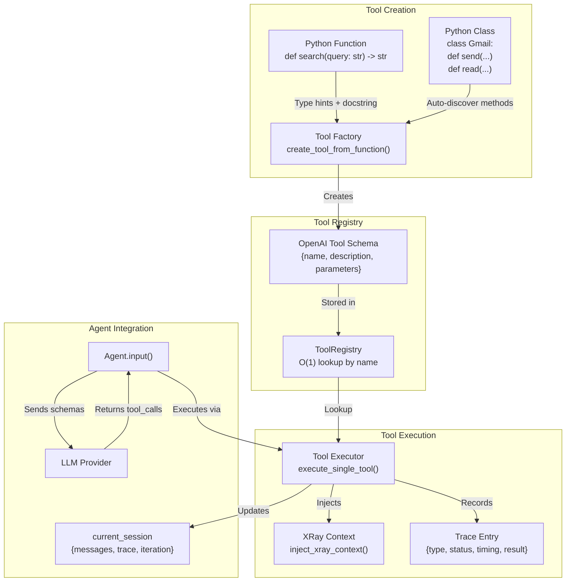
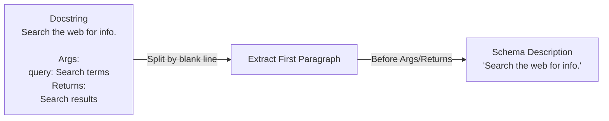
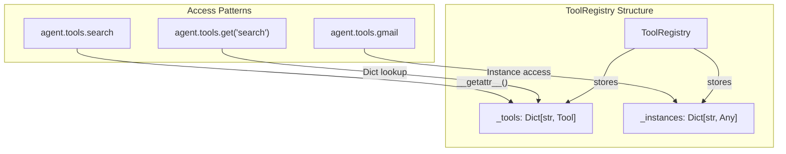
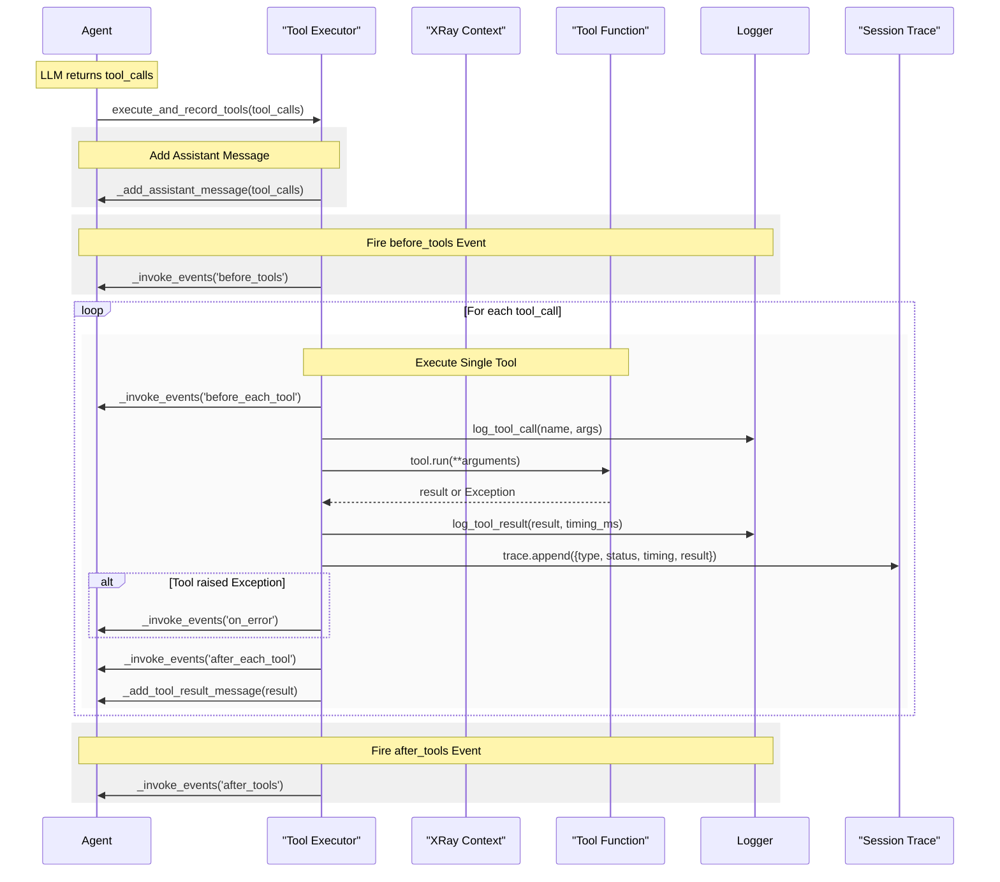
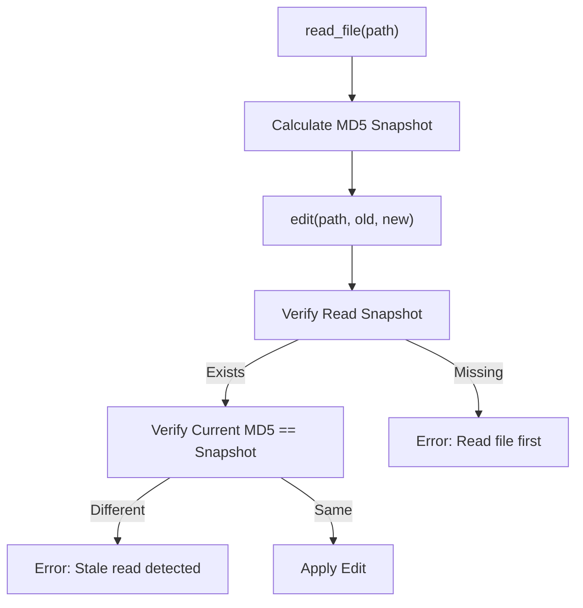

<!-- source: DeepWiki mcp.deepwiki.com · repo openonion/connectonion · page 3.3 Tools System · fetched 2026-10-26 -->

# Tools System

<details>
<summary>Relevant source files</summary>

The following files were used as context for generating this wiki page:

- [CHANGELOG.md](CHANGELOG.md)
- [connectonion/core/agent.py](connectonion/core/agent.py)
- [connectonion/logger.py](connectonion/logger.py)
- [connectonion/useful_tools/browser_tools/scroll.py](connectonion/useful_tools/browser_tools/scroll.py)
- [connectonion/useful_tools/file_tools/README.md](connectonion/useful_tools/file_tools/README.md)
- [connectonion/useful_tools/file_tools/__init__.py](connectonion/useful_tools/file_tools/__init__.py)
- [connectonion/useful_tools/file_tools/edit.py](connectonion/useful_tools/file_tools/edit.py)
- [connectonion/useful_tools/file_tools/file_tools.py](connectonion/useful_tools/file_tools/file_tools.py)
- [connectonion/useful_tools/file_tools/glob.py](connectonion/useful_tools/file_tools/glob.py)
- [connectonion/useful_tools/file_tools/grep.py](connectonion/useful_tools/file_tools/grep.py)
- [connectonion/useful_tools/file_tools/multi_edit.py](connectonion/useful_tools/file_tools/multi_edit.py)
- [connectonion/useful_tools/file_tools/read.py](connectonion/useful_tools/file_tools/read.py)
- [docs/api.md](docs/api.md)
- [docs/concepts/tools.md](docs/concepts/tools.md)
- [tests/real_api/manual/manual_defaults.py](tests/real_api/manual/manual_defaults.py)
- [tests/unit/test_agent.py](tests/unit/test_agent.py)
- [tests/unit/test_logger.py](tests/unit/test_logger.py)
- [tests/unit/test_tool_executor.py](tests/unit/test_tool_executor.py)
- [tests/unit/test_tool_executor_errors.py](tests/unit/test_tool_executor_errors.py)
- [tests/unit/test_tool_factory.py](tests/unit/test_tool_factory.py)

</details>


**Purpose**: The Tools System enables agents to interact with the world by converting Python functions and classes into callable actions that LLMs can invoke. This page covers tool creation patterns, schema generation, tool registry architecture, and the execution lifecycle.

**Scope**: This page focuses on the technical implementation of the tools system. For practical guidance on designing tools, see [10.1 Tool Design](). For information about the event system that hooks into tool execution, see [3.4 Event System]().

---

## System Architecture

The tools system consists of four primary components that work together to transform Python code into LLM-callable actions:

**Tool Transformation Flow**


**Sources**: [connectonion/core/tool_factory.py:1-150](), [connectonion/core/tool_registry.py:1-100](), [connectonion/core/tool_executor.py:1-250](), [connectonion/core/agent.py:111-132]()

---

## Tool Creation Patterns

### Function-Based Tools (Recommended)

Function-based tools are the simplest way to create tools. Any Python function with type hints can be automatically converted to a tool using `create_tool_from_function` [connectonion/core/tool_factory.py:20-20]().

```python
def search(query: str, limit: int = 10) -> str:
    """Search for information."""
    return f"Found results for {query}"

agent = Agent("assistant", tools=[search])
```

**Schema Generation Process**:

| Input | Source | Output Schema Field |
|-------|--------|---------------------|
| Function name | `func.__name__` | `"name": "search"` |
| Type hints | `query: str` | `"query": {"type": "string"}` |
| Docstring | First paragraph | `"description": "Search for..."` |
| Default values | `limit: int = 10` | `"required": ["query"]` (limit is optional) |

**Type Mapping via `get_json_schema_type`**:

| Python Type | JSON Schema Type |
|-------------|------------------|
| `str` | `"string"` |
| `int` | `"integer"` |
| `float` | `"number"` |
| `bool` | `"boolean"` |
| `list`, `List[T]` | `"array"` |
| `dict`, `Dict[K,V]` | `"object"` |

**Sources**: [connectonion/core/tool_factory.py:20-120](), [tests/unit/test_tool_factory.py:116-165](), [docs/api.md:126-131]()

### Class-Based Tools (Stateful Operations)

For tools that need shared state, caching, or resource management, pass class instances directly to the `Agent` [connectonion/core/agent.py:118-125]().

```python
class Gmail:
    def __init__(self):
        self._service = None  # Shared state
    
    def send(self, to: str, subject: str, body: str) -> str:
        """Send an email."""
        return f"Sent to {to}"
    
    def read_inbox(self, last: int = 10) -> str:
        """Read recent emails."""
        return f"Read {last} emails"

gmail = Gmail()
agent = Agent("assistant", tools=[gmail])  # Auto-discovers methods
```

**Method Discovery Rules**:
- Only `public` methods (not starting with `_`) are registered as tools [connectonion/core/tool_factory.py:80-100]().
- Each method must have type hints for parameters and return type to be included [tests/unit/test_agent.py:125-128]().
- The class instance itself is stored in the registry for direct access [connectonion/core/agent.py:121-121]().

**Sources**: [connectonion/core/tool_factory.py:80-150](), [tests/unit/test_agent.py:96-129](), [docs/concepts/tools.md:162-175]()

---

## Schema Generation Pipeline

### Docstring Processing

The tool factory extracts only the first paragraph of docstrings to minimize token usage and exclude implementation details like `Args` or `Returns` sections [connectonion/core/tool_factory.py:45-70]().

**Docstring Extraction Logic**


**Sources**: [connectonion/core/tool_factory.py:45-70](), [tests/unit/test_tool_factory.py:72-110]()

---

## Tool Registry Architecture

The `ToolRegistry` [connectonion/core/tool_registry.py:1-100]() provides O(1) lookup and attribute-style access to tools and their underlying class instances.

**Registry Internal Structure**


**Sources**: [connectonion/core/tool_registry.py:1-100](), [connectonion/core/agent.py:112-132]()

---

## Tool Execution Lifecycle

### Execution Flow with Events

The `execute_and_record_tools` function manages the batch execution of tool calls returned by an LLM [connectonion/core/tool_executor.py:24-100]().

**Tool Execution Sequence**


**Sources**: [connectonion/core/tool_executor.py:24-250](), [tests/unit/test_tool_executor.py:1-238](), [connectonion/core/agent.py:78-92]()

### Error Handling

Tool execution captures failures and returns them as strings to the LLM so the agent can attempt to self-correct [connectonion/core/tool_executor.py:180-202]().

| Error Type | Status | Result Format |
|------------|--------|---------------|
| **Tool Not Found** | `not_found` | `"Error: Tool {name} not found"` |
| **Execution Exception** | `error` | `"Error: {exception_message}"` |
| **Success** | `success` | Raw return value (as string) |

**Sources**: [connectonion/core/tool_executor.py:108-202](), [tests/unit/test_tool_executor_errors.py:62-214]()

---

## File Tools (Special Case)

The `FileTools` system implements a "Claude Code-style" safety pattern where edits require prior reads [connectonion/useful_tools/file_tools/README.md:1-40]().

**File Safety Logic**


**Key Implementation Details**:
- **MD5 Snapshots**: Tracks file state at the moment of reading to detect external changes [connectonion/useful_tools/file_tools/README.md:58-68]().
- **Write Restriction**: `write()` is restricted to creating *new* files only; existing files must be modified via `edit()` or `multi_edit()` [connectonion/useful_tools/file_tools/README.md:70-84]().
- **Permission Modes**: Supports `read` (read-only) and `write` (full access) modes [connectonion/useful_tools/file_tools/README.md:86-104]().

**Sources**: [connectonion/useful_tools/file_tools/README.md:1-205](), [CHANGELOG.md:9-42]()

---

## Performance and Observability

### Logging
The `Logger` [connectonion/logger.py:44-116]() delegates tool execution events to the `Console` for terminal output and records them in structured YAML evals for replay [connectonion/logger.py:134-143]().

### Token Usage
Tool execution results are appended to the session message history, contributing to context window usage. Structured returns (like `List[Dict]`) are automatically serialized to JSON for the LLM [docs/concepts/tools.md:70-98]().

**Sources**: [connectonion/logger.py:1-160](), [connectonion/core/agent.py:63-65](), [docs/api.md:151-220]()

---

