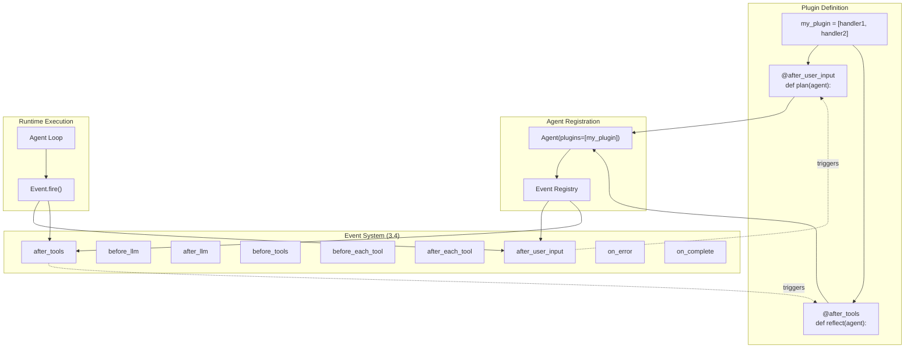
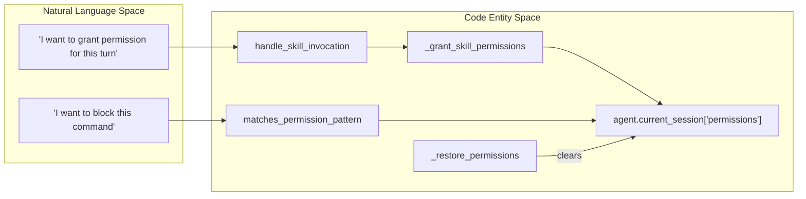

<!-- source: DeepWiki mcp.deepwiki.com · repo openonion/connectonion · page 3.5 Plugin System · fetched 2026-10-26 -->

# Plugin System

<details>
<summary>Relevant source files</summary>

The following files were used as context for generating this wiki page:

- [connectonion/network/asgi/__init__.py](connectonion/network/asgi/__init__.py)
- [connectonion/useful_events_handlers/reflect.py](connectonion/useful_events_handlers/reflect.py)
- [connectonion/useful_plugins/__init__.py](connectonion/useful_plugins/__init__.py)
- [connectonion/useful_plugins/image_result_formatter.py](connectonion/useful_plugins/image_result_formatter.py)
- [connectonion/useful_plugins/prefer_write_tool.py](connectonion/useful_plugins/prefer_write_tool.py)
- [connectonion/useful_plugins/re_act.py](connectonion/useful_plugins/re_act.py)
- [connectonion/useful_plugins/skills.py](connectonion/useful_plugins/skills.py)
- [connectonion/useful_plugins/tool_approval/bash_parser.py](connectonion/useful_plugins/tool_approval/bash_parser.py)
- [docs/concepts/plugins.md](docs/concepts/plugins.md)
- [docs/features/transcribe.md](docs/features/transcribe.md)
- [docs/features/trust.md](docs/features/trust.md)
- [docs/useful_plugins/prefer_write_tool.md](docs/useful_plugins/prefer_write_tool.md)
- [tests/e2e/test_example_agent.py](tests/e2e/test_example_agent.py)
- [tests/unit/test_skills.py](tests/unit/test_skills.py)
- [tests/unit/test_tool_approval.py](tests/unit/test_tool_approval.py)

</details>


The plugin system provides a composable architecture for extending agent behavior through reusable event handler bundles. Plugins inject logic at specific points in the agent execution lifecycle without modifying core agent code.

This page covers plugin architecture, built-in plugins, and custom plugin creation. For details on the underlying event hooks, see [Event System (3.4)](). For tool creation patterns, see [Tools System (3.3)]().

---

## Plugin Architecture

### Core Concept

A plugin is a **list of event handlers** that fire during agent execution. Plugins modify agent behavior by intercepting lifecycle events and injecting messages, making LLM calls, or mutating session state.

```python
# Plugin = list of decorated event handlers
my_plugin = [
    after_user_input(plan_function),
    after_tools(reflect_function)
]

# Use in agent
agent = Agent(
    name="assistant",
    tools=[search, analyze],
    plugins=[my_plugin, another_plugin]  # Composable
)
```

**Key Properties:**
- **Reusable**: Package behavior once, use across multiple agents [docs/concepts/plugins.md:95-104]().
- **Composable**: Combine multiple plugins without conflicts [docs/concepts/plugins.md:68-73]().
- **Declarative**: List of event handlers, not imperative code [connectonion/useful_plugins/re_act.py:162-164]().
- **Non-invasive**: No inheritance or agent subclassing required [docs/concepts/plugins.md:39-47]().

Sources: [connectonion/useful_plugins/__init__.py:1-28](), [docs/concepts/plugins.md:1-111]()

---

### Plugin to Event System Mapping

The diagram below bridges the natural language concepts of "planning" and "reflecting" to the specific code entities in the event system.



**Execution Flow:**
1. Agent initialization registers plugin handlers to event system.
2. During `agent.input()`, agent loop fires events at lifecycle points.
3. Registered handlers execute in registration order [docs/useful_plugins/prefer_write_tool.md:113-119]().
4. Handlers receive `agent` instance with full session access [connectonion/useful_plugins/re_act.py:120-160]().

Sources: [connectonion/useful_plugins/re_act.py:119-165](), [connectonion/useful_plugins/image_result_formatter.py:105-155](), [connectonion/useful_plugins/prefer_write_tool.py:77-143]()

---

## Plugin Structure

### Anatomy of a Plugin

A plugin is defined as a collection of functions decorated with event hooks from `connectonion.core.events`.

```python
from connectonion.core.events import after_user_input, after_tools
from connectonion.llm_do import llm_do

@after_user_input
def plan_task(agent: 'Agent') -> None:
    """Generate task plan after user input."""
    user_prompt = agent.current_session.get('user_prompt', '')
    # Inject into conversation
    agent.current_session['messages'].append({
        'role': 'assistant',
        'content': f"💭 I will handle: {user_prompt}"
    })

@after_tools
def evaluate_result(agent: 'Agent') -> None:
    """Evaluate tool execution success."""
    trace = agent.current_session.get('trace', [])
    if trace and trace[-1]['status'] == 'success':
        agent.logger.print("✓ Tool succeeded")

# Bundle as plugin
my_plugin = [plan_task, evaluate_result]
```

**Handler Requirements:**
- **Signature**: `def handler(agent: Agent) -> None` [connectonion/useful_plugins/re_act.py:120]()
- **Decorator**: One of the event decorators from `connectonion.core.events` [connectonion/useful_plugins/prefer_write_tool.py:77]()
- **Return**: `None` (side effects only)
- **State Access**: Via `agent.current_session` dictionary [connectonion/useful_plugins/image_result_formatter.py:121-122]()

**Session State Keys often used by Plugins:**
| Key | Type | Description |
|-----|------|-------------|
| `user_prompt` | `str` | Original user input [connectonion/useful_plugins/re_act.py:122]() |
| `messages` | `List[Dict]` | Full conversation history [connectonion/useful_plugins/re_act.py:127]() |
| `trace` | `List[Dict]` | Execution trace (tool results, errors) [connectonion/useful_plugins/image_result_formatter.py:121]() |
| `pending_tool`| `Dict` | Tool currently awaiting execution [connectonion/useful_plugins/prefer_write_tool.py:80]() |
| `permissions` | `Dict` | Tool-level approval/denial state [tests/unit/test_tool_approval.py:199-203]() |

Sources: [connectonion/useful_plugins/re_act.py:119-160](), [connectonion/useful_plugins/image_result_formatter.py:105-155](), [connectonion/useful_plugins/prefer_write_tool.py:77-143]()

---

## Built-in Plugins

### Plugin Catalog

ConnectOnion includes several built-in plugins that extend agent functionality:

| Plugin | Purpose | Implementation |
|--------|---------|----------------|
| `re_act` | Reasoning (Intent Recognition + Reflection) | [re_act.py:164]() |
| `image_result_formatter` | Formats base64 images for multimodal LLMs | [image_result_formatter.py:105]() |
| `tool_approval` | Web-based approval for dangerous tools | [tool_approval/approval.py]() |
| `prefer_write_tool` | Blocks bash file creation, nudges toward `Write` tool | [prefer_write_tool.py:143]() |
| `skills` | Invoke pre-packaged workflows with scoped permissions | [skills.py:274]() |
| `subagents` | Task delegation to parallel sub-agents | [subagents.py]() |

Sources: [connectonion/useful_plugins/__init__.py:12-28](), [docs/concepts/plugins.md:49-67]()

---

### re_act Plugin

**Purpose**: Implements the Reasoning + Acting pattern. It acknowledges the user's intent and reflects on tool results to improve planning.

**Event Handlers:**
- `acknowledge_request` (`after_user_input`): Summarizes the agent's understanding of the task [connectonion/useful_plugins/re_act.py:120-160]().
- `reflect` (`after_tools`): Generates reasoning about tool outcomes using `llm_do` [connectonion/useful_events_handlers/reflect.py:74-132]().

**Behavior:**
1. **After User Input**: Calls `llm_do` with `react_acknowledge.md` prompt [connectonion/useful_plugins/re_act.py:140-145]().
2. **Trace Recording**: Records a `thinking` trace with `kind: intent` [connectonion/useful_plugins/re_act.py:149-153]().
3. **Reflection**: After tools finish, it summarizes the conversation (truncating tool results to 150 chars) and asks the LLM to evaluate next steps [connectonion/useful_events_handlers/reflect.py:40-70]().

Sources: [connectonion/useful_plugins/re_act.py:1-165](), [connectonion/useful_events_handlers/reflect.py:1-132]()

---

### prefer_write_tool Plugin

**Purpose**: Prevents agents from using error-prone bash redirections (e.g., `cat <<EOF > file.py`) to create files, forcing them to use the structured `Write` tool.

**Implementation Logic:**
- **Hard Block**: If `before_each_tool` detects patterns like `>` or `tee` in a bash command, it raises a `ValueError` [connectonion/useful_plugins/prefer_write_tool.py:91-115]().
- **Soft Reminder**: If the agent uses `cat` or `head` to read files, the plugin sets a flag and appends a `<system-reminder>` to the tool result in `after_each_tool` [connectonion/useful_plugins/prefer_write_tool.py:118-141]().

Sources: [connectonion/useful_plugins/prefer_write_tool.py:1-143](), [docs/useful_plugins/prefer_write_tool.md:1-119]()

---

### image_result_formatter Plugin

**Purpose**: Detects base64 encoded strings in tool results and transforms them into multimodal message structures that vision-capable LLMs can interpret.

**Transformation Flow:**
1. **Detection**: Scans the `trace` for `tool_result` entries containing base64 data [connectonion/useful_plugins/image_result_formatter.py:129-141]().
2. **Shortening**: Replaces the massive base64 string in the `tool` message with a placeholder ("Screenshot captured") to save tokens [connectonion/useful_plugins/image_result_formatter.py:149]().
3. **Injection**: Inserts a new `user` message immediately after containing the actual image URL/data [connectonion/useful_plugins/image_result_formatter.py:152-155]().

Sources: [connectonion/useful_plugins/image_result_formatter.py:1-155]()

---

## Creating Custom Plugins

### Advanced Plugin with Permission Logic

This diagram maps the code entities involved in creating a plugin that interacts with the permission system, such as the `skills` or `tool_approval` plugins.



### Pattern: Scoped Permissions (Skills)
Plugins can manage temporary permissions by taking a snapshot of the current `permissions` dict and restoring it later.

1. **Snapshot**: Store existing permissions in `agent.current_session['_permission_snapshot']` [tests/unit/test_skills.py:61-64]().
2. **Grant**: Add new patterns (e.g., `Bash(git status)`) to `agent.current_session['permissions']` [tests/unit/test_skills.py:71-76]().
3. **Cleanup**: Use `on_complete` or `on_turn_end` to restore the snapshot [tests/unit/test_skills.py:131-140]().

Sources: [connectonion/useful_plugins/skills.py:1-66](), [tests/unit/test_skills.py:43-141]()

### Pattern: Bash Command Chain Validation
If creating a security-focused plugin, use the `bash_parser` utilities to ensure sub-commands hidden in pipes or chains are also validated.

```python
from connectonion.useful_plugins.tool_approval.bash_parser import check_bash_chain_permitted

@before_each_tool
def secure_bash(agent):
    pending = agent.current_session.get('pending_tool')
    if pending['name'] == 'bash':
        cmd = pending['arguments'].get('command', '')
        # check_bash_chain_permitted parses AST to find 'rm -rf' hidden in 'ls && rm -rf'
        permitted, reason, source = check_bash_chain_permitted(cmd, agent.current_session['permissions'])
        if not permitted:
            raise ValueError(f"Blocked: {reason}")
```

Sources: [connectonion/useful_plugins/tool_approval/bash_parser.py:136-171]()

---

## Best Practices

1. **Order Matters**: Place blocking plugins (like `prefer_write_tool`) before interactive plugins (like `tool_approval`) so the agent is corrected before the user is bothered [docs/useful_plugins/prefer_write_tool.md:113-119]().
2. **Use `llm_do` for Reasoning**: Plugins should use the `llm_do` utility for internal reasoning calls to keep the main agent loop clean [connectonion/useful_plugins/re_act.py:140-145]().
3. **Context Management**: When generating reasoning in plugins, use conversation compression (e.g., `_format_conversation`) to avoid blowing out the token budget [connectonion/useful_plugins/re_act.py:47-116]().
4. **Trace Recording**: Use `agent._record_trace()` to ensure plugin actions are visible in the UI/logs [connectonion/useful_plugins/re_act.py:149-153]().

Sources: [connectonion/useful_plugins/re_act.py:47-153](), [docs/useful_plugins/prefer_write_tool.md:108-119]()

---

