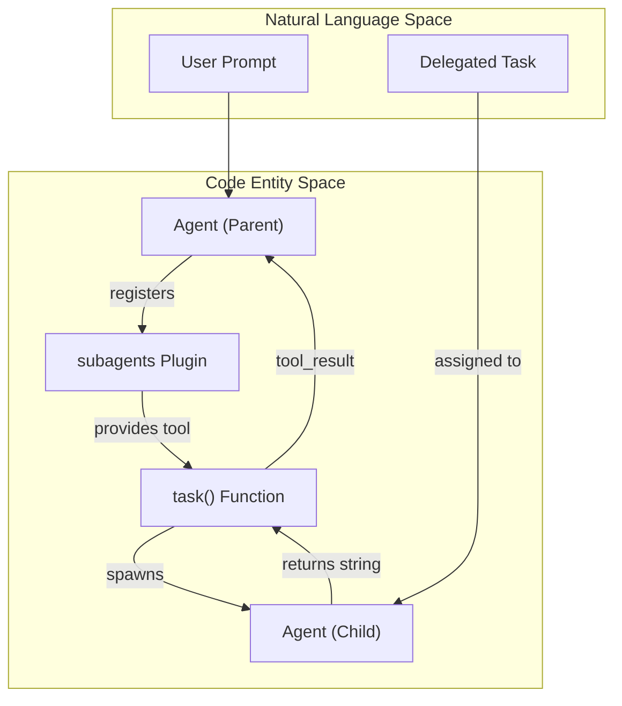
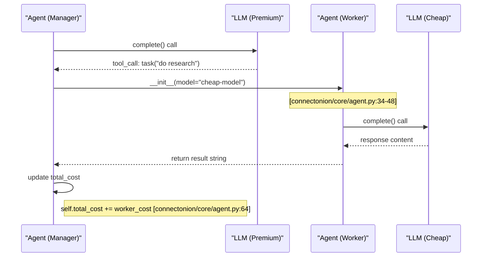

<!-- source: DeepWiki mcp.deepwiki.com · repo openonion/connectonion · page 3.6 Sub-Agent System · fetched 2026-10-26 -->

# Sub-Agent System

<details>
<summary>Relevant source files</summary>

The following files were used as context for generating this wiki page:

- [README.md](README.md)
- [connectonion/core/agent.py](connectonion/core/agent.py)
- [docs/README.md](docs/README.md)
- [docs/quickstart.md](docs/quickstart.md)
- [docs/templates/README.md](docs/templates/README.md)
- [docs/templates/meta-agent.md](docs/templates/meta-agent.md)
- [docs/templates/minimal.md](docs/templates/minimal.md)
- [docs/templates/playwright.md](docs/templates/playwright.md)
- [docs/templates/web-research.md](docs/templates/web-research.md)
- [tests/unit/test_agent.py](tests/unit/test_agent.py)

</details>


The Sub-Agent System in ConnectOnion allows a primary agent to delegate complex, specialized, or resource-intensive tasks to secondary agents. This hierarchical structure enables cost optimization, specialized tool scoping, and parallel processing capabilities.

## Overview

ConnectOnion implements sub-agent spawning primarily through the `subagents` plugin and the `task()` function. When an agent is equipped with the sub-agent capability, it can create "child" agents that operate with their own independent system prompts, toolsets, and memory contexts [README.md:152-165]().

### Key Benefits
*   **Cost Optimization**: Use cheaper models (e.g., GPT-4o-mini) for sub-tasks while the "manager" uses a more capable model [README.md:175-181]().
*   **Context Management**: Sub-agents start with a clean or scoped context, preventing the main conversation from becoming bloated [README.md:157-160]().
*   **Tool Isolation**: Limit a sub-agent's capabilities to only the tools required for its specific task [connectonion/core/agent.py:111-132]().

## The `subagents` Plugin

The `subagents` plugin is a built-in extension that mirrors high-level autonomous capabilities. When registered, it provides the agent with the ability to spawn and manage lifecycle events for secondary agents [README.md:152-165]().

### Implementation and Hooks
The sub-agent system leverages the `Agent` class's event registry to manage the hand-off between the parent and child [connectonion/core/agent.py:78-92]().

| Hook Name | Role in Sub-Agent System |
| :--- | :--- |
| `before_iteration` | Checks for stop signals from parent or pending sub-agent results [connectonion/core/agent.py:81](). |
| `after_tools` | Processes the output of sub-agent tool calls to format them for the parent's context [connectonion/core/agent.py:88](). |
| `on_stop_signal` | Ensures child agents are terminated if the parent is stopped [connectonion/core/agent.py:91](). |

**Sources:** [connectonion/core/agent.py:78-92](), [README.md:152-165]()

## Task Delegation via `task()`

The `task()` function is the primary mechanism for one-shot sub-agent execution. It allows the agent to treat a complex natural language prompt as a single tool call.

### Data Flow: Parent to Sub-Agent
1.  **Tool Call**: The parent LLM decides to use the `task` tool.
2.  **Instantiation**: A new `Agent` instance is created dynamically [connectonion/core/agent.py:34-48]().
3.  **Execution**: The child agent runs its own execution loop until completion or `max_iterations` is reached [connectonion/core/agent.py:5-9]().
4.  **Return**: The final response of the child is returned to the parent as a string.

### Sub-Agent System Architecture
This diagram illustrates how the `Agent` class interacts with the `subagents` plugin to spawn child entities.


**Sources:** [connectonion/core/agent.py:31-48](), [connectonion/core/agent.py:78-92](), [README.md:152-165]()

## File-Based Sub-Agent Definitions

ConnectOnion supports defining sub-agent behaviors through the filesystem using the `.co/skills/` directory structure. This allows for reusable sub-agent logic that can be auto-discovered by any agent using the `skills` plugin [README.md:127-146]().

### Discovery Hierarchy
The system searches for sub-agent/skill definitions in the following order:
1.  **Project-level**: `.co/skills/skill-name/SKILL.md` [README.md:141]()
2.  **User-level**: `~/.co/skills/skill-name/SKILL.md` [README.md:142]()
3.  **Built-in**: Framework-provided skills [README.md:143]()

This hierarchy allows developers to override global sub-agent behaviors with project-specific instructions without modifying the core framework code.

**Sources:** [README.md:127-146]()

## Cost Optimization Patterns

The sub-agent system is frequently used to implement the "Manager-Worker" pattern to reduce API costs.

### Pattern: Cheap Workers
In this pattern, a high-intelligence model (the Manager) orchestrates several low-cost models (the Workers).

```python
from connectonion import Agent
from connectonion.useful_plugins import subagents

# The Manager uses a premium model
manager = Agent(
    name="manager",
    model="gpt-4o", 
    plugins=[subagents]
)

# Internally, the subagents plugin can be configured 
# to spawn workers using "gpt-4o-mini"
```

### Resource Tracking
The parent agent tracks the cumulative cost of all its operations, including those performed by sub-agents, via the `total_cost` attribute [connectonion/core/agent.py:64]().

### Sub-Agent Lifecycle and Cost Flow
This diagram maps the association between the `Agent` state and the cost accumulation during delegation.


**Sources:** [connectonion/core/agent.py:34-66](), [README.md:175-181]()

---

