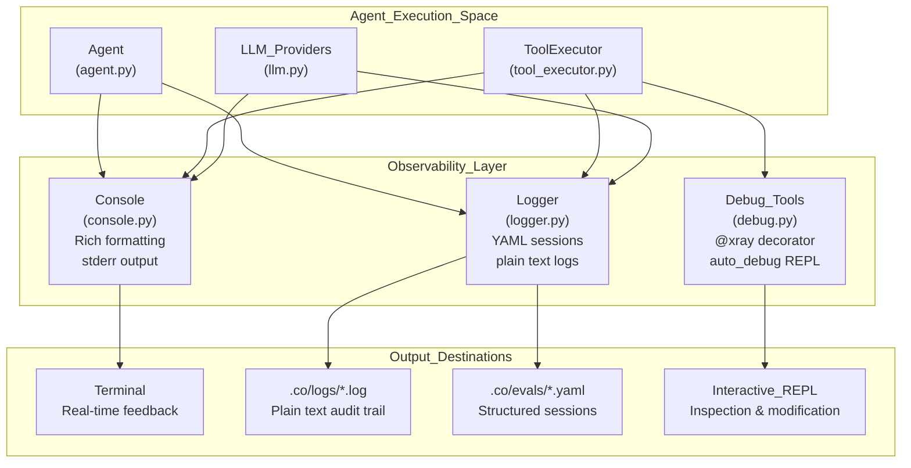
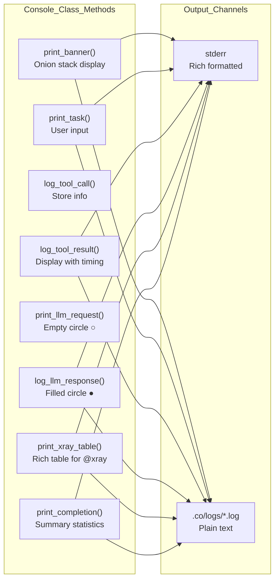

<!-- source: DeepWiki mcp.deepwiki.com · repo openonion/connectonion · page 4 Observability & Debugging · fetched 2026-10-26 -->

# Observability & Debugging

<details>
<summary>Relevant source files</summary>

The following files were used as context for generating this wiki page:

- [connectonion/console.py](connectonion/console.py)
- [docs/debug/auto_debug.md](docs/debug/auto_debug.md)
- [docs/debug/xray.md](docs/debug/xray.md)
- [tests/unit/test_address.py](tests/unit/test_address.py)
- [tests/unit/test_console.py](tests/unit/test_console.py)

</details>


## Purpose and Scope

This page provides an overview of ConnectOnion's observability and debugging infrastructure. ConnectOnion provides three integrated layers of visibility into agent execution: real-time console output, persistent logging, and interactive debugging tools. All observability features are enabled by default following the principle that good developer experience requires visibility.

For detailed information on specific features, see:
- [Console & Logging](#4.1) — Document console output, log files, and structured session logging
- [Interactive Debugging](#4.2) — Explain `@xray` decorator, `auto_debug` mode, and breakpoint functionality
- [Session Replay](#4.3) — Document replay functionality and how to analyze past executions

## Architecture Overview

ConnectOnion's observability system consists of three primary components that work together to provide comprehensive visibility:

**Observability System Architecture**


**Sources:** [connectonion/console.py:1-10](), [connectonion/console.py:68-81](), [docs/debug/xray.md:1-22](), [docs/debug/auto_debug.md:24-43]()

### Design Principles

| Principle | Implementation | Rationale |
|-----------|---------------|-----------|
| **Visibility by Default** | Console output always enabled | Developers need to see what's happening, like FastAPI/npm/cargo [connectonion/console.py:71-72]() |
| **Multi-Level Logging** | Terminal + plain text + structured YAML | Different formats for different use cases (monitoring vs analysis) [connectonion/console.py:5-6]() |
| **Zero Configuration** | Automatic log directory creation | No setup required, works out of the box [connectonion/console.py:88-90]() |
| **Non-Intrusive** | stderr for console, separate files for logs | Agent results on stdout remain clean [connectonion/console.py:21-22]() |
| **Interactive Debugging** | `@xray` breakpoints + REPL | Pause and inspect without modifying source code [docs/debug/auto_debug.md:1-5]() |

**Sources:** [connectonion/console.py:21-22](), [connectonion/console.py:71-72](), [connectonion/console.py:88-90](), [docs/debug/auto_debug.md:1-5]()

## Execution Flow with Observability Hooks

The observability system integrates with the agent execution loop at multiple points to capture comprehensive information:

**Agent Lifecycle Observability Flow**
```mermaid
sequenceDiagram
    participant User
    participant Agent["Agent (agent.py)"]
    participant Console["Console (console.py)"]
    participant Logger["Logger (logger.py)"]
    participant Tool["Tool (@xray)"]
    participant Debug["Debug (debug.py)"]
    
    User->>Agent: input("task")
    
    Agent->>Console: print_banner()
    Agent->>Console: print_task()
    Agent->>Logger: start_session()
    
    loop Until complete or max_iterations
        Agent->>Console: print_llm_request()
        Note over Agent,Console: "○ model · iteration"
        
        Agent->>LLM: complete()
        LLM-->>Agent: response
        
        Agent->>Console: log_llm_response()
        Note over Agent,Console: "● model · N tools · tokens · cost · time"
        Agent->>Logger: log_turn()
        
        alt Tool calls requested
            loop For each tool
                Agent->>Console: log_tool_call()
                
                alt Tool has @xray decorator
                    Agent->>Debug: check_breakpoint()
                    Debug->>Console: print_xray_table()
                    Debug->>User: REPL prompt
                    User-->>Debug: continue/edit/quit
                end
                
                Agent->>Tool: execute()
                Tool-->>Agent: result
                
                Agent->>Console: log_tool_result()
                Note over Agent,Console: "▸ tool(args) · ✓ time"
                Agent->>Logger: log_tool_execution()
            end
        end
    end
    
    Agent->>Console: print_completion()
    Agent->>Logger: save_session()
    Note over Logger: ".co/evals/*.yaml"
    
    Agent-->>User: final result
```

**Sources:** [connectonion/console.py:98-107](), [connectonion/console.py:315-320](), [connectonion/console.py:410-418](), [docs/debug/auto_debug.md:41-89]()

## Console Output System

The `Console` class in [connectonion/console.py]() provides formatted terminal output using the Rich library. All output goes to stderr to avoid mixing with agent results on stdout [connectonion/console.py:21-22]().

### Console Architecture



**Sources:** [connectonion/console.py:68-539]()

### Visual Elements

The console uses a consistent symbol system for different operations:

| Symbol | Purpose | Color | Usage |
|--------|---------|-------|-------|
| `○` `◎` `●` | Onion layers / LLM state | Cyan/Magenta | Banner and LLM thinking indicators [connectonion/console.py:28-30]() |
| `▸` | Tool execution | Green | Tool action marker [connectonion/console.py:33]() |
| `✓` | Success | Green | Tool completion [connectonion/console.py:34]() |
| `✗` | Error | Red | Tool failure [connectonion/console.py:36]() |
| `⚡` | LLM completion | Magenta | Thinking complete [connectonion/console.py:35]() |

**Sources:** [connectonion/console.py:24-46]()

## Interactive Debugging

The debugging system provides two main features: the `@xray` decorator for tool-level breakpoints and `auto_debug()` for interactive sessions.

### @xray Decorator

The `@xray` decorator marks tools for enhanced observability. Inside a decorated tool, developers can access `xray.agent`, `xray.task`, and `xray.iteration` to understand the agent's context [docs/debug/xray.md:10-20]().

### auto_debug Mode

The `auto_debug()` method enables an interactive session where execution pauses at each `@xray` breakpoint [docs/debug/auto_debug.md:41-43]().

**Interactive Menu Options:**
- **Continue (c/Enter)**: Resume execution [docs/debug/auto_debug.md:151-165]().
- **Edit (e)**: Launch a Python shell to modify local variables like `result` or `tool_args` [docs/debug/auto_debug.md:237-260]().
- **Quit (q)**: Exit the debugging session [docs/debug/auto_debug.md:12-13]().

For details, see [Interactive Debugging](#4.2).

**Sources:** [docs/debug/xray.md:1-22](), [docs/debug/auto_debug.md:1-25]()

## Session Replay

ConnectOnion supports analyzing past executions by capturing structured session data in YAML format. These files include the full conversation history and a detailed execution trace [connectonion/console.py:5-6]().

For details, see [Session Replay](#4.3).

**Sources:** [connectonion/console.py:5-6](), [connectonion/console.py:83-96]()

---

