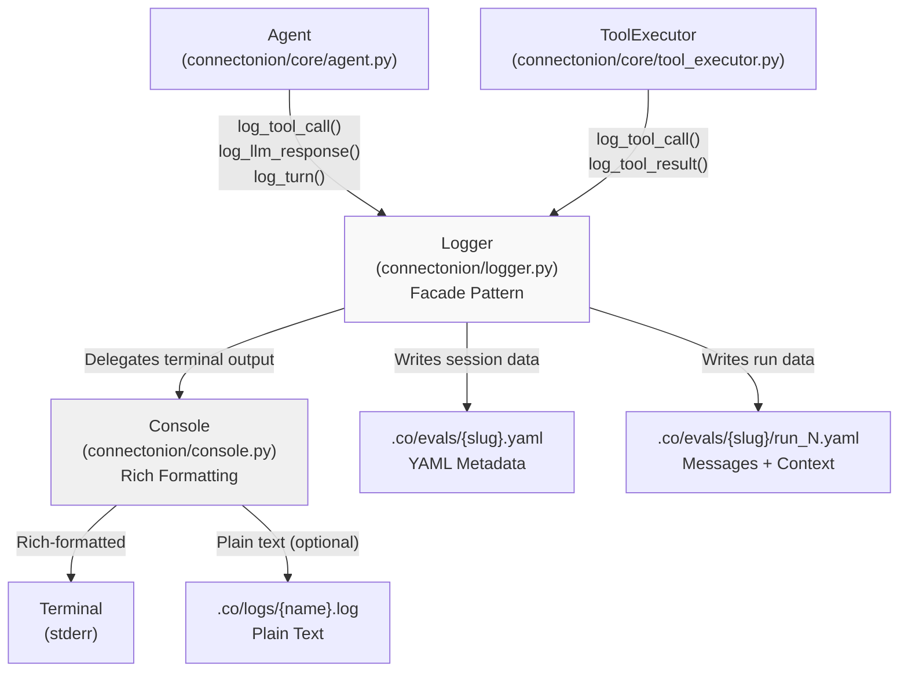
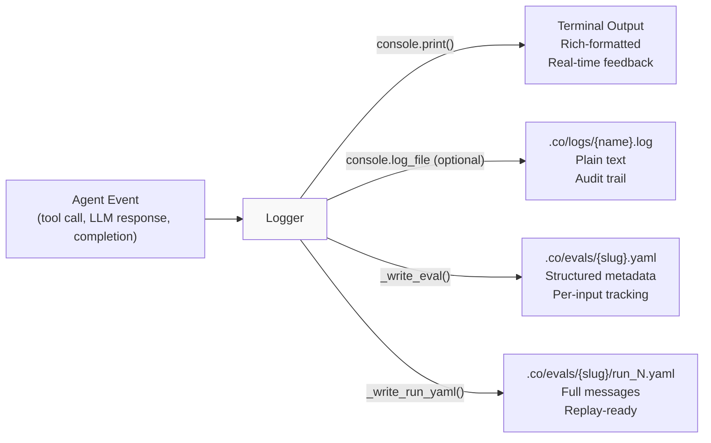
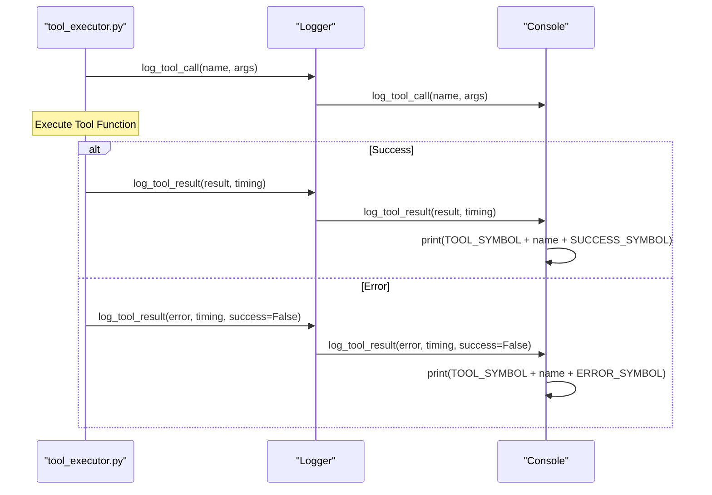

<!-- source: DeepWiki mcp.deepwiki.com · repo openonion/connectonion · page 4.1 Console & Logging · fetched 2026-10-26 -->

# Console & Logging

<details>
<summary>Relevant source files</summary>

The following files were used as context for generating this wiki page:

- [connectonion/console.py](connectonion/console.py)
- [connectonion/logger.py](connectonion/logger.py)
- [docs/api.md](docs/api.md)
- [docs/concepts/tools.md](docs/concepts/tools.md)
- [tests/real_api/manual/manual_defaults.py](tests/real_api/manual/manual_defaults.py)
- [tests/unit/test_address.py](tests/unit/test_address.py)
- [tests/unit/test_console.py](tests/unit/test_console.py)
- [tests/unit/test_logger.py](tests/unit/test_logger.py)
- [tests/unit/test_tool_executor.py](tests/unit/test_tool_executor.py)
- [tests/unit/test_tool_executor_errors.py](tests/unit/test_tool_executor_errors.py)
- [tests/unit/test_tool_factory.py](tests/unit/test_tool_factory.py)

</details>


This page documents ConnectOnion's observability system: console output formatting, plain text logging, and structured session recording. These features provide visibility into agent execution without requiring special configuration.

For interactive debugging with breakpoints and variable inspection, see [Interactive Debugging](). For analyzing past executions, see [Session Replay]().

---

## Architecture Overview

ConnectOnion's logging system uses a two-layer architecture:



**Sources:** [connectonion/logger.py:1-11](), [connectonion/console.py:1-10](), [connectonion/core/tool_executor.py:158-210]()

### Component Responsibilities

| Component | Purpose | Output |
|-----------|---------|--------|
| **Logger** | Unified facade for all logging | Delegates to Console + writes YAML |
| **Console** | Terminal formatting | Rich-formatted stderr + optional plain file |
| **Agent/ToolExecutor** | Log events during execution | Calls Logger methods at lifecycle points |

**Sources:** [connectonion/logger.py:44-72](), [connectonion/console.py:68-73]()

---

## Output Destinations

### Three Logging Channels



**Sources:** [connectonion/logger.py:44-72](), [connectonion/logger.py:119-142](), [connectonion/logger.py:158-177]()

#### 1. Terminal Output (Console)

Real-time formatted output to `stderr` using the Rich library. Using `stderr` ensures console output doesn't mix with agent results if redirected [connectonion/console.py:21-22]().

#### 2. Plain Text Log (Optional)

Timestamped plain text log at `.co/logs/{agent_name}.log`. This file includes a session separator and start time on initialization [connectonion/console.py:86-96]().

#### 3. Session YAML (Evals)

Structured YAML at `.co/evals/{input_slug}.yaml` for evaluation. It tracks the number of runs for a specific input and stores a history of previous run metadata [connectonion/logger.py:225-330]().

#### 4. Run YAML (Messages)

Full conversation history at `.co/evals/{input_slug}/run_N.yaml`. This includes the `system_prompt`, `model`, `cwd`, and the full `messages` list as a JSON string [connectonion/logger.py:332-403]().

---

## Console Output Format

### Visual Design System

ConnectOnion uses a consistent visual language based on the "onion stack" metaphor:

| Symbol | Name | Meaning | Code Entity |
| :--- | :--- | :--- | :--- |
| `○` | `CIRCLE_EMPTY` | LLM request / AI thinking | [connectonion/console.py:29]() |
| `◎` | Onion Layer | Middle layer (Banner) | [connectonion/console.py:166]() |
| `●` | `CIRCLE_FILLED` | LLM response / thinking complete | [connectonion/console.py:30]() |
| `▸` | `TOOL_SYMBOL` | Tool execution | [connectonion/console.py:33]() |
| `✓` | `SUCCESS_SYMBOL` | Tool success | [connectonion/console.py:34]() |
| `⚡` | `LLM_DONE_SYMBOL` | LLM thinking complete | [connectonion/console.py:35]() |
| `✗` | `ERROR_SYMBOL` | Error occurred | [connectonion/console.py:36]() |

**Constants defined in:** [connectonion/console.py:24-46]()

### Banner Format

The `print_banner()` method formats the "Onion Stack" style header, displaying the agent name, model, tool count, and skills [connectonion/console.py:98-172]().

### Tool Display Formatting

The `_format_tool_display()` method implements smart truncation for tool calls to keep terminal output readable. It attempts to fit the call within 45 characters, progressively truncating argument values if necessary [connectonion/console.py:355-408]().

---

## Configuration Modes

### Logger Initialization

The `Logger` class constructor accepts parameters controlling output behavior [connectonion/logger.py:74-113]():

```python
Logger(
    agent_name: str,
    quiet: bool = False,              # Suppress console output
    log: Union[bool, str, Path, None] = None, # File/session logging
    co_dir: Union[str, Path, None] = None     # Base .co directory
)
```

### Configuration Matrix

| `quiet` | `log` | Console | Plain Text | Sessions | Use Case |
| :--- | :--- | :--- | :--- | :--- | :--- |
| `False` | `True`/`None` | ✓ | ✓ | ✓ | **Development (default)** |
| `True` | `True`/`None` | ✗ | ✗ | ✓ | **Eval/Testing** |
| `False` | `False` | ✓ | ✗ | ✗ | **Benchmarking** |
| `False` | `"path"` | ✓ | ✓ (custom) | ✓ | **Custom log path** |

**Sources:** [connectonion/logger.py:74-113](), [docs/api.md:178-183]()

---

## Session Logging (Evals)

### File Naming Strategy

Session files are named from the **first input** using the `_slugify()` function, which converts text to a URL-friendly lowercase string [connectonion/logger.py:24-42]().

### Run Tracking

When the same input is executed multiple times, ConnectOnion tracks runs by incrementing a counter in the YAML file and moving the previous run's metadata into a `history` list [connectonion/logger.py:225-330]().

### Run YAML Format

Full conversation history is stored in `.co/evals/{slug}/run_N.yaml`. The `messages` are stored as a multi-line JSON string to ensure compatibility with various YAML parsers [connectonion/logger.py:332-403]().

---

## Tool Execution Logging

Tool execution logging is handled within `connectonion/core/tool_executor.py`. The `execute_single_tool` function ensures that both the call and the result (or error) are logged via the unified `Logger` interface.



**Sources:** [connectonion/core/tool_executor.py:158-210](), [connectonion/console.py:315-354](), [tests/unit/test_tool_executor.py:161-210]()

### Error Handling in Logs

When a tool fails, the `status` is set to `"error"` in the trace, and the `error_type` and `error` message are recorded [tests/unit/test_tool_executor_errors.py:153-185](). The console displays the `ERROR_SYMBOL` (`✗`) in red [connectonion/console.py:45, 95]().

---

## Performance Considerations

- **Direct stderr writes**: Console output uses `stderr` directly to avoid buffering delays and mixing with stdout results [connectonion/console.py:5, 22]().
- **Lazy Eval Initialization**: The eval file is created only when the first input is available to generate the filename [connectonion/logger.py:164-165]().
- **Regex Markup Removal**: When writing to plain text log files, Rich markup is stripped using regex to keep the files readable [connectonion/console.py:8, 528-539]().

**Sources:** [connectonion/console.py:1-10](), [connectonion/logger.py:161-180]()

---

