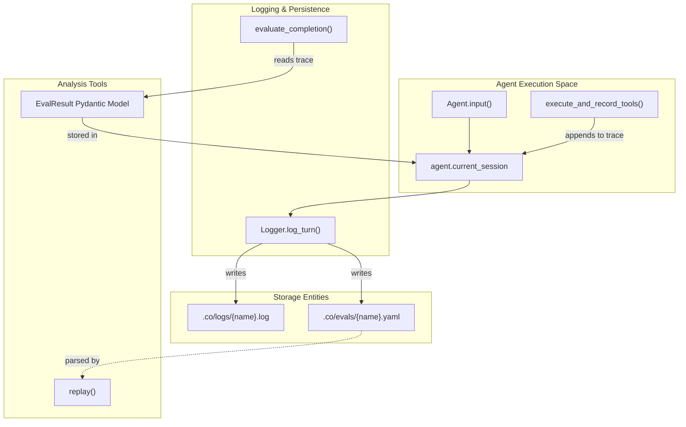
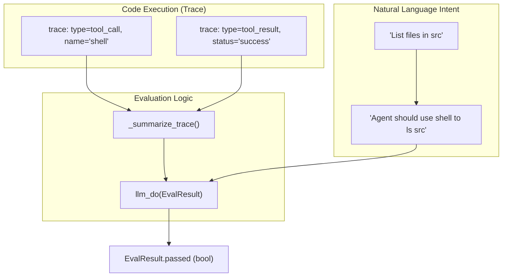

<!-- source: DeepWiki mcp.deepwiki.com · repo openonion/connectonion · page 4.3 Session Replay · fetched 2026-10-26 -->

# Session Replay

<details>
<summary>Relevant source files</summary>

The following files were used as context for generating this wiki page:

- [connectonion/cli/commands/ai_commands.py](connectonion/cli/commands/ai_commands.py)
- [connectonion/core/tool_executor.py](connectonion/core/tool_executor.py)
- [connectonion/useful_plugins/eval.py](connectonion/useful_plugins/eval.py)
- [connectonion/useful_plugins/ulw.py](connectonion/useful_plugins/ulw.py)
- [docs/session-persistence.md](docs/session-persistence.md)

</details>


Session Replay enables you to step through past agent executions without re-running them or making new LLM calls. This saves API costs and allows retrospective analysis of agent behavior using recorded session data.

**Scope:** This page covers the replay functionality for analyzing past executions. For real-time debugging with breakpoints, see [Interactive Debugging](4.2). For console output and log file formats, see [Console & Logging](4.1).

---

## Overview

ConnectOnion automatically records every agent execution to structured YAML files in `.co/evals/`. The `replay()` function loads these sessions and allows you to step through the execution history, inspect state at each point, and understand agent decision-making without incurring new API costs.

**Key characteristics:**
- **No re-execution**: Replay reads from logs; no new LLM calls are made.
- **Automatic recording**: All sessions captured by default via the `Logger` system.
- **Cost-free analysis**: Inspect past executions without API charges.
- **Full context**: Access to messages, tool calls, results, and timing.

Sources: [connectonion/core/tool_executor.py:119-158](), [connectonion/useful_plugins/eval.py:132-164]()

---

## Session Recording Architecture

Every agent execution automatically records a complete audit trail. The `tool_executor` records granular `tool_call` and `tool_result` events into the `agent.current_session['trace']`.

### Execution to Code Entity Mapping



**Recording Flow:**

1.  **Execution Phase**: `execute_single_tool` records a `tool_call` event before execution and a `tool_result` event after completion into the session trace [connectonion/core/tool_executor.py:151-158]().
2.  **Evaluation Phase**: If the `eval` plugin is active, `evaluate_completion` summarizes the trace and uses `llm_do` to verify if the user's intent was met [connectonion/useful_plugins/eval.py:114-154]().
3.  **Persistence**: The session state, including the trace and evaluation results, is persisted to disk.

Sources: [connectonion/core/tool_executor.py:119-141](), [connectonion/useful_plugins/eval.py:114-141]()

---

## Session Data Structure

Each session captured in `.co/evals/` contains the complete execution context. The `trace` is the primary source for replay analysis.

| Field | Description | Code Reference |
| :--- | :--- | :--- |
| `messages` | List of role/content dicts representing the conversation. | [connectonion/core/tool_executor.py:40-41]() |
| `trace` | Chronological list of `tool_call` and `tool_result` entries. | [connectonion/core/tool_executor.py:119-127]() |
| `evaluation` | Results from the `EvalResult` model (passed/summary). | [connectonion/useful_plugins/eval.py:38-41]() |
| `status` | The final state of a tool execution (e.g., `success`, `error`, `not_found`). | [connectonion/core/tool_executor.py:124-135]() |

**Trace Entry Example:**
A `tool_result` entry in the trace includes timing and status data used by the replay system to visualize performance.
```python
trace_entry = {
    "type": "tool_result",
    "tool_id": tool_id,
    "name": tool_name,
    "args": tool_args,
    "status": "pending",
    "result": None,
    "timing_ms": 0,
}
```
Sources: [connectonion/core/tool_executor.py:119-127](), [connectonion/useful_plugins/eval.py:196-201]()

---

## Evaluation and Replay Logic

The `eval` plugin enhances session replays by providing an automated "Expected vs Actual" analysis. It generates an expectation based on the `user_prompt` and compares it against the `actions_summary` derived from the trace.

### Logic Flow: Natural Language to Code



**Key Functions:**
- `_summarize_trace(trace)`: Iterates through the session trace to build a concise string of actions taken (e.g., `- shell: file1.py, file2.py`) [connectonion/useful_plugins/eval.py:97-110]().
- `evaluate_completion(agent)`: The core hook that triggers after the task is done. It builds a prompt containing the user request, the summary of actions, and the final response [connectonion/useful_plugins/eval.py:114-164]().

Sources: [connectonion/useful_plugins/eval.py:97-110](), [connectonion/useful_plugins/eval.py:143-164]()

---

## Replay vs. Autonomous Modes (ULW)

Session replay behavior is influenced by the agent's operating mode. In **ULW (Ultra Light Work)** mode, the agent operates autonomously without tool approval.

- **ULW Checkpoints**: In ULW mode, the agent continues until `ulw_turns` is reached [connectonion/useful_plugins/ulw.py:107-114]().
- **Replay Impact**: When replaying a ULW session, the trace will contain many more iterations. The `eval` plugin explicitly skips evaluation during ULW mode because the agent is considered "still working" until a checkpoint is reached [connectonion/useful_plugins/eval.py:125-126]().

Sources: [connectonion/useful_plugins/ulw.py:95-138](), [connectonion/useful_plugins/eval.py:125-126]()

---

## Client-Side Persistence

While the server saves structured YAML for replay, the live session state is maintained by the client (SDK/UI) as the source of truth.

- **Persistence**: The TypeScript SDK saves the `SessionState` to `localStorage` under the key `connectonion_session_{session_id}` [docs/session-persistence.md:101-104]().
- **Recovery**: Upon browser refresh, the SDK loads the active session from `localStorage`, ensuring the replay of the current conversation context is seamless [docs/session-persistence.md:119-128]().

Sources: [docs/session-persistence.md:11-25](), [docs/session-persistence.md:101-115]()

---

## Best Practices for Replayable Tools

To ensure tools provide high-quality data for session replay:
1.  **Use `@xray`**: Decorating tools with `@xray` allows the `tool_executor` to inject context and record detailed execution state that the replay system can visualize [connectonion/core/tool_executor.py:144-166]().
2.  **Return Structured Data**: Tools should return strings or objects that are easily serializable into the trace [connectonion/core/tool_executor.py:66-70]().
3.  **Handle Errors**: Ensure errors are caught so the `tool_executor` can record a `status: "error"` entry in the trace, allowing the replay to highlight exactly where a sequence failed [connectonion/core/tool_executor.py:131-141]().

Sources: [connectonion/core/tool_executor.py:144-166](), [connectonion/core/tool_executor.py:77-78]()

---

