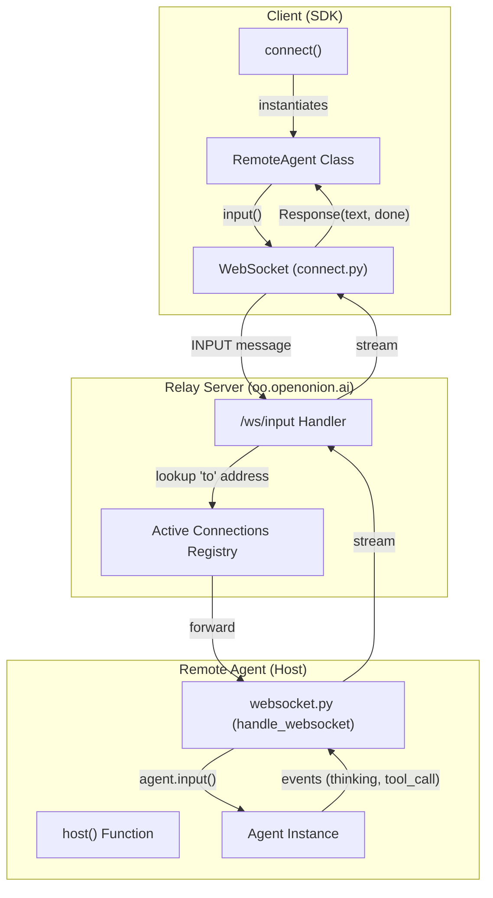
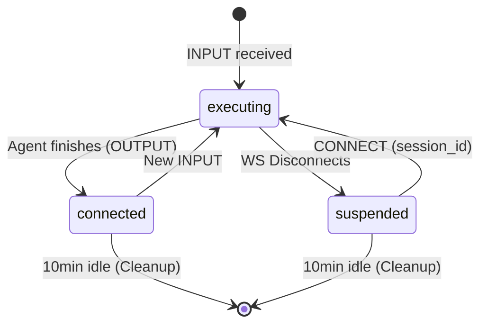

<!-- source: DeepWiki mcp.deepwiki.com · repo openonion/connectonion · page 5.2 Connecting to Remote Agents · fetched 2026-10-26 -->

# Connecting to Remote Agents

<details>
<summary>Relevant source files</summary>

The following files were used as context for generating this wiki page:

- [connectonion/network/asgi/websocket.py](connectonion/network/asgi/websocket.py)
- [connectonion/network/connect.py](connectonion/network/connect.py)
- [connectonion/network/host/session/active.py](connectonion/network/host/session/active.py)
- [docs/network/README.md](docs/network/README.md)
- [docs/network/connect.md](docs/network/connect.md)
- [docs/network/io.md](docs/network/io.md)
- [docs/network/session-reconnect.md](docs/network/session-reconnect.md)
- [docs/network/session-websocket-lifecycle.md](docs/network/session-websocket-lifecycle.md)
- [docs/network/websocket-protocol.md](docs/network/websocket-protocol.md)
- [tests/unit/test_host_session.py](tests/unit/test_host_session.py)

</details>


This page explains how to connect to and interact with remote agents using the `connect()` function and `RemoteAgent` proxy class. It covers client-side networking, the WebSocket-based message protocol, session management, and automatic reconnection.

For hosting agents as network services, see **5.1 Hosting Agents**. For trust and authentication policies, see **5.3 Trust & Authentication**.

---

## Overview

The `connect()` function creates a `RemoteAgent` proxy that communicates with a remote agent over a WebSocket. This proxy exposes an `.input()` interface that mirrors the local `Agent` class, allowing remote agents to be used as if they were running locally.

**Basic usage:**

```python
from connectonion import connect

# Connect to remote agent by its hex address
agent = connect("0x3d4017c3e843895a92b70aa74d1b7ebc9c982ccf")

# Use like a local agent
response = agent.input("Analyze this data")
print(response.text)
```

**Sources:** [connectonion/network/connect.py:111-127](), [docs/network/connect.md:72-77]()

---

## Network Architecture

ConnectOnion uses a Relay Server to route messages between clients and agents. This allows agents to be hosted behind NATs or firewalls without public IP addresses.

### Data Flow Diagram

The following diagram maps the high-level flow to specific code entities:



**Sources:** [docs/network/connect.md:9-49](), [connectonion/network/connect.py:7-15]()

---

## The Connection Protocol

The communication follows a specific lifecycle to ensure authentication and session persistence.

### WebSocket Lifecycle

1.  **CONNECT**: The client sends a `CONNECT` message first on every new WebSocket. This carries authentication (signatures) and the `session_id`.
2.  **CONNECTED**: The server responds with the session status (`new`, `running`, or `connected`).
3.  **INPUT**: The client sends the actual prompt.
4.  **STREAMING**: The agent sends real-time events (`thinking`, `tool_call`, `tool_result`).
5.  **OUTPUT**: The final result is sent, and the session enters an idle `connected` state.

### Message Reference (Client → Server)

| Type | Purpose | Key Fields |
| :--- | :--- | :--- |
| `CONNECT` | Authenticate & restore session | `session_id`, `signature`, `payload` |
| `INPUT` | Execute a task | `prompt`, `images`, `files` |
| `PONG` | Keep-alive response | (Empty) |

**Sources:** [connectonion/network/asgi/websocket.py:4-23](), [docs/network/websocket-protocol.md:9-28]()

---

## Session Management & Reconnection

One of ConnectOnion's core features is **Session Survival**. If a WebSocket drops, the agent continues running on the server.

### Active Session Registry

The server maintains an in-memory `ActiveSessionRegistry` that preserves running agents across reconnections.



**Key Mechanisms:**
*   **IO Queue Bridge**: The agent runs in a synchronous thread. Two thread-safe queues (`incoming` and `outgoing`) bridge it to the asynchronous WebSocket handler. These queues survive even if the WebSocket is closed.
*   **Heartbeat**: The server sends a `PING` every 30 seconds. The client must respond with `PONG` to prevent the session from being marked as `suspended`.
*   **Cleanup**: Sessions in `connected` or `suspended` states are removed from memory after 10 minutes of inactivity, though final results remain in `SessionStorage` (disk) for 24 hours.

**Sources:** [connectonion/network/host/session/active.py:8-15](), [docs/network/session-reconnect.md:129-143](), [connectonion/network/host/session/active.py:89-106]()

---

## Endpoint Resolution (Direct vs. Relay)

While the Relay Server is the default, the `connect()` system can resolve direct endpoints for better performance (e.g., when the client and agent are on the same local network).

### Resolution Logic

When `connect(address)` is called, the client:
1.  Queries the relay's `/api/relay/agents/{address}` endpoint to get a list of announced endpoints.
2.  Sorts endpoints by priority: `localhost` > `local network (192.168.x.x)` > `public IP`.
3.  Verifies the endpoint by calling its `/info` HTTP route to confirm the agent address matches.
4.  Upgrades to WebSocket (`ws://`) if verification succeeds.

**Sources:** [connectonion/network/connect.py:40-101](), [docs/network/connect.md:140-158]()

---

## Client-Side UI Events

The `RemoteAgent` class transforms raw network events into a format suitable for UI rendering via the `.ui` property.

| Network Event | UI Transformation |
| :--- | :--- |
| `tool_call` + `tool_result` | Merged into a single "tool" component entry |
| `thinking` | Becomes a "thinking" component |
| `ask_user` | Sets `agent.status` to `waiting` |

**Example of checking status:**
```python
agent = connect("0x...")
response = agent.input("Delete the database")

if not response.done:
    print(f"Agent is {agent.status}") # Likely 'waiting' for approval
    # The .ui list will contain the 'approval_needed' event
```

**Sources:** [connectonion/network/connect.py:156-164](), [docs/network/io.md:44-61]()

---

## Summary of Key Classes

| Class | Location | Role |
| :--- | :--- | :--- |
| `RemoteAgent` | `connectonion/network/connect.py` | Client-side proxy managing WS state and UI event transformation. |
| `ActiveSession` | `connectonion/network/host/session/active.py` | Server-side container for the agent thread and IO queues. |
| `ActiveSessionRegistry` | `connectonion/network/host/session/active.py` | Thread-safe manager for all live sessions on a host. |
| `WebSocketIO` | `connectonion/network/io.py` | Bridges the sync Agent code to the async WS protocol. |

**Sources:** [connectonion/network/connect.py:111-127](), [connectonion/network/host/session/active.py:24-32](), [connectonion/network/asgi/websocket.py:39-61]()

---

