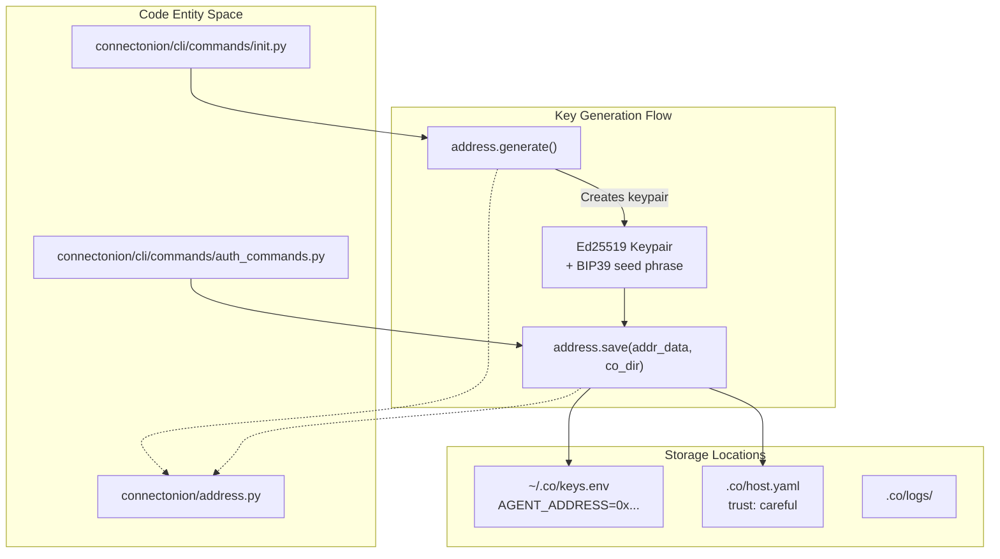
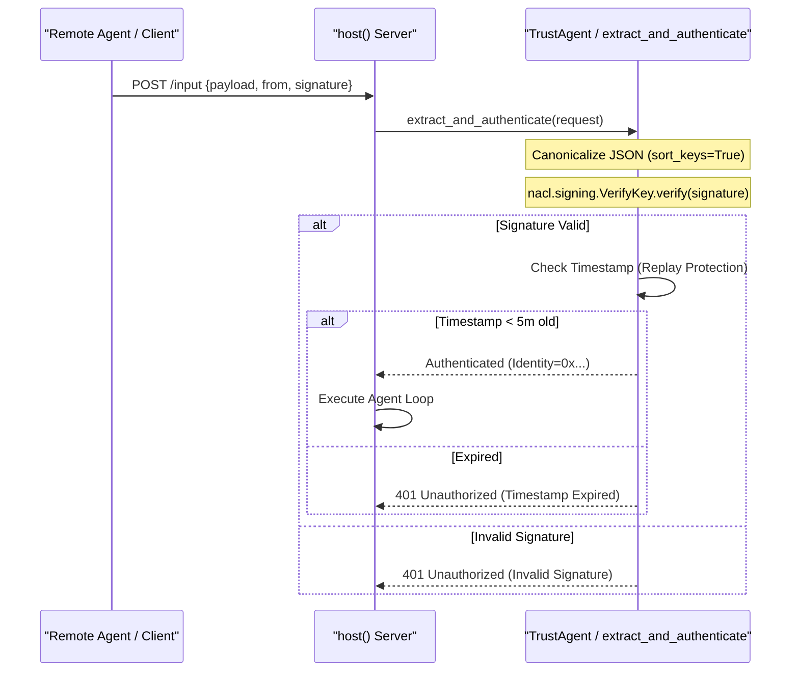
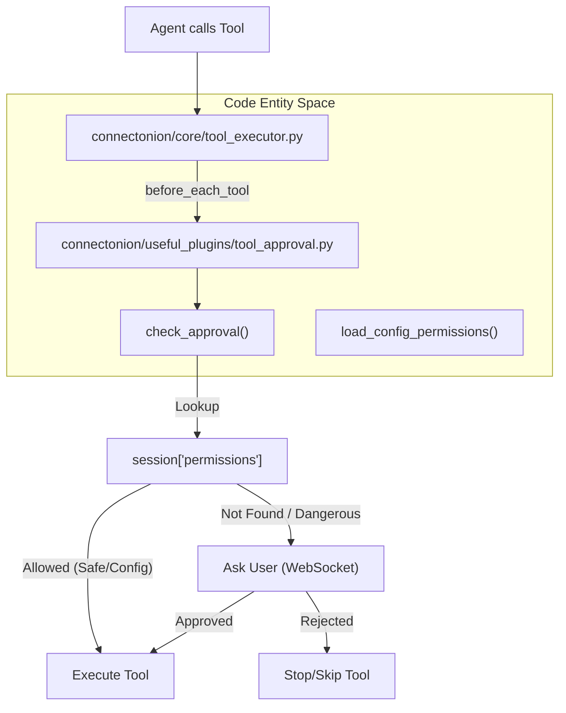

<!-- source: DeepWiki mcp.deepwiki.com · repo openonion/connectonion · page 5.3 Trust & Authentication · fetched 2026-10-26 -->

# Trust & Authentication

<details>
<summary>Relevant source files</summary>

The following files were used as context for generating this wiki page:

- [connectonion/address.py](connectonion/address.py)
- [connectonion/network/host/config.py](connectonion/network/host/config.py)
- [connectonion/network/host/host.yaml](connectonion/network/host/host.yaml)
- [docs/features/permissions.md](docs/features/permissions.md)
- [docs/network/host-config.md](docs/network/host-config.md)
- [docs/useful_plugins/tool_approval.md](docs/useful_plugins/tool_approval.md)
- [docs/windows-support.md](docs/windows-support.md)
- [tests/integration/test_config_permissions.py](tests/integration/test_config_permissions.py)
- [tests/unit/test_announce.py](tests/unit/test_announce.py)
- [tests/unit/test_decorators.py](tests/unit/test_decorators.py)
- [tests/unit/test_email_functions.py](tests/unit/test_email_functions.py)
- [tests/unit/test_trust.py](tests/unit/test_trust.py)
- [tests/unit/test_trust_agents.py](tests/unit/test_trust_agents.py)
- [tests/unit/test_xray.py](tests/unit/test_xray.py)

</details>


This page documents the cryptographic identity, message signing, and trust verification systems used in ConnectOnion's multi-agent networking. When agents communicate over the network, they can sign requests with Ed25519 signatures, and hosting agents can enforce trust policies to control access.

**Scope:** This page covers the authentication protocol, trust levels, and access control mechanisms. For deploying agents as network services, see [Hosting Agents](5.1). For connecting to remote agents, see [Connecting to Remote Agents](5.2). For the P2P relay infrastructure, see [P2P Relay System](5.4).

---

## Ed25519 Identity System

ConnectOnion uses Ed25519 public-key cryptography for agent identity. Each agent has a keypair generated during initialization and stored in the `.co/` directory.

### Keypair Structure

The identity system relies on a data structure containing the public address, signing keys, and a recovery seed.

```python
# Internal address data structure
{
    "address": "0x3d4017c3e843895a92b70aa74d1b7ebc9c982ccf2ec4968cc0cd55f12af4660c",
    "signing_key": b"...",  # Ed25519 private key bytes
    "verify_key": b"...",   # Ed25519 public key bytes
    "seed_phrase": "word1 word2 ... word12"  # BIP39 mnemonic
}
```

The `address` is the hex-encoded public key with a `0x` prefix, serving as the agent's unique identifier.

**Sources:** [connectonion/network/announce.py:26-33](), [tests/unit/test_announce.py:24-40]()

### Key Generation and Storage

The following diagram illustrates the flow from key generation to persistent storage in the file system.



**Sources:** [connectonion/network/host/config.py:51-62](), [connectonion/network/host/host.yaml:1-7](), [docs/network/host-config.md:31-41]()

---

## Message Signing Protocol

All network communications, including `ANNOUNCE` messages for discovery and `INPUT` requests for task execution, use a signed message format.

### ANNOUNCE Message Structure

When an agent announces itself to a relay, it signs a deterministic JSON representation of its metadata.

```python
# connectonion/network/announce.py
message = {
    "type": "ANNOUNCE",
    "address": address_data["address"],
    "timestamp": int(time.time()),
    "summary": summary,
    "endpoints": endpoints or [],
    "relay": relay_url
}
# Signed using sort_keys=True for determinism
```

**Sources:** [connectonion/network/announce.py:18-33](), [tests/unit/test_announce.py:85-104]()

### Signature Verification Flow

The `extract_and_authenticate` function processes incoming requests by verifying the Ed25519 signature against the message payload.



**Sources:** [tests/unit/test_trust.py:196-205](), [tests/unit/test_announce.py:71-84]()

---

## Trust Levels & Policies

ConnectOnion defines three standard trust levels that determine how the `host()` function handles incoming requests. These levels are implemented via `TrustAgent` and markdown policy files.

### Standard Trust Levels

| Level | Behavior | Environment | Source File |
|-------|----------|-------------|-------------|
| `open` | Accept all requests, even unsigned | Development | `prompts/trust/open.md` |
| `careful` | Recommend signatures, allow unsigned with warning | Staging / Default | `prompts/trust/careful.md` |
| `strict` | Require valid signatures for all requests | Production | `prompts/trust/strict.md` |

**Sources:** [connectonion/network/trust/factory.py:16-47](), [tests/unit/test_trust.py:58-69](), [docs/network/host-config.md:92-101]()

### Unified Permission System

ConnectOnion uses a unified data structure for permissions, whether they originate from `host.yaml`, user approvals, or internal "safe" tool lists.

```python
# Runtime structure in session['permissions']
{
    "tool_name": {
        "allowed": True,
        "source": "config" | "skill" | "user" | "safe",
        "reason": "description",
        "when": {"param": "pattern"},  # Granular matching
        "expires": {"type": "never" | "turn_end" | "session_end"}
    }
}
```

**Sources:** [docs/features/permissions.md:7-22](), [connectonion/network/host/host.yaml:15-22]()

### Config-Based Auto-Approval

The `host.yaml` file allows developers to pre-approve specific tools or command patterns.

```yaml
# .co/host.yaml
permissions:
  "read_file":
    allowed: true
    source: config
    reason: safe read operation
    expires: { type: never }

  "Bash(git status)":
    allowed: true
    source: config
    reason: safe git read
    expires: { type: never }
```

At runtime, `load_config_permissions` converts `Bash(command)` patterns into the internal `when` parameter matching format.

**Sources:** [connectonion/network/host/host.yaml:24-30](), [tests/integration/test_config_permissions.py:40-45](), [docs/features/permissions.md:161-185]()

---

## Tool Approval Lifecycle

The `tool_approval` plugin intercepts tool calls and checks them against the unified permission structure.



**Sources:** [docs/useful_plugins/tool_approval.md:20-63](), [tests/integration/test_config_permissions.py:146-155]()

---

## Authentication with OpenOnion Backend

The `co auth` command handles authentication with the central OpenOnion backend to enable managed LLM keys and email services.

### API Key and Email Activation

The system uses environment variables for authenticated services:
- `OPENONION_API_KEY`: A JWT token obtained via Ed25519 signature challenge.
- `AGENT_EMAIL`: The assigned agent email address for the `send_email` tool.

```python
# Example: Email tool checking activation
def test_send_email_not_activated(mock_post):
    mock_response.status_code = 403
    mock_response.json.return_value = {"detail": "Email not activated. Run 'co auth' to activate."}
    # ...
```

**Sources:** [tests/unit/test_email_functions.py:38-57](), [tests/unit/test_email_functions.py:59-73]()

---

## Security Best Practices

1. **Environment-Based Trust**: Use `CONNECTONION_ENV` to automatically set trust levels (`production` defaults to `strict`). [tests/unit/test_trust.py:76-100]()
2. **Deterministic Signing**: Always use `sort_keys=True` when serializing JSON for signatures to prevent verification failure due to key ordering. [tests/unit/test_announce.py:85-104]()
3. **Replay Protection**: Ensure system clocks are synchronized as the server rejects timestamps older than 5 minutes. [tests/unit/test_announce.py:56-69]()
4. **Granular Permissions**: Use the `when` field in `host.yaml` to restrict tools like `write` to specific file patterns (e.g., `*.md`). [docs/features/permissions.md:93-101]()
5. **Tool-Level Approvals**: Remember that user approvals via the `tool_approval` plugin are tool-level (e.g., approving one `bash` command approves all `bash` commands for that session). [docs/features/permissions.md:61-80]()

**Sources:** [connectonion/network/host/config.py:116-153](), [docs/useful_plugins/tool_approval.md:143-187]()

---

