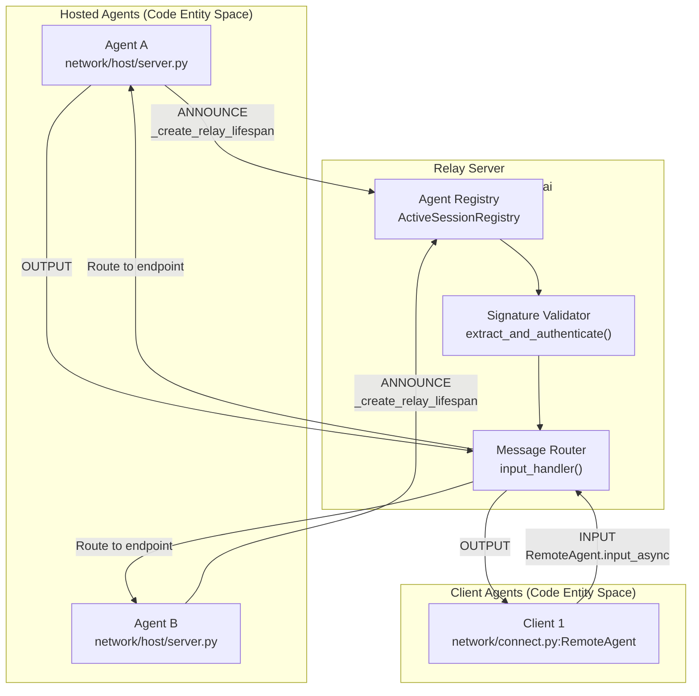
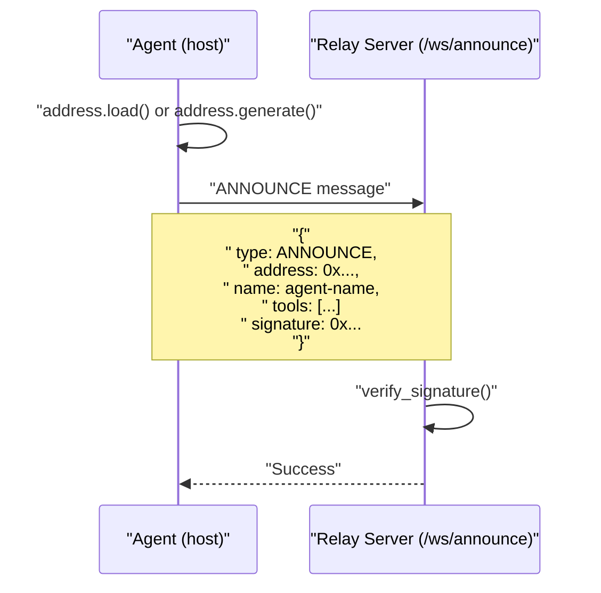
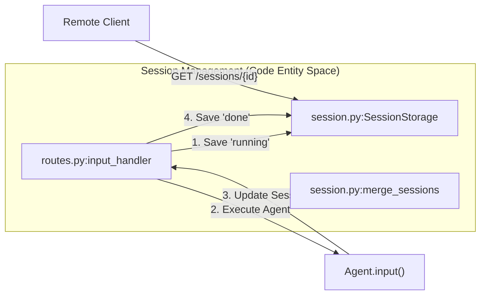

<!-- source: DeepWiki mcp.deepwiki.com · repo openonion/connectonion · page 5.4 P2P Relay System · fetched 2026-10-26 -->

# P2P Relay System

<details>
<summary>Relevant source files</summary>

The following files were used as context for generating this wiki page:

- [connectonion/network/asgi/http.py](connectonion/network/asgi/http.py)
- [connectonion/network/host/routes.py](connectonion/network/host/routes.py)
- [connectonion/network/host/server.py](connectonion/network/host/server.py)
- [docs/design-decisions/022-raw-asgi-implementation.md](docs/design-decisions/022-raw-asgi-implementation.md)
- [tests/integration/test_host.py](tests/integration/test_host.py)
- [tests/integration/test_host_ws.py](tests/integration/test_host_ws.py)
- [tests/unit/test_asgi.py](tests/unit/test_asgi.py)
- [tests/unit/test_asgi_http.py](tests/unit/test_asgi_http.py)
- [tests/unit/test_asgi_websocket_admin_onboard.py](tests/unit/test_asgi_websocket_admin_onboard.py)
- [tests/unit/test_connect.py](tests/unit/test_connect.py)
- [tests/unit/test_host_relay.py](tests/unit/test_host_relay.py)
- [tests/unit/test_host_routes.py](tests/unit/test_host_routes.py)

</details>


**Purpose**: The P2P Relay System provides agent discovery and message routing infrastructure that enables ConnectOnion agents to communicate across networks. It acts as a central WebSocket server that maintains an agent registry, routes messages between agents, and handles authentication via Ed25519 signatures.

**Scope**: This document covers the relay server protocol, agent announcement mechanism, message routing, and security features. For information about hosting agents on the relay, see [Hosting Agents](#5.1). For connecting to remote agents via the relay, see [Connecting to Remote Agents](#5.2). For authentication details, see [Trust & Authentication](#5.3).

---

## Architecture Overview

The relay system forms the networking backbone of ConnectOnion's multi-agent infrastructure. It bridges the gap between agents hosted behind NAT/firewalls and clients wishing to reach them.



**Sources**: [connectonion/network/host/server.py:7-8](), [connectonion/network/host/server.py:117-128](), [connectonion/network/connect.py:28-29]()

---

## Relay Server Endpoints

The production relay server at `wss://oo.openonion.ai` provides two primary communication patterns:

| Endpoint | Purpose | Used By |
|----------|---------|---------|
| `/ws/announce` | Agent registration and discovery | `host()` for announcing agent availability |
| `/ws/input` | Task submission and routing | `connect()` for sending tasks to remote agents |
| `/info` | Metadata discovery | Clients fetching agent capabilities (tools, model) |

**Default Configuration**:
The system defaults to `wss://oo.openonion.ai` unless overridden in the `host()` call.
[connectonion/network/host/server.py:8]()

---

## Message Protocol

### ANNOUNCE Message

When an agent calls `host(agent)`, it automatically initiates a relay connection if a `relay_url` is provided. This process involves loading or generating Ed25519 keys for the agent's identity.



In `server.py`, the relay connection is managed as a background task via `_create_relay_lifespan`.
[connectonion/network/host/server.py:76-79](), [tests/unit/test_host_relay.py:64-70]()

### INPUT/OUTPUT Message Flow

The `input_handler` in `routes.py` is the core logic for processing incoming tasks, whether they arrive via direct HTTP or a relayed WebSocket.

1. **INPUT**: The client sends a prompt, often accompanied by a `session_id`.
2. **Processing**: The server calls `create_agent()` to get a fresh instance for isolation.
3. **OUTPUT**: The result is returned to the client and persisted in `SessionStorage`.

```python
# connectonion/network/host/routes.py:27-29
def input_handler(create_agent: Callable, storage: SessionStorage, prompt: str, result_ttl: int,
                  session: dict | None = None, connection=None, images: list[str] | None = None,
                  files: list[dict] | None = None) -> dict:
```

**Sources**: [connectonion/network/host/routes.py:27-53](), [connectonion/network/host/server.py:133-139]()

---

## Agent Discovery & Metadata

### Address Management
Agents are identified by Ed25519 public keys. If no keys exist in the `.co/` directory, `host()` generates them automatically.
[tests/unit/test_host_relay.py:84-91]()

### Info Endpoint
The `/info` route provides a way for clients to discover an agent's capabilities before sending a task. It returns:
- Agent name and address
- Available tools and "skills"
- Supported LLM model
- Accepted input types (text, images, files)
- Trust level requirements (onboard info)

[connectonion/network/host/routes.py:134-168]()

---

## Session Persistence and Recovery

The relay system is designed for reliability. If a WebSocket connection drops during a long-running task, the result is not lost.

1. **Storage**: All results are saved to `SessionStorage` (typically a `.jsonl` file).
2. **Recovery**: Clients can poll `GET /sessions/{id}` to retrieve results after a disconnect.
3. **State Sync**: The `merge_sessions` utility ensures that conversation history is synchronized between the client's local state and the server's record.



**Sources**: [connectonion/network/host/routes.py:63-69](), [connectonion/network/host/routes.py:96-101](), [connectonion/network/host/session.py:24]()

---

## Security & Trust

### Signature Verification
The `extract_and_authenticate` function is the gatekeeper for all hosted routes. It verifies the Ed25519 signature of the incoming request against the claimed sender address.
[connectonion/network/host/server.py:38](), [connectonion/network/host/server.py:156]()

### Onboarding Flow
When an agent is in `careful` or `strict` mode, the relay system can trigger an onboarding flow. If a user is "forbidden," the server sends an `ONBOARD_REQUIRED` message via WebSocket, detailing the required invite code or payment.

[tests/unit/test_asgi_websocket_admin_onboard.py:58-88](), [tests/unit/test_asgi_websocket_admin_onboard.py:149-164]()

---

## Implementation Details: Raw ASGI

ConnectOnion uses a raw ASGI implementation rather than a framework like FastAPI to maintain zero dependencies and full protocol control.

- **HTTP Routing**: Handled in `connectonion/network/asgi/http.py` via `handle_http`.
- **WebSocket Pumping**: The `_pipe_ws_io` function in `asgi.py` manages the bidirectional flow between the ASGI `receive/send` channels and the agent's `WebSocketIO` object.
- **CORS**: Manually implemented to allow cross-origin requests from web-based agent controllers.

[connectonion/network/asgi/http.py:102-128](), [connectonion/network/asgi/http.py:58-62](), [connectonion/network/asgi/__init__.py:22]()

**Sources**: [docs/design-decisions/022-raw-asgi-implementation.md:107-122](), [tests/unit/test_asgi.py:81-110]()

---

