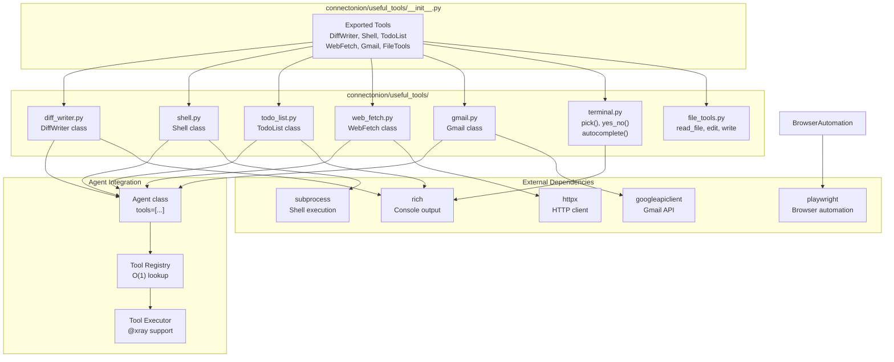
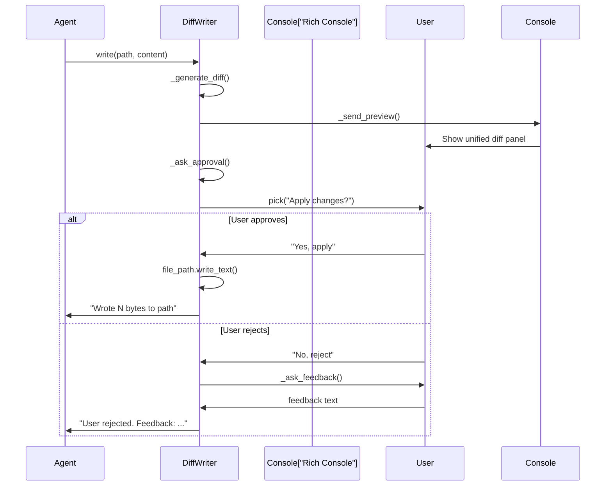

<!-- source: DeepWiki mcp.deepwiki.com · repo openonion/connectonion · page 6 Built-in Tools & Agents · fetched 2026-10-26 -->

# Built-in Tools & Agents

Relevant source files

The following files were used as context for generating this wiki page:

- [connectonion/cli/browser_agent/__init__.py](connectonion/cli/browser_agent/__init__.py)
- [connectonion/cli/browser_agent/agent.py](connectonion/cli/browser_agent/agent.py)
- [connectonion/cli/commands/browser_commands.py](connectonion/cli/commands/browser_commands.py)
- [connectonion/useful_plugins/shell_approval.py](connectonion/useful_plugins/shell_approval.py)
- [connectonion/useful_tools/__init__.py](connectonion/useful_tools/__init__.py)
- [connectonion/useful_tools/browser_tools/browser.py](connectonion/useful_tools/browser_tools/browser.py)
- [connectonion/useful_tools/diff_writer.py](connectonion/useful_tools/diff_writer.py)
- [connectonion/useful_tools/gmail.py](connectonion/useful_tools/gmail.py)
- [connectonion/useful_tools/shell.py](connectonion/useful_tools/shell.py)
- [connectonion/useful_tools/terminal.py](connectonion/useful_tools/terminal.py)
- [connectonion/useful_tools/todo_list.py](connectonion/useful_tools/todo_list.py)
- [connectonion/useful_tools/web_fetch.py](connectonion/useful_tools/web_fetch.py)

**Purpose and Scope**: This document provides an overview of the pre-built tools and specialized agents included with ConnectOnion. These components are production-ready implementations that cover common agent capabilities: file manipulation, shell execution, task tracking, web fetching, email management, and browser automation.

For detailed usage of individual tools, see:
- Terminal utilities (DiffWriter, pick, yes_no, etc.): [Useful Tools Reference](#6.1)
- Gmail integration and OAuth setup: [Gmail Integration](#6.2)
- Browser automation with Playwright: [Browser Agent](#6.3)
- Complete agent example with ReAct plugin: [Email Agent Example](#6.4)

For information about creating custom tools, see [Tools System](#3.3). For extending agent behavior, see [Plugin System](#3.5).

---

## Tool Architecture

ConnectOnion ships with two categories of built-in capabilities:

1. **Useful Tools**: Reusable tool classes and functions exported via `connectonion.useful_tools` [connectonion/useful_tools/__init__.py:1-73]().
2. **Specialized Agents**: Complete agent implementations, such as the `BrowserAutomation` agent used by the CLI [connectonion/cli/browser_agent/agent.py:19-45]().

All tools follow the same integration pattern established by the framework's tool system, supporting both function-based and class-based implementations with automatic schema generation.

**Tool Integration Pattern**

**Sources**: [connectonion/useful_tools/__init__.py:11-73](), [connectonion/useful_tools/diff_writer.py:44-63](), [connectonion/useful_tools/shell.py:30-41](), [connectonion/useful_tools/todo_list.py:28-46](), [connectonion/useful_tools/web_fetch.py:35-44](), [connectonion/useful_tools/gmail.py:62-93](), [connectonion/useful_tools/browser_tools/browser.py:50-81]()

---

## Tool Categories

### Human-in-the-Loop Tools

Tools that pause agent execution for user approval or input, enabling safe automation with human oversight.

| Tool | Purpose | Key Methods | User Interaction |
|------|---------|-------------|------------------|
| `DiffWriter` | File writing with diff display | `write(path, content)` | Shows unified diff, prompts for approval [connectonion/useful_tools/diff_writer.py:65-110]() |
| `pick` | Single-keypress selection | `pick(title, options)` | Arrow keys + Enter or number keys [connectonion/useful_tools/terminal.py:94-116]() |
| `yes_no` | Binary confirmation | `yes_no(message, default)` | Single keypress (y/n) [connectonion/useful_tools/terminal.py:186-200]() |
| `ask_user` | General feedback | `ask_user(question)` | Blocks for agent.io input [connectonion/useful_tools/diff_writer.py:178-186]() |

**DiffWriter Workflow**

**Sources**: [connectonion/useful_tools/diff_writer.py:65-110](), [connectonion/useful_tools/terminal.py:94-184]()

### System Interaction Tools

Tools that execute system-level operations.

| Tool | Purpose | Key Methods | Capabilities |
|------|---------|-------------|--------------|
| `Shell` | Execute shell commands | `run(command)` | Captures stdout/stderr via `subprocess.run` [connectonion/useful_tools/shell.py:41-65]() |
| `bash` | Unix-specific shell | `bash(command)` | Optimized for bash environments [connectonion/useful_tools/__init__.py:20]() |
| `FileTools` | Claude-style file ops | `read_file`, `edit`, `write` | High-level file manipulation [connectonion/useful_tools/__init__.py:29-37]() |

**Shell Approval Plugin**: The `shell_approval` plugin [connectonion/useful_plugins/shell_approval.py:167]() wraps the `Shell` tool to provide human-in-the-loop safety. It automatically bypasses approval for safe commands like `ls`, `cat`, or `pwd` [connectonion/useful_plugins/shell_approval.py:35-84]().

**Sources**: [connectonion/useful_tools/shell.py:30-92](), [connectonion/useful_plugins/shell_approval.py:87-163]()

### Progress Tracking Tools

Tools for visualizing multi-step task progress.

| Tool | Purpose | Key Methods | Display |
|------|---------|-------------|---------|
| `TodoList` | Track task progress | `add()`, `start()`, `complete()` | Rich panel with status indicators (○ pending, ◐ in progress, ● completed) [connectonion/useful_tools/todo_list.py:28-110]() |

**Sources**: [connectonion/useful_tools/todo_list.py:20-242]()

### Web & Browser Tools

Tools for HTTP requests, web analysis, and browser automation.

| Tool | Purpose | Key Methods | Features |
|------|---------|-------------|----------|
| `WebFetch` | Fetch and parse pages | `fetch(url)`, `strip_tags()` | Uses `httpx` for requests [connectonion/useful_tools/web_fetch.py:46-66]() |
| `BrowserAutomation` | Playwright automation | `navigate()`, `click()`, `screenshot()` | Natural language element finding via vision LLM [connectonion/useful_tools/browser_tools/browser.py:50-81]() |

**Sources**: [connectonion/useful_tools/web_fetch.py:35-217](), [connectonion/useful_tools/browser_tools/browser.py:12-22]()

### Communication Tools

Tools for email and calendar management.

| Tool | Purpose | Key Methods | OAuth Setup |
|------|---------|-------------|-------------|
| `Gmail` | Read/send Gmail | `read_inbox()`, `send()` | `co auth google` [connectonion/useful_tools/gmail.py:62-93]() |
| `Outlook` | Outlook email | `Outlook()` | `co auth microsoft` [connectonion/useful_tools/__init__.py:16]() |

**Sources**: [connectonion/useful_tools/gmail.py:62-138](), [connectonion/useful_tools/__init__.py:11-21]()

---

## Specialized Agents

### Browser Agent
The Browser Agent is a specialized implementation that uses `BrowserAutomation` to perform complex web tasks. It uses a persistent profile at `~/.co/browser_profile/` to maintain sessions across runs [connectonion/useful_tools/browser_tools/browser.py:101-104]().

**Execution Flow**:
1. CLI receives command via `handle_browser` [connectonion/cli/commands/browser_commands.py:17-28]().
2. `execute_browser_command` initializes a ConnectOnion `Agent` with `BrowserAutomation` as a tool [connectonion/cli/browser_agent/agent.py:19-45]().
3. The agent uses a vision-capable model (e.g., `co/gemini-3-flash-preview`) to locate elements based on natural language descriptions [connectonion/cli/browser_agent/agent.py:38]().

For details, see [Browser Agent](#6.3).

### Email Agent
The Email Agent example demonstrates the use of the `ReAct` plugin to coordinate multiple tools (Gmail, WebFetch, DiffWriter) to handle complex inbox management tasks.

For details, see [Email Agent Example](#6.4).

---

## Tool Quick Reference

**All Built-in Tools by Module [connectonion/useful_tools/__init__.py:39-73]()**

| Module | Exports | Purpose |
|--------|---------|---------|
| `diff_writer` | `DiffWriter` | Human-in-the-loop file writing |
| `shell` | `Shell`, `bash` | Command execution |
| `todo_list` | `TodoList` | Task progress tracking |
| `web_fetch` | `WebFetch` | Web scraping and analysis |
| `gmail` | `Gmail` | Gmail API integration |
| `terminal` | `pick`, `yes_no` | CLI input utilities |
| `file_tools` | `read_file`, `edit`, `write` | Claude-style file operations |

**Sources**: [connectonion/useful_tools/__init__.py:1-73]()

---

## Next Steps

- **Detailed Tool Documentation**: See [Useful Tools Reference](#6.1) for comprehensive method documentation and examples.
- **Gmail OAuth Setup**: See [Gmail Integration](#6.2) for authentication flow and scope configuration.
- **Browser Automation**: See [Browser Agent](#6.3) for Playwright integration and natural language selectors.
- **Complete Example**: See [Email Agent Example](#6.4) for a full agent implementation with ReAct reasoning.

---

