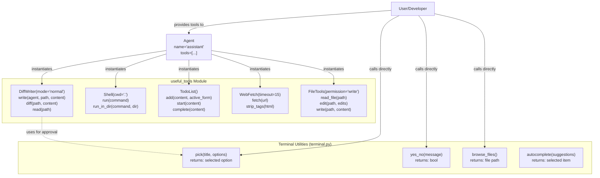
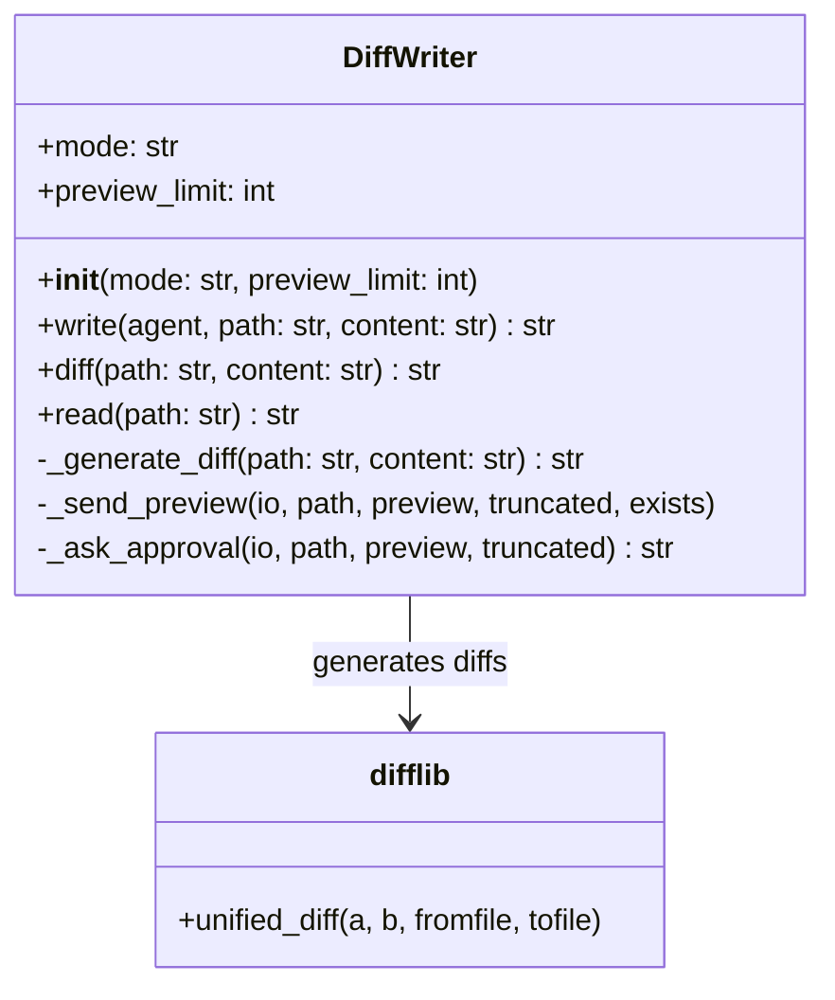
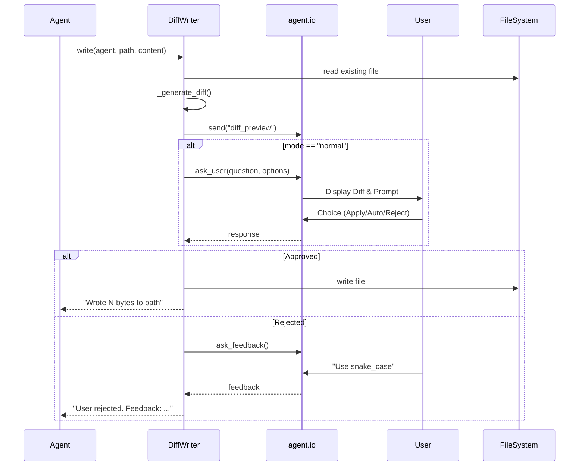
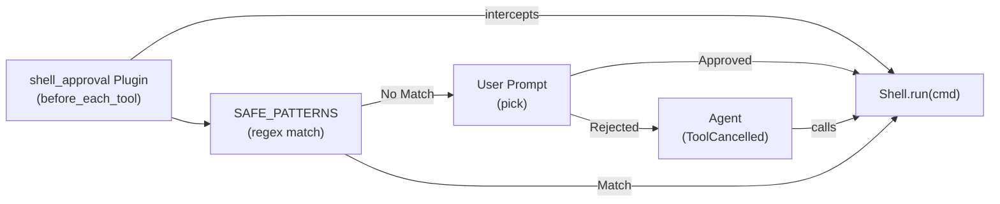

<!-- source: DeepWiki mcp.deepwiki.com · repo openonion/connectonion · page 6.1 Useful Tools Reference · fetched 2026-10-26 -->

# Useful Tools Reference

Relevant source files

The following files were used as context for generating this wiki page:

- [CHANGELOG.md](CHANGELOG.md)
- [connectonion/useful_plugins/shell_approval.py](connectonion/useful_plugins/shell_approval.py)
- [connectonion/useful_tools/__init__.py](connectonion/useful_tools/__init__.py)
- [connectonion/useful_tools/browser_tools/scroll.py](connectonion/useful_tools/browser_tools/scroll.py)
- [connectonion/useful_tools/diff_writer.py](connectonion/useful_tools/diff_writer.py)
- [connectonion/useful_tools/file_tools/README.md](connectonion/useful_tools/file_tools/README.md)
- [connectonion/useful_tools/file_tools/__init__.py](connectonion/useful_tools/file_tools/__init__.py)
- [connectonion/useful_tools/file_tools/edit.py](connectonion/useful_tools/file_tools/edit.py)
- [connectonion/useful_tools/file_tools/file_tools.py](connectonion/useful_tools/file_tools/file_tools.py)
- [connectonion/useful_tools/file_tools/glob.py](connectonion/useful_tools/file_tools/glob.py)
- [connectonion/useful_tools/file_tools/grep.py](connectonion/useful_tools/file_tools/grep.py)
- [connectonion/useful_tools/file_tools/multi_edit.py](connectonion/useful_tools/file_tools/multi_edit.py)
- [connectonion/useful_tools/file_tools/read.py](connectonion/useful_tools/file_tools/read.py)
- [connectonion/useful_tools/gmail.py](connectonion/useful_tools/gmail.py)
- [connectonion/useful_tools/shell.py](connectonion/useful_tools/shell.py)
- [connectonion/useful_tools/terminal.py](connectonion/useful_tools/terminal.py)
- [connectonion/useful_tools/todo_list.py](connectonion/useful_tools/todo_list.py)
- [connectonion/useful_tools/web_fetch.py](connectonion/useful_tools/web_fetch.py)
- [docs/useful_tools/README.md](docs/useful_tools/README.md)
- [docs/useful_tools/diff_writer.md](docs/useful_tools/diff_writer.md)
- [docs/useful_tools/shell.md](docs/useful_tools/shell.md)
- [docs/useful_tools/web_fetch.md](docs/useful_tools/web_fetch.md)
- [tests/cli/test_cli_help.py](tests/cli/test_cli_help.py)

## Purpose and Scope

This page documents the general-purpose tools provided in the `connectonion/useful_tools/` module. These tools extend agent capabilities with file operations, shell execution, task tracking, web fetching, and interactive terminal inputs. 

For Gmail integration specifically, see [Gmail Integration](#6.2). For browser automation, see [Browser Agent](#6.3).

---

## Tool Architecture Overview

ConnectOnion provides a collection of reusable tools that agents can use to interact with the filesystem, execute commands, track progress, and fetch web content. All tools follow the same integration pattern: instantiate the tool class and pass it to the agent's `tools` parameter [connectonion/useful_tools/__init__.py:11-37]().

**Tool Integration Pattern Diagram**

**Sources:** [connectonion/useful_tools/diff_writer.py:44-63](), [connectonion/useful_tools/shell.py:30-41](), [connectonion/useful_tools/todo_list.py:28-47](), [connectonion/useful_tools/terminal.py:94-286](), [connectonion/useful_tools/__init__.py:1-73]()

---

## FileTools - Claude Code-style Operations

The `FileTools` class provides a unified interface for file operations with safety tracking and permission control. It is the modern successor to `DiffWriter` for complex editing tasks [CHANGELOG.md:9-15]().

### Key Features

| Feature | Description |
|---------|-------------|
| **Read-Before-Edit** | Prevents editing files that haven't been read first to ensure context [CHANGELOG.md:11]() |
| **Stale Read Detection** | Uses MD5 hash snapshots to detect if a file changed externally since reading [CHANGELOG.md:12]() |
| **Permission Modes** | Supports `write` (full access) and `read` (read-only) modes [CHANGELOG.md:13]() |
| **Atomic Multi-Edit** | All edits in a `multi_edit` call succeed or none are applied [CHANGELOG.md:39]() |

### API Reference

- **`read_file(path, offset, limit)`**: Read file content with pagination support [connectonion/useful_tools/__init__.py:31]().
- **`write(path, content)`**: Create a NEW file. Returns an error if the file already exists, guiding agents to use `edit()` instead [CHANGELOG.md:22]().
- **`edit(path, edits)`**: Apply string replacements to an existing file [connectonion/useful_tools/__init__.py:32]().
- **`glob(pattern)`**: Find files matching a pattern [connectonion/useful_tools/__init__.py:35]().
- **`grep(query)`**: Search for text within files [connectonion/useful_tools/__init__.py:36]().

**Sources:** [CHANGELOG.md:9-42](), [connectonion/useful_tools/__init__.py:28-37]()

---

## DiffWriter - Interactive File Writing

The `DiffWriter` class provides file writing capabilities with diff preview and user approval, enabling human oversight of agent-generated code changes.

### Permission Modes

`DiffWriter` supports three modes [connectonion/useful_tools/diff_writer.py:39-41]():
- **`normal`**: Prompt for every edit (default).
- **`auto`**: Auto-approve all edits without prompting.
- **`plan`**: Read-only mode; only shows what would happen.

### API Reference

**DiffWriter Class Diagram**

**Methods:**

- **`write(agent, path: str, content: str) -> str`**: Write file with diff preview and approval. It automatically injects the `agent` parameter via the tool executor to communicate with the frontend [connectonion/useful_tools/diff_writer.py:65-78]().
- **`diff(path: str, content: str) -> str`**: Preview diff without writing [connectonion/useful_tools/diff_writer.py:112-125]().
- **`read(path: str) -> str`**: Read file contents [connectonion/useful_tools/diff_writer.py:127-139]().

### Approval Workflow

**DiffWriter Approval Flow Diagram**

**Sources:** [connectonion/useful_tools/diff_writer.py:65-110](), [connectonion/useful_tools/diff_writer.py:146-186]()

---

## Shell - Command Execution

The `Shell` class enables agents to execute terminal commands and capture output.

### Key Features

| Feature | Description |
|---------|-------------|
| **Command Execution** | Run any shell command via `subprocess.run(shell=True)` [connectonion/useful_tools/shell.py:54-61]() |
| **Output Capture** | Returns combined stdout + stderr [connectonion/useful_tools/shell.py:49]() |
| **Timeout Control** | Default 120s, max 600s [connectonion/useful_tools/shell.py:41-51]() |
| **Output Truncation** | Limits output to 10,000 characters to prevent token overflow [connectonion/useful_tools/shell.py:107-110]() |

### Safety with `shell_approval` Plugin

To prevent destructive commands, the `shell_approval` plugin can be used. It intercepts shell tools and asks for user approval unless the command matches a `SAFE_PATTERNS` list (e.g., `ls`, `cat`, `grep`, `git status`) [connectonion/useful_plugins/shell_approval.py:35-84]().

**Shell Command Security Diagram**

**Sources:** [connectonion/useful_tools/shell.py:30-111](), [connectonion/useful_plugins/shell_approval.py:1-167]()

---

## TodoList - Task Tracking

The `TodoList` class provides visual task tracking for multi-step agent workflows.

### Key Features

| Feature | Description |
|---------|-------------|
| **Status Tracking** | Three states: `pending` (○), `in_progress` (◐), `completed` (●) [connectonion/useful_tools/todo_list.py:180-186]() |
| **Visual Display** | Rich-formatted table with status indicators [connectonion/useful_tools/todo_list.py:196-223]() |
| **Single Active Task** | Enforces one `in_progress` task at a time [connectonion/useful_tools/todo_list.py:86-88]() |

**Methods:**

- **`add(content, active_form)`**: Add a new task [connectonion/useful_tools/todo_list.py:48-67]().
- **`start(content)`**: Mark a task as in progress [connectonion/useful_tools/todo_list.py:69-93]().
- **`complete(content)`**: Mark a task as finished [connectonion/useful_tools/todo_list.py:94-110]().
- **`list()`**: Get all todos as formatted text [connectonion/useful_tools/todo_list.py:128-142]().

**Sources:** [connectonion/useful_tools/todo_list.py:28-223]()

---

## WebFetch - Web Content Retrieval

The `WebFetch` class provides web page fetching and parsing capabilities.

### Key Features

| Feature | Description |
|---------|-------------|
| **HTTP Requests** | Fetches raw HTML using `httpx` [connectonion/useful_tools/web_fetch.py:35-50]() |
| **Content Extraction** | `strip_tags` removes scripts/styles to reduce token count [connectonion/useful_tools/web_fetch.py:52-65]() |
| **LLM Analysis** | `analyze_page` uses LLM to summarize website purpose [connectonion/useful_tools/web_fetch.py:160-185]() |

**Sources:** [connectonion/useful_tools/web_fetch.py:1-217]()

---

## Terminal Utilities - Interactive Inputs

The terminal utilities in `connectonion/useful_tools/terminal.py` provide interactive CLI prompts for human-in-the-loop workflows.

| Function | Purpose |
|----------|---------|
| `pick(title, options)` | Single keypress selection via arrow keys or numbers [connectonion/useful_tools/terminal.py:94-116]() |
| `yes_no(message)` | Binary confirmation (y/n) [connectonion/useful_tools/terminal.py:186-213]() |
| `browse_files()` | Interactive file system navigator [connectonion/useful_tools/terminal.py:40-44]() |
| `input_with_at(prompt)` | Standard input with `@` triggering the file browser [connectonion/useful_tools/terminal.py:45-49]() |

**Sources:** [connectonion/useful_tools/terminal.py:11-286]()

---

