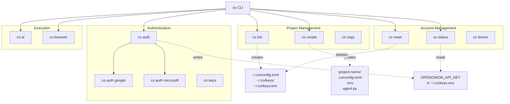

<!-- source: DeepWiki mcp.deepwiki.com · repo openonion/connectonion · page 7 CLI Reference · fetched 2026-10-26 -->

# CLI Reference

<details>
<summary>Relevant source files</summary>

The following files were used as context for generating this wiki page:

- [VERSIONING.md](VERSIONING.md)
- [connectonion/__init__.py](connectonion/__init__.py)
- [connectonion/cli/co_ai/agent.py](connectonion/cli/co_ai/agent.py)
- [connectonion/cli/commands/auth_commands.py](connectonion/cli/commands/auth_commands.py)
- [connectonion/cli/commands/create.py](connectonion/cli/commands/create.py)
- [connectonion/cli/commands/init.py](connectonion/cli/commands/init.py)
- [connectonion/cli/commands/project_cmd_lib.py](connectonion/cli/commands/project_cmd_lib.py)
- [connectonion/cli/commands/reset_commands.py](connectonion/cli/commands/reset_commands.py)
- [connectonion/cli/commands/status_commands.py](connectonion/cli/commands/status_commands.py)
- [connectonion/cli/main.py](connectonion/cli/main.py)
- [pyproject.toml](pyproject.toml)

</details>


This page provides a complete reference for all ConnectOnion CLI commands and their options. The CLI (`co`) is the primary interface for project management, authentication, and agent deployment.

For detailed guides on specific command categories, see:
- Project creation and initialization: [Project Commands](#7.1)
- Authentication and OAuth: [Authentication Commands](#7.2)
- Browser automation: [Browser Commands](#7.3)
- Account management: [Status & Management](#7.4)

---

## Command Structure

The ConnectOnion CLI is built using the `typer` framework [connectonion/cli/main.py:26](). It follows a consistent command structure with global flags and subcommand-specific options:

```
co [global-flags] <command> [command-options] [arguments]
```

### Global Flags

| Flag | Description | Default |
|------|-------------|---------|
| `--version`, `-v` | Display ConnectOnion version | `false` |
| `--help` | Show help for any command | N/A |

Sources: [connectonion/cli/main.py:38-42]()

---

## Command Overview

### Command Categories



**Command Flow Overview**

Sources: [connectonion/cli/main.py:45-160](), [connectonion/cli/commands/init.py:120-125](), [connectonion/cli/commands/create.py:118-123](), [connectonion/cli/commands/auth_commands.py:84-94](), [connectonion/cli/commands/status_commands.py:77-87](), [connectonion/cli/commands/reset_commands.py:26-35]()

---

## Quick Reference Table

| Command | Purpose | Modifies | Network Call |
|---------|---------|----------|--------------|
| `co init` | Add ConnectOnion to current directory | `.co/`, `.env`, `~/.co/` | ✓ (auth) |
| `co create <name>` | Create new project in new directory | `<name>/`, `~/.co/` | ✓ (auth) |
| `co auth` | Authenticate with OpenOnion backend | `~/.co/keys.env` | ✓ |
| `co auth google` | Connect Google OAuth | `.env`, `~/.co/keys.env` | ✓ |
| `co auth microsoft` | Connect Microsoft OAuth | `.env`, `~/.co/keys.env` | ✓ |
| `co status` | Display account balance and usage | None | ✓ |
| `co reset` | Delete global config and create new account | `~/.co/` (delete all) | ✓ |
| `co browser <cmd>` | Execute browser automation command | None | ✗ |
| `co ai [prompt]` | Launch the coding agent | `~/.co/logs/` | ✓ (LLM) |

Sources: [connectonion/cli/main.py:56-67](), [connectonion/cli/main.py:161-170]()

---

## Project Commands

### `co init`

Initialize ConnectOnion in the current directory. This adds the `.co/` configuration folder and authentication setup to an existing project.

**Syntax:**
```bash
co init [options]
```

**Options:**

| Option | Type | Description | Default |
|--------|------|-------------|---------|
| `--template`, `-t` | string | Template: `minimal`, `playwright`, `custom` | `none` |
| `--description` | string | Description for custom template | None |
| `--yes`, `-y` | flag | Skip all prompts | `false` |
| `--force` | flag | Overwrite existing files | `false` |
| `--key` | string | API key to use | Auto-detect |

**Behavior:**

1. **Global Setup**: Creates `~/.co/` and generates Ed25519 keypair via `address.generate()` if not present [connectonion/cli/commands/init.py:61-68]().
2. **Authentication**: Calls `authenticate()` to obtain an `OPENONION_API_KEY` [connectonion/cli/commands/init.py:245]().
3. **Local Setup**: Creates `.co/config.toml` and `.env` [connectonion/cli/commands/init.py:369-393]().

For details, see [Project Commands](#7.1).

Sources: [connectonion/cli/main.py:73-83](), [connectonion/cli/commands/init.py:120-150]()

---

### `co create`

Create a new ConnectOnion project in a new directory.

**Syntax:**
```bash
co create <name> [options]
```

**Options:**

| Option | Type | Description | Default |
|--------|------|-------------|---------|
| `name` | string | Project directory name | Interactive prompt |
| `--template`, `-t` | string | Template: `minimal`, `playwright`, `custom` | `minimal` |
| `--yes`, `-y` | flag | Skip all prompts | `false` |

**Behavior:**

1. **Validation**: Validates the project name [connectonion/cli/commands/create.py:283-287]().
2. **Directory Creation**: Creates a new folder and populates it with template files [connectonion/cli/commands/create.py:321-349]().

For details, see [Project Commands](#7.1).

Sources: [connectonion/cli/main.py:86-97](), [connectonion/cli/commands/create.py:118-130]()

---

## Authentication Commands

### `co auth`

Authenticate with OpenOnion backend to obtain a JWT token for managed keys (`co/*` models).

**Syntax:**
```bash
co auth [service]
```

**Arguments:**
- `service`: Optional. Can be `google` or `microsoft` for OAuth flows [connectonion/cli/main.py:107-118]().

**Behavior:**
Uses the agent's Ed25519 keypair to sign an authentication message [connectonion/cli/commands/auth_commands.py:103-107](). The signature is verified by `https://oo.openonion.ai/api/v1/auth` [connectonion/cli/commands/auth_commands.py:109-115]().

For details, see [Authentication Commands](#7.2).

Sources: [connectonion/cli/commands/auth_commands.py:84-115](), [connectonion/cli/main.py:107-118]()

---

## Browser Commands

### `co browser`

Execute browser automation commands using natural language.

**Syntax:**
```bash
co browser <command> [options]
```

**Options:**
- `--headless / --no-headless`: Run browser in headless mode [connectonion/cli/main.py:152]().

**Behavior:**
Initializes a `BrowserAutomation` agent and executes the provided command string [connectonion/cli/commands/browser_commands.py:17-27]().

For details, see [Browser Commands](#7.3).

Sources: [connectonion/cli/main.py:150-158](), [connectonion/cli/commands/browser_commands.py:17-27]()

---

## Status & Management

### `co status`

Display account status including balance, usage, and agent identity.

**Syntax:**
```bash
co status
```

**Behavior:**
Loads the `OPENONION_API_KEY` and queries the backend for user data including `balance_usd` and `total_cost_usd` [connectonion/cli/commands/status_commands.py:122-152]().

### `co reset`

Destructive operation to delete global configuration and create a fresh account.

**Syntax:**
```bash
co reset
```

**Behavior:**
Deletes `~/.co/keys/`, `~/.co/config.toml`, and `~/.co/keys.env` before regenerating a new identity [connectonion/cli/commands/reset_commands.py:64-91]().

For details, see [Status & Management](#7.4).

Sources: [connectonion/cli/main.py:130-141](), [connectonion/cli/commands/status_commands.py:77-169](), [connectonion/cli/commands/reset_commands.py:26-150]()

---

## Execution: `co ai`

The `co ai` command launches a powerful coding agent (named "oo") equipped with file tools, shell access, and browser automation [connectonion/cli/co_ai/agent.py:67-82]().

**Syntax:**
```bash
co ai [prompt] [options]
```

**Options:**
- `--model`, `-m`: Model to use (default: `co/gemini-3-flash-preview`) [connectonion/cli/main.py:164]().
- `--port`, `-p`: Port for the web server interface [connectonion/cli/main.py:163]().
- `--max-iterations`: Maximum execution turns [connectonion/cli/main.py:165]().

**Behavior:**
Creates a coding agent using `create_coding_agent()` [connectonion/cli/co_ai/agent.py:58](). It includes the `subagents` and `eval` plugins for complex task handling and observability [connectonion/cli/co_ai/agent.py:95]().

Sources: [connectonion/cli/main.py:161-170](), [connectonion/cli/co_ai/agent.py:58-108]()

---

