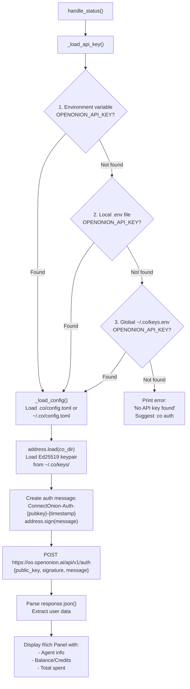
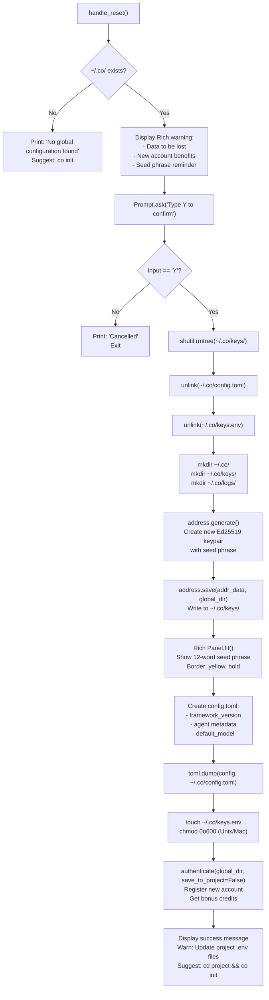
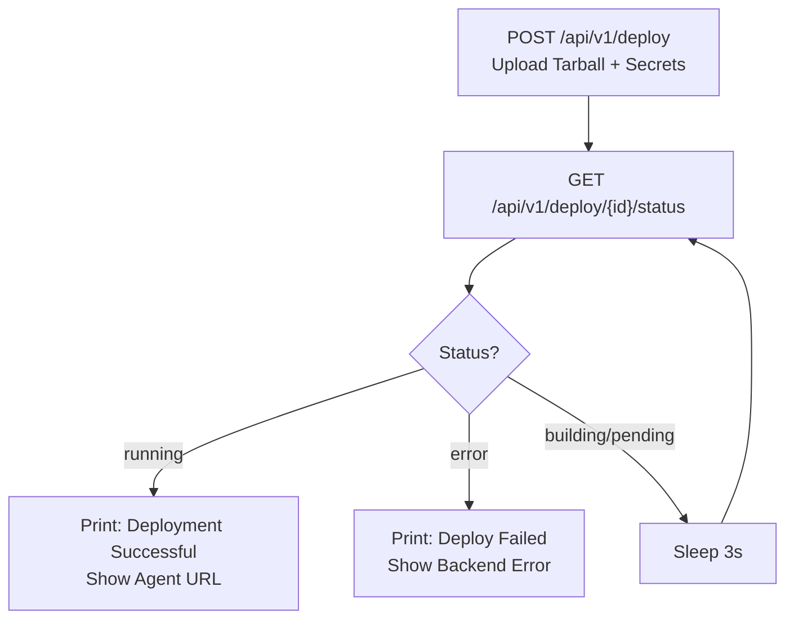
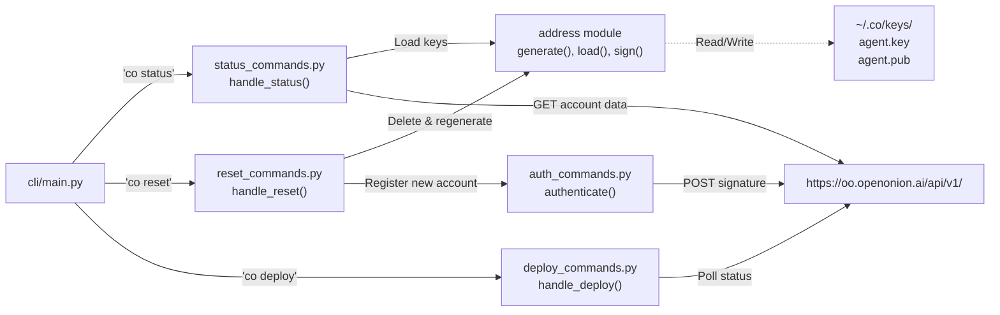

<!-- source: DeepWiki mcp.deepwiki.com · repo openonion/connectonion · page 7.4 Status & Management · fetched 2026-10-26 -->

# Status & Management

<details>
<summary>Relevant source files</summary>

The following files were used as context for generating this wiki page:

- [connectonion/cli/commands/auth_commands.py](connectonion/cli/commands/auth_commands.py)
- [connectonion/cli/commands/create.py](connectonion/cli/commands/create.py)
- [connectonion/cli/commands/deploy_commands.py](connectonion/cli/commands/deploy_commands.py)
- [connectonion/cli/commands/init.py](connectonion/cli/commands/init.py)
- [connectonion/cli/commands/project_cmd_lib.py](connectonion/cli/commands/project_cmd_lib.py)
- [connectonion/cli/commands/reset_commands.py](connectonion/cli/commands/reset_commands.py)
- [connectonion/cli/commands/status_commands.py](connectonion/cli/commands/status_commands.py)
- [tests/e2e/test_deploy.py](tests/e2e/test_deploy.py)

</details>


This page documents the CLI commands for checking account status and resetting your ConnectOnion configuration. These commands manage your global `~/.co/` directory and associated OpenOnion backend account.

For authentication setup, see [Authentication Commands](#7.2). For initial project creation, see [Project Commands](#7.1).

---

## Commands Overview

ConnectOnion provides two management commands:

| Command | Purpose | Destructive | Network Call |
|---------|---------|-------------|--------------|
| `co status` | Display account balance, usage, and email | No | Yes (read-only) |
| `co reset` | Delete all data and create fresh account | **Yes** | Yes (new registration) |

Both commands operate on the global `~/.co/` directory, not project-specific configurations.

---

## `co status` - Account Status Display

### Purpose

The `co status` command displays your current OpenOnion account information without requiring re-authentication. It provides a read-only view of your balance, spending, and configuration by performing a signature-based verification against the backend.

**Command Invocation:**
```bash
co status
```

**Sources:** [connectonion/cli/commands/status_commands.py:77-168]()

### Output Information

The command displays:

| Field | Description | Source |
|-------|-------------|--------|
| **Agent Address** | Full Ed25519 public key | `~/.co/keys/agent.pub` |
| **Agent ID** | Shortened address (`first6...last4`) | Computed from address |
| **Email** | OpenOnion email address | Backend response or `AGENT_EMAIL` env var |
| **API Key** | First 20 chars of `OPENONION_API_KEY` | Environment/`.env`/`~/.co/keys.env` |
| **Balance** | Current account balance in USD | Backend `/api/v1/auth` response |
| **Total Spent** | Cumulative spending | Backend response |
| **Credits** | Available free credits | Backend response |

### API Key Lookup Order

The command searches for `OPENONION_API_KEY` in this priority order:



**Sources:** [connectonion/cli/commands/status_commands.py:23-56](), [connectonion/cli/commands/status_commands.py:77-168]()

### Re-Authentication Flow

Despite having an API key, `co status` performs a fresh authentication to get current account data. This ensures balance and usage information is up-to-date:

1. **Load Ed25519 keypair** from `~/.co/keys/agent.key` [connectonion/cli/commands/status_commands.py:104-112]()
2. **Create timestamp-bound message**: `ConnectOnion-Auth-{public_key}-{timestamp}` [connectonion/cli/commands/status_commands.py:115-116]()
3. **Sign message** with private key using `address.sign()` [connectonion/cli/commands/status_commands.py:117]()
4. **POST to `/api/v1/auth`** with signature [connectonion/cli/commands/status_commands.py:120-127]()
5. **Extract user data** from response JSON [connectonion/cli/commands/status_commands.py:134-152]()

This approach provides fresh data without requiring a full `co auth` flow, which would update stored credentials.

---

## `co reset` - Full Account Reset

### Purpose

The `co reset` command performs a **destructive** operation that deletes all ConnectOnion data and creates a fresh account with a new Ed25519 keypair. This is useful for starting over or creating a new identity.

**Command Invocation:**
```bash
co reset
```

### What Gets Deleted

The command removes:

| Path | Contents | Recoverable |
|------|----------|-------------|
| `~/.co/keys/` | Ed25519 private/public keys | No (unless seed phrase saved) |
| `~/.co/config.toml` | Global configuration | No |
| `~/.co/keys.env` | API keys and credentials | No |

**All data is permanently deleted.** The only recovery option is the 12-word seed phrase displayed during reset.

**Sources:** [connectonion/cli/commands/reset_commands.py:26-79]()

### Reset and Recreation Workflow



**Sources:** [connectonion/cli/commands/reset_commands.py:26-149]()

### Fresh Account Registration

After recreating the directory structure, the reset flow calls `authenticate()` to register the new keypair with the OpenOnion backend:

```python
# Authenticate to get fresh bonus
console.print("\n🔐 Authenticating with OpenOnion...")
success = authenticate(global_dir, save_to_project=False)
```

This creates a new backend account and assigns initial bonus credits. The `save_to_project=False` parameter ensures the `OPENONION_API_KEY` is only written to `~/.co/keys.env`, not the current directory's `.env`.

**Sources:** [connectonion/cli/commands/reset_commands.py:133-149]()

### Seed Phrase Display

The reset command displays the 12-word seed phrase in a prominent Rich panel:

```python
console.print(Panel.fit(
    f"[bold yellow]{addr_data['seed_phrase']}[/bold yellow]",
    title="🔐 Your 12-Word Seed Phrase (SAVE THIS!)",
    border_style="yellow"
))
```

This is the **only** opportunity to save the seed phrase. If lost, the keypair cannot be recovered.

**Sources:** [connectonion/cli/commands/reset_commands.py:94-98]()

---

## Deployment Status & Management

While `co status` covers account-level information, `co deploy` (documented in [Project Commands](#7.1)) includes its own status polling mechanism to manage the lifecycle of a deployed agent.

### Deployment Polling Logic

When an agent is deployed via `handle_deploy()`, the CLI polls the backend status endpoint until the agent is either running or has encountered an error.



**Sources:** [connectonion/cli/commands/deploy_commands.py:142-189]()

---

## Error Handling

### `co status` Errors

| Error Condition | Message | Resolution |
|----------------|---------|------------|
| No `OPENONION_API_KEY` found | `"No API key found"` | Run `co auth` |
| No Ed25519 keys in `~/.co/keys/` | `"No keys found"` | Run `co auth` |
| Backend returns HTTP error | `"Error {status_code}"` | Check network, retry |

**Sources:** [connectonion/cli/commands/status_commands.py:90-132]()

### `co reset` Errors

| Error Condition | Message | Resolution |
|----------------|---------|------------|
| No `~/.co/` directory | `"No global configuration found"` | Run `co init` instead |
| User input != `'Y'` | `"Cancelled."` | Re-run if desired |
| Authentication fails | `"Reset complete, but authentication failed"` | Run `co auth` manually |

**Sources:** [connectonion/cli/commands/reset_commands.py:39-149]()

---

## Code Entity Mapping

### Key Functions

| Function | File | Purpose |
|----------|------|---------|
| `handle_status()` | [status_commands.py:77]() | Entry point for `co status` |
| `_load_api_key()` | [status_commands.py:23]() | Load API key with priority order |
| `handle_reset()` | [reset_commands.py:26]() | Entry point for `co reset` |
| `handle_deploy()` | [deploy_commands.py:66]() | Entry point for `co deploy` and status polling |

### Integration Points



**Sources:** [connectonion/cli/commands/status_commands.py:1-168](), [connectonion/cli/commands/reset_commands.py:1-150](), [connectonion/cli/commands/deploy_commands.py:1-190]()

---

