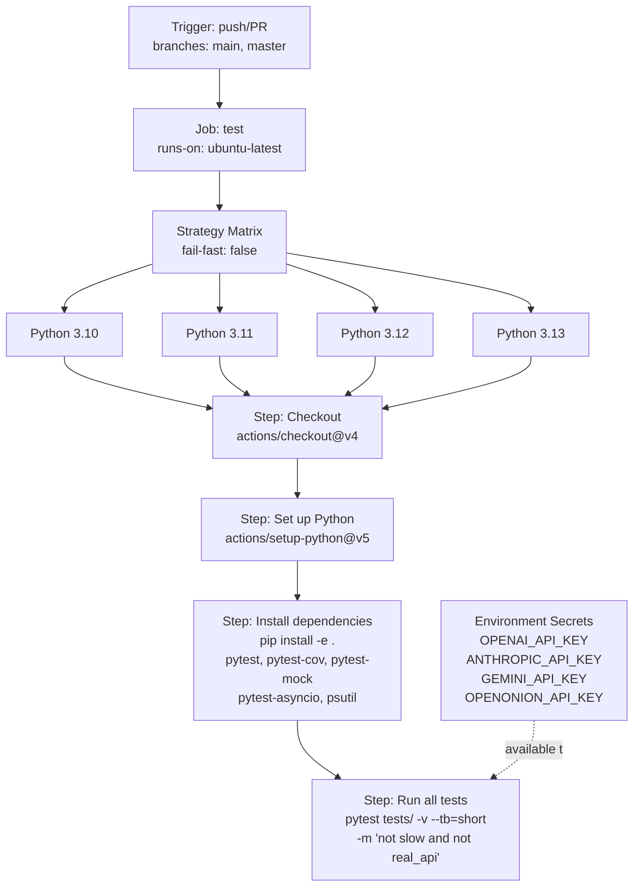
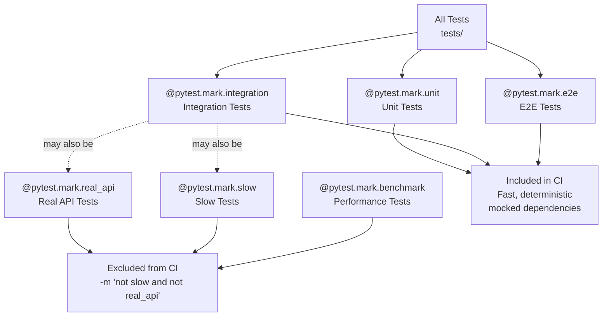
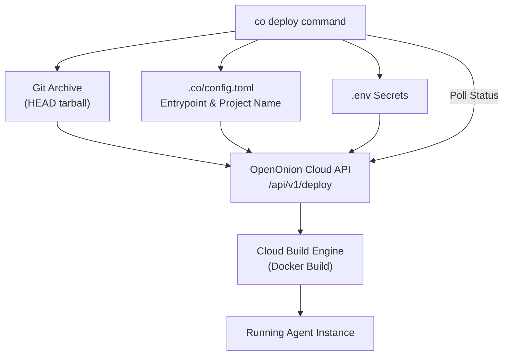

<!-- source: DeepWiki mcp.deepwiki.com · repo openonion/connectonion · page 8.3 CI/CD Pipeline · fetched 2026-10-26 -->

# CI/CD Pipeline

<details>
<summary>Relevant source files</summary>

The following files were used as context for generating this wiki page:

- [.github/workflows/tests.yml](.github/workflows/tests.yml)
- [connectonion/cli/commands/deploy_commands.py](connectonion/cli/commands/deploy_commands.py)
- [tests/e2e/test_deploy.py](tests/e2e/test_deploy.py)
- [tests/fixtures/test_tools.py](tests/fixtures/test_tools.py)
- [tests/integration/test_agent_workflows.py](tests/integration/test_agent_workflows.py)
- [tests/integration/test_auth_integration.py](tests/integration/test_auth_integration.py)
- [tests/integration/test_benchmarks.py](tests/integration/test_benchmarks.py)
- [tests/real_api/__init__.py](tests/real_api/__init__.py)
- [tests/real_api/conftest.py](tests/real_api/conftest.py)
- [tox.ini](tox.ini)

</details>


This document describes ConnectOnion's continuous integration and deployment infrastructure, including GitHub Actions workflow configuration, test categorization, performance benchmarking, and multi-version testing strategy. For information about writing tests and using the mock system, see [Testing](8.1) and [Mock System](8.2).

## Overview

ConnectOnion uses GitHub Actions for automated testing across multiple Python versions (3.10-3.13) on every push and pull request [[.github/workflows/tests.yml:1-15]](). The CI pipeline runs a curated subset of tests that are fast, deterministic, and do not require external API keys [[.github/workflows/tests.yml:38-39]](). This enables rapid feedback while maintaining comprehensive coverage through optional real API tests and local multi-version testing via `tox` [[tox.ini:1-24]]().

**Sources:** [.github/workflows/tests.yml:1-40](), [tox.ini:1-24]()

## GitHub Actions Workflow

The main CI pipeline is defined in a single workflow file that executes on every push to main/master branches and all pull requests [[.github/workflows/tests.yml:3-7]]().

### Workflow Structure



**Sources:** [.github/workflows/tests.yml:1-40]()

### Key Configuration Details

| Aspect | Value | Purpose |
|--------|-------|---------|
| **Trigger Events** | `push`, `pull_request` | Validate all code changes [[.github/workflows/tests.yml:3-7]]() |
| **Target Branches** | `main`, `master` | Primary development branches [[.github/workflows/tests.yml:5-7]]() |
| **Runner OS** | `ubuntu-latest` | Consistent Linux environment [[.github/workflows/tests.yml:11]]() |
| **Python Versions** | 3.10, 3.11, 3.12, 3.13 | Broad compatibility testing [[.github/workflows/tests.yml:15]]() |
| **Fail Fast** | `false` | Test all versions even if one fails [[.github/workflows/tests.yml:13]]() |
| **Test Command** | `pytest tests/ -v --tb=short -m "not slow and not real_api"` | Fast, deterministic tests only [[.github/workflows/tests.yml:39]]() |

**Sources:** [.github/workflows/tests.yml:3-15](), [.github/workflows/tests.yml:38-39]()

### Dependency Installation

The workflow installs ConnectOnion in editable mode and includes all testing dependencies [[.github/workflows/tests.yml:27-30]]():

```bash
python -m pip install --upgrade pip
pip install -e .
pip install pytest pytest-cov pytest-mock pytest-asyncio psutil
```

- **`-e .`**: Editable install allows testing the exact source code [[.github/workflows/tests.yml:29]]().
- **`pytest-cov`**: Code coverage reporting [[.github/workflows/tests.yml:30]]().
- **`pytest-asyncio`**: Support for async test functions [[.github/workflows/tests.yml:30]]().
- **`psutil`**: Process utilities for performance benchmarks [[.github/workflows/tests.yml:30]]().

**Sources:** [.github/workflows/tests.yml:26-30]()

### API Key Management

The workflow provides API keys via GitHub Secrets, making them available to tests that might need them for optional validation [[.github/workflows/tests.yml:33-38]]():

```yaml
env:
  OPENAI_API_KEY: ${{ secrets.OPENAI_API_KEY }}
  ANTHROPIC_API_KEY: ${{ secrets.ANTHROPIC_API_KEY }}
  GEMINI_API_KEY: ${{ secrets.GEMINI_API_KEY }}
  OPENONION_API_KEY: ${{ secrets.OPENONION_API_KEY }}
```

However, tests marked with `@pytest.mark.real_api` are **explicitly excluded** from standard CI execution [[.github/workflows/tests.yml:39]]().

**Sources:** [.github/workflows/tests.yml:33-39]()

## Test Categories and Markers

ConnectOnion uses `pytest` markers to categorize tests by speed, dependencies, and purpose.

### Test Marker Hierarchy



**Sources:** [.github/workflows/tests.yml:39](), [tests/integration/test_benchmarks.py:28-29](), [tests/real_api/conftest.py:57-60]()

### Marker Definitions

| Marker | Purpose | CI Execution | Typical Location |
|--------|---------|--------------|------------------|
| **`unit`** | Fast, isolated tests with mocked LLMs | ✅ Yes | `tests/unit/` [[tox.ini:26-28]]() |
| **`integration`** | Component interaction tests | ✅ Yes | `tests/integration/` [[tests/integration/test_agent_workflows.py:30-31]]() |
| **`e2e`** | Complete workflow tests | ✅ Yes | `tests/e2e/` [[tests/e2e/test_deploy.py:41-42]]() |
| **`real_api`** | Tests requiring actual API calls | ❌ No | `tests/real_api/` [[tests/real_api/conftest.py:57-60]]() |
| **`benchmark`** | Performance measurements | ❌ No | `tests/integration/test_benchmarks.py` [[tests/integration/test_benchmarks.py:28-29]]() |

**Sources:** [tox.ini:26-40](), [tests/integration/test_agent_workflows.py:30-31](), [tests/real_api/conftest.py:57-60]()

### Real API Test Auto-Marking

All tests in the `tests/real_api/` directory are automatically marked with `@pytest.mark.real_api` via a `pytest` hook in `conftest.py` [[tests/real_api/conftest.py:57-60]]():

```python
def pytest_collection_modifyitems(items):
    for item in items:
        if "real_api" in str(item.fspath):
            item.add_marker(pytest.mark.real_api)
```

**Sources:** [tests/real_api/conftest.py:57-60]()

## Performance Benchmarking

Performance tests are marked with `@pytest.mark.benchmark` and measure timing, memory usage, and throughput [[tests/integration/test_benchmarks.py:28-29]](). They use **psutil** to track resource usage [[tests/integration/test_benchmarks.py:20]]().

### Benchmark Categories

| Test | Metric | Threshold | Purpose |
|------|--------|-----------|---------|
| `test_agent_response_time_simple` | Average response time | < 5.0s | Agent overhead measurement [[tests/integration/test_benchmarks.py:55]]() |
| `test_agent_response_time_with_tools` | Tool execution time | < 5.0s | Tool invocation overhead [[tests/integration/test_benchmarks.py:83]]() |
| `test_memory_usage_single_agent` | Memory increase | < 50 MB | Memory leak detection [[tests/integration/test_benchmarks.py:142]]() |
| `test_concurrent_agents_performance` | Total/average time | < 10s / < 5s | Thread safety validation [[tests/integration/test_benchmarks.py:177-178]]() |

**Sources:** [tests/integration/test_benchmarks.py:32-181]()

## Deployment Infrastructure

ConnectOnion includes a deployment pipeline for hosting agents on **ConnectOnion Cloud** via the `co deploy` command [[connectonion/cli/commands/deploy_commands.py:66-68]]().

### Deployment Flow



**Sources:** [connectonion/cli/commands/deploy_commands.py:4-10](), [connectonion/cli/commands/deploy_commands.py:118-152]()

### Deployment Validation
The deployment process performs several checks before uploading:
1. **Git Repository**: Must be a git repo to use `git archive` [[connectonion/cli/commands/deploy_commands.py:73-75]]().
2. **Project Config**: Requires `.co/config.toml` [[connectonion/cli/commands/deploy_commands.py:78-81]]().
3. **Entrypoint**: Must exist and export an ASGI app via `host()` [[connectonion/cli/commands/deploy_commands.py:101-112]]().
4. **Authentication**: Requires a valid `OPENONION_API_KEY` [[connectonion/cli/commands/deploy_commands.py:84-87]]().

**Sources:** [connectonion/cli/commands/deploy_commands.py:70-112]()

## Tox Configuration

`tox` provides local multi-version testing and linting environments [[tox.ini:1-5]]().

### Tox Environments

| Environment | Purpose |
|-------------|---------|
| `py310`, `py311`, `py312` | Run tests on specific Python versions [[tox.ini:8-10]]() |
| `unit`, `integration`, `cli`, `e2e` | Run specific subsets of the test suite [[tox.ini:26-40]]() |
| `lint` | Run `flake8`, `black`, and `isort` checks [[tox.ini:59-68]]() |
| `format` | Run `black` and `isort` to fix code style [[tox.ini:70-77]]() |
| `real_api` | Run tests that require actual API keys [[tox.ini:79-95]]() |

**Sources:** [tox.ini:1-96]()

### Real API Test Setup
Tests in the `real_api` environment pass through several API keys to allow testing against live providers [[tox.ini:81-93]]():
- `OPENAI_API_KEY`
- `ANTHROPIC_API_KEY`
- `GEMINI_API_KEY`
- `OPENONION_API_KEY`

**Sources:** [tox.ini:81-93](), [tests/real_api/conftest.py:67-85]()

---

