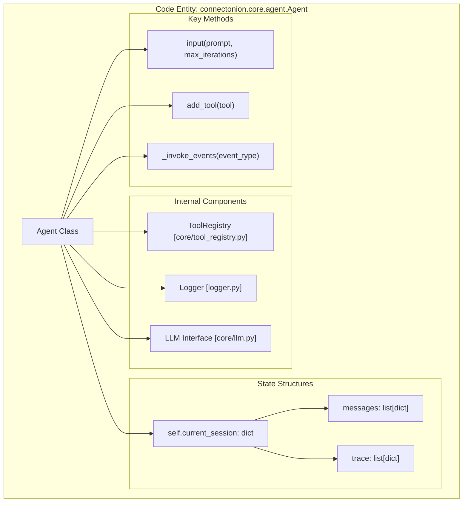
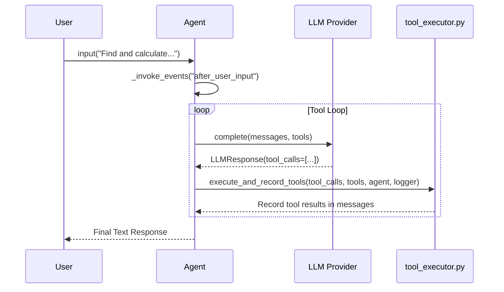

<!-- source: DeepWiki mcp.deepwiki.com · repo openonion/connectonion · page 9.1 Agent API · fetched 2026-10-26 -->

# Agent API

<details>
<summary>Relevant source files</summary>

The following files were used as context for generating this wiki page:

- [connectonion/core/agent.py](connectonion/core/agent.py)
- [connectonion/logger.py](connectonion/logger.py)
- [docs/api.md](docs/api.md)
- [docs/cli/README.md](docs/cli/README.md)
- [docs/cli/create.md](docs/cli/create.md)
- [docs/cli/init.md](docs/cli/init.md)
- [docs/concepts/agent.md](docs/concepts/agent.md)
- [docs/concepts/llm_do.md](docs/concepts/llm_do.md)
- [docs/concepts/max_iterations.md](docs/concepts/max_iterations.md)
- [docs/concepts/tools.md](docs/concepts/tools.md)
- [docs/connectonion.md](docs/connectonion.md)
- [docs/useful_plugins/README.md](docs/useful_plugins/README.md)
- [tests/real_api/manual/manual_defaults.py](tests/real_api/manual/manual_defaults.py)
- [tests/unit/test_agent.py](tests/unit/test_agent.py)
- [tests/unit/test_logger.py](tests/unit/test_logger.py)
- [tests/unit/test_tool_executor.py](tests/unit/test_tool_executor.py)
- [tests/unit/test_tool_executor_errors.py](tests/unit/test_tool_executor_errors.py)
- [tests/unit/test_tool_factory.py](tests/unit/test_tool_factory.py)

</details>


## Purpose and Scope

This page provides a comprehensive API reference for the `Agent` class, the core orchestrator in ConnectOnion. The `Agent` class manages LLM interactions, tool execution, event systems, and session state.

For tool creation, see [Tool API](#9.3). For networking capabilities, see [Networking API](#9.4). For LLM provider configuration, see [LLM API](#9.2).

---

## Class Entity Mapping

The following diagram bridges the conceptual "Agent" with the specific code entities and data structures defined in the `Agent` class.


**Sources:** [connectonion/core/agent.py:31-48](), [connectonion/core/agent.py:112-112](), [connectonion/core/agent.py:54-55]()

---

## Constructor

### `Agent.__init__()`

```python
Agent(
    name: str,
    llm: Optional[LLM] = None,
    tools: Optional[Union[List[Callable], Callable, Any]] = None,
    system_prompt: Union[str, Path, None] = None,
    api_key: Optional[str] = None,
    model: str = "co/gemini-2.5-pro",
    max_iterations: int = 100,
    log: Optional[Union[bool, str, Path]] = None,
    quiet: bool = False,
    plugins: Optional[List[List[EventHandler]]] = None,
    on_events: Optional[List[EventHandler]] = None,
    co_dir: Optional[Union[str, Path]] = None
)
```

Creates a new agent instance. The constructor initializes the tool registry, event system, and logging infrastructure.

### Parameters

| Parameter | Type | Default | Description |
|-----------|------|---------|-------------|
| `name` | `str` | Required | Unique identifier for the agent. Used in log filenames. |
| `llm` | `Optional[LLM]` | `None` | Custom LLM instance. If provided, overrides `model`. |
| `tools` | `Optional[List[...]]` | `None` | Functions, class instances, or Tool objects. Functions are auto-converted to tools via `create_tool_from_function`. |
| `system_prompt` | `Union[str, Path, None]` | `None` | Agent behavior definition. Can be string or file path. Loaded via `load_system_prompt`. |
| `model` | `str` | `"co/gemini-2.5-pro"` | LLM model identifier. Prefix `co/` uses managed keys via `OpenOnionLLM`. |
| `max_iterations` | `int` | `100` | Maximum tool calling loops per turn. |
| `quiet` | `bool` | `False` | Suppresses console output while maintaining session logs. |
| `log` | `Union[bool, str, Path, None]` | `None` | `False` disables file logging. String/Path sets custom log location. |
| `plugins` | `Optional[List[List[EventHandler]]]` | `None` | List of event handler bundles. |
| `co_dir` | `Optional[Union[str, Path]]` | `None` | Base directory for `.co` metadata (defaults to `.co`). |

**Sources:** [connectonion/core/agent.py:34-48](), [connectonion/core/agent.py:126-131](), [connectonion/core/agent.py:143-150]()

---

## Core Methods

### `input()`

The primary entry point for agent execution. It manages the loop between the LLM and tool execution.

```python
def input(
    self,
    prompt: str,
    max_iterations: Optional[int] = None
) -> str
```

#### Execution Logic
1. **Initialization**: Initializes or extends `self.current_session` [connectonion/core/agent.py:186-193]().
2. **LLM Loop**: Calls `self.llm.complete()` with current messages and tool schemas [connectonion/core/agent.py:228-232]().
3. **Tool Execution**: If the LLM returns `tool_calls`, it delegates to `execute_and_record_tools` in the `tool_executor` module [connectonion/core/agent.py:255-261]().
4. **Recursion**: The loop continues until no more tool calls are made or `max_iterations` is reached.


**Sources:** [connectonion/core/agent.py:180-280](), [connectonion/core/tool_executor.py:23-45]()

### `add_tool()`

Adds a function or class instance to the agent's registry.

```python
def add_tool(self, tool: Union[Callable, Any]) -> None
```
- If `tool` is a class instance, it extracts methods using `extract_methods_from_instance` [connectonion/core/agent.py:118-125]().
- If `tool` is a function, it wraps it using `create_tool_from_function` [connectonion/core/agent.py:127-131]().

**Sources:** [connectonion/core/agent.py:111-132](), [connectonion/core/tool_factory.py:136-150]()

---

## Session State Structure

The `Agent` maintains state in `self.current_session`. This dictionary is populated during the `input()` call.

| Key | Type | Description |
|-----|------|-------------|
| `messages` | `list[dict]` | The standard OpenAI-style message list (`role`, `content`, `tool_calls`). |
| `trace` | `list[dict]` | Internal execution log for debugging and `Logger` usage. |
| `turn` | `int` | Counter for user-agent interaction cycles. |
| `iteration` | `int` | Counter for tool-call loops within a single turn. |

**Sources:** [connectonion/core/agent.py:54-55](), [connectonion/core/agent.py:192-205]()

---

## Event Lifecycle Hooks

The `Agent` class implements a hook system allowing plugins to intercept execution. Hooks are invoked via `self._invoke_events(event_type)`.

| Event Type | Timing |
|------------|--------|
| `before_llm` | Just before sending messages to the LLM. |
| `after_llm` | Immediately after receiving the LLM response. |
| `before_tools` | Once before a batch of tool calls are executed. |
| `after_tools` | Once after all tool calls in a batch finish (safe for message modification). |
| `before_each_tool` | Before an individual tool execution. |
| `after_each_tool` | After an individual tool execution. |
| `on_error` | When a tool execution raises an exception. |

**Sources:** [connectonion/core/agent.py:78-92](), [docs/useful_plugins/README.md:101-140]()

---

## Tool Registry Access

Tools are managed by the `ToolRegistry` class, which allows both dictionary-style and attribute-style access.

```python
agent = Agent("bot", tools=[my_func])

# Access via attribute
agent.tools.my_func.run(args)

# Access via registry get
tool = agent.tools.get("my_func")
```
**Sources:** [connectonion/core/agent.py:112-112](), [connectonion/core/tool_registry.py:1-20]()

---

## Logging & Observability

The `Agent` utilizes the `Logger` class defined in `connectonion/logger.py`.

- **Console Output**: Real-time rich formatting of LLM calls and tool results [connectonion/logger.py:118-143]().
- **Plain Text Logs**: Saved to `.co/logs/{agent_name}.log` [connectonion/logger.py:89-89]().
- **Eval Sessions**: Structured YAML and JSONL files saved to `.co/evals/` for replay and evaluation [connectonion/logger.py:160-180]().

**Sources:** [connectonion/core/agent.py:67-73](), [connectonion/logger.py:44-72]()

---

## Error Handling

Tool execution errors are handled in `tool_executor.py`. When a tool fails:
1. An `on_error` event is fired [connectonion/core/tool_executor.py:195-195]().
2. The error is caught and formatted as a string [connectonion/core/tool_executor.py:186-192]().
3. A `role: "tool"` message containing the error is appended to the session so the LLM can see the failure and potentially retry [connectonion/core/tool_executor.py:202-202]().

**Sources:** [connectonion/core/tool_executor.py:180-205](), [tests/unit/test_tool_executor_errors.py:153-185]()

---

