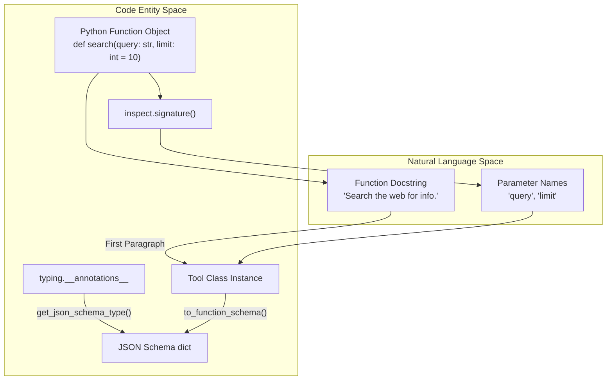
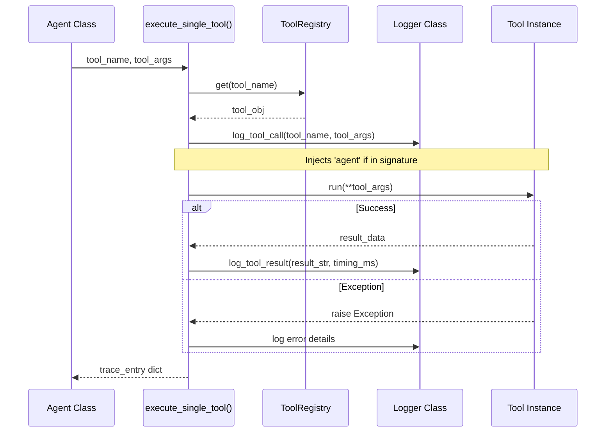

<!-- source: DeepWiki mcp.deepwiki.com · repo openonion/connectonion · page 9.3 Tool API · fetched 2026-10-26 -->

# Tool API

<details>
<summary>Relevant source files</summary>

The following files were used as context for generating this wiki page:

- [connectonion/logger.py](connectonion/logger.py)
- [connectonion/useful_plugins/shell_approval.py](connectonion/useful_plugins/shell_approval.py)
- [connectonion/useful_tools/__init__.py](connectonion/useful_tools/__init__.py)
- [connectonion/useful_tools/diff_writer.py](connectonion/useful_tools/diff_writer.py)
- [connectonion/useful_tools/gmail.py](connectonion/useful_tools/gmail.py)
- [connectonion/useful_tools/shell.py](connectonion/useful_tools/shell.py)
- [connectonion/useful_tools/terminal.py](connectonion/useful_tools/terminal.py)
- [connectonion/useful_tools/todo_list.py](connectonion/useful_tools/todo_list.py)
- [connectonion/useful_tools/web_fetch.py](connectonion/useful_tools/web_fetch.py)
- [docs/api.md](docs/api.md)
- [docs/concepts/tools.md](docs/concepts/tools.md)
- [tests/real_api/manual/manual_defaults.py](tests/real_api/manual/manual_defaults.py)
- [tests/unit/test_logger.py](tests/unit/test_logger.py)
- [tests/unit/test_tool_executor.py](tests/unit/test_tool_executor.py)
- [tests/unit/test_tool_executor_errors.py](tests/unit/test_tool_executor_errors.py)
- [tests/unit/test_tool_factory.py](tests/unit/test_tool_factory.py)

</details>


This page provides a comprehensive API reference for creating and using tools in ConnectOnion. It covers the `create_tool_from_function()` factory, the `Tool` interface, schema generation rules, and tool registry operations.

For conceptual explanations and design patterns, see [3.3. Tools System](). For documentation of built-in tools, see [6.1. Useful Tools Reference](). For best practices, see [10.1. Tool Design]().

---

## Overview

ConnectOnion tools are Python functions or class methods that agents can invoke. The framework automatically converts Python callables into OpenAI-compatible tool schemas using type hints and docstrings.

**Key Components:**
- `create_tool_from_function()`: Converts Python functions to tool objects. [connectonion/core/tool_factory.py:16-16]()
- `ToolRegistry`: Stores and retrieves tools with O(1) lookup. [connectonion/core/tool_registry.py:1-1]()
- `Tool` interface: Internal representation with `name`, `description`, `run()`, and `to_function_schema()`. [docs/api.md:148-148]()

**Sources:** [connectonion/__init__.py:1-39](), [connectonion/core/tool_factory.py:1-17](), [docs/api.md:105-150]()

---

## Tool Creation Function

### `create_tool_from_function(func: Callable) -> Tool`

Converts a Python function into a tool object that can be used by agents.

**Parameters:**
- `func` (`Callable`): A Python function with type hints.

**Returns:**
- `Tool`: An object with `name`, `description`, `run()`, and `to_function_schema()` methods. [docs/api.md:147-148]()

**Example:**

```python
from connectonion import create_tool_from_function

def simple_function(x: int) -> int:
    """Double a number."""
    return x * 2

tool = create_tool_from_function(simple_function)
# tool now has: .name, .description, .run(), .to_function_schema()
```
[docs/api.md:141-149]()

**Automatic Extraction Logic:**

Title: Tool Schema Extraction Data Flow

**Sources:** [connectonion/core/tool_factory.py:16-16](), [tests/unit/test_tool_factory.py:45-61](), [docs/api.md:126-135]()

**Schema Generation Rules:**

| Python Element | Schema Field | Logic |
|----------------|--------------|-------|
| Function name | `name` | Direct copy from `func.__name__`. [docs/api.md:127-127]() |
| Type hints | `parameters` | Converted via `get_json_schema_type()`. [tests/unit/test_tool_factory.py:112-165]() |
| Default values | `required` | Parameters without default values are marked required. [docs/api.md:130-130]() |
| Docstring | `description` | First paragraph only (Args/Returns excluded). [tests/unit/test_tool_factory.py:72-92]() |
| No docstring | `description` | Defaults to `"Execute the {name} tool."` [docs/api.md:133-133]() |

**Sources:** [connectonion/core/tool_factory.py:16-17](), [tests/unit/test_tool_factory.py:22-111](), [docs/api.md:126-135]()

---

## Tool Interface

Every tool object implements the following interface (represented here by `FunctionBasedTool` logic):

### Tool Properties

#### `name: str`
The tool's identifier, extracted from the function name. [tests/unit/test_tool_factory.py:30-30]()

#### `description: str`
Human-readable explanation for the LLM. It extracts only the first paragraph and removes "Args" or "Returns" sections. [tests/unit/test_tool_factory.py:86-92]()

### Tool Methods

#### `run(**kwargs) -> Any`
Executes the underlying Python function. Injected parameters like `agent` are handled by the `tool_executor` and excluded from the LLM-facing schema. [connectonion/useful_tools/diff_writer.py:15-19](), [tests/unit/test_tool_executor.py:48-69]()

#### `to_function_schema() -> dict`
Generates the JSON schema for LLM tool-calling. It maps Python types to JSON types:
- `str` → `string`
- `int` → `integer`
- `bool` → `boolean`
- `List[str]` → `array` with `items: {type: string}`
- `Optional[T]` → `T` (handled by `get_json_schema_type`).

**Sources:** [tests/unit/test_tool_factory.py:112-165](), [docs/api.md:105-150]()

---

## Tool Registry & Execution

The `ToolRegistry` stores tools, while the `tool_executor` handles the lifecycle of a tool call.

Title: Tool Execution Pipeline


### Tool Executor Details
- **Injection:** The `tool_executor` detects `agent` in a tool's signature and injects the current agent instance automatically. [connectonion/useful_tools/diff_writer.py:15-19]()
- **Logging:** `Logger.log_tool_call` is invoked before execution, and `Logger.log_tool_result` is invoked after, capturing execution time in milliseconds. [tests/unit/test_tool_executor.py:161-210]()
- **Error Handling:** If a tool is not found, it returns a `not_found` status. If it crashes, it captures the exception type and message in the trace. [tests/unit/test_tool_executor_errors.py:65-94](), [tests/unit/test_tool_executor_errors.py:153-185]()

**Sources:** [connectonion/core/tool_executor.py:15-16](), [connectonion/logger.py:134-143](), [tests/unit/test_tool_executor.py:48-84]()

---

## Specialized Tool APIs

### IO-Aware Tools (e.g., `DiffWriter`)
Tools can interact with the user via `agent.io`. For example, `DiffWriter.write` requests approval for file changes.
- **Modes:** `MODE_NORMAL` (prompt), `MODE_AUTO` (auto-approve), `MODE_PLAN` (read-only). [connectonion/useful_tools/diff_writer.py:39-41]()
- **Events:** Sends `diff_preview` and `ask_user` events through the IO channel. [connectonion/useful_tools/diff_writer.py:146-160]()

### Terminal Utilities
Used for building interactive tools:
- `pick(title, options)`: Single keypress selection with arrow keys. [connectonion/useful_tools/terminal.py:94-116]()
- `yes_no(message)`: Simple binary confirmation. [connectonion/useful_tools/terminal.py:186-200]()

### Approval Plugins
Plugins like `shell_approval` intercept tool calls using the `before_each_tool` event to enforce human-in-the-loop safety for dangerous commands. [connectonion/useful_plugins/shell_approval.py:1-21](), [connectonion/useful_plugins/shell_approval.py:167-167]()

**Sources:** [connectonion/useful_tools/diff_writer.py:44-110](), [connectonion/useful_tools/terminal.py:1-50](), [connectonion/useful_plugins/shell_approval.py:96-167]()

---

