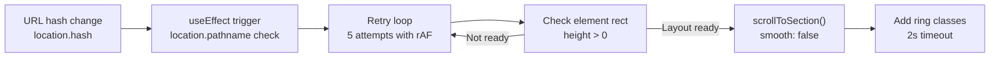
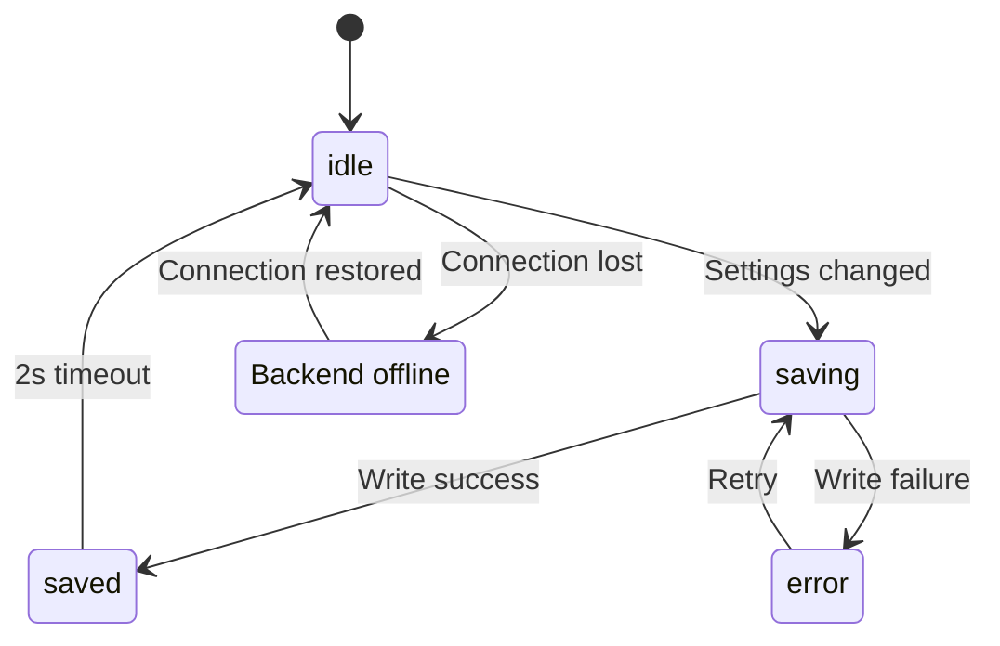
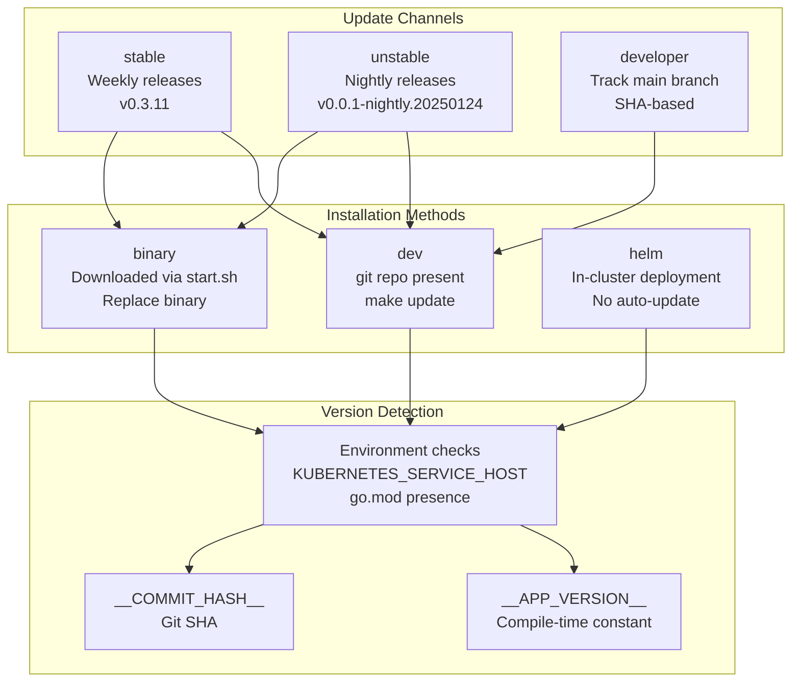
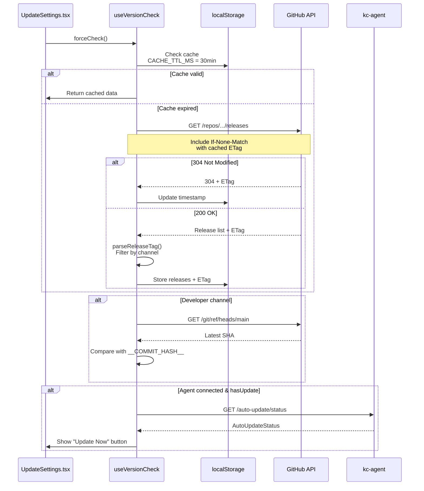
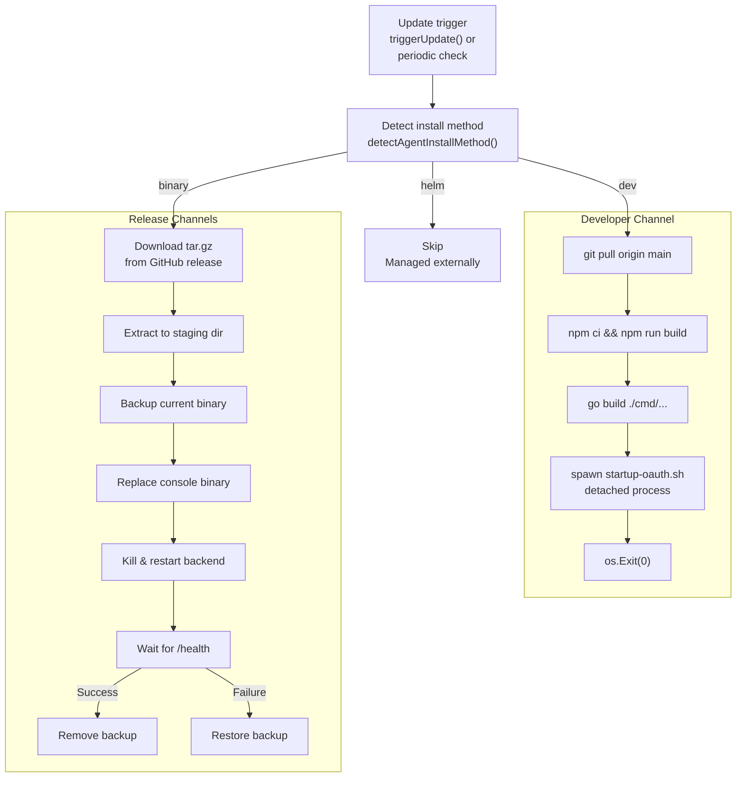
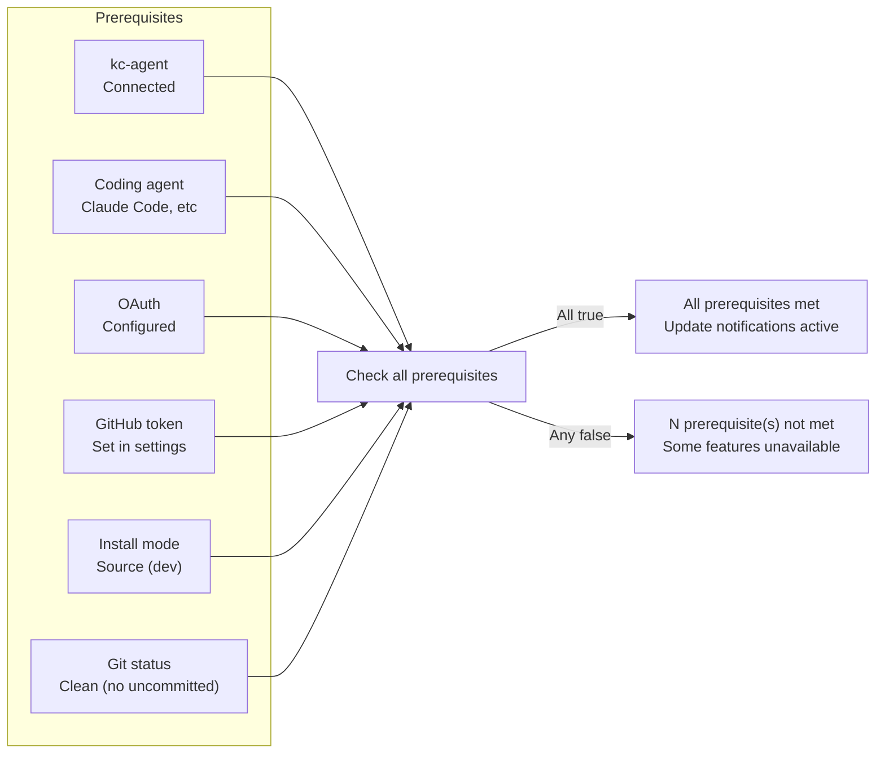

<!-- source: DeepWiki mcp.deepwiki.com · repo kubestellar/console · page 10 Settings System · fetched 2026-10-26 -->

# Settings System

<details>
<summary>Relevant source files</summary>

The following files were used as context for generating this wiki page:

- [pkg/agent/update_checker.go](pkg/agent/update_checker.go)
- [pkg/settings/types.go](pkg/settings/types.go)
- [web/src/components/layout/UserProfileDropdown.tsx](web/src/components/layout/UserProfileDropdown.tsx)
- [web/src/components/layout/navbar/UpdateIndicator.tsx](web/src/components/layout/navbar/UpdateIndicator.tsx)
- [web/src/components/settings/Settings.tsx](web/src/components/settings/Settings.tsx)
- [web/src/components/settings/UpdateSettings.tsx](web/src/components/settings/UpdateSettings.tsx)
- [web/src/components/settings/sections/AnalyticsSection.tsx](web/src/components/settings/sections/AnalyticsSection.tsx)
- [web/src/components/settings/sections/index.ts](web/src/components/settings/sections/index.ts)
- [web/src/components/updates/UpdateProgressBanner.tsx](web/src/components/updates/UpdateProgressBanner.tsx)
- [web/src/hooks/useUpdateProgress.ts](web/src/hooks/useUpdateProgress.ts)
- [web/src/hooks/useVersionCheck.tsx](web/src/hooks/useVersionCheck.tsx)
- [web/src/locales/de/common.json](web/src/locales/de/common.json)
- [web/src/locales/en/common.json](web/src/locales/en/common.json)
- [web/src/locales/es/common.json](web/src/locales/es/common.json)
- [web/src/locales/fr/common.json](web/src/locales/fr/common.json)
- [web/src/locales/hi/common.json](web/src/locales/hi/common.json)
- [web/src/locales/it/common.json](web/src/locales/it/common.json)
- [web/src/locales/ja/common.json](web/src/locales/ja/common.json)
- [web/src/locales/pt/common.json](web/src/locales/pt/common.json)
- [web/src/locales/zh/common.json](web/src/locales/zh/common.json)
- [web/src/types/updates.ts](web/src/types/updates.ts)

</details>


## Purpose and Scope

The Settings System provides a comprehensive configuration interface for the KubeStellar Console, organized into 5 major groups with 16 individual settings sections. This document covers the architecture, navigation structure, persistence mechanism, and the sophisticated update subsystem.

For information about specific feature implementations (AI predictions, theme management, etc.), see their respective component documentation. For the Update System's backend implementation, see page [8](#8).

---

## Architecture Overview

### Component Hierarchy

```mermaid
graph TB
    Settings["Settings.tsx<br/>Main Orchestrator"]
    Nav["Settings Navigation<br/>SETTINGS_NAV structure"]
    Content["Settings Content Area"]
    
    subgraph "Context & Hooks"
        useAuth["useAuth<br/>User data"]
        useTheme["useTheme<br/>Theme state"]
        useAIMode["useAIMode<br/>AI mode"]
        useLocalAgent["useLocalAgent<br/>Agent health"]
        useVersionCheck["useVersionCheck<br/>Update detection"]
        usePersisted["usePersistedSettings<br/>File sync"]
    end
    
    subgraph "Settings Groups"
        G1["AI & Intelligence<br/>5 sections"]
        G2["Integrations<br/>3 sections"]
        G3["User & Alerts<br/>2 sections"]
        G4["Appearance<br/>2 sections"]
        G5["Utilities<br/>5 sections"]
    end
    
    subgraph "Section Components"
        AISettings["AISettingsSection"]
        PredSettings["PredictionSettingsSection"]
        AgentSec["AgentSection"]
        APIKeys["APIKeysSection"]
        TokenUsage["TokenUsageSection"]
        GitHub["GitHubTokenSection"]
        Widget["WidgetSettingsSection"]
        Persistence["PersistenceSection"]
        Profile["ProfileSection"]
        Notifications["NotificationSettingsSection"]
        Theme["ThemeSection"]
        Access["AccessibilitySection"]
        Backup["SettingsBackupSection"]
        LocalClusters["LocalClustersSection"]
        Permissions["PermissionsSection"]
        Analytics["AnalyticsSection"]
        Updates["UpdateSettings"]
    end
    
    Settings --> Nav
    Settings --> Content
    
    Settings --> useAuth
    Settings --> useTheme
    Settings --> useAIMode
    Settings --> useLocalAgent
    Settings --> useVersionCheck
    Settings --> usePersisted
    
    Content --> G1
    Content --> G2
    Content --> G3
    Content --> G4
    Content --> G5
    
    G1 --> AISettings
    G1 --> PredSettings
    G1 --> AgentSec
    G1 --> APIKeys
    G1 --> TokenUsage
    
    G2 --> GitHub
    G2 --> Widget
    G2 --> Persistence
    
    G3 --> Profile
    G3 --> Notifications
    
    G4 --> Theme
    G4 --> Access
    
    G5 --> Backup
    G5 --> LocalClusters
    G5 --> Permissions
    G5 --> Analytics
    G5 --> Updates
```



**Sources:** [web/src/components/settings/Settings.tsx:1-380](), [web/src/components/settings/sections/index.ts:1-17]()

---

## Settings Navigation Structure

The settings page uses a two-column layout with a fixed sidebar navigation and scrollable content area. The navigation automatically tracks the active section via `IntersectionObserver`.

### Navigation Definition

| Group | Section ID | Label Key | Icon | Component |
|-------|-----------|-----------|------|-----------|
| **AI & Intelligence** | `ai-mode-settings` | `settings.nav.aiMode` | `Cpu` | `AISettingsSection` |
| | `prediction-settings` | `settings.nav.predictions` | `TrendingUp` | `PredictionSettingsSection` |
| | `agent-settings` | `settings.nav.localAgent` | `Plug` | `AgentSection` |
| | `api-keys-settings` | `settings.nav.apiKeys` | `Key` | `APIKeysSection` |
| | `token-usage-settings` | `settings.nav.tokenUsage` | `Coins` | `TokenUsageSection` |
| **Integrations** | `github-token-settings` | `settings.nav.github` | `Github` | `GitHubTokenSection` |
| | `widget-settings` | `settings.nav.desktopWidget` | `LayoutGrid` | `WidgetSettingsSection` |
| | `persistence-settings` | `settings.nav.deployPersistence` | `Database` | `PersistenceSection` |
| **User & Alerts** | `profile-settings` | `settings.nav.profile` | `User` | `ProfileSection` |
| | `notifications-settings` | `settings.nav.notifications` | `Bell` | `NotificationSettingsSection` |
| **Appearance** | `theme-settings` | `settings.nav.theme` | `Palette` | `ThemeSection` |
| | `accessibility-settings` | `settings.nav.accessibility` | `Eye` | `AccessibilitySection` |
| **Utilities** | `settings-backup` | `settings.nav.backupSync` | `HardDrive` | `SettingsBackupSection` |
| | `local-clusters-settings` | `settings.nav.localClusters` | `Container` | `LocalClustersSection` |
| | `permissions-settings` | `settings.nav.permissions` | `Shield` | `PermissionsSection` |
| | `analytics-settings` | `settings.nav.analytics` | `BarChart3` | `AnalyticsSection` |
| | `system-updates-settings` | `settings.nav.updates` | `Download` | `UpdateSettings` |

**Sources:** [web/src/components/settings/Settings.tsx:48-93](), [web/src/locales/en/common.json:179-197]()

### Deep Linking and Scroll Behavior

The settings page supports URL hash-based deep linking to any section. When navigating to `/settings#agent-settings`, the page automatically scrolls to that section and applies a temporary highlight ring.



The retry mechanism is necessary because `KeepAlive` transitions components from `display:none` to `display:contents`, and elements may not have layout on the first frame.

**Sources:** [web/src/components/settings/Settings.tsx:141-165]()

---

## Settings Persistence System

Settings are automatically saved to `~/.kc/settings.json` on the local machine via the `usePersistedSettings` hook. The system distinguishes between sensitive data (encrypted) and user preferences (plaintext).

### Sync Status Indicator



| Status | Icon | Meaning |
|--------|------|---------|
| `idle` | `CheckCircle` (gray) | Synced, no pending changes |
| `saving` | `Loader2` (yellow, spinning) | Writing to file |
| `saved` | `CheckCircle` (green) | Successfully saved |
| `error` | `AlertCircle` (red) | Save failed |
| `offline` | `WifiOff` (gray) | Backend unavailable |

**Sources:** [web/src/components/settings/Settings.tsx:40-46](), [web/src/components/settings/Settings.tsx:213-222]()

### File Structure

The settings file at `~/.kc/settings.json` has the following structure:

```typescript
interface SettingsFile {
  version: number
  lastModified: string
  settings: PlaintextSettings     // Non-sensitive preferences
  encrypted: EncryptedSettings    // AES-256-GCM encrypted
  keyFingerprint: string
}
```

**Plaintext Settings** (readable):
- AI mode (`low`, `medium`, `high`)
- Prediction settings (intervals, thresholds)
- Token usage limits
- Theme ID
- Accessibility preferences
- Profile contact info (email, Slack ID)
- Widget configuration

**Encrypted Settings** (AES-256-GCM):
- Anthropic API key
- OpenAI API key
- Google Gemini API key
- GitHub personal access token
- Slack webhook URL
- SMTP credentials

**Sources:** [pkg/settings/types.go:4-10](), [web/src/locales/en/common.json:411-430]()

### Backup and Restore

Users can export settings to a JSON file and import them on another machine. The exported file retains encryption, so it can only be imported on machines with the same encryption key (derived from machine-specific hardware identifiers).

**Sources:** [web/src/locales/en/common.json:411-429]()

---

## Update System

The Update System supports three update channels and three installation methods, with automatic detection and channel-specific update strategies.

### Update Channels



**Sources:** [web/src/types/updates.ts:1-26](), [web/src/hooks/useVersionCheck.tsx:1-522]()

### Version Checking Flow



**Sources:** [web/src/hooks/useVersionCheck.tsx:240-320](), [web/src/components/settings/UpdateSettings.tsx:145-147]()

### Auto-Update Execution

When auto-update is enabled and an update is detected, the kc-agent `UpdateChecker` executes the update and broadcasts progress via WebSocket.



**Sources:** [pkg/agent/update_checker.go:274-352](), [pkg/agent/update_checker.go:470-594]()

### WebSocket Progress Reporting

The backend broadcasts `update_progress` events via WebSocket during updates. The frontend displays a progress banner with a countdown timer.

| Event Field | Type | Description |
|-------------|------|-------------|
| `status` | `string` | `pulling`, `building`, `restarting`, `done`, `failed` |
| `message` | `string` | Human-readable progress message |
| `progress` | `number` | Percentage (0-100) |
| `error` | `string` | Error details if status is `failed` |

**Example Progress Sequence:**
1. `pulling` (10%) - "Pulling abc1234 from main..."
2. `building` (30%) - "Installing dependencies and building frontend..."
3. `building` (60%) - "Building Go binaries..."
4. `restarting` (80%) - "Restarting via startup-oauth.sh..."
5. `restarting` (90%) - "Waiting for backend to come up..."
6. `done` (100%) - "Update complete — restart successful"

**Sources:** [pkg/agent/update_checker.go:52-58](), [web/src/hooks/useUpdateProgress.ts:1-71](), [web/src/components/settings/UpdateSettings.tsx:458-481]()

---

## Update Settings UI

### Prerequisites Display

On the developer channel, the UI shows a prerequisites panel that checks for required components:



Each prerequisite row has:
- **Icon** - Visual indicator of the component
- **Label** - Prerequisite name
- **Status** - "Ok text" (green) or "Fail text" (yellow/gray)
- **Fix button** - Links to relevant settings section if fixable

**Sources:** [web/src/components/settings/UpdateSettings.tsx:309-388](), [web/src/locales/en/common.json:531-553]()

### Update Now Button

When `hasUpdate && agentConnected && !isHelmInstall`, the UI displays an "Update Now" button that calls `triggerUpdate()` on the `useVersionCheck` hook. This sends a POST request to `/api/agent/auto-update/trigger`, which queues the update on kc-agent.

```typescript
// POST /api/agent/auto-update/trigger
// Body: { channel?: string }
// Response: { success: boolean, error?: string }
```

The button is disabled during updates (either WebSocket-driven or in "triggered" state).

**Sources:** [web/src/components/settings/UpdateSettings.tsx:611-637](), [web/src/hooks/useVersionCheck.tsx:419-450]()

---

## Settings Groups

### AI & Intelligence

| Section | Purpose | Key Settings |
|---------|---------|--------------|
| AI Mode | Balance between AI assistance and direct kubectl | `low`, `medium`, `high` modes |
| Predictions | Configure AI-powered failure detection | Analysis interval, confidence threshold, heuristic thresholds |
| Local Agent | kc-agent connection status | Version, cluster count, Claude Code availability |
| API Keys | Manage AI provider keys | Anthropic, OpenAI, Gemini (encrypted) |
| Token Usage | Set token limits and alerts | Monthly limit, warning/critical percentages |

**Sources:** [web/src/locales/en/common.json:205-317]()

### Integrations

| Section | Purpose | Key Settings |
|---------|---------|--------------|
| GitHub | GitHub API access for activity cards | Personal access token, rate limit status |
| Desktop Widget | Monitor clusters from desktop | Browser widget (PiP) or Übersicht widget (macOS) |
| Deploy Persistence | Store workloads as Kubernetes CRs | Primary/secondary cluster, namespace, sync mode |

**Sources:** [web/src/locales/en/common.json:259-391]()

### User & Alerts

| Section | Purpose | Key Settings |
|---------|---------|--------------|
| Profile | User contact information | Email, Slack ID |
| Notifications | Alert delivery channels | Slack webhook, SMTP config, test buttons |

**Sources:** [web/src/locales/en/common.json:318-361]()

### Appearance

| Section | Purpose | Key Settings |
|---------|---------|--------------|
| Theme | Choose from 30+ oh-my-zsh inspired themes | Theme ID, quick select gallery |
| Accessibility | Customize accessibility features | Color blind mode, reduce motion, high contrast |

**Sources:** [web/src/locales/en/common.json:555-563](), [web/src/locales/en/common.json:155-164]()

### Utilities

| Section | Purpose | Key Settings |
|---------|---------|--------------|
| Backup & Sync | Export/import encrypted settings | File location, last saved timestamp |
| Local Clusters | Create/manage kind, k3d, minikube clusters | Detected tools, cluster list |
| Permissions | Check Kubernetes RBAC permissions | (View-only, no configuration) |
| Analytics | Opt out of Google Analytics | Toggle anonymous usage data |
| Updates | System updates and version checking | Update channel, auto-update, current/latest version |

**Sources:** [web/src/locales/en/common.json:411-553]()

---

## Key Implementation Details

### Scroll Container

The settings page uses `#main-content` as the scroll container (not `window`), which is the parent layout element. This requires custom scroll handling:

```typescript
const getScrollContainer = () => document.getElementById('main-content')

const scrollToSection = (sectionId: string, smooth = true) => {
  const element = document.getElementById(sectionId)
  const container = getScrollContainer()
  if (!element || !container) return
  const containerRect = container.getBoundingClientRect()
  const elementRect = element.getBoundingClientRect()
  const y = elementRect.top - containerRect.top + container.scrollTop - SCROLL_OFFSET
  container.scrollTo({ top: y, behavior: smooth ? 'smooth' : 'auto' })
}
```

**Sources:** [web/src/components/settings/Settings.tsx:125-135]()

### Active Section Tracking

An `IntersectionObserver` watches all section elements and updates the active section based on which one is currently visible at the top of the viewport:

```typescript
const observer = new IntersectionObserver(
  (entries) => {
    for (const entry of entries) {
      if (entry.isIntersecting) {
        visibleSections.set(entry.target.id, entry.intersectionRatio)
      } else {
        visibleSections.delete(entry.target.id)
      }
    }
    // Pick the first visible section in document order
    for (const id of allSectionIds) {
      if (visibleSections.has(id)) {
        setActiveSection(id)
        break
      }
    }
  },
  { root: container, rootMargin: '0px 0px -40% 0px', threshold: [0, 0.1, 0.5] }
)
```

**Sources:** [web/src/components/settings/Settings.tsx:168-204]()

### Settings Restored Toast

When settings are restored from the backup file (e.g., after browser cache is cleared), a green toast appears for 5 seconds:

```typescript
useEffect(() => {
  if (restoredFromFile) {
    setShowRestoredToast(true)
    const timer = setTimeout(() => setShowRestoredToast(false), 5000)
    return () => clearTimeout(timer)
  }
}, [restoredFromFile])
```

**Sources:** [web/src/components/settings/Settings.tsx:113-119](), [web/src/locales/en/common.json:171]()

---

## API Endpoints

The settings system interacts with the following backend endpoints:

| Endpoint | Method | Purpose |
|----------|--------|---------|
| `/api/user` | GET | Fetch user profile |
| `/api/user` | POST | Update profile (email, slackId) |
| `/api/settings` | GET | Load settings from `~/.kc/settings.json` |
| `/api/settings` | POST | Save settings to file |
| `/api/settings/export` | GET | Download settings backup |
| `/api/settings/import` | POST | Upload settings backup |
| `/api/version` | GET | Get current version and commit hash |
| `/api/oauth-configured` | GET | Check if GitHub OAuth is configured |
| `/api/agent/health` | GET | Check kc-agent connection status |
| `/api/agent/auto-update/status` | GET | Get auto-update status (developer channel) |
| `/api/agent/auto-update/config` | POST | Configure auto-update (enable/channel) |
| `/api/agent/auto-update/trigger` | POST | Manually trigger update |

**Sources:** [web/src/hooks/useVersionCheck.tsx:378-450](), [web/src/hooks/usePersistedSettings.tsx]() (implied from usage patterns)

---

## Translation Keys

All settings UI text is internationalized via the `settings.*` keys in translation files. The system supports 9 languages (en, es, fr, de, it, ja, zh, pt, hi).

Key namespaces:
- `settings.title`, `settings.subtitle` - Page header
- `settings.groups.*` - Group labels
- `settings.nav.*` - Navigation item labels
- `settings.syncStatus.*` - Sync status messages
- `settings.aiMode.*`, `settings.apiKeys.*`, etc. - Section-specific keys
- `settings.updates.*` - Update system messages (80+ keys)

**Sources:** [web/src/locales/en/common.json:144-563]()

---

