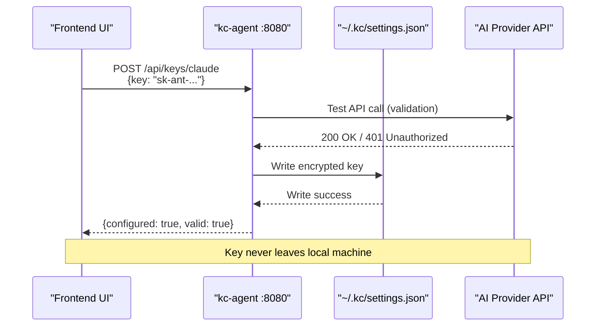
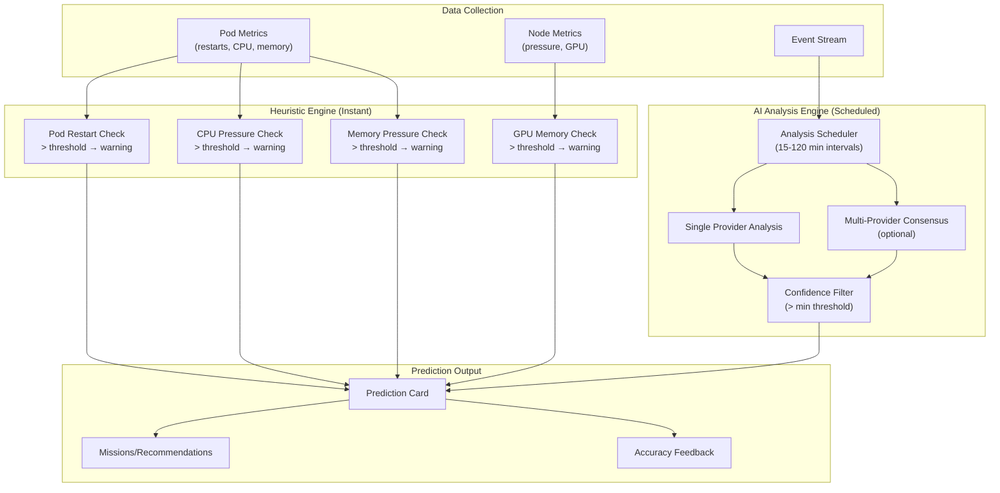
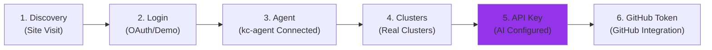
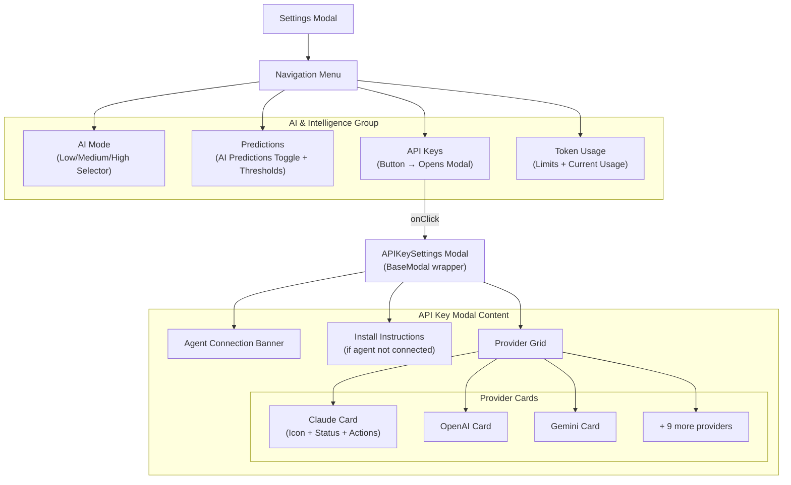

<!-- source: DeepWiki mcp.deepwiki.com · repo kubestellar/console · page 10.1 AI & Intelligence Settings · fetched 2026-10-26 -->

# AI & Intelligence Settings

<details>
<summary>Relevant source files</summary>

The following files were used as context for generating this wiki page:

- [.env.example](.env.example)
- [netlify.toml](netlify.toml)
- [pkg/api/handlers/analytics_proxy.go](pkg/api/handlers/analytics_proxy.go)
- [web/netlify/functions/analytics-collect.mts](web/netlify/functions/analytics-collect.mts)
- [web/package-lock.json](web/package-lock.json)
- [web/package.json](web/package.json)
- [web/src/components/agent/APIKeySettings.tsx](web/src/components/agent/APIKeySettings.tsx)
- [web/src/components/layout/UserProfileDropdown.tsx](web/src/components/layout/UserProfileDropdown.tsx)
- [web/src/hooks/useLocalAgent.ts](web/src/hooks/useLocalAgent.ts)
- [web/src/lib/analytics.ts](web/src/lib/analytics.ts)
- [web/src/locales/de/common.json](web/src/locales/de/common.json)
- [web/src/locales/en/common.json](web/src/locales/en/common.json)
- [web/src/locales/es/common.json](web/src/locales/es/common.json)
- [web/src/locales/fr/common.json](web/src/locales/fr/common.json)
- [web/src/locales/hi/common.json](web/src/locales/hi/common.json)
- [web/src/locales/it/common.json](web/src/locales/it/common.json)
- [web/src/locales/ja/common.json](web/src/locales/ja/common.json)
- [web/src/locales/pt/common.json](web/src/locales/pt/common.json)
- [web/src/locales/zh/common.json](web/src/locales/zh/common.json)
- [web/vite.config.ts](web/vite.config.ts)

</details>


## Purpose and Scope

This page documents the **AI & Intelligence** settings group within the Settings modal, which controls all AI-powered features in the KubeStellar Console. This includes AI mode selection, predictive failure detection, API key management for multiple providers, and token usage monitoring.

For settings related to kc-agent connection status and cluster access, see [Integration Settings](#10.2). For general settings persistence and backup, see [Settings System](#10).

---

## System Architecture

The AI & Intelligence settings control a multi-tier system that bridges the frontend UI, local agent, and external AI providers.

### High-Level Flow

```mermaid
graph TB
    subgraph "Frontend (React)"
        SettingsModal["Settings Modal"]
        APIKeyModal["APIKeySettings.tsx"]
        PredictionsPanel["Predictions Settings"]
        TokenPanel["Token Usage Panel"]
        AIMode["AI Mode Selector"]
    end
    
    subgraph "kc-agent (Local)"
        AgentHealth["Health Endpoint<br/>/health"]
        KeysEndpoint["Keys Status<br/>/api/keys"]
        KeysSet["Set Key<br/>/api/keys/:provider"]
        KeysDelete["Delete Key<br/>/api/keys/:provider"]
        ConfigFile["~/.kc/settings.json<br/>(AES-256 encrypted)"]
    end
    
    subgraph "AI Providers"
        Anthropic["Anthropic Claude<br/>claude-sonnet-4-5"]
        OpenAI["OpenAI GPT<br/>gpt-4-turbo"]
        Gemini["Google Gemini<br/>gemini-2.0-flash"]
        IDEs["IDE Extensions<br/>Cursor/VSCode/Windsurf"]
    end
    
    subgraph "Analytics"
        ConversionFunnel["Conversion Funnel<br/>Step 5: api_key"]
        AnalyticsLib["analytics.ts"]
    end
    
    SettingsModal --> AIMode
    SettingsModal --> PredictionsPanel
    SettingsModal --> TokenPanel
    SettingsModal --> APIKeyModal
    
    APIKeyModal -->|"GET /api/keys"| KeysEndpoint
    APIKeyModal -->|"POST /api/keys/:provider"| KeysSet
    APIKeyModal -->|"DELETE /api/keys/:provider"| KeysDelete
    
    AgentHealth -->|"Returns token usage"| TokenPanel
    
    KeysEndpoint --> ConfigFile
    KeysSet --> ConfigFile
    KeysDelete --> ConfigFile
    
    ConfigFile -."|Validates with"| Anthropic
    ConfigFile -."|Validates with"| OpenAI
    ConfigFile -."|Validates with"| Gemini
    ConfigFile -."|Reads from"| IDEs
    
    KeysSet --> AnalyticsLib
    AnalyticsLib --> ConversionFunnel
```

**Sources:** [web/src/components/agent/APIKeySettings.tsx:1-600](), [web/src/hooks/useLocalAgent.ts:1-80](), [web/src/lib/analytics.ts:352-381]()

---

## AI Mode Configuration

### Three Operating Modes

The AI Mode setting controls the balance between AI assistance and direct kubectl operations across the console.

| Mode | Description | Token Usage | Primary Use Case |
|------|-------------|-------------|------------------|
| **Low** | Direct kubectl, minimal tokens | ~100-500/day | Production environments, cost-conscious users |
| **Medium** | AI for analysis, kubectl for data | ~1000-3000/day | Balanced troubleshooting, default recommended |
| **High** | Full AI assistance | ~5000+/day | Development, learning, maximum automation |

### Translation Keys

```
settings.aiMode.title: "AI Usage Mode"
settings.aiMode.subtitle: "Balance between AI assistance and direct kubectl"
settings.aiMode.low: "Low"
settings.aiMode.medium: "Medium"  
settings.aiMode.high: "High"
settings.aiMode.lowDesc: "Direct kubectl, minimal tokens"
settings.aiMode.mediumDesc: "AI for analysis, kubectl for data"
settings.aiMode.highDesc: "Full AI assistance"
```

**Sources:** [web/src/locales/en/common.json:205-216]()

---

## API Key Management System

### Supported Providers

The console supports API keys for **12 AI providers**, organized into two categories:

#### Core AI Providers (Direct API Access)
- **Anthropic Claude** (`claude`) - Recommended for reasoning tasks
- **OpenAI GPT** (`openai`) - Industry standard, broad compatibility
- **Google Gemini** (`gemini`) - Fast inference, multimodal support

#### IDE Extension Providers (Key Detection Only)
- **Cursor** (`cursor`) - Anysphere's AI-native editor
- **VSCode Copilot** (`vscode`) - Microsoft's extension
- **Windsurf** (`windsurf`) - Codeium's editor
- **Cline** (`cline`) - Claude integration for VSCode
- **JetBrains AI** (`jetbrains`) - IntelliJ family
- **Zed AI** (`zed`) - High-performance editor
- **Continue.dev** (`continue`) - Open-source autopilot
- **Raycast AI** (`raycast`) - macOS launcher integration
- **Open WebUI** (`open-webui`) - Self-hosted interface

### APIKeySettings Component

```mermaid
graph TB
    Modal["BaseModal<br/>APIKeySettings"]
    
    subgraph "State Management"
        KeysStatus["keysStatus: KeyStatus[]"]
        ConfigPath["configPath: string"]
        Loading["loading: boolean"]
        ShowKey["showKey: Record&lt;string,bool&gt;"]
        EditingKey["editingKey: string | null"]
        KeyValue["keyValue: string"]
    end
    
    subgraph "API Communication"
        FetchKeys["fetchKeys()"]
        SetKey["setKey(provider, key)"]
        DeleteKey["deleteKey(provider)"]
    end
    
    subgraph "UI Components"
        ProviderList["Provider Cards"]
        KeyInput["Key Input Field"]
        ValidateButton["Validate Button"]
        DeleteButton["Delete Button"]
        ShowHideToggle["Show/Hide Toggle"]
        DocsLink["External Docs Link"]
    end
    
    subgraph "kc-agent Endpoints"
        GetKeys["/api/keys<br/>GET"]
        PostKey["/api/keys/:provider<br/>POST {key}"]
        DelKey["/api/keys/:provider<br/>DELETE"]
    end
    
    Modal --> KeysStatus
    Modal --> FetchKeys
    
    FetchKeys -->|"HTTP GET"| GetKeys
    SetKey -->|"HTTP POST"| PostKey
    DeleteKey -->|"HTTP DELETE"| DelKey
    
    GetKeys -->|"Returns KeysStatusResponse"| KeysStatus
    
    ProviderList --> KeyInput
    KeyInput --> SetKey
    ValidateButton --> SetKey
    DeleteButton --> DeleteKey
    
    SetKey -."|Calls"| AnalyticsEmit["emitApiKeyConfigured()"]
    DeleteKey -."|Calls"| AnalyticsRemove["emitApiKeyRemoved()"]
```

**Sources:** [web/src/components/agent/APIKeySettings.tsx:103-600]()

### Key Status Interface

```typescript
interface KeyStatus {
  provider: string          // "claude" | "openai" | "gemini" | ...
  displayName: string       // "Anthropic Claude"
  configured: boolean       // Key exists in config
  source?: 'env' | 'config' // Environment var vs settings file
  valid?: boolean           // Validation check result
  error?: string            // Validation error message
}

interface KeysStatusResponse {
  keys: KeyStatus[]
  configPath: string        // "~/.kc/settings.json"
}
```

**Sources:** [web/src/components/agent/APIKeySettings.tsx:14-26]()

### Security Model

API keys are **never transmitted through the browser**. All key operations flow through kc-agent:

1. **Storage Location**: `~/.kc/settings.json` on local machine
2. **Encryption**: AES-256-GCM at rest
3. **Validation**: kc-agent makes direct API calls to test keys
4. **Environment Override**: Keys in env vars (e.g., `ANTHROPIC_API_KEY`) take precedence and cannot be deleted



**Sources:** [web/src/components/agent/APIKeySettings.tsx:178-267](), [web/src/locales/en/common.json:217-222]()

---

## Token Usage Monitoring

### Real-Time Tracking via kc-agent

The kc-agent tracks token consumption across three time windows by monitoring AI provider API responses.

```typescript
interface AgentHealth {
  status: string
  version: string
  clusters: number
  hasClaude: boolean
  claude?: {
    installed: boolean
    path?: string
    version?: string
    tokenUsage: {
      session: { input: number; output: number }
      today: { input: number; output: number }
      thisMonth: { input: number; output: number }
    }
  }
}
```

**Sources:** [web/src/hooks/useLocalAgent.ts:6-21]()

### Token Limits Configuration

Users can configure monthly limits and alert thresholds in the Token Usage settings panel.

| Setting | Description | Default | Range |
|---------|-------------|---------|-------|
| **Monthly Limit** | Max tokens per calendar month | 100,000 | 10k - 10M |
| **Warning At (%)** | Show yellow warning badge | 70% | 50-90% |
| **Critical At (%)** | Show red critical badge | 90% | 60-100% |

### Translation Keys

```
settings.tokens.title: "Token Usage"
settings.tokens.subtitle: "Configure AI token limits and alerts"
settings.tokens.resetUsage: "Reset Usage"
settings.tokens.currentUsage: "Current Usage"
settings.tokens.tokensLabel: "tokens"
settings.tokens.monthlyLimit: "Monthly Limit"
settings.tokens.warningAt: "Warning at (%)"
settings.tokens.criticalAt: "Critical at (%)"
```

**Sources:** [web/src/locales/en/common.json:247-258]()

### Display Components

The token usage display appears in two locations:

1. **Settings Modal → Token Usage Panel**: Detailed configuration with sliders
2. **Local Agent Card** (Settings → Local Agent): Live session/today/month counters

```
Agent v0.5.2                    Connected
├─ Clusters: 4
├─ Claude Code: Available
└─ Token Usage
   ├─ This Session:    1,245 tokens
   ├─ Today:           8,932 tokens  
   └─ This Month:     45,678 tokens  (46% of 100k limit)
```

**Sources:** [web/src/locales/en/common.json:223-246]()

---

## Predictive Failure Detection

### Overview

The Predictive Failure Detection system combines **heuristic thresholds** (instant) with **AI analysis** (scheduled) to proactively identify cluster issues before they cause outages.



**Sources:** [web/src/locales/en/common.json:285-317]()

### Configuration Settings

#### AI Predictions Toggle

Enables or disables AI-powered pattern detection entirely. When disabled, only heuristic thresholds are active.

#### Analysis Interval

Controls how frequently AI analyzes cluster data:
- **Minimum**: 15 minutes (aggressive monitoring)
- **Maximum**: 2 hours (cost-effective)
- **Default**: 60 minutes
- **Trade-off**: Lower intervals = more API calls/tokens but faster detection

#### Minimum Confidence

Only show predictions with confidence above this threshold:
- **Range**: 50% - 90%
- **50%**: More predictions, higher false positive rate
- **90%**: Only high-confidence predictions, may miss edge cases

#### Multi-Provider Consensus

When enabled, runs predictions on **multiple AI providers** simultaneously and boosts confidence when they agree:
- **Providers**: Claude + OpenAI + Gemini
- **Confidence Boost**: +10-20% when 2+ providers agree
- **Cost Impact**: 2-3x token usage

### Heuristic Thresholds

Instant predictions triggered without AI analysis:

| Threshold | Default | Range | Trigger Condition |
|-----------|---------|-------|-------------------|
| **Pod Restart Warning** | 5 restarts | 3-20 | Pod restarted N times in 1 hour |
| **CPU Pressure** | 85% | 70-95% | Node CPU usage exceeds threshold |
| **Memory Pressure** | 90% | 80-95% | Node memory usage exceeds threshold |
| **GPU Memory Pressure** | 95% | 85-98% | GPU memory usage exceeds threshold |

**Sources:** [web/src/locales/en/common.json:301-308]()

### Accuracy Tracking

The system tracks prediction accuracy based on user feedback:

```
Prediction Accuracy: 78% accurate
Total Rated: 234 predictions
├─ Accurate:   182 (78%)
└─ Inaccurate:  52 (22%)

By Provider:
├─ Claude:  81% (93 rated)
├─ OpenAI:  76% (87 rated)
└─ Gemini:  73% (54 rated)
```

**Translation Keys:**
```
settings.predictions.predictionAccuracy: "Prediction Accuracy"
settings.predictions.percentAccurate: "{{percent}}% accurate"
settings.predictions.totalRated: "Total Rated"
settings.predictions.accurate: "Accurate"
settings.predictions.inaccurate: "Inaccurate"
settings.predictions.byProvider: "By Provider:"
settings.predictions.clearFeedback: "Clear feedback history"
```

**Sources:** [web/src/locales/en/common.json:309-316]()

---

## Analytics & Conversion Tracking

### Conversion Funnel Integration

The AI & Intelligence settings are part of a **6-step conversion funnel** that tracks user activation:



**Step 5 (api_key)** is tracked when:
- User saves an API key via `APIKeySettings` modal
- `emitApiKeyConfigured(provider)` is called
- `emitConversionStep(5, 'api_key', { provider })` fires

**Sources:** [web/src/lib/analytics.ts:362-381](), [web/src/components/agent/APIKeySettings.tsx:257-263]()

### Tracked Events

```typescript
// API Key Lifecycle
emitApiKeyConfigured(provider: string)   // Key saved
emitApiKeyRemoved(provider: string)      // Key deleted

// AI Provider Connection
emitApiProviderConnected(provider: string) // First successful API call

// Conversion Funnel
emitConversionStep(step: 5, stepName: 'api_key', details?: { provider: string })
```

**Sources:** [web/src/lib/analytics.ts:352-361]()

---

## Settings Persistence

### Storage Hierarchy

AI & Intelligence settings are persisted in **two layers**:

1. **Frontend Settings** (Browser localStorage)
   - AI Mode selection (`aiMode`)
   - Prediction thresholds (`predictions.thresholds`)
   - Token limits (`tokens.monthlyLimit`, `tokens.warningAt`, `tokens.criticalAt`)

2. **Backend Settings** (kc-agent config file)
   - API Keys (encrypted at `~/.kc/settings.json`)
   - Provider selection (`DEFAULT_AGENT`)
   - Model overrides (`CLAUDE_MODEL`, `OPENAI_MODEL`, `GEMINI_MODEL`)

### Backup & Export

Settings backup includes **non-sensitive preferences only**. API keys remain in the encrypted config file and are **not included in exports**.

```json
{
  "aiMode": "medium",
  "predictions": {
    "enabled": true,
    "analysisInterval": 60,
    "minConfidence": 70,
    "multiProvider": false,
    "thresholds": {
      "podRestarts": 5,
      "cpuPressure": 85,
      "memoryPressure": 90,
      "gpuMemoryPressure": 95
    }
  },
  "tokens": {
    "monthlyLimit": 100000,
    "warningAt": 70,
    "criticalAt": 90
  }
}
```

**Sources:** [web/src/locales/en/common.json:411-430]()

---

## Environment Variables

### Backend Configuration (.env)

```bash
# AI Provider API Keys (at least one required for AI features)
ANTHROPIC_API_KEY=sk-ant-api03-...
OPENAI_API_KEY=sk-...
GOOGLE_API_KEY=AIza...

# Model Selection (optional - uses defaults if not set)
CLAUDE_MODEL=claude-sonnet-4-5-20250514
OPENAI_MODEL=gpt-4-turbo
GEMINI_MODEL=gemini-2.0-flash

# Default AI Agent (optional - auto-detected from available keys)
# Options: claude, openai, gemini
DEFAULT_AGENT=claude
```

**Sources:** [.env.example:42-62]()

### Frontend Configuration (vite.config.ts)

No frontend environment variables required for AI settings. All configuration flows through kc-agent.

---

## kc-agent Endpoints

### GET /api/keys

Returns status of all configured API keys without exposing key values.

**Response:**
```json
{
  "keys": [
    {
      "provider": "claude",
      "displayName": "Anthropic Claude",
      "configured": true,
      "source": "config",
      "valid": true
    },
    {
      "provider": "openai",
      "displayName": "OpenAI GPT",
      "configured": true,
      "source": "env",
      "valid": true
    },
    {
      "provider": "gemini",
      "displayName": "Google Gemini",
      "configured": false
    }
  ],
  "configPath": "~/.kc/settings.json"
}
```

### POST /api/keys/:provider

Saves a new API key for the specified provider. Performs validation by making a test API call.

**Request:**
```json
{
  "key": "sk-ant-api03-..."
}
```

**Response:**
```json
{
  "success": true,
  "provider": "claude",
  "valid": true,
  "configured": true
}
```

### DELETE /api/keys/:provider

Removes an API key from the config file. Environment-sourced keys cannot be deleted.

**Response:**
```json
{
  "success": true,
  "provider": "claude",
  "configured": false
}
```

**Sources:** [web/src/components/agent/APIKeySettings.tsx:138-267]()

---

## UI Component Tree



**Sources:** [web/src/components/agent/APIKeySettings.tsx:103-600](), [web/src/locales/en/common.json:179-197]()

---

