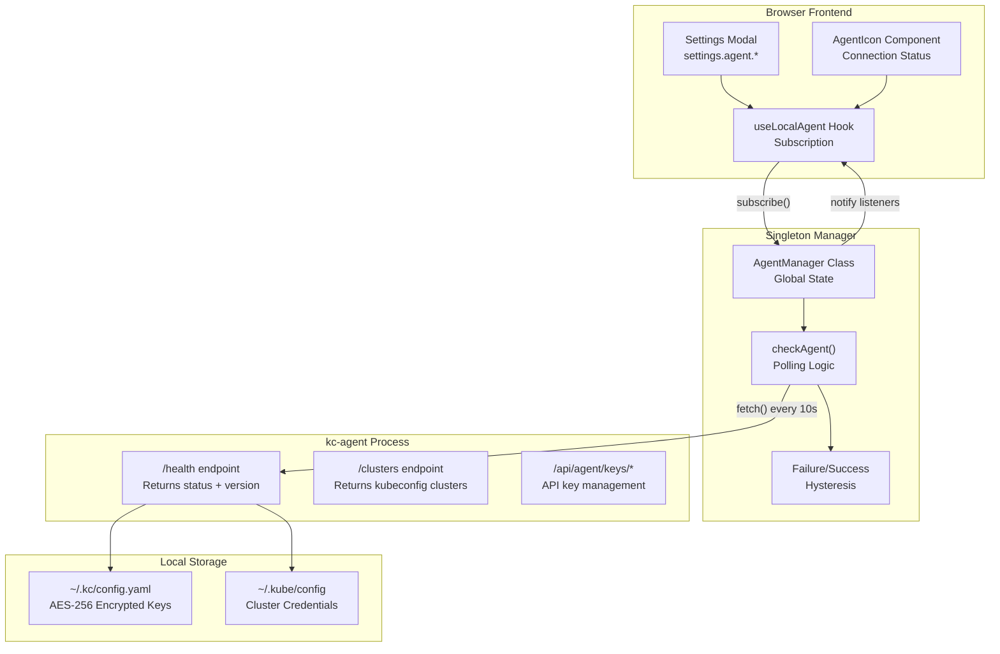
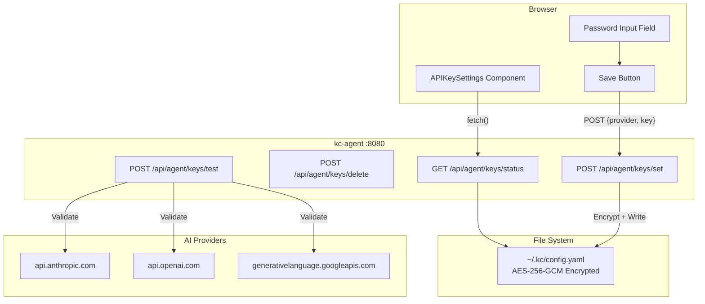
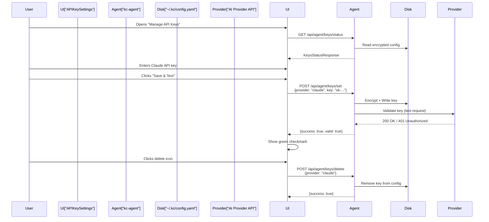
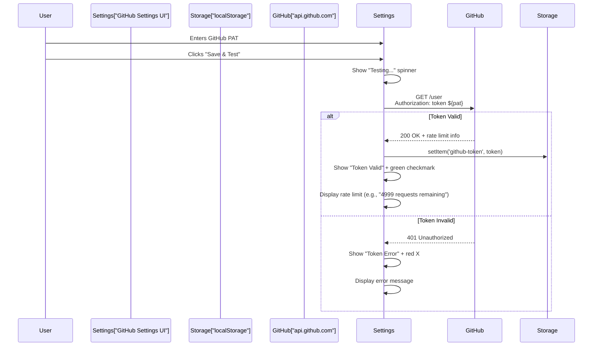
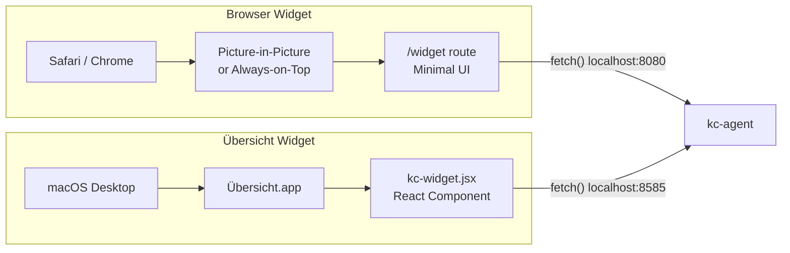
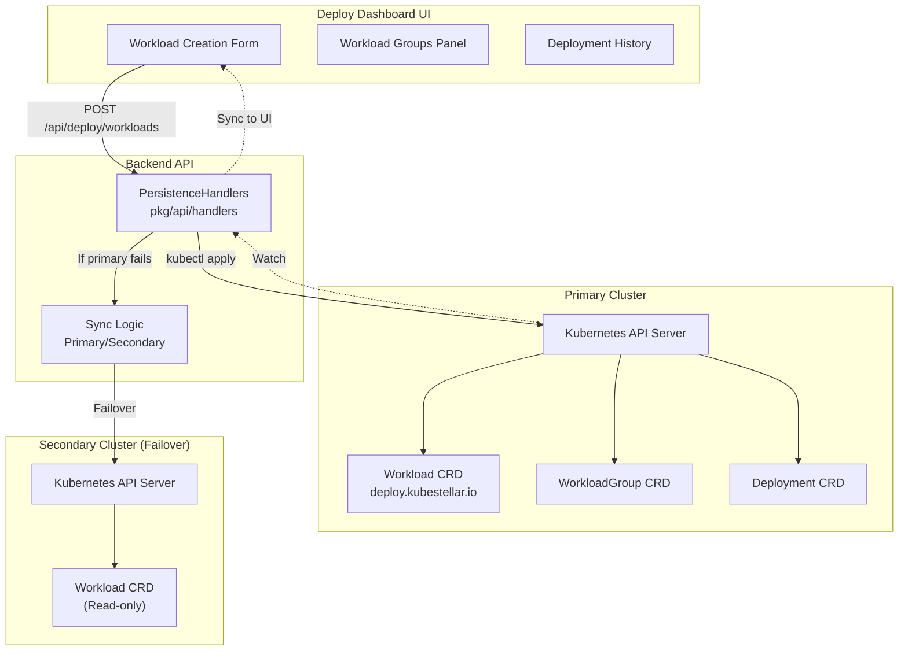
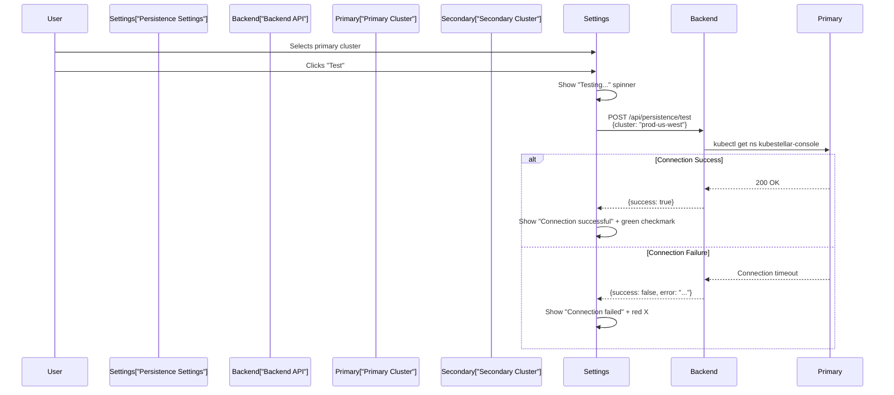
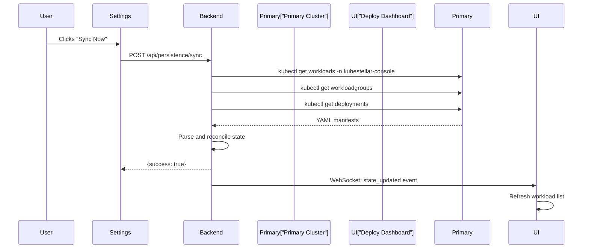
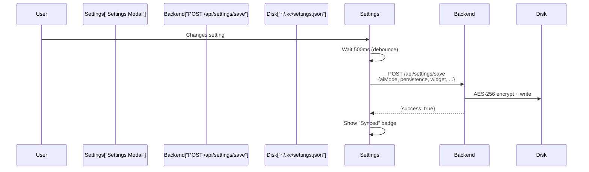

<!-- source: DeepWiki mcp.deepwiki.com · repo kubestellar/console · page 10.2 Integration Settings · fetched 2026-10-26 -->

# Integration Settings

<details>
<summary>Relevant source files</summary>

The following files were used as context for generating this wiki page:

- [.env.example](.env.example)
- [netlify.toml](netlify.toml)
- [pkg/api/handlers/analytics_proxy.go](pkg/api/handlers/analytics_proxy.go)
- [web/netlify/functions/analytics-collect.mts](web/netlify/functions/analytics-collect.mts)
- [web/package-lock.json](web/package-lock.json)
- [web/package.json](web/package.json)
- [web/src/components/agent/APIKeySettings.tsx](web/src/components/agent/APIKeySettings.tsx)
- [web/src/components/layout/UserProfileDropdown.tsx](web/src/components/layout/UserProfileDropdown.tsx)
- [web/src/hooks/useLocalAgent.ts](web/src/hooks/useLocalAgent.ts)
- [web/src/lib/analytics.ts](web/src/lib/analytics.ts)
- [web/src/locales/de/common.json](web/src/locales/de/common.json)
- [web/src/locales/en/common.json](web/src/locales/en/common.json)
- [web/src/locales/es/common.json](web/src/locales/es/common.json)
- [web/src/locales/fr/common.json](web/src/locales/fr/common.json)
- [web/src/locales/hi/common.json](web/src/locales/hi/common.json)
- [web/src/locales/it/common.json](web/src/locales/it/common.json)
- [web/src/locales/ja/common.json](web/src/locales/ja/common.json)
- [web/src/locales/pt/common.json](web/src/locales/pt/common.json)
- [web/src/locales/zh/common.json](web/src/locales/zh/common.json)
- [web/vite.config.ts](web/vite.config.ts)

</details>


## Purpose and Scope

This document explains the **Integrations** settings group in the Settings modal, which controls external system connections and data persistence. This includes:

- **Local Agent (kc-agent)**: Connection to the local agent for kubeconfig access and AI provider integration
- **API Keys**: Management of AI provider credentials (Claude, OpenAI, Gemini, etc.)
- **GitHub Integration**: GitHub Personal Access Token for the GitHub Activity card
- **Desktop Widget**: Floating desktop widget configuration
- **Deploy Persistence**: Custom Resource storage for Deploy dashboard state

For AI behavior settings like predictions and token limits, see [AI & Intelligence Settings](#10.1). For visual customization, see [Appearance & Accessibility](#10.3).

---

## Local Agent Configuration

The **Local Agent** (`kc-agent`) is an optional local process that provides:
- Access to all clusters in your `~/.kube/config`
- Secure API key storage with AES-256 encryption
- Real-time token usage tracking for AI providers
- No cloud dependencies (runs entirely on `127.0.0.1:8080`)

### Agent Connection Architecture



**Sources:** [web/src/hooks/useLocalAgent.ts:54-421]()

### Connection States and Hysteresis

The agent connection uses a state machine with hysteresis to prevent UI flicker during transient network issues:

| State | Description | Poll Interval | Transition Requirements |
|-------|-------------|---------------|------------------------|
| `connecting` | Initial state, searching for agent | 10s | 1 successful health check → `connected` |
| `connected` | Agent healthy, all features available | 10s | 2 consecutive failures → `disconnected` |
| `degraded` | Agent connected but data endpoints failing | 10s | 3 data errors in 60s window |
| `disconnected` | Agent unavailable, using demo data | 60s | 2 consecutive successes → `connected` |

**Hysteresis Parameters:**
- `FAILURE_THRESHOLD = 2` — Require 2 consecutive failures before disconnecting ([web/src/hooks/useLocalAgent.ts:33]())
- `SUCCESS_THRESHOLD = 2` — Require 2 consecutive successes before reconnecting ([web/src/hooks/useLocalAgent.ts:34]())
- `AGGRESSIVE_POLL_INTERVAL = 1000` — 1-second polling during aggressive detection ([web/src/hooks/useLocalAgent.ts:35]())
- `AGGRESSIVE_DETECT_DURATION = 10000` — 10 seconds of rapid polling ([web/src/hooks/useLocalAgent.ts:36]())

**Sources:** [web/src/hooks/useLocalAgent.ts:23-36](), [web/src/hooks/useLocalAgent.ts:215-276]()

### Aggressive Detection Mode

When users toggle demo mode OFF or manually trigger reconnection, the system enters **aggressive detection mode** to immediately find the agent without waiting for the next poll cycle:

```mermaid
sequenceDiagram
    participant User
    participant UI["Settings UI"]
    participant Manager["AgentManager"]
    participant Agent["kc-agent :8080"]
    
    User->>UI: Toggles demo mode OFF
    UI->>Manager: triggerAggressiveDetection()
    Manager->>Manager: Reset to 'connecting' state
    Manager->>Manager: Set poll interval = 1s
    Manager->>Agent: Immediate health check
    Agent-->>Manager: 200 OK + health data
    Manager->>Manager: Set poll interval = 10s
    Manager->>UI: Status = 'connected'
    
    Note over Manager: After 10 seconds, return<br/>to normal poll interval
```

**Sources:** [web/src/hooks/useLocalAgent.ts:331-360](), [web/src/hooks/useLocalAgent.ts:416-421]()

### Non-Hook API for Module-Level Code

The agent manager provides module-level functions for code that cannot use React hooks:

| Function | Purpose | Return Type |
|----------|---------|-------------|
| `isAgentConnected()` | Check if agent is connected or degraded | `boolean` |
| `isAgentUnavailable()` | Check if agent is confirmed disconnected | `boolean` |
| `reportAgentDataError(endpoint, error)` | Report data endpoint failures | `void` |
| `reportAgentDataSuccess()` | Report successful data fetch | `void` |
| `triggerAggressiveDetection()` | Force immediate reconnection attempt | `Promise<boolean>` |

**Usage Example:**
```typescript
// In useMCP.ts or other data fetching hooks
import { isAgentUnavailable, reportAgentDataError } from '../hooks/useLocalAgent'

async function fetchClusters() {
  if (isAgentUnavailable()) {
    return DEMO_DATA // Skip agent, use demo data
  }
  
  try {
    const response = await fetch('/api/clusters')
    return await response.json()
  } catch (error) {
    reportAgentDataError('/api/clusters', error.message)
    throw error
  }
}
```

**Sources:** [web/src/hooks/useLocalAgent.ts:370-421]()

### Installation Instructions

The Settings modal displays installation commands when the agent is not detected:

```bash
# Homebrew (macOS)
brew install kubestellar/tap/kc-agent && kc-agent

# Build from source
go install github.com/kubestellar/console/cmd/kc-agent@latest && kc-agent
```

**Benefits displayed in UI:**
- Access all your kubeconfig clusters
- Real-time token usage tracking
- Secure local-only connection (127.0.0.1)

**Sources:** [web/src/locales/en/common.json:223-245]()

---

## API Keys Management

API keys for AI providers (Claude, OpenAI, Gemini) and coding agents (Cursor, VSCode, Windsurf, etc.) are managed through the kc-agent and stored encrypted on disk.

### API Key Storage Architecture



**Sources:** [web/src/components/agent/APIKeySettings.tsx:1-615]()

### Supported Providers

The system supports 12 providers across AI services and coding agents:

| Category | Providers | Environment Variable | Placeholder |
|----------|-----------|---------------------|-------------|
| **AI Services** | Claude (Anthropic) | `ANTHROPIC_API_KEY` | `sk-ant-api03-...` |
| | OpenAI | `OPENAI_API_KEY` | `sk-...` |
| | Gemini (Google) | `GOOGLE_API_KEY` | `AIza...` |
| **Coding Agents** | Cursor | `CURSOR_API_KEY` | `cursor-...` |
| | VSCode Copilot | `VSCODE_API_KEY` | `vscode-...` |
| | Windsurf (Codeium) | `WINDSURF_API_KEY` | `codeium-...` |
| | Cline | `CLINE_API_KEY` | `cline-...` |
| | JetBrains AI | `JETBRAINS_API_KEY` | `jb-...` |
| | Zed Editor | `ZED_API_KEY` | `zed-...` |
| | Continue | `CONTINUE_API_KEY` | `continue-...` |
| | Raycast AI | `RAYCAST_API_KEY` | `raycast-...` |
| | Open WebUI | `OPEN_WEBUI_API_KEY` | `owui-...` |

**Sources:** [web/src/components/agent/APIKeySettings.tsx:33-82]()

### Key Status Response

The agent returns the status of all configured keys:

```typescript
interface KeyStatus {
  provider: string        // e.g., "claude", "openai"
  displayName: string     // e.g., "Claude (Anthropic)"
  configured: boolean     // True if key exists
  source?: 'env' | 'config' // Where key is stored
  valid?: boolean         // True if validation passed
  error?: string          // Error message if validation failed
}

interface KeysStatusResponse {
  keys: KeyStatus[]
  configPath: string      // e.g., "/Users/alice/.kc/config.yaml"
}
```

**Sources:** [web/src/components/agent/APIKeySettings.tsx:14-26]()

### API Key Operations



**Sources:** [web/src/components/agent/APIKeySettings.tsx:160-250]()

### Encryption and Security

- **Storage Location**: `~/.kc/config.yaml` on user's local machine
- **Encryption**: AES-256-GCM with unique nonce per field
- **Key Derivation**: PBKDF2 from machine-specific salt (not user password)
- **Scope**: Keys never leave the local machine except for direct API calls to providers
- **Backup**: Encrypted keys are included in settings backup exports ([web/src/locales/en/common.json:429]())

**Sources:** [web/src/locales/en/common.json:220]()

### Analytics Integration

When users configure or remove API keys, analytics events are emitted:

```typescript
// On successful save
emitApiKeyConfigured(provider) // e.g., 'claude'

// On delete
emitApiKeyRemoved(provider)

// On first API key (conversion funnel step 5)
emitConversionStep(5, 'api_key', { provider })
```

**Sources:** [web/src/components/agent/APIKeySettings.tsx:8](), [web/src/lib/analytics.ts:352-361]()

---

## GitHub Integration

The **GitHub Integration** setting configures a Personal Access Token (PAT) for the GitHub Activity card. This token enables:
- Fetching repository activity (commits, PRs, issues)
- Displaying contribution graphs
- Accessing private repositories (if granted)

### Token Storage and Security

**Storage Method:**
- Stored in browser `localStorage` under key `github-token`
- **Not encrypted** — plain text in browser storage
- **Security warning** displayed in UI: "Token is stored in browser localStorage (not encrypted). Use a token with minimal permissions and set an expiration date."

**Recommended Token Configuration:**
1. **Fine-grained Token** (preferred): Public repositories (read-only), no additional permissions
2. **Classic Token**: No scopes for public repos; `repo` scope for private repos

**Sources:** [web/src/locales/en/common.json:259-283]()

### Token Validation



**Sources:** [web/src/locales/en/common.json:262-275]()

### Rate Limit Information

The UI displays GitHub API rate limit status:

| Without Token | With Token |
|---------------|------------|
| 60 requests/hour | 5,000 requests/hour |

**Rate Limit Display:**
- "requests remaining" count
- "Rate limit resets at HH:MM" timestamp
- Warning: "Limited to 60 requests/hour" (for unauthenticated requests)

**Sources:** [web/src/locales/en/common.json:267-270]()

### Token Creation Links

The Settings UI provides direct links to GitHub token creation pages:

| Token Type | URL | Description |
|------------|-----|-------------|
| Fine-grained | `https://github.com/settings/personal-access-tokens/new` | Recommended: granular permissions |
| Classic | `https://github.com/settings/tokens/new` | Legacy: simpler but broader scopes |

**Sources:** [web/src/locales/en/common.json:279-282]()

---

## Desktop Widget

The **Desktop Widget** feature provides a floating, always-visible cluster status monitor that lives outside the browser. Two implementations are supported:

### Widget Types



**Sources:** [web/src/locales/en/common.json:435-458]()

### Browser Widget Setup

**Safari:**
1. Click "Open Widget Page" button
2. Right-click the tab → "Enter Picture in Picture"
3. Floating widget appears, always-on-top

**Chrome/Edge:**
1. Click "Open Widget Page" button
2. Install "Always on Top" browser extension
3. Pin the widget tab with extension

**Widget Features:**
- Draggable window
- Click stats to open full console
- Auto-refreshes every 30 seconds
- Minimal UI (no navigation, just cluster status)

**Sources:** [web/src/locales/en/common.json:443-446]()

### Übersicht Widget Setup

**Installation Steps:**
1. Download `kc-widget.jsx` file
2. Move to `~/Library/Application Support/Übersicht/widgets/`
3. Ensure `kc-agent` is running on port `8585`
4. Restart Übersicht

**Übersicht App:** Free macOS desktop widget engine
- Download: `https://tracesof.net/uebersicht/`
- Allows custom widgets in React/JSX
- Always visible, draggable, customizable

**Widget Preview Description:**
- "Draggable · Click stats to open console · Auto-refreshes every 30s"

**Sources:** [web/src/locales/en/common.json:447-457]()

### Widget Configuration

| Setting | Browser Widget | Übersicht Widget |
|---------|----------------|------------------|
| **Port** | `:8080` (standard) | `:8585` (alternate) |
| **Installation** | No installation required | Download `.jsx` file |
| **Platform** | Any OS with browser | macOS only |
| **Persistence** | Tab-based (can close) | Always visible |
| **Customization** | Browser zoom only | Full JSX editing |

**Sources:** [web/src/locales/en/common.json:435-458]()

---

## Deploy Persistence

**Deploy Persistence** stores the Deploy dashboard's workload definitions, groups, and deployment history as Kubernetes Custom Resources (CRs). This enables:
- kubectl-based management of workloads
- GitOps workflows for deployment configurations
- Backup/restore via standard Kubernetes tools
- Multi-user collaboration with RBAC

### Persistence Architecture



**Sources:** [web/src/locales/en/common.json:362-390]()

### Configuration Settings

| Setting | Options | Description |
|---------|---------|-------------|
| **Enable Persistence** | On / Off | Master toggle for CR storage |
| **Primary Cluster** | Dropdown | Main cluster for CR storage |
| **Namespace** | Text input | Namespace for console CRs (default: `kubestellar-console`) |
| **Sync Mode** | Primary Only / Active-Passive | Failover behavior |
| **Secondary Cluster** | Dropdown | Failover cluster (Active-Passive only) |

**Sources:** [web/src/locales/en/common.json:367-382]()

### Sync Modes

**Primary Only:**
- Write CRs to primary cluster only
- If primary unavailable, persistence fails
- Simpler setup, no failover

**Active-Passive:**
- Write CRs to primary cluster
- Replicate to secondary cluster (read-only)
- Automatic failover if primary is unavailable
- Secondary becomes active until primary recovers

**Sources:** [web/src/locales/en/common.json:375-379]()

### Connection Testing

The Settings UI provides a "Test" button for each cluster:



**Sources:** [web/src/locales/en/common.json:371-374]()

### Status Display

The Settings UI shows real-time persistence status:

| Field | Description | Example |
|-------|-------------|---------|
| **Active Cluster** | Currently writing cluster | "prod-us-west" |
| **Status** | Operational state | "Connected", "Disconnected" |
| **Message** | Error or info message | "Primary cluster unavailable, using secondary" |
| **Failover Indicator** | Shows if using secondary | "(Failover)" label |

**Sources:** [web/src/locales/en/common.json:383-388]()

### kubectl Integration

When persistence is enabled, users can manage workloads directly with kubectl:

```bash
# List all workloads
kubectl get workloads -n kubestellar-console

# Create a workload from YAML
kubectl apply -f my-workload.yaml

# Delete a workload
kubectl delete workload my-app -n kubestellar-console

# Changes made via kubectl automatically sync to the UI
```

**UI Hint:** "When enabled, you can use kubectl to manage workloads, groups, and deployments. Changes made via kubectl will automatically sync to the UI."

**Sources:** [web/src/locales/en/common.json:390]()

### Sync Operation

Users can manually trigger synchronization:



**Sources:** [web/src/locales/en/common.json:365-366]()

---

## Settings Persistence

All integration settings (except GitHub token) are automatically persisted to disk via the backend's settings API:

### Save Flow



**Saved Settings:**
- Local agent connection preferences
- API key configuration metadata (not keys themselves — those are in kc-agent's config)
- GitHub token enablement flag (token stored in localStorage)
- Widget type preference
- Deploy persistence configuration (cluster, namespace, sync mode)

**Sources:** [web/src/locales/en/common.json:197-204]()

---

## Related Pages

- [AI & Intelligence Settings](#10.1) — AI mode, predictions, API keys, token usage
- [Appearance & Accessibility](#10.3) — Theme selection, accessibility features
- [Local Agent (kc-agent)](#2.3) — Architecture and implementation details
- [Settings System](#10) — Overall settings organization and structure

---

