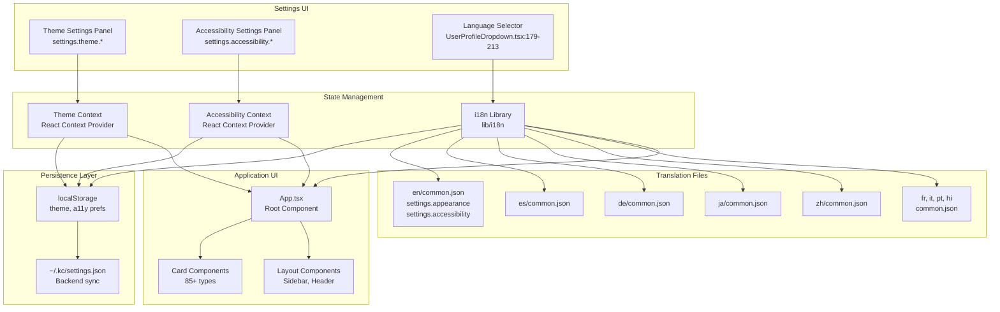
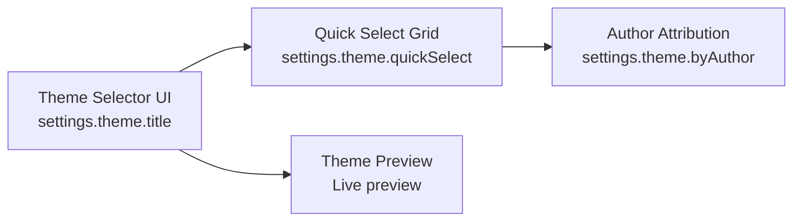
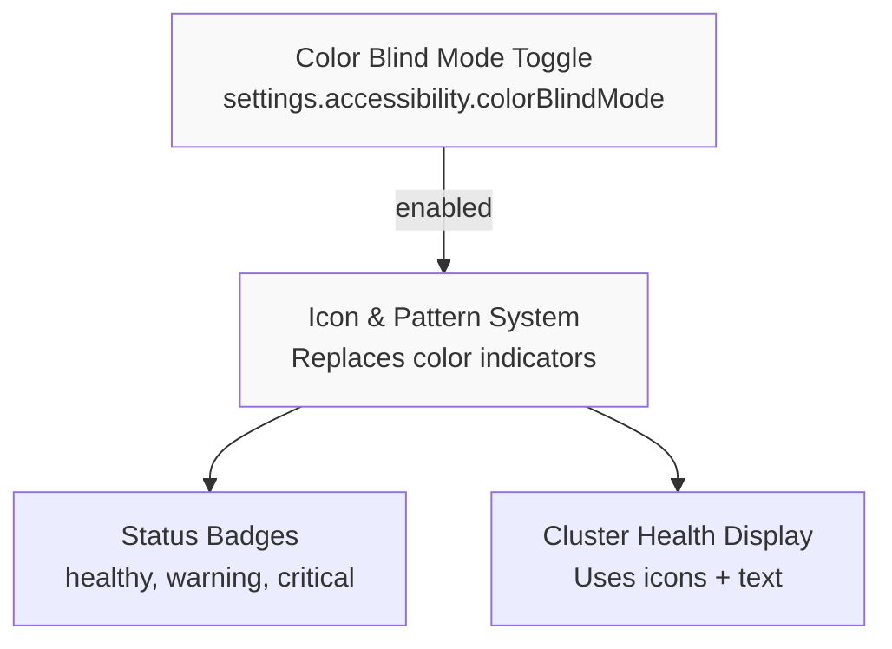
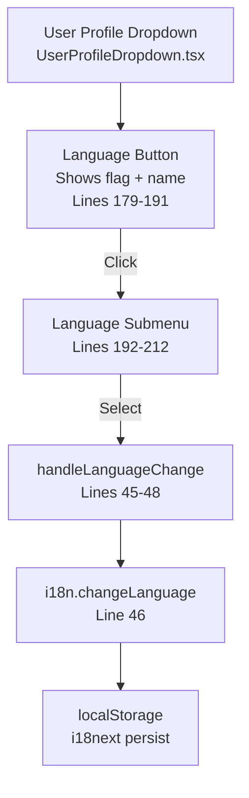
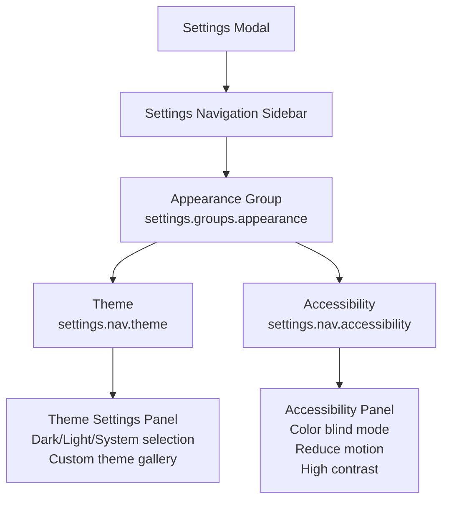
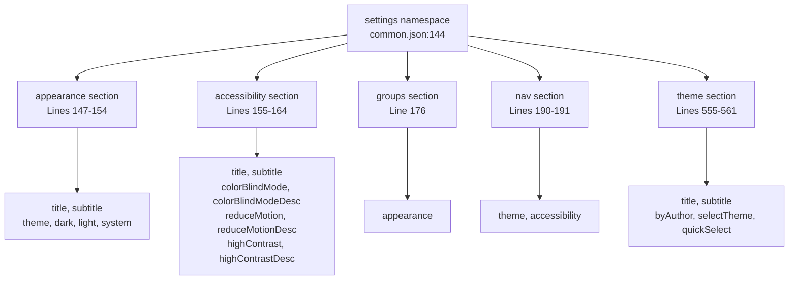
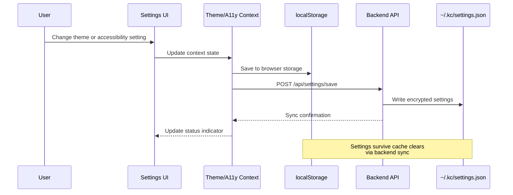

<!-- source: DeepWiki mcp.deepwiki.com · repo kubestellar/console · page 10.3 Appearance & Accessibility · fetched 2026-10-26 -->

# Appearance & Accessibility

Relevant source files

The following files were used as context for generating this wiki page:

- [web/src/components/layout/UserProfileDropdown.tsx](web/src/components/layout/UserProfileDropdown.tsx)
- [web/src/locales/de/common.json](web/src/locales/de/common.json)
- [web/src/locales/en/common.json](web/src/locales/en/common.json)
- [web/src/locales/es/common.json](web/src/locales/es/common.json)
- [web/src/locales/fr/common.json](web/src/locales/fr/common.json)
- [web/src/locales/hi/common.json](web/src/locales/hi/common.json)
- [web/src/locales/it/common.json](web/src/locales/it/common.json)
- [web/src/locales/ja/common.json](web/src/locales/ja/common.json)
- [web/src/locales/pt/common.json](web/src/locales/pt/common.json)
- [web/src/locales/zh/common.json](web/src/locales/zh/common.json)

This page documents the appearance customization and accessibility features provided by the console's settings system. These features enable users to adjust the visual presentation and interaction patterns to match their preferences and needs.

For AI-related settings, see [AI & Intelligence Settings](#10.1). For integration and agent settings, see [Integration Settings](#10.2).

---

## Overview

The Appearance & Accessibility settings provide two main categories of customization:

1. **Appearance**: Theme selection including dark, light, and system-synchronized modes with support for custom oh-my-zsh-inspired themes
2. **Accessibility**: Features to improve usability including color blind mode, reduced motion, and high contrast options

These settings are organized under the "Appearance" group in the settings navigation and are stored persistently across sessions.

**Settings Storage**: Theme and accessibility preferences are persisted to browser localStorage and optionally synced to `~/.kc/settings.json` when the backend is available.

---

## Architecture

The appearance and accessibility system consists of three main components: theme management, accessibility feature toggles, and language selection.

**Sources:**
- [web/src/locales/en/common.json:144-164]()
- [web/src/locales/en/common.json:555-561]()
- [web/src/components/layout/UserProfileDropdown.tsx:1-416]()

---

## Theme System

### Available Themes

The console supports three base theme modes with optional custom theme overlays:

| Theme Mode | Translation Key | Description |
|------------|----------------|-------------|
| **Dark** | `settings.appearance.dark` | Dark background with light text |
| **Light** | `settings.appearance.light` | Light background with dark text |
| **System** | `settings.appearance.system` | Matches OS theme preference |

### Custom Themes

The settings system includes support for oh-my-zsh-inspired custom themes with author attribution:

**Translation Keys:**
- `settings.theme.title`: "Appearance"
- `settings.theme.subtitle`: "Choose your theme - inspired by oh-my-zsh"
- `settings.theme.byAuthor`: "by {{author}}"
- `settings.theme.selectTheme`: "Select Theme"
- `settings.theme.quickSelect`: "Quick Select"

**Sources:**
- [web/src/locales/en/common.json:555-561]()

---

## Accessibility Features

### Color Blind Mode

Replaces color-only indicators with patterns and icons to ensure information is accessible to users with color vision deficiencies.

**Implementation:**
- **Translation Key**: `settings.accessibility.colorBlindMode`
- **Description**: `settings.accessibility.colorBlindModeDesc` - "Use icons and patterns instead of colors alone"
- **Scope**: Affects status indicators, cluster health displays, and alert severity badges

**Sources:**
- [web/src/locales/en/common.json:155-164]()

### Reduce Motion

Minimizes or disables animations and transitions for users who experience motion sensitivity.

**Translation Keys:**
- `settings.accessibility.reduceMotion`: "Reduce Motion"
- `settings.accessibility.reduceMotionDesc`: "Minimize animations and transitions"

**Affected Components:**
- Card animations during drag-and-drop
- Dashboard transitions
- Modal and dialog entrance effects
- Loading spinners and progress indicators
- Notification animations

**Sources:**
- [web/src/locales/en/common.json:160-161]()

### High Contrast Mode

Increases contrast ratios between text and background colors to improve visibility.

**Translation Keys:**
- `settings.accessibility.highContrast`: "High Contrast"
- `settings.accessibility.highContrastDesc`: "Increase contrast for better visibility"

**Affected Elements:**
- Text color intensities
- Border weights and colors
- Background color separation
- Icon contrast
- Focus indicators

**Sources:**
- [web/src/locales/en/common.json:162-163]()

---

## Language Selection

### Supported Languages

The console provides full internationalization support for 9 languages:

| Language | Locale Code | Flag | Translation File |
|----------|-------------|------|-----------------|
| **English** | `en` | 🇬🇧 | `web/src/locales/en/common.json` |
| **Spanish** | `es` | 🇪🇸 | `web/src/locales/es/common.json` |
| **Italian** | `it` | 🇮🇹 | `web/src/locales/it/common.json` |
| **Chinese** | `zh` | 🇨🇳 | `web/src/locales/zh/common.json` |
| **Hindi** | `hi` | 🇮🇳 | `web/src/locales/hi/common.json` |
| **German** | `de` | 🇩🇪 | `web/src/locales/de/common.json` |
| **Japanese** | `ja` | 🇯🇵 | `web/src/locales/ja/common.json` |
| **Portuguese** | `pt` | 🇵🇹 | `web/src/locales/pt/common.json` |
| **French** | `fr` | 🇫🇷 | `web/src/locales/fr/common.json` |

### Language Selector UI

The language selector is integrated into the user profile dropdown:

**Implementation Details:**
- **Component**: [UserProfileDropdown.tsx:179-213]()
- **Language Data**: Imported from `../../lib/i18n` at [line 7]()
- **State Management**: `showLanguageSubmenu` toggle at [line 27]()
- **Change Handler**: [lines 45-48]()

**UI Features:**
- Current language displayed with flag emoji and name
- Expandable submenu with all available languages
- Check mark indicator for active language
- Hover effects for language options

**Sources:**
- [web/src/components/layout/UserProfileDropdown.tsx:7]()
- [web/src/components/layout/UserProfileDropdown.tsx:27]()
- [web/src/components/layout/UserProfileDropdown.tsx:42-48]()
- [web/src/components/layout/UserProfileDropdown.tsx:179-213]()

---

## Settings Navigation

The appearance and accessibility settings are organized in the settings sidebar navigation:

**Navigation Translation Keys:**
- `settings.groups.appearance`: "Appearance" - Group header
- `settings.nav.theme`: "Theme" - Theme settings link
- `settings.nav.accessibility`: "Accessibility" - Accessibility settings link

**Sources:**
- [web/src/locales/en/common.json:176]()
- [web/src/locales/en/common.json:190-191]()

---

## Translation Structure

All appearance and accessibility strings are organized under the `settings` namespace:

**Key Structure:**
- `settings.appearance.*` - Basic theme mode labels
- `settings.accessibility.*` - Accessibility feature labels and descriptions
- `settings.groups.appearance` - Navigation group name
- `settings.nav.theme` - Theme nav item
- `settings.nav.accessibility` - Accessibility nav item
- `settings.theme.*` - Custom theme selection UI

**Sources:**
- [web/src/locales/en/common.json:144-164]()
- [web/src/locales/en/common.json:172-197]()
- [web/src/locales/en/common.json:555-561]()

---

## Data Flow

### Settings Persistence Flow

**Persistence Layers:**

1. **Browser localStorage**: Immediate persistence for instant page reload support
2. **Backend Settings File**: `~/.kc/settings.json` for cross-device sync and backup
3. **Encryption**: Non-sensitive preferences stored in plaintext, theme data persisted unencrypted

**Sync Status Indicators:**
- `settings.syncStatus.synced`: "Synced"
- `settings.syncStatus.saving`: "Saving..."
- `settings.syncStatus.savedToFile`: "Saved to file"
- `settings.syncStatus.saveFailed`: "Save failed"
- `settings.syncStatus.localOnly`: "Local only"

**Sources:**
- [web/src/locales/en/common.json:198-204]()

---

## Integration with Other Settings

The Appearance & Accessibility settings are part of the larger settings system organized into 5 groups:

| Group | Settings Pages |
|-------|---------------|
| **AI & Intelligence** | AI Mode, Predictions, API Keys, Token Usage |
| **Integrations** | Local Agent, GitHub, Desktop Widget, Deploy Persistence |
| **User & Alerts** | Profile, Notifications |
| **Appearance** | **Theme, Accessibility** |
| **Utilities** | Backup & Sync, Local Clusters, Permissions, Updates, Analytics |

**Navigation Keys:**
- `settings.groups.aiIntelligence`: "AI & Intelligence"
- `settings.groups.integrations`: "Integrations"
- `settings.groups.userAlerts`: "User & Alerts"
- `settings.groups.appearance`: "Appearance"
- `settings.groups.utilities`: "Utilities"

**Sources:**
- [web/src/locales/en/common.json:172-178]()

---

