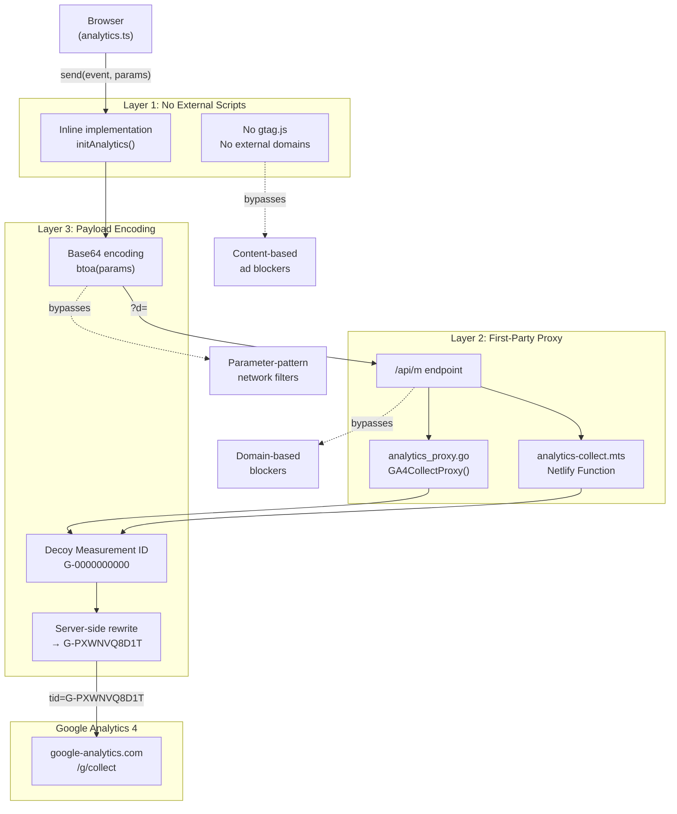
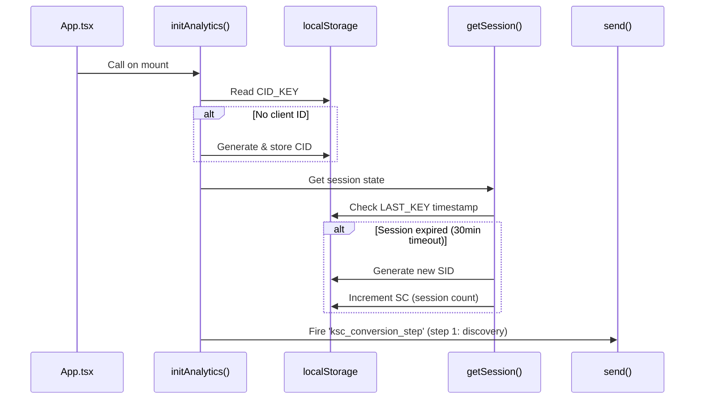
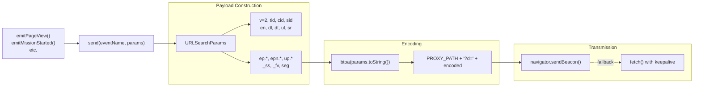
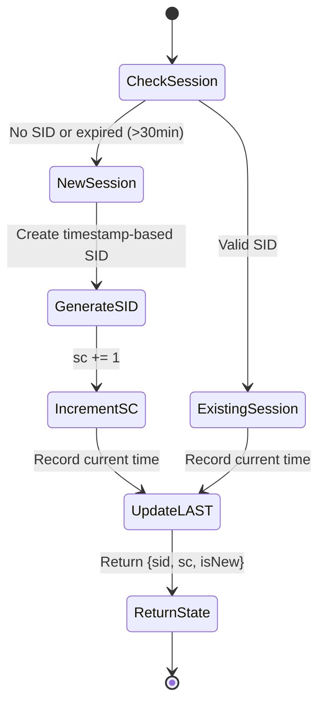
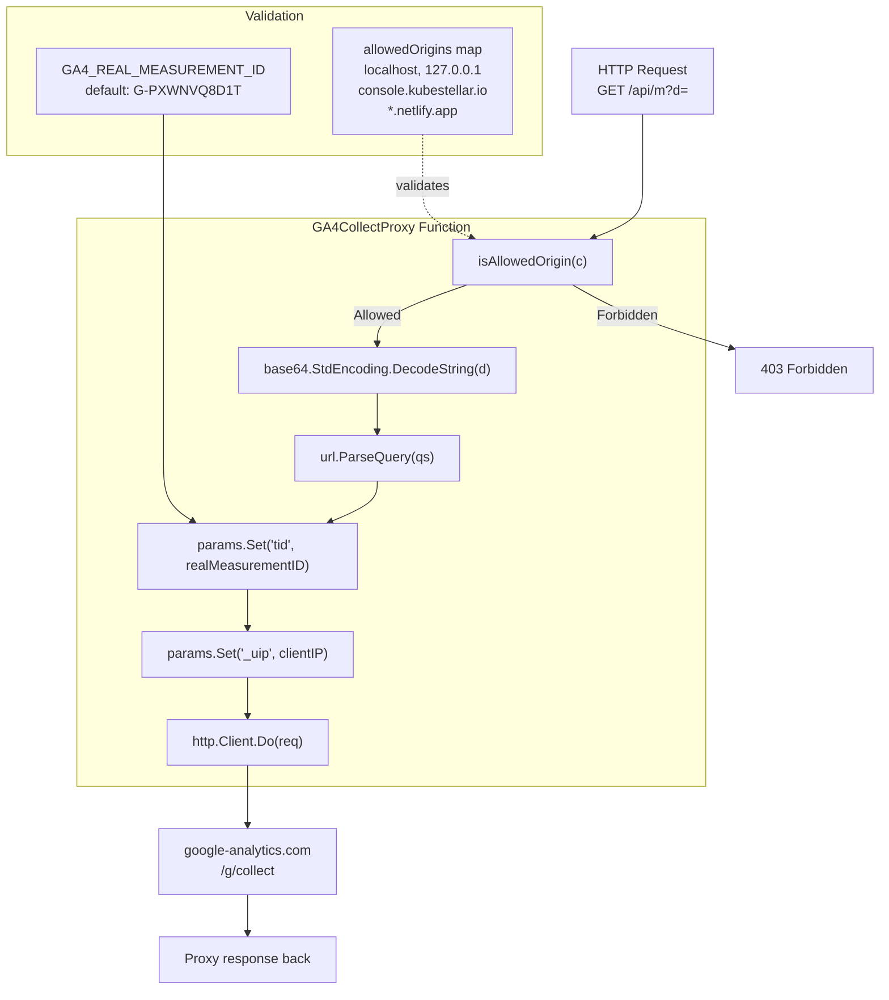
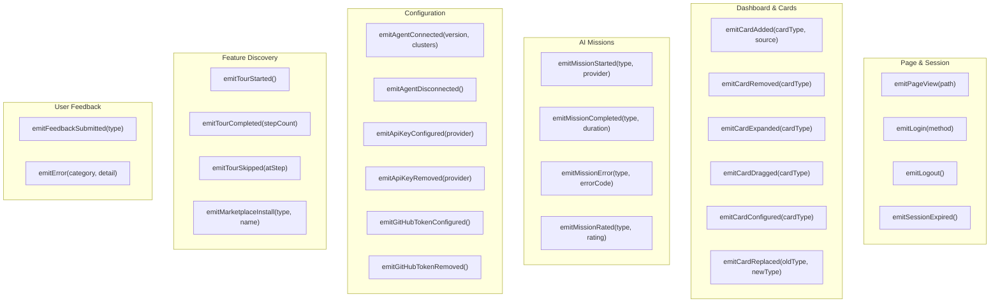
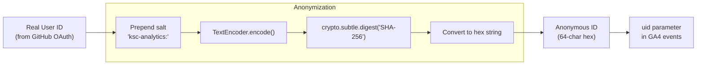
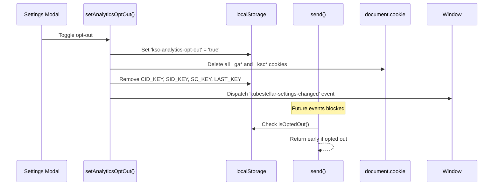
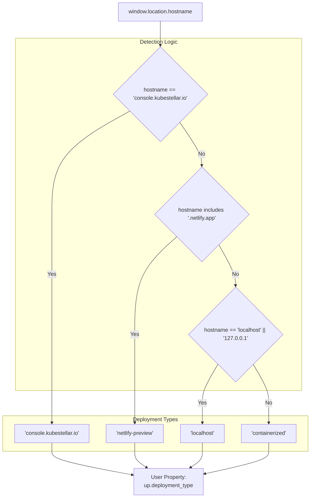

<!-- source: DeepWiki mcp.deepwiki.com · repo kubestellar/console · page 11 Analytics System · fetched 2026-10-26 -->

# Analytics System

<details>
<summary>Relevant source files</summary>

The following files were used as context for generating this wiki page:

- [.env.example](.env.example)
- [netlify.toml](netlify.toml)
- [pkg/api/handlers/analytics_proxy.go](pkg/api/handlers/analytics_proxy.go)
- [web/netlify/functions/analytics-collect.mts](web/netlify/functions/analytics-collect.mts)
- [web/package-lock.json](web/package-lock.json)
- [web/package.json](web/package.json)
- [web/src/components/agent/APIKeySettings.tsx](web/src/components/agent/APIKeySettings.tsx)
- [web/src/hooks/useLocalAgent.ts](web/src/hooks/useLocalAgent.ts)
- [web/src/lib/analytics.ts](web/src/lib/analytics.ts)
- [web/vite.config.ts](web/vite.config.ts)

</details>


## Purpose and Scope

The Analytics System provides privacy-respecting usage telemetry for the KubeStellar Console using a **stealth architecture** designed to bypass ad blockers and content filters. The system tracks user behavior, conversion funnels, and feature adoption while maintaining user privacy through anonymous identifiers and SHA-256 hashing.

This document covers the analytics implementation layer only. For user-facing privacy settings, see [Settings System](#10). For authentication and user identification, see [Backend Architecture](#2.2).

**Sources:** [web/src/lib/analytics.ts:1-13]()

---

## Architecture Overview

### Three-Layer Anti-Blocking Strategy

The analytics system employs three defensive layers to ensure event delivery even in environments with aggressive ad blocking:



**Key Design Principles:**

| Layer | Threat Mitigated | Implementation |
|-------|------------------|----------------|
| **No External Scripts** | Content security policies, script blockers | All analytics code bundled in app, no `<script src="ga.js">` tags |
| **First-Party Proxy** | Domain blockers (e.g., `*.google-analytics.com`) | Routes through `/api/m` on same domain |
| **Base64 Encoding** | Network filters matching GA4 parameters (`tid=G-*`) | Payload encoded before transmission, decoded by proxy |

**Sources:** [web/src/lib/analytics.ts:1-23](), [pkg/api/handlers/analytics_proxy.go:1-14](), [web/netlify/functions/analytics-collect.mts:1-12]()

---

## Client-Side Implementation

### Core Analytics Module

The client-side analytics implementation resides in `analytics.ts` and provides a lightweight event emitter with no external dependencies.

#### Initialization Flow



#### Key Functions and Constants

| Symbol | Type | Purpose | Location |
|--------|------|---------|----------|
| `GA_MEASUREMENT_ID` | const | Decoy ID (G-0000000000) visible in source | [analytics.ts:17]() |
| `PROXY_PATH` | const | First-party proxy endpoint (`/api/m`) | [analytics.ts:19]() |
| `CID_KEY` | const | localStorage key for client ID (`_ksc_cid`) | [analytics.ts:21]() |
| `SID_KEY` | const | localStorage key for session ID (`_ksc_sid`) | [analytics.ts:22]() |
| `SC_KEY` | const | localStorage key for session count (`_ksc_sc`) | [analytics.ts:23]() |
| `SESSION_TIMEOUT_MS` | const | 30-minute session timeout | [analytics.ts:20]() |
| `initAnalytics()` | function | Initialize tracking, set user properties | [analytics.ts:157-175]() |
| `send()` | function | Core event transmission function | [analytics.ts:90-153]() |
| `getClientId()` | function | Generate or retrieve persistent client ID | [analytics.ts:55-62]() |
| `getSession()` | function | Manage session lifecycle with timeout | [analytics.ts:64-79]() |

**Sources:** [web/src/lib/analytics.ts:16-88]()

---

### Event Transmission Protocol

The `send()` function constructs GA4 Measurement Protocol payloads and transmits them via the first-party proxy:



**Payload Structure:**

The `send()` function builds a `URLSearchParams` object with the following keys:

| Parameter | Format | Example | Purpose |
|-----------|--------|---------|---------|
| `v` | string | `2` | Measurement Protocol version |
| `tid` | string | `G-0000000000` | Decoy measurement ID (rewritten server-side) |
| `cid` | string | `1234567890.1705234567` | Client ID (random.timestamp) |
| `sid` | string | `1705234567` | Session ID (session start timestamp) |
| `_p` | string | `987654321` | Page ID (random per page load) |
| `en` | string | `ksc_card_added` | Event name |
| `_s` | string | `1` | Session count |
| `dl` | string | `https://console.kubestellar.io/dashboard` | Document location |
| `dt` | string | `KubeStellar Console` | Document title |
| `ul` | string | `en-US` | User language |
| `sr` | string | `1920x1080` | Screen resolution |
| `ep.*` | string | `ep.card_type=PodStatusCard` | Event parameters (string) |
| `epn.*` | number | `epn.duration_sec=42` | Event parameters (numeric) |
| `up.*` | string | `up.deployment_type=localhost` | User properties |
| `uid` | string | `SHA-256 hash` | Hashed user ID (if authenticated) |
| `_ss` | string | `1` | Session start flag |
| `_fv` | string | `1` | First visit flag |
| `_nsi` | string | `1` | New session info flag |
| `seg` | string | `1` | Engagement flag (eventCount > 1) |

**Sources:** [web/src/lib/analytics.ts:90-153]()

---

### Session Management

Session state is tracked in localStorage with automatic expiration and session count incrementing:



**Session Detection Logic:**

The `getSession()` function implements the following algorithm ([analytics.ts:64-79]()):

1. Read `LAST_KEY` timestamp from localStorage
2. Calculate time elapsed since last activity
3. If elapsed > `SESSION_TIMEOUT_MS` (30 minutes) or no `SID_KEY`:
   - Generate new session ID (current timestamp in seconds)
   - Increment `SC_KEY` (session count)
   - Set `_ss=1` and `_nsi=1` flags on next event
4. If first session (`sc === 1`), set `_fv=1` (first visit) flag
5. Update `LAST_KEY` to current time
6. Return `{sid, sc, isNew}` object

**Sources:** [web/src/lib/analytics.ts:64-79]()

---

## Server-Side Proxy Implementations

The analytics system supports two deployment modes with corresponding proxy implementations:

### Go Backend Proxy (Containerized/Local)

The Go backend provides the analytics proxy at `/api/m` via the `GA4CollectProxy` handler:



**Key Functions:**

| Function | Location | Purpose |
|----------|----------|---------|
| `GA4CollectProxy()` | [analytics_proxy.go:48-120]() | Main proxy handler |
| `isAllowedOrigin()` | [analytics_proxy.go:123-147]() | Origin/Referer validation |
| `stripPort()` | [analytics_proxy.go:150-155]() | Hostname normalization |

**Origin Validation Logic:**

The proxy validates requests using `Origin` or `Referer` headers ([analytics_proxy.go:123-147]()):

1. Parse `Origin` header → extract hostname → check against `allowedOrigins` map or `.netlify.app` suffix
2. If Origin invalid, parse `Referer` header → same validation
3. If both headers missing (server-to-server), allow request
4. Otherwise, return `403 Forbidden`

**Measurement ID Rewrite:**

The proxy reads `GA4_REAL_MEASUREMENT_ID` from environment ([analytics_proxy.go:55-58]()) and overwrites the decoy `tid` parameter ([analytics_proxy.go:90-92]()). The real ID defaults to `G-PXWNVQ8D1T` if not configured.

**IP Forwarding:**

To preserve user geolocation data, the proxy extracts the client's real IP from `X-Forwarded-For` or `X-Real-Ip` headers ([analytics_proxy.go:75-86]()) and injects it as the `_uip` parameter ([analytics_proxy.go:93-96]()).

**Sources:** [pkg/api/handlers/analytics_proxy.go:1-156]()

---

### Netlify Function Proxy (Preview Deployments)

For Netlify preview deployments, a serverless function provides the same proxy functionality:

**Configuration:**

The Netlify function is routed via `netlify.toml` (lines commented out in current config, but implemented):

```toml
# GA4 event collection proxy
[[redirects]]
  from = "/api/m"
  to = "/.netlify/functions/analytics-collect"
  status = 200
```

**Function Implementation:**

The TypeScript function ([analytics-collect.mts:41-119]()) mirrors the Go implementation:

1. **CORS Preflight**: Handle `OPTIONS` requests ([analytics-collect.mts:48-50]())
2. **Origin Validation**: Check against `ALLOWED_HOSTS` set ([analytics-collect.mts:22-39]())
3. **Base64 Decoding**: Extract and decode `d` parameter ([analytics-collect.mts:59-72]())
4. **Measurement ID Rewrite**: Use `Netlify.env.get("GA4_REAL_MEASUREMENT_ID")` ([analytics-collect.mts:56]())
5. **IP Forwarding**: Extract from `x-nf-client-connection-ip` header ([analytics-collect.mts:80-86]())
6. **Proxy Request**: Forward to `google-analytics.com/g/collect` ([analytics-collect.mts:88-100]())

**Sources:** [web/netlify/functions/analytics-collect.mts:1-124](), [netlify.toml:1-76]()

---

## Event Catalog

The analytics system provides typed event emission functions for consistent event naming:

### Core Event Functions



### Event Reference Table

| Function | Event Name | Parameters | Purpose |
|----------|-----------|------------|---------|
| `emitPageView()` | `page_view` | `page_path`, `ksc_demo_mode` | Track navigation |
| `emitLogin()` | `login` | `method` | Track authentication method |
| `emitLogout()` | `ksc_logout` | - | Track logout events |
| `emitCardAdded()` | `ksc_card_added` | `card_type`, `source` | Track card additions |
| `emitCardRemoved()` | `ksc_card_removed` | `card_type` | Track card deletions |
| `emitCardExpanded()` | `ksc_card_expanded` | `card_type` | Track card expansions |
| `emitMissionStarted()` | `ksc_mission_started` | `mission_type`, `agent_provider` | Track AI mission starts |
| `emitMissionCompleted()` | `ksc_mission_completed` | `mission_type`, `duration_sec` | Track AI mission completions |
| `emitAgentConnected()` | `ksc_agent_connected` | `agent_version`, `cluster_count` | Track kc-agent connections |
| `emitApiKeyConfigured()` | `ksc_api_key_configured` | `provider` | Track AI API key setup |
| `emitGitHubTokenConfigured()` | `ksc_github_token_configured` | - | Track GitHub token setup |
| `emitFeedbackSubmitted()` | `ksc_feedback_submitted` | `feedback_type` | Track feedback submissions |
| `emitError()` | `ksc_error` | `error_category`, `error_detail` | Track application errors |
| `emitConversionStep()` | `ksc_conversion_step` | `step_number`, `step_name`, `details` | Track conversion funnel |

**Sources:** [web/src/lib/analytics.ts:219-381]()

---

## Conversion Funnel

The analytics system tracks a 6-step conversion funnel to measure user journey completion:

```mermaid
graph LR
    Step1["1. Discovery<br/>emitConversionStep(1, 'discovery')"]
    Step2["2. Login<br/>emitConversionStep(2, 'login')"]
    Step3["3. Agent<br/>emitConversionStep(3, 'agent')"]
    Step4["4. Clusters<br/>emitConversionStep(4, 'clusters')"]
    Step5["5. API Key<br/>emitConversionStep(5, 'api_key')"]
    Step6["6. GitHub Token<br/>emitConversionStep(6, 'github_token')"]
    
    Step1 -->|"User visits site"| Step2
    Step2 -->|"OAuth or demo"| Step3
    Step3 -->|"kc-agent connected"| Step4
    Step4 -->|"Real clusters detected"| Step5
    Step5 -->|"AI provider configured"| Step6
    Step6 -->|"GitHub integration enabled"| Complete["Complete"]
```



**Funnel Trigger Points:**

| Step | Trigger Location | Code Reference |
|------|------------------|----------------|
| 1. Discovery | `initAnalytics()` on first page load | [analytics.ts:174]() |
| 2. Login | After successful authentication | App-level auth callback |
| 3. Agent | `useLocalAgent` detects connection | [useLocalAgent.ts:236]() |
| 4. Clusters | `useLocalAgent` detects clusters > 0 | [useLocalAgent.ts:237-239]() |
| 5. API Key | `APIKeySettings` saves first key | [APIKeySettings.tsx:177]() |
| 6. GitHub Token | Settings modal saves token | User settings flow |

**Sources:** [web/src/lib/analytics.ts:362-381](), [web/src/hooks/useLocalAgent.ts:236-239](), [web/src/components/agent/APIKeySettings.tsx:176-177]()

---

## Privacy & Opt-Out

### Anonymous User Identification

The system implements privacy-preserving user identification:



**Hash Function:**

The `hashUserId()` function ([analytics.ts:179-185]()) performs the following:

1. Prepend salt string `ksc-analytics:` to user ID
2. Encode to `Uint8Array` via `TextEncoder`
3. Hash using `crypto.subtle.digest('SHA-256')`
4. Convert bytes to hex string (`b.toString(16).padStart(2, '0')`)
5. Store in `userId` module variable for inclusion in events

The resulting hash is **irreversible** and cannot be linked back to the original user ID without the salt.

**Sources:** [web/src/lib/analytics.ts:177-190]()

---

### Opt-Out Mechanism

Users can disable analytics via the Settings modal:

**localStorage Key:** `STORAGE_KEY_ANALYTICS_OPT_OUT` = `ksc-analytics-opt-out`

**Opt-Out Flow:**



**Cleanup Actions:**

When a user opts out ([analytics.ts:198-213]()), the system:

1. Sets `ksc-analytics-opt-out` = `true` in localStorage
2. Deletes all cookies starting with `_ga` or `_ksc`
3. Removes all session tracking keys from localStorage
4. Dispatches custom event for UI refresh
5. Future `send()` calls return early without transmission

**Sources:** [web/src/lib/analytics.ts:196-217]()

---

## Configuration

### Environment Variables

The analytics system is configured via environment variables at build time and runtime:

| Variable | Scope | Purpose | Default |
|----------|-------|---------|---------|
| `VITE_GA_MEASUREMENT_ID` | Build-time | Override decoy measurement ID in client code | `G-0000000000` |
| `GA4_REAL_MEASUREMENT_ID` | Runtime | Real measurement ID for server-side rewrite | `G-PXWNVQ8D1T` |

**Build-Time Configuration:**

The Vite build process injects the measurement ID via `import.meta.env` ([analytics.ts:158]()):

```typescript
measurementId = (import.meta.env.VITE_GA_MEASUREMENT_ID as string | undefined) || GA_MEASUREMENT_ID
```

**Runtime Configuration:**

The Go backend reads the real ID from environment ([analytics_proxy.go:55-58]()):

```go
realMeasurementID := os.Getenv("GA4_REAL_MEASUREMENT_ID")
if realMeasurementID == "" {
    realMeasurementID = "G-PXWNVQ8D1T"
}
```

The Netlify function uses platform-specific environment access ([analytics-collect.mts:56]()):

```typescript
const realMeasurementId = Netlify.env.get("GA4_REAL_MEASUREMENT_ID") || process.env.GA4_REAL_MEASUREMENT_ID;
```

**Sources:** [.env.example:65-70](), [web/src/lib/analytics.ts:158](), [pkg/api/handlers/analytics_proxy.go:55-58](), [web/netlify/functions/analytics-collect.mts:56]()

---

### Deployment-Specific Configuration

The system detects deployment type automatically and sets corresponding user properties:



**Deployment Detection:**

The `getDeploymentType()` function ([analytics.ts:41-47]()) determines the environment:

1. Exact match for `console.kubestellar.io` → production
2. `.netlify.app` suffix → preview deployment
3. `localhost` or `127.0.0.1` → local development
4. All other hostnames → containerized deployment

**User Properties Set on Init:**

The `initAnalytics()` function ([analytics.ts:164-171]()) sets persistent user properties:

- `deployment_type`: One of the four deployment types above
- `demo_mode`: String boolean indicating demo mode state
- `timezone`: User's IANA timezone (e.g., `America/New_York`) for geo identification

**Sources:** [web/src/lib/analytics.ts:28-47](), [web/src/lib/analytics.ts:164-171]()

---

### Vite Proxy Configuration

For local development, Vite proxies the `/api/m` endpoint to the Go backend:

**Vite Config:**

[vite.config.ts:162-165]() configures the proxy:

```typescript
'/api/m': {
  target: 'http://localhost:8080',
  changeOrigin: true,
},
```

This ensures that during development, analytics events sent to `/api/m` are forwarded to the local Go server at port 8080, where the `GA4CollectProxy` handler processes them.

**Sources:** [web/vite.config.ts:162-165]()

---

