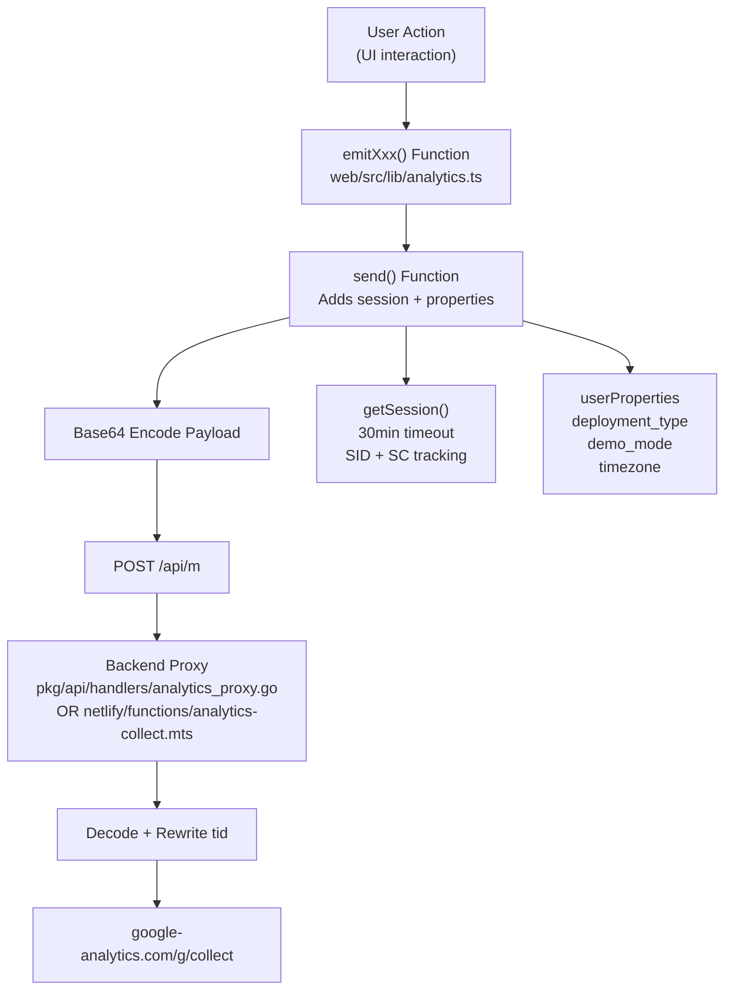
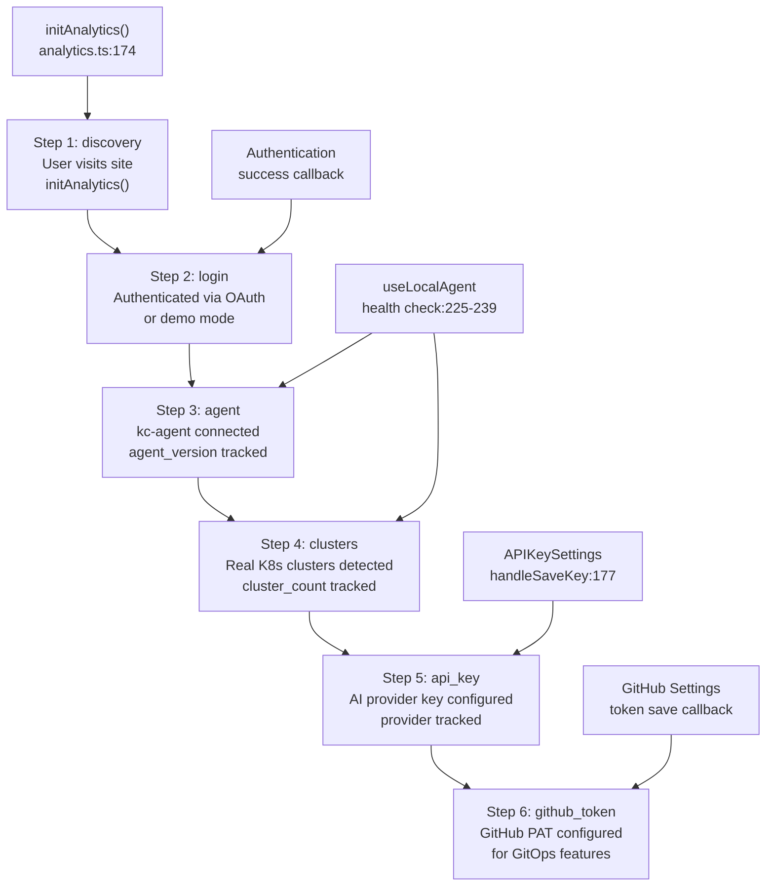
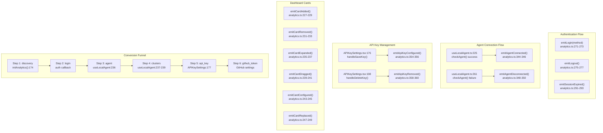
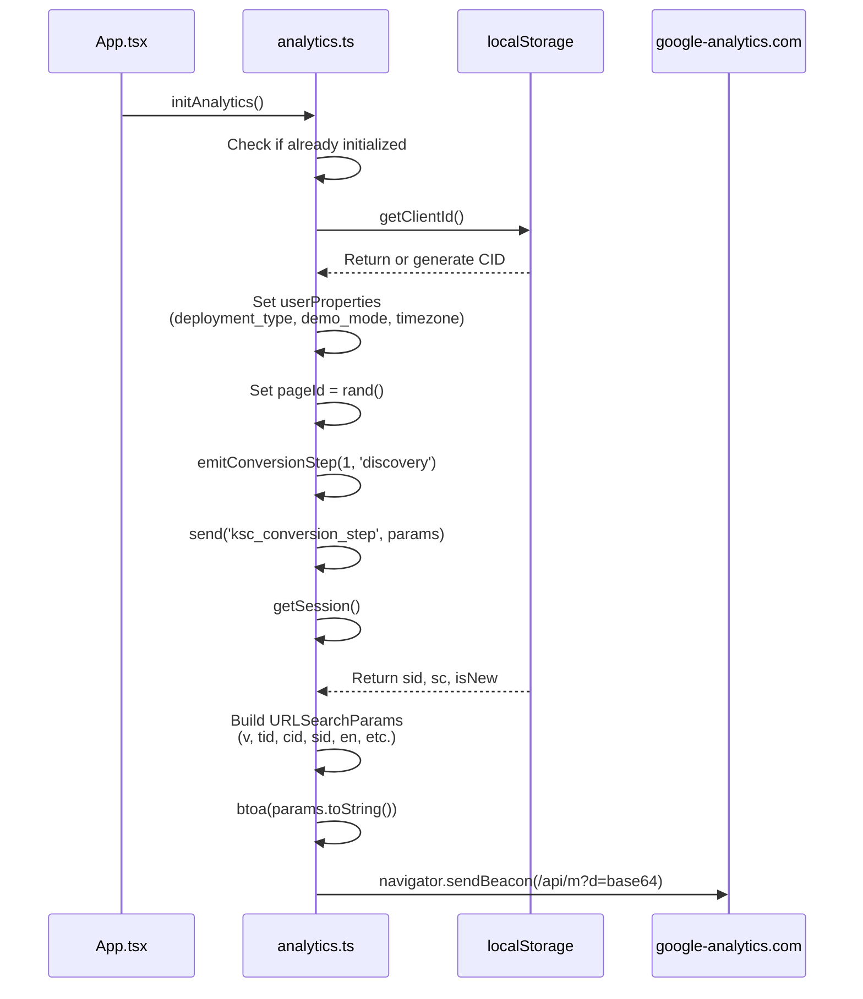

<!-- source: DeepWiki mcp.deepwiki.com · repo kubestellar/console · page 11.2 Event Tracking · fetched 2026-10-26 -->

# Event Tracking

<details>
<summary>Relevant source files</summary>

The following files were used as context for generating this wiki page:

- [.env.example](.env.example)
- [netlify.toml](netlify.toml)
- [pkg/api/handlers/analytics_proxy.go](pkg/api/handlers/analytics_proxy.go)
- [web/netlify/functions/analytics-collect.mts](web/netlify/functions/analytics-collect.mts)
- [web/package-lock.json](web/package-lock.json)
- [web/package.json](web/package.json)
- [web/src/components/agent/APIKeySettings.tsx](web/src/components/agent/APIKeySettings.tsx)
- [web/src/hooks/useLocalAgent.ts](web/src/hooks/useLocalAgent.ts)
- [web/src/lib/analytics.ts](web/src/lib/analytics.ts)
- [web/vite.config.ts](web/vite.config.ts)

</details>


This page documents the events tracked by the KubeStellar Console analytics system and how they are instrumented throughout the codebase. This covers the specific events, their parameters, and the conversion funnel used to measure user journey progress.

For information about the underlying analytics infrastructure (first-party proxy, base64 encoding), see [Analytics Architecture](#11.1). For opt-out mechanisms and privacy controls, see [Privacy & Opt-Out](#11.3).

## Event Tracking Architecture

The event tracking system is built around a central `send()` function that adds session management, user properties, and GA4-specific parameters to every event before proxying it to Google Analytics.



**Sources:** [web/src/lib/analytics.ts:90-153](), [pkg/api/handlers/analytics_proxy.go:48-120](), [web/netlify/functions/analytics-collect.mts:41-119]()

### Core Event Dispatch Function

The `send()` function in [web/src/lib/analytics.ts:90-153]() performs the following steps:

1. **Opt-out check** - Returns early if `STORAGE_KEY_ANALYTICS_OPT_OUT` is set
2. **Session management** - Calls `getSession()` to get `sid`, `sc`, and `isNew` flag
3. **Parameter encoding** - Adds GA4 parameters (`v`, `tid`, `cid`, `sid`, `en`, etc.)
4. **Event parameters** - Encodes custom parameters as `ep.key` (string) or `epn.key` (numeric)
5. **User properties** - Adds `up.key` parameters for persistent user attributes
6. **Base64 encoding** - Encodes entire query string to prevent network-level blocking
7. **Transmission** - Uses `navigator.sendBeacon()` or `fetch()` with `keepalive: true`

Sources: [web/src/lib/analytics.ts:90-153]()

## Event Categories

### Page View Events

| Function | Event Name | Parameters | When Emitted |
|----------|-----------|------------|--------------|
| `emitPageView()` | `page_view` | `page_path`, `ksc_demo_mode` | On route navigation |

Sources: [web/src/lib/analytics.ts:221-223]()

### Dashboard & Card Events

| Function | Event Name | Parameters | When Emitted |
|----------|-----------|------------|--------------|
| `emitCardAdded()` | `ksc_card_added` | `card_type`, `source` | Card added to dashboard |
| `emitCardRemoved()` | `ksc_card_removed` | `card_type` | Card removed from dashboard |
| `emitCardExpanded()` | `ksc_card_expanded` | `card_type` | Card expanded to full screen |
| `emitCardDragged()` | `ksc_card_dragged` | `card_type` | Card position changed via drag |
| `emitCardConfigured()` | `ksc_card_configured` | `card_type` | Card settings modified |
| `emitCardReplaced()` | `ksc_card_replaced` | `old_type`, `new_type` | Card swapped with another type |

Sources: [web/src/lib/analytics.ts:227-249]()

### AI Mission Events

| Function | Event Name | Parameters | When Emitted |
|----------|-----------|------------|--------------|
| `emitMissionStarted()` | `ksc_mission_started` | `mission_type`, `agent_provider` | AI mission initiated |
| `emitMissionCompleted()` | `ksc_mission_completed` | `mission_type`, `duration_sec` | Mission finished successfully |
| `emitMissionError()` | `ksc_mission_error` | `mission_type`, `error_code` | Mission encountered error |
| `emitMissionRated()` | `ksc_mission_rated` | `mission_type`, `rating` | User rated mission result |

Sources: [web/src/lib/analytics.ts:253-267]()

### Authentication Events

| Function | Event Name | Parameters | When Emitted |
|----------|-----------|------------|--------------|
| `emitLogin()` | `login` | `method` | User authenticated (GitHub OAuth or demo) |
| `emitLogout()` | `ksc_logout` | None | User logged out |

Sources: [web/src/lib/analytics.ts:271-277]()

### User Feedback Events

| Function | Event Name | Parameters | When Emitted |
|----------|-----------|------------|--------------|
| `emitFeedbackSubmitted()` | `ksc_feedback_submitted` | `feedback_type` | Bug report or feature request submitted |

Sources: [web/src/lib/analytics.ts:281-283]()

### Error Tracking Events

| Function | Event Name | Parameters | When Emitted |
|----------|-----------|------------|--------------|
| `emitError()` | `ksc_error` | `error_category`, `error_detail` (truncated 100 chars) | Application error occurred |
| `emitSessionExpired()` | `ksc_session_expired` | None | JWT token expired |

Sources: [web/src/lib/analytics.ts:287-293]()

### Onboarding Tour Events

| Function | Event Name | Parameters | When Emitted |
|----------|-----------|------------|--------------|
| `emitTourStarted()` | `ksc_tour_started` | None | User started onboarding tour |
| `emitTourCompleted()` | `ksc_tour_completed` | `step_count` | User completed entire tour |
| `emitTourSkipped()` | `ksc_tour_skipped` | `at_step` | User exited tour early |

Sources: [web/src/lib/analytics.ts:297-307]()

### Marketplace Events

| Function | Event Name | Parameters | When Emitted |
|----------|-----------|------------|--------------|
| `emitMarketplaceInstall()` | `ksc_marketplace_install` | `item_type`, `item_name` | Dashboard template or card installed |
| `emitMarketplaceRemove()` | `ksc_marketplace_remove` | `item_type` | Marketplace item removed |

Sources: [web/src/lib/analytics.ts:311-317]()

### GitHub Integration Events

| Function | Event Name | Parameters | When Emitted |
|----------|-----------|------------|--------------|
| `emitGitHubTokenConfigured()` | `ksc_github_token_configured` | None | GitHub PAT configured |
| `emitGitHubTokenRemoved()` | `ksc_github_token_removed` | None | GitHub PAT removed |

Sources: [web/src/lib/analytics.ts:321-327]()

### AI Provider Connection Events

| Function | Event Name | Parameters | When Emitted |
|----------|-----------|------------|--------------|
| `emitApiProviderConnected()` | `ksc_api_provider_connected` | `provider` | AI provider API key validated |

Sources: [web/src/lib/analytics.ts:331-333]()

### Demo Mode Events

| Function | Event Name | Parameters | When Emitted |
|----------|-----------|------------|--------------|
| `emitDemoModeToggled()` | `ksc_demo_mode_toggled` | `enabled` | User toggled demo mode on/off |

Sources: [web/src/lib/analytics.ts:337-340]()

### Local Agent Events

| Function | Event Name | Parameters | When Emitted |
|----------|-----------|------------|--------------|
| `emitAgentConnected()` | `ksc_agent_connected` | `agent_version`, `cluster_count` | kc-agent health check succeeded |
| `emitAgentDisconnected()` | `ksc_agent_disconnected` | None | Agent health check failed |

**Integration Example:**
```typescript
// From useLocalAgent.ts:225-236
if (response.ok) {
  const data = await response.json()
  // ...
  emitAgentConnected(data.version || 'unknown', data.clusters || 0)
  emitConversionStep(3, 'agent', { agent_version: data.version || 'unknown' })
  if ((data.clusters || 0) > 0) {
    emitConversionStep(4, 'clusters', { cluster_count: String(data.clusters) })
  }
}
```

Sources: [web/src/lib/analytics.ts:344-350](), [web/src/hooks/useLocalAgent.ts:225-239]()

### API Key Configuration Events

| Function | Event Name | Parameters | When Emitted |
|----------|-----------|------------|--------------|
| `emitApiKeyConfigured()` | `ksc_api_key_configured` | `provider` | API key saved to kc-agent |
| `emitApiKeyRemoved()` | `ksc_api_key_removed` | `provider` | API key deleted from kc-agent |

**Integration Example:**
```typescript
// From APIKeySettings.tsx:176-177
emitApiKeyConfigured(provider)
emitConversionStep(5, 'api_key', { provider })
```

Sources: [web/src/lib/analytics.ts:354-360](), [web/src/components/agent/APIKeySettings.tsx:176-177]()

## Conversion Funnel

The conversion funnel tracks the user journey from discovery to full platform adoption using a unified `emitConversionStep()` function. Each step represents a major milestone in the onboarding flow.



**Sources:** [web/src/lib/analytics.ts:362-381](), [web/src/lib/analytics.ts:157-175](), [web/src/hooks/useLocalAgent.ts:225-239](), [web/src/components/agent/APIKeySettings.tsx:176-177]()

### Conversion Step Function

The `emitConversionStep()` function defined in [web/src/lib/analytics.ts:371-381]() sends a `ksc_conversion_step` event with:

| Parameter | Type | Description |
|-----------|------|-------------|
| `step_number` | Number | Sequential step ID (1-6) |
| `step_name` | String | Human-readable step name |
| `...details` | Object | Step-specific metadata |

### Funnel Stage Definitions

| Step | Name | Trigger Location | Additional Parameters |
|------|------|------------------|----------------------|
| 1 | `discovery` | [web/src/lib/analytics.ts:174]() | `deployment_type` |
| 2 | `login` | Authentication callback | `method` |
| 3 | `agent` | [web/src/hooks/useLocalAgent.ts:236]() | `agent_version` |
| 4 | `clusters` | [web/src/hooks/useLocalAgent.ts:237-239]() | `cluster_count` |
| 5 | `api_key` | [web/src/components/agent/APIKeySettings.tsx:177]() | `provider` |
| 6 | `github_token` | GitHub settings save | None |

Sources: [web/src/lib/analytics.ts:362-381]()

## Session and User Property Management

### Session Tracking

The `getSession()` function in [web/src/lib/analytics.ts:64-79]() manages session lifecycle:

- **Session ID (`sid`)** - Unix timestamp when session started
- **Session Count (`sc`)** - Total lifetime sessions for this user
- **Session Timeout** - 30 minutes (defined by `SESSION_TIMEOUT_MS`)
- **Storage Keys** - `_ksc_sid`, `_ksc_sc`, `_ksc_last` in `localStorage`

**Session Markers in Events:**
- `_ss=1` - Session start (first event in new session)
- `_nsi=1` - New session indicator
- `_fv=1` - First visit ever (sent when `sc=1`)
- `seg=1` - Engagement (sent on 2+ events)

Sources: [web/src/lib/analytics.ts:64-79](), [web/src/lib/analytics.ts:112-121]()

### User Properties

User properties persist across all events for a given user via `userProperties` object set in [web/src/lib/analytics.ts:157-175]():

| Property | Type | Set When | Purpose |
|----------|------|----------|---------|
| `deployment_type` | String | `initAnalytics()` | Identifies localhost, containerized, production, or Netlify preview |
| `demo_mode` | String | `initAnalytics()` and `emitDemoModeToggled()` | Tracks whether user is using mock data |
| `timezone` | String | `initAnalytics()` | User's IANA timezone for geo identification |

User properties are sent with every event as `up.key=value` parameters in [web/src/lib/analytics.ts:135-137]().

Sources: [web/src/lib/analytics.ts:157-175](), [web/src/lib/analytics.ts:192-194](), [web/src/lib/analytics.ts:135-137]()

## Client and User Identification

### Client ID Generation

The `getClientId()` function in [web/src/lib/analytics.ts:55-62]() generates a persistent identifier:

```typescript
function getClientId(): string {
  let cid = localStorage.getItem(CID_KEY) // '_ksc_cid'
  if (!cid) {
    cid = `${rand()}.${Math.floor(Date.now() / 1000)}`
    localStorage.setItem(CID_KEY, cid)
  }
  return cid
}
```

Format: `<random_int>.<unix_timestamp>`

Sources: [web/src/lib/analytics.ts:55-62]()

### Anonymous User ID

The `setAnalyticsUserId()` function in [web/src/lib/analytics.ts:187-190]() generates a SHA-256 hash of the authenticated user ID:

```typescript
async function hashUserId(uid: string): Promise<string> {
  const data = new TextEncoder().encode(`ksc-analytics:${uid}`)
  const hash = await crypto.subtle.digest('SHA-256', data)
  return Array.from(new Uint8Array(hash))
    .map(b => b.toString(16).padStart(2, '0'))
    .join('')
}
```

This allows user-level cohort analysis without transmitting PII. The hashed ID is sent as the `uid` parameter.

Sources: [web/src/lib/analytics.ts:179-190](), [web/src/lib/analytics.ts:139-141]()

## Event Parameter Encoding

### GA4 Parameter Prefixes

The `send()` function encodes parameters with specific prefixes for GA4:

| Prefix | Type | Example | Encoded As |
|--------|------|---------|-----------|
| `ep.` | String event parameter | `ep.card_type=ClusterHealth` | From `params` object |
| `epn.` | Numeric event parameter | `epn.duration_sec=42` | From `params` object with numeric values |
| `up.` | User property | `up.deployment_type=localhost` | From `userProperties` global |

Sources: [web/src/lib/analytics.ts:124-137]()

### Base64 Payload Encoding

After constructing the query string, the entire payload is base64-encoded in [web/src/lib/analytics.ts:145-146]():

```typescript
const encoded = btoa(p.toString())
const url = `${PROXY_PATH}?d=${encodeURIComponent(encoded)}`
```

This prevents network-level filters from detecting GA4 parameter patterns like `tid=G-*`, `en=`, `cid=`, etc.

The backend proxy decodes this in [pkg/api/handlers/analytics_proxy.go:63-72]() or [web/netlify/functions/analytics-collect.mts:59-72]().

Sources: [web/src/lib/analytics.ts:145-146](), [pkg/api/handlers/analytics_proxy.go:63-72](), [web/netlify/functions/analytics-collect.mts:59-72]()

## Event Emitter to Code Entity Map



**Sources:** [web/src/lib/analytics.ts:271-360](), [web/src/hooks/useLocalAgent.ts:225-261](), [web/src/components/agent/APIKeySettings.tsx:176-198]()

## Initialization Flow



**Sources:** [web/src/lib/analytics.ts:157-175](), [web/src/lib/analytics.ts:90-153](), [web/src/lib/analytics.ts:55-79]()

## Integration Patterns

### React Component Integration

```typescript
import { emitCardAdded, emitCardRemoved } from '@/lib/analytics'

function Dashboard() {
  const handleAddCard = (cardType: string) => {
    // ... add card logic
    emitCardAdded(cardType, 'marketplace')
  }
  
  const handleRemoveCard = (cardType: string) => {
    // ... remove card logic
    emitCardRemoved(cardType)
  }
}
```

### React Hook Integration

The `useLocalAgent` hook demonstrates integration in non-UI code:

```typescript
// From useLocalAgent.ts:225-239
if (response.ok) {
  const data = await response.json()
  // ... state updates
  emitAgentConnected(data.version || 'unknown', data.clusters || 0)
  emitConversionStep(3, 'agent', { agent_version: data.version || 'unknown' })
  if ((data.clusters || 0) > 0) {
    emitConversionStep(4, 'clusters', { cluster_count: String(data.clusters) })
  }
}
```

Sources: [web/src/hooks/useLocalAgent.ts:225-239]()

### Error Boundary Integration

```typescript
import { emitError } from '@/lib/analytics'

class ErrorBoundary extends React.Component {
  componentDidCatch(error: Error, errorInfo: React.ErrorInfo) {
    emitError('react_error', error.message)
  }
}
```

Sources: [web/src/lib/analytics.ts:287-289]()

## Environment Configuration

### Measurement ID Configuration

The decoy measurement ID in [web/src/lib/analytics.ts:17]():

```typescript
const GA_MEASUREMENT_ID = 'G-0000000000'
```

This is overridden at runtime by `VITE_GA_MEASUREMENT_ID` environment variable in [web/src/lib/analytics.ts:158]():

```typescript
measurementId = (import.meta.env.VITE_GA_MEASUREMENT_ID as string | undefined) || GA_MEASUREMENT_ID
```

The backend proxy rewrites this to the real measurement ID from the `GA4_REAL_MEASUREMENT_ID` environment variable in [pkg/api/handlers/analytics_proxy.go:55-58]() or [web/netlify/functions/analytics-collect.mts:56]().

Sources: [web/src/lib/analytics.ts:17](), [web/src/lib/analytics.ts:158](), [pkg/api/handlers/analytics_proxy.go:55-58](), [web/netlify/functions/analytics-collect.mts:56](), [.env.example:66-70]()

---

