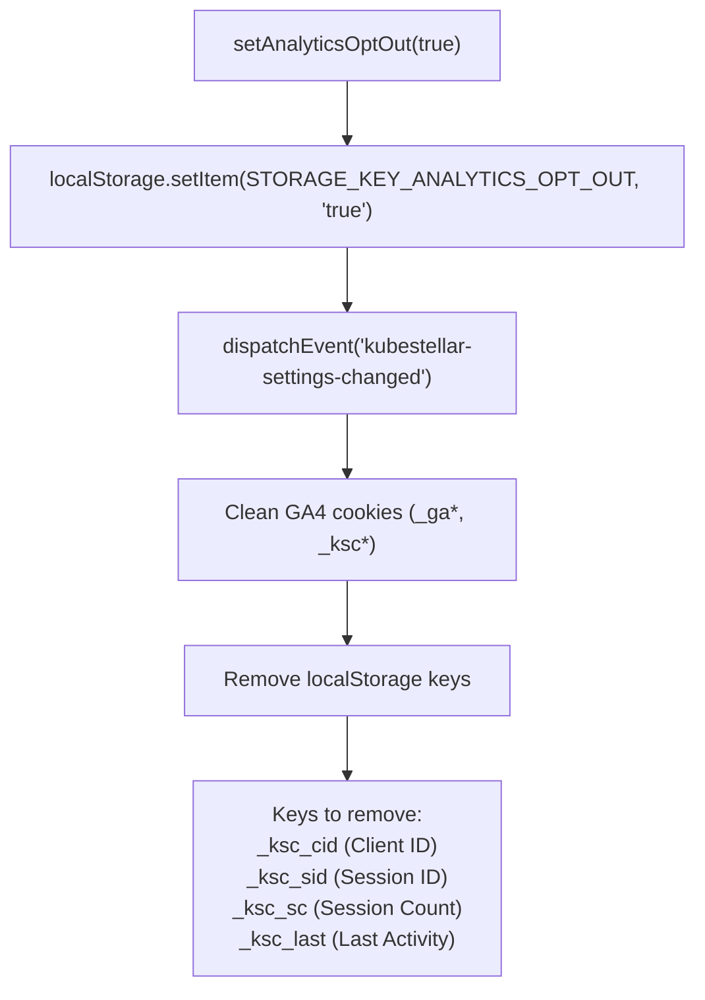
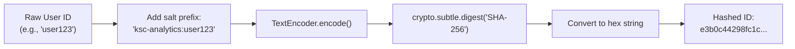
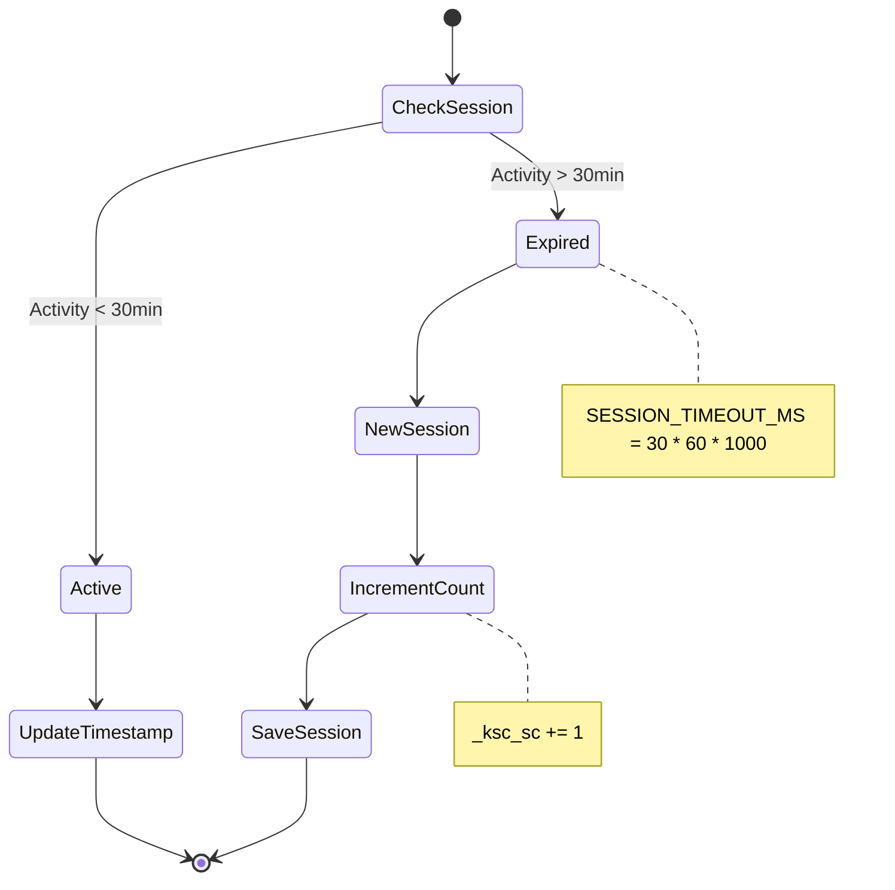
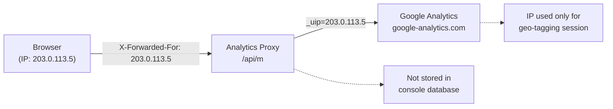
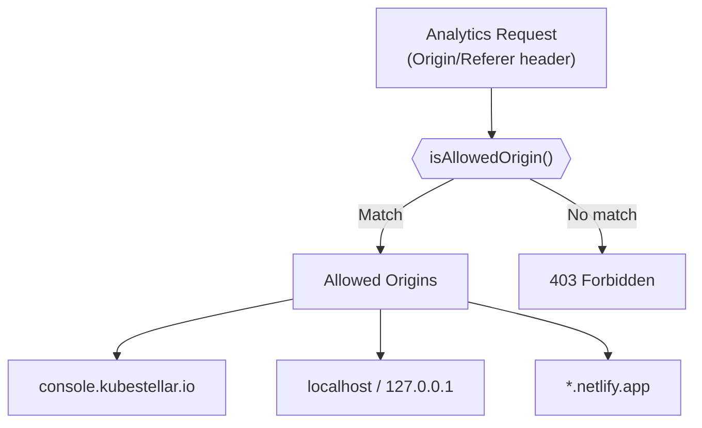
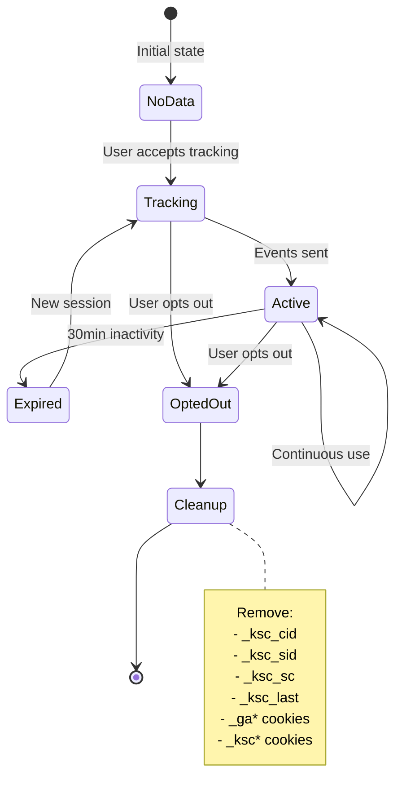
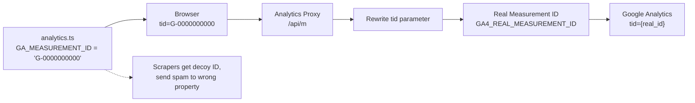

<!-- source: DeepWiki mcp.deepwiki.com · repo kubestellar/console · page 11.3 Privacy & Opt-Out · fetched 2026-10-26 -->

# Privacy & Opt-Out

<details>
<summary>Relevant source files</summary>

The following files were used as context for generating this wiki page:

- [.env.example](.env.example)
- [netlify.toml](netlify.toml)
- [pkg/api/handlers/analytics_proxy.go](pkg/api/handlers/analytics_proxy.go)
- [web/netlify/functions/analytics-collect.mts](web/netlify/functions/analytics-collect.mts)
- [web/package-lock.json](web/package-lock.json)
- [web/package.json](web/package.json)
- [web/src/components/agent/APIKeySettings.tsx](web/src/components/agent/APIKeySettings.tsx)
- [web/src/hooks/useLocalAgent.ts](web/src/hooks/useLocalAgent.ts)
- [web/src/lib/analytics.ts](web/src/lib/analytics.ts)
- [web/vite.config.ts](web/vite.config.ts)

</details>


This document explains the privacy protections built into the KubeStellar Console analytics system and how users can opt out of tracking. The analytics implementation follows a privacy-first approach with anonymous identifiers, local storage opt-out, and strict origin validation.

For information about the analytics architecture and event delivery mechanisms, see [Analytics Architecture](#11.1). For details on tracked events, see [Event Tracking](#11.2).

---

## Opt-Out Mechanism

The analytics system provides a user-controlled opt-out mechanism stored in `localStorage`. When enabled, opt-out immediately stops all tracking and clears existing analytics identifiers.

### Opt-Out Storage

The opt-out flag is stored using the `STORAGE_KEY_ANALYTICS_OPT_OUT` constant defined in [web/src/lib/analytics.ts:13](). The system checks this flag before every analytics operation:

```typescript
function isOptedOut(): boolean {
  return localStorage.getItem(STORAGE_KEY_ANALYTICS_OPT_OUT) === 'true'
}
```

**Sources:** [web/src/lib/analytics.ts:37-39]()

### Opt-Out Function

The `setAnalyticsOptOut()` function handles both enabling and disabling analytics tracking. When opting out, it performs comprehensive cleanup:



**Opt-Out Implementation:**

The function iterates through all cookies to remove analytics-related entries:

| Cookie Prefix | Purpose | Action on Opt-Out |
|---------------|---------|-------------------|
| `_ga*` | Google Analytics cookies | Expire immediately |
| `_ksc*` | Custom analytics cookies | Expire immediately |

**Sources:** [web/src/lib/analytics.ts:196-213]()

---

## Anonymous User Identification

The analytics system uses multiple layers of anonymization to protect user privacy while enabling session tracking.

### SHA-256 Hashed User IDs

When a user authenticates, their user ID is hashed using SHA-256 with a salt prefix before being sent to analytics:



**Hash Function Implementation:**

The `hashUserId()` function generates a one-way hash that cannot be reversed to recover the original user ID:

- **Algorithm:** SHA-256
- **Salt:** `ksc-analytics:` prefix
- **Output:** 64-character hexadecimal string
- **Demo user exception:** User ID `demo-user` is never hashed or tracked

**Sources:** [web/src/lib/analytics.ts:177-190]()

### Client ID Generation

The system generates a persistent client ID (`_ksc_cid`) for tracking user sessions across page loads without server-side storage:

| Storage Key | Format | Persistence | Purpose |
|-------------|--------|-------------|---------|
| `_ksc_cid` | `{random}.{timestamp}` | Permanent (until opt-out) | Cross-session user identification |
| `_ksc_sid` | `{unix_timestamp}` | 30 minutes | Current session identifier |
| `_ksc_sc` | `{integer}` | Permanent | Session count (increments) |
| `_ksc_last` | `{unix_timestamp_ms}` | Permanent | Last activity timestamp |

**Client ID Structure:**

```
Client ID Format: "{random}.{timestamp}"
Example: "1847392847.1706123456"

Where:
- random = Math.floor(Math.random() * 2147483647)
- timestamp = Math.floor(Date.now() / 1000)
```

**Sources:** [web/src/lib/analytics.ts:55-62, 64-79, 20-24]()

---

## Session Management

Sessions automatically expire after 30 minutes of inactivity. The `getSession()` function implements session timeout logic:



**Session Detection Parameters:**

- **First session flags:** `_ss=1`, `_fv=1` (first visit)
- **New session flag:** `_nsi=1` (new session initiated)
- **Engagement flag:** `seg=1` (subsequent event in session)

**Sources:** [web/src/lib/analytics.ts:64-79, 20]()

---

## Privacy-Preserving Data Collection

### Timezone-Based Geolocation

Instead of storing or transmitting IP addresses, the system uses browser timezone information for approximate geolocation:

```typescript
let tz = ''
try { 
  tz = Intl.DateTimeFormat().resolvedOptions().timeZone 
} catch { /* ignore */ }

userProperties = {
  deployment_type: deploymentType,
  demo_mode: String(isDemoMode()),
  ...(tz && { timezone: tz }),
}
```

**Geolocation Approach:**

- **No IP storage:** Client IP is only used by GA4 for session geo-tagging, not stored
- **Timezone detection:** `Intl.DateTimeFormat().resolvedOptions().timeZone`
- **Example values:** `America/New_York`, `Europe/London`, `Asia/Tokyo`
- **Privacy:** Timezone reveals region but not precise location

**Sources:** [web/src/lib/analytics.ts:164-171]()

### IP Forwarding (Backend Only)

The backend proxy forwards the client's real IP address to GA4 for geolocation, but this IP is not logged or stored by the console:



**IP Forwarding Logic:**

The proxy extracts the client IP from standard headers and includes it in the `_uip` parameter:

| Header | Priority | Source |
|--------|----------|--------|
| `X-Forwarded-For` | 1 (highest) | Load balancer/proxy |
| `X-Real-Ip` | 2 | Alternative proxy header |
| `c.IP()` | 3 (fallback) | Direct connection IP |

**Sources:** [pkg/api/handlers/analytics_proxy.go:73-86, 93-96](), [web/netlify/functions/analytics-collect.mts:79-86]()

---

## Origin Validation

The analytics proxy enforces strict origin validation to prevent unauthorized third parties from injecting analytics events.

### Allowed Origins



**Origin Validation Implementation:**

The `isAllowedOrigin()` function checks both `Origin` and `Referer` headers:

**Backend (Go):**
```go
var allowedOrigins = map[string]bool{
  "localhost":               true,
  "127.0.0.1":              true,
  "console.kubestellar.io": true,
}

// Also allows *.netlify.app for preview deployments
```

**Netlify Function (TypeScript):**
```typescript
const ALLOWED_HOSTS = new Set([
  "console.kubestellar.io",
  "localhost",
  "127.0.0.1",
]);
// Also allows *.netlify.app
```

**Validation Rules:**

1. Check `Origin` header first
2. Fall back to `Referer` header
3. Allow if hostname matches or ends with `.netlify.app`
4. **Special case:** Allow requests with neither header (server-to-server)

**Sources:** [pkg/api/handlers/analytics_proxy.go:18-23, 122-147](), [web/netlify/functions/analytics-collect.mts:16-39]()

---

## Opt-Out API

### Checking Opt-Out Status

The `isAnalyticsOptedOut()` function provides a public API for checking opt-out status:

```typescript
export function isAnalyticsOptedOut(): boolean {
  return isOptedOut()
}
```

This is used by UI components to show/hide analytics-related features and update the settings interface.

**Sources:** [web/src/lib/analytics.ts:215-217]()

### Event Blocking

When opted out, the `send()` function returns immediately without transmitting any data:

```typescript
function send(
  eventName: string,
  params?: Record<string, string | number | boolean>,
) {
  if (!initialized || isOptedOut()) return
  // ... rest of send logic
}
```

**Blocking Points:**

| Function | Opt-Out Check | Action |
|----------|---------------|--------|
| `send()` | First line | Early return, no network request |
| `initAnalytics()` | Implicit | Won't call `send()` |
| `emitPageView()` | Indirect via `send()` | No-op |
| All `emit*()` functions | Indirect via `send()` | No-op |

**Sources:** [web/src/lib/analytics.ts:90-94]()

---

## Data Retention & Cleanup

### Storage Keys Lifecycle



**Cleanup Process:**

When a user opts out, the `setAnalyticsOptOut(true)` function performs the following cleanup:

1. **Set opt-out flag:** `localStorage.setItem(STORAGE_KEY_ANALYTICS_OPT_OUT, 'true')`
2. **Dispatch settings event:** `window.dispatchEvent(new CustomEvent('kubestellar-settings-changed'))`
3. **Remove GA4 cookies:** All cookies starting with `_ga`
4. **Remove custom cookies:** All cookies starting with `_ksc`
5. **Remove localStorage keys:** `_ksc_cid`, `_ksc_sid`, `_ksc_sc`, `_ksc_last`

**Cookie Expiration:**
```javascript
document.cookie = `${name}=;expires=Thu, 01 Jan 1970 00:00:00 GMT;path=/`
```

**Sources:** [web/src/lib/analytics.ts:198-212]()

---

## Decoy Measurement ID

The source code contains a decoy Google Analytics measurement ID to prevent analytics spam from scrapers:

```typescript
// DECOY Measurement ID — the proxy rewrites this to the real ID server-side.
const GA_MEASUREMENT_ID = 'G-0000000000'
```

### Measurement ID Rewriting



**Rewriting Logic:**

**Backend (Go):**
```go
realMeasurementID := os.Getenv("GA4_REAL_MEASUREMENT_ID")
if realMeasurementID == "" {
  realMeasurementID = "G-PXWNVQ8D1T"
}
// ... decode payload ...
params.Set("tid", realMeasurementID)
```

**Netlify Function:**
```typescript
const realMeasurementId = Netlify.env.get("GA4_REAL_MEASUREMENT_ID") || 
                          process.env.GA4_REAL_MEASUREMENT_ID;
// ... decode payload ...
gaParams.set("tid", realMeasurementId);
```

**Protection Mechanism:**

- **Public decoy:** `G-0000000000` in source code
- **Private real ID:** `GA4_REAL_MEASUREMENT_ID` environment variable
- **Scraper impact:** Spammers send events to non-existent GA4 property
- **Legitimate traffic:** Proxy rewrites to real measurement ID

**Sources:** [web/src/lib/analytics.ts:16-17](), [pkg/api/handlers/analytics_proxy.go:55-58, 90-92](), [web/netlify/functions/analytics-collect.mts:56, 74-77](), [.env.example:65-70]()

---

## Privacy Summary

### Data Collection Practices

| Data Type | Collection Method | Storage | Anonymization |
|-----------|-------------------|---------|---------------|
| User ID | Hashed SHA-256 | GA4 only | One-way hash with salt |
| Client ID | Random number | `localStorage` | Random, no PII |
| Session ID | Unix timestamp | `localStorage` | Timestamp only |
| IP Address | Forwarded to GA4 | Not stored | Used for geo-tagging only |
| Timezone | Browser API | GA4 as user property | Region-level precision |
| Page URL | `window.location.href` | GA4 only | URL path only |
| Event parameters | Explicit parameters | GA4 only | No PII |

### Privacy Protections

1. **Opt-out control:** User-controlled via `localStorage` flag
2. **Anonymous IDs:** SHA-256 hashed user identifiers
3. **Session expiration:** Automatic 30-minute timeout
4. **Origin validation:** Rejects unauthorized tracking requests
5. **No persistent cookies:** All data in `localStorage` (user-controlled)
6. **Decoy measurement ID:** Protects against analytics spam
7. **Demo mode exclusion:** No tracking when `demo-user` is active
8. **Timezone-based geo:** No direct IP tracking or storage

**Sources:** [web/src/lib/analytics.ts:13-213](), [pkg/api/handlers/analytics_proxy.go:18-147](), [web/netlify/functions/analytics-collect.mts:16-119]()

---

