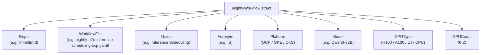
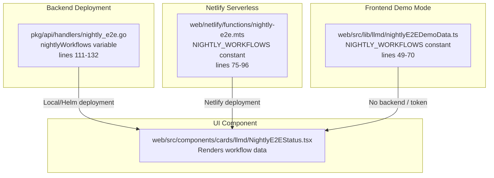
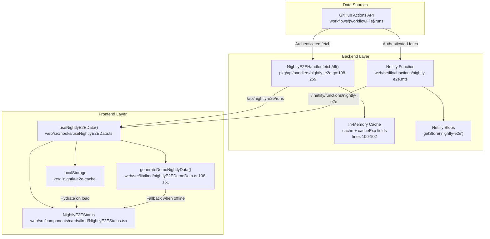
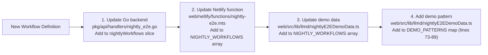

<!-- source: DeepWiki mcp.deepwiki.com · repo kubestellar/console · page 12.1 Workflow Configuration · fetched 2026-10-26 -->

# Workflow Configuration

<details>
<summary>Relevant source files</summary>

The following files were used as context for generating this wiki page:

- [pkg/api/handlers/nightly_e2e.go](pkg/api/handlers/nightly_e2e.go)
- [web/netlify/functions/nightly-e2e.mts](web/netlify/functions/nightly-e2e.mts)
- [web/src/components/cards/llmd/NightlyE2EStatus.tsx](web/src/components/cards/llmd/NightlyE2EStatus.tsx)
- [web/src/config/cards/nightly-e2e-status.ts](web/src/config/cards/nightly-e2e-status.ts)
- [web/src/hooks/useNightlyE2EData.ts](web/src/hooks/useNightlyE2EData.ts)
- [web/src/lib/llmd/nightlyE2EDemoData.ts](web/src/lib/llmd/nightlyE2EDemoData.ts)

</details>


This page documents the canonical list of nightly E2E workflows monitored by the console. It covers the workflow definition structure, the complete inventory of monitored workflows across all platforms (OCP, GKE, CKS), and the configuration locations that must be kept in sync. For information about how failures are detected and classified, see [Failure Detection & Classification](#12.2). For AI-powered diagnosis of failures, see [AI Diagnosis Integration](#12.3).

---

## Workflow Definition Structure

Each monitored workflow is defined by a set of metadata fields that identify the GitHub Actions workflow and describe its infrastructure requirements.

**Workflow Definition Diagram**



**Sources:** [pkg/api/handlers/nightly_e2e.go:30-40](), [web/src/lib/llmd/nightlyE2EDemoData.ts:8-17]()

### Field Definitions

| Field | Type | Purpose | Example |
|-------|------|---------|---------|
| `Repo` | string | GitHub repository in `owner/repo` format | `"llm-d/llm-d"` |
| `WorkflowFile` | string | Workflow YAML filename in `.github/workflows/` | `"nightly-e2e-inference-scheduling-ocp.yaml"` |
| `Guide` | string | Human-readable guide name for UI display | `"Inference Scheduling"` |
| `Acronym` | string | Short identifier (2-3 chars) for compact display | `"IS"` |
| `Platform` | string | Target platform: `"OCP"`, `"GKE"`, or `"CKS"` | `"OCP"` |
| `Model` | string | LLM model being tested | `"Qwen3-32B"` |
| `GPUType` | string | GPU hardware type or `"CPU"` for simulated tests | `"H100"` |
| `GPUCount` | int | Number of GPUs required (0 for CPU) | `2` |

**Sources:** [pkg/api/handlers/nightly_e2e.go:30-40]()

---

## Monitored Workflows by Platform

The console monitors 18 nightly E2E workflows across three Kubernetes platforms. Each platform uses different GPU hardware based on availability and cost.

**Platform Overview Table**

| Platform | Total Workflows | Primary GPU Type | Secondary GPU | CPU Tests |
|----------|----------------|------------------|---------------|-----------|
| OCP | 8 | H100 | A100 | 1 (Simulated Accelerators) |
| GKE | 4 | L4 | — | — |
| CKS | 5 | H100 | — | — |

**Sources:** [pkg/api/handlers/nightly_e2e.go:111-132]()

### OCP Workflows

OpenShift Container Platform (OCP) workflows primarily run on H100 GPUs, with exceptions for WVA (A100) and Simulated Accelerators (CPU).

| Acronym | Guide | Model | GPU | Count | Workflow File |
|---------|-------|-------|-----|-------|---------------|
| IS | Inference Scheduling | Qwen3-32B | H100 | 2 | `nightly-e2e-inference-scheduling-ocp.yaml` |
| PD | PD Disaggregation | Qwen3-0.6B | H100 | 2 | `nightly-e2e-pd-disaggregation-ocp.yaml` |
| PPC | Precise Prefix Cache | Qwen3-32B | H100 | 2 | `nightly-e2e-precise-prefix-cache-ocp.yaml` |
| SA | Simulated Accelerators | Simulated | CPU | 0 | `nightly-e2e-simulated-accelerators.yaml` |
| TPC | Tiered Prefix Cache | Qwen3-0.6B | H100 | 1 | `nightly-e2e-tiered-prefix-cache-ocp.yaml` |
| WEP | Wide EP + LWS | Qwen3-0.6B | H100 | 2 | `nightly-e2e-wide-ep-lws-ocp.yaml` |
| WVA | WVA | Llama-3.1-8B | A100 | 2 | `nightly-e2e-wva-ocp.yaml` |
| BM | Benchmarking | opt-125m | A100 | 1 | `ci-nighly-benchmark-ocp.yaml` |

**Sources:** [pkg/api/handlers/nightly_e2e.go:112-120]()

**Note:** The Benchmarking workflow resides in the `llm-d/llm-d-benchmark` repository, while all others are in `llm-d/llm-d`.

### GKE Workflows

Google Kubernetes Engine (GKE) workflows exclusively use L4 GPUs.

| Acronym | Guide | Model | GPU | Count | Workflow File |
|---------|-------|-------|-----|-------|---------------|
| IS | Inference Scheduling | Qwen3-32B | L4 | 2 | `nightly-e2e-inference-scheduling-gke.yaml` |
| PD | PD Disaggregation | Qwen3-0.6B | L4 | 2 | `nightly-e2e-pd-disaggregation-gke.yaml` |
| WEP | Wide EP + LWS | Qwen3-0.6B | L4 | 2 | `nightly-e2e-wide-ep-lws-gke.yaml` |
| BM | Benchmarking | opt-125m | L4 | 1 | `ci-nighly-benchmark-gke.yaml` |

**Sources:** [pkg/api/handlers/nightly_e2e.go:122-125]()

### CKS Workflows

Cloud Kubernetes Service (CKS) workflows run on H100 GPUs.

| Acronym | Guide | Model | GPU | Count | Workflow File |
|---------|-------|-------|-----|-------|---------------|
| IS | Inference Scheduling | Qwen3-32B | H100 | 2 | `nightly-e2e-inference-scheduling-cks.yaml` |
| PD | PD Disaggregation | Qwen3-0.6B | H100 | 2 | `nightly-e2e-pd-disaggregation-cks.yaml` |
| WEP | Wide EP + LWS | Qwen3-0.6B | H100 | 2 | `nightly-e2e-wide-ep-lws-cks.yaml` |
| WVA | WVA | Llama-3.1-8B | H100 | 2 | `nightly-e2e-wva-cks.yaml` |
| BM | Benchmarking | opt-125m | H100 | 1 | `ci-nightly-benchmark-cks.yaml` |

**Sources:** [pkg/api/handlers/nightly_e2e.go:127-131]()

---

## Configuration Locations

The workflow configuration must be maintained in three locations to support different deployment modes. Each location serves a specific purpose and must be kept synchronized.

**Configuration Location Mapping**



**Sources:** [pkg/api/handlers/nightly_e2e.go:111-132](), [web/netlify/functions/nightly-e2e.mts:75-96](), [web/src/lib/llmd/nightlyE2EDemoData.ts:49-70]()

### Go Backend Handler

**Location:** [pkg/api/handlers/nightly_e2e.go:111-132]()

The canonical workflow definition lives in the `nightlyWorkflows` slice. This is used by:
- Local development server running `go run cmd/server/main.go`
- Helm chart deployments with the backend pod
- Docker containerized deployments

**Variable Name:** `nightlyWorkflows`

**Type:** `[]NightlyWorkflow`

The `NightlyE2EHandler` iterates over this slice in the `fetchAll()` method [pkg/api/handlers/nightly_e2e.go:198-259]() to fetch workflow run data from the GitHub API.

### Netlify Serverless Function

**Location:** [web/netlify/functions/nightly-e2e.mts:75-96]()

The Netlify function is a serverless TypeScript handler that duplicates the workflow configuration for preview deployments. This enables the console to function on `console.kubestellar.io` without requiring a persistent backend.

**Constant Name:** `NIGHTLY_WORKFLOWS`

**Type:** `NightlyWorkflow[]`

The function uses Netlify Blobs for caching and requires `GITHUB_TOKEN` to be set as an environment variable [web/netlify/functions/nightly-e2e.mts:291-297]().

### Frontend Demo Data

**Location:** [web/src/lib/llmd/nightlyE2EDemoData.ts:49-70]()

The frontend maintains a copy of the workflow configuration with seeded demo patterns [web/src/lib/llmd/nightlyE2EDemoData.ts:73-89]() to generate realistic run history when neither the backend nor Netlify function is available.

**Constant Name:** `NIGHTLY_WORKFLOWS`

**Type:** `NightlyWorkflowConfig[]`

The `generateDemoNightlyData()` function [web/src/lib/llmd/nightlyE2EDemoData.ts:108-151]() uses this configuration to create simulated `NightlyGuideStatus` objects with realistic pass/fail patterns.

---

## Data Flow Architecture

**Component Interaction Diagram**



**Sources:** [pkg/api/handlers/nightly_e2e.go:164-196](), [web/netlify/functions/nightly-e2e.mts:279-357](), [web/src/hooks/useNightlyE2EData.ts:61-162]()

### Cache Strategy

**Cache TTL Table**

| Location | Idle TTL | Active TTL | Trigger |
|----------|----------|------------|---------|
| Go Backend | 5 minutes | 2 minutes | `hasInProgressRuns()` [pkg/api/handlers/nightly_e2e.go:607-616]() |
| Netlify Function | 5 minutes | 2 minutes | `hasInProgressRuns()` [web/netlify/functions/nightly-e2e.mts:130-134]() |
| Frontend localStorage | Persistent | Persistent | Manual cache key [web/src/hooks/useNightlyE2EData.ts:26-27]() |

The cache TTL is reduced from 5 minutes to 2 minutes when any workflow run has `status: "in_progress"` to provide near-real-time updates during active test execution.

**Sources:** [pkg/api/handlers/nightly_e2e.go:16-18](), [web/netlify/functions/nightly-e2e.mts:15-16]()

---

## Synchronization Requirements

When adding or modifying workflows, all three configuration locations must be updated identically to ensure consistent behavior across deployment modes.

**Synchronization Checklist**



### Required Updates

1. **Go Backend** [pkg/api/handlers/nightly_e2e.go:111-132]()
   - Add new `NightlyWorkflow` struct to `nightlyWorkflows` slice
   - Maintain alphabetical order within platform group (OCP → GKE → CKS)

2. **Netlify Function** [web/netlify/functions/nightly-e2e.mts:75-96]()
   - Add identical entry to `NIGHTLY_WORKFLOWS` constant
   - Ensure field names match TypeScript interface [web/netlify/functions/nightly-e2e.mts:24-33]()

3. **Frontend Demo Data** [web/src/lib/llmd/nightlyE2EDemoData.ts:49-70]()
   - Add identical entry to `NIGHTLY_WORKFLOWS` constant
   - Match TypeScript interface [web/src/lib/llmd/nightlyE2EDemoData.ts:8-17]()

4. **Demo Pattern** [web/src/lib/llmd/nightlyE2EDemoData.ts:73-89]()
   - Add entry to `DEMO_PATTERNS` map using key format `"{Guide}-{Platform}"`
   - Provide 7-element array of outcomes: `'success' | 'failure' | 'in_progress'`
   - Example: `'Inference Scheduling-OCP': ['success', 'success', 'failure', 'success', 'success', 'success', 'success']`

**Sources:** [web/src/lib/llmd/nightlyE2EDemoData.ts:73-89]()

### Validation

After updating all locations, verify synchronization by:

1. **Count Check:** All three arrays should have the same length
2. **Field Match:** Each workflow should have identical values for `repo`, `workflowFile`, `guide`, `acronym`, `platform`, `model`, `gpuType`, and `gpuCount`
3. **Demo Pattern Check:** `DEMO_PATTERNS` map should have an entry for every workflow (except CKS workflows which may have no runs yet)

---

## Adding New Workflows

Follow these steps to add a new nightly E2E workflow to the monitoring system.

### Step 1: Determine Workflow Metadata

Gather the following information from the workflow YAML file in the target repository:

- **Repository:** GitHub owner/repo (e.g., `llm-d/llm-d`)
- **Workflow Filename:** Must match the filename in `.github/workflows/` directory
- **Guide Name:** Full human-readable name for UI display
- **Acronym:** 2-3 character abbreviation (must be unique within platform)
- **Platform:** `OCP`, `GKE`, or `CKS`
- **Model:** LLM model being tested (e.g., `Qwen3-32B`)
- **GPU Type:** `H100`, `A100`, `L4`, or `CPU`
- **GPU Count:** Number of GPUs required (0 for CPU tests)

### Step 2: Add to Go Backend

Edit [pkg/api/handlers/nightly_e2e.go:111-132]() and insert the new workflow in the appropriate platform section:

```go
{Repo: "llm-d/llm-d", WorkflowFile: "nightly-e2e-new-guide-ocp.yaml", Guide: "New Guide", Acronym: "NG", Platform: "OCP", Model: "Qwen3-32B", GPUType: "H100", GPUCount: 2},
```

### Step 3: Add to Netlify Function

Edit [web/netlify/functions/nightly-e2e.mts:75-96]() and add the identical entry:

```typescript
{ repo: "llm-d/llm-d", workflowFile: "nightly-e2e-new-guide-ocp.yaml", guide: "New Guide", acronym: "NG", platform: "OCP", model: "Qwen3-32B", gpuType: "H100", gpuCount: 2 },
```

### Step 4: Add to Frontend Demo Data

Edit [web/src/lib/llmd/nightlyE2EDemoData.ts:49-70]() and add the workflow:

```typescript
{ repo: 'llm-d/llm-d', workflowFile: 'nightly-e2e-new-guide-ocp.yaml', guide: 'New Guide', acronym: 'NG', platform: 'OCP', model: 'Qwen3-32B', gpuType: 'H100', gpuCount: 2 },
```

### Step 5: Add Demo Pattern

Edit [web/src/lib/llmd/nightlyE2EDemoData.ts:73-89]() and add a demo pattern:

```typescript
'New Guide-OCP': ['success', 'success', 'success', 'success', 'success', 'success', 'success'],
```

Vary the pattern to create realistic demo data. For a flaky test, use a mix like:
```typescript
'New Guide-OCP': ['failure', 'success', 'failure', 'success', 'success', 'failure', 'success'],
```

For a consistently failing test:
```typescript
'New Guide-OCP': ['failure', 'failure', 'failure', 'failure', 'failure', 'failure', 'failure'],
```

### Step 6: Test Changes

1. **Backend Test:** Start the Go server and verify the new workflow appears in `/api/nightly-e2e/runs`
2. **Netlify Test:** Deploy to a preview branch and verify the serverless function includes the new workflow
3. **Demo Test:** Clear localStorage and refresh without authentication to verify demo data includes the new workflow

**Sources:** [pkg/api/handlers/nightly_e2e.go:111-132](), [web/netlify/functions/nightly-e2e.mts:75-96](), [web/src/lib/llmd/nightlyE2EDemoData.ts:49-70](), [web/src/lib/llmd/nightlyE2EDemoData.ts:73-89]()

---

## Configuration Constants

### Go Backend Constants

| Constant | Value | Purpose | Location |
|----------|-------|---------|----------|
| `nightlyCacheIdleTTL` | 5 minutes | Cache TTL when no jobs running | [pkg/api/handlers/nightly_e2e.go:17]() |
| `nightlyCacheActiveTTL` | 2 minutes | Cache TTL during active jobs | [pkg/api/handlers/nightly_e2e.go:18]() |
| `nightlyRunsPerPage` | 7 | Number of recent runs to fetch per workflow | [pkg/api/handlers/nightly_e2e.go:19]() |
| `githubAPIBase` | `"https://api.github.com"` | GitHub API base URL | [pkg/api/handlers/nightly_e2e.go:20]() |
| `failureReasonGPU` | `"gpu_unavailable"` | GPU availability failure classification | [pkg/api/handlers/nightly_e2e.go:22]() |
| `failureReasonTest` | `"test_failure"` | Test failure classification | [pkg/api/handlers/nightly_e2e.go:23]() |

### Netlify Function Constants

| Constant | Value | Purpose | Location |
|----------|-------|---------|----------|
| `CACHE_STORE` | `"nightly-e2e"` | Netlify Blobs store name | [web/netlify/functions/nightly-e2e.mts:13]() |
| `CACHE_KEY` | `"runs"` | Cache key within blob store | [web/netlify/functions/nightly-e2e.mts:14]() |
| `CACHE_IDLE_TTL_MS` | 300000 (5 min) | Cache TTL when idle | [web/netlify/functions/nightly-e2e.mts:15]() |
| `CACHE_ACTIVE_TTL_MS` | 120000 (2 min) | Cache TTL during active jobs | [web/netlify/functions/nightly-e2e.mts:16]() |
| `RUNS_PER_PAGE` | 7 | Workflow runs to fetch | [web/netlify/functions/nightly-e2e.mts:17]() |
| `GITHUB_API` | `"https://api.github.com"` | GitHub API base URL | [web/netlify/functions/nightly-e2e.mts:18]() |

### Frontend Constants

| Constant | Value | Purpose | Location |
|----------|-------|---------|----------|
| `REFRESH_IDLE_MS` | 300000 (5 min) | Frontend refresh interval when idle | [web/src/hooks/useNightlyE2EData.ts:21]() |
| `REFRESH_ACTIVE_MS` | 120000 (2 min) | Frontend refresh interval during active jobs | [web/src/hooks/useNightlyE2EData.ts:22]() |
| `LS_CACHE_KEY` | `"nightly-e2e-cache"` | localStorage cache key | [web/src/hooks/useNightlyE2EData.ts:26]() |

**Sources:** [pkg/api/handlers/nightly_e2e.go:16-27](), [web/netlify/functions/nightly-e2e.mts:13-18](), [web/src/hooks/useNightlyE2EData.ts:21-26]()

---

