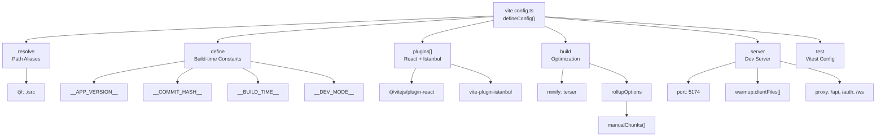
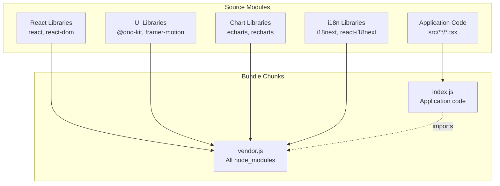
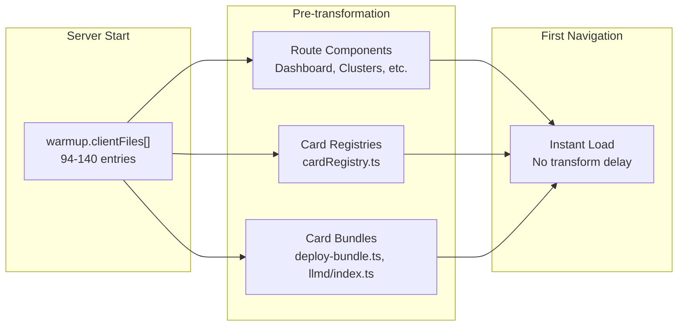
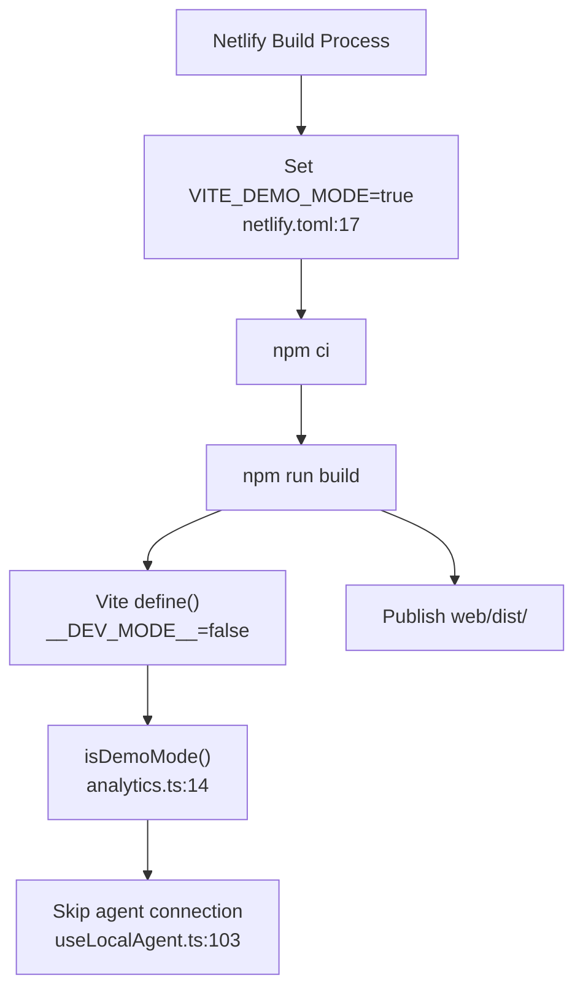
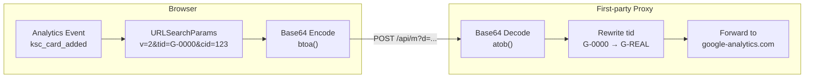

<!-- source: DeepWiki mcp.deepwiki.com · repo kubestellar/console · page 13.1 Frontend Build (Vite) · fetched 2026-10-26 -->

# Frontend Build (Vite)

<details>
<summary>Relevant source files</summary>

The following files were used as context for generating this wiki page:

- [.env.example](.env.example)
- [netlify.toml](netlify.toml)
- [pkg/api/handlers/analytics_proxy.go](pkg/api/handlers/analytics_proxy.go)
- [web/netlify/functions/analytics-collect.mts](web/netlify/functions/analytics-collect.mts)
- [web/package-lock.json](web/package-lock.json)
- [web/package.json](web/package.json)
- [web/src/components/agent/APIKeySettings.tsx](web/src/components/agent/APIKeySettings.tsx)
- [web/src/hooks/useLocalAgent.ts](web/src/hooks/useLocalAgent.ts)
- [web/src/lib/analytics.ts](web/src/lib/analytics.ts)
- [web/vite.config.ts](web/vite.config.ts)

</details>


This document covers the Vite-based build system for the KubeStellar Console frontend. It explains the build configuration, environment variable injection, optimization strategies, bundle chunking, and deployment modes. For backend build processes, see [Backend Build (Go)](#13.2). For deployment configuration across different environments, see [Deployment Options](#13.3).

---

## Vite Configuration Overview

The frontend build is configured in [web/vite.config.ts:1-192](). Vite serves as both the development server and production build tool, using esbuild for fast transpilation and Rollup for optimized production bundles.

### Configuration Structure



**Sources:** [web/vite.config.ts:34-191]()

---

## Environment Variables & Build-time Substitution

Vite injects environment variables at build time using the `define` configuration. These become compile-time constants, enabling tree-shaking of unused code paths.

### Build-time Constants

| Constant | Source | Purpose |
|----------|--------|---------|
| `__APP_VERSION__` | `VITE_APP_VERSION` or `getGitVersion()` | Display version in UI footer |
| `__COMMIT_HASH__` | `VITE_COMMIT_HASH` or `getGitCommitHash()` | Link to source commit |
| `__BUILD_TIME__` | `new Date().toISOString()` | Build timestamp |
| `__DEV_MODE__` | `VITE_DEV_MODE` or `mode === 'development'` | Enable dev-only features |

```mermaid
graph LR
    subgraph "Build Time"
        envVar["Environment Variable<br/>VITE_APP_VERSION"]
        gitCmd["Git Command<br/>git describe --tags"]
        fallback["Fallback<br/>getGitVersion()"]
    end
    
    subgraph "Source Code"
        constant["Constant<br/>__APP_VERSION__"]
    end
    
    subgraph "Production Bundle"
        literal["String Literal<br/>'v0.3.6-nightly.20260124'"]
    end
    
    envVar -->|if set| constant
    gitCmd -->|if env unset| fallback
    fallback --> constant
    constant -->|Vite define()| literal
```

The `getGitVersion()` function at [web/vite.config.ts:10-22]() parses `git describe --tags` output to extract the version tag. The `getGitCommitHash()` function at [web/vite.config.ts:24-31]() retrieves the full commit SHA.

### Demo Mode Injection

The `VITE_DEMO_MODE` environment variable forces demo mode in Netlify deployments, bypassing agent connection attempts. This is set in [netlify.toml:17]() and [netlify.toml:65-75]().

**Sources:** [web/vite.config.ts:40-48](), [netlify.toml:15-18](), [.env.example:1-70]()

---

## Build Optimization

### Terser Minification

Production builds use Terser with aggressive compression to reduce bundle size. Console statements are stripped in production at [web/vite.config.ts:68-77]().

**Terser Configuration:**
- `drop_console: true` - Remove `console.log`, `console.info`, `console.debug`, `console.trace`
- `drop_debugger: true` - Remove debugger statements
- `pure_funcs` - Mark console functions as side-effect-free for better tree-shaking

### Istanbul Coverage Instrumentation

The `vite-plugin-istanbul` plugin instruments code for E2E coverage collection when `VITE_COVERAGE=true`. Configuration at [web/vite.config.ts:52-61]() excludes test files and forces instrumentation even in production mode.

**Coverage Trigger:**
```bash
npm run dev:coverage  # Sets VITE_COVERAGE=true
```

The instrumented code exposes `window.__coverage__` for Playwright tests to collect. See [web/package.json:8]().

**Sources:** [web/vite.config.ts:68-89](), [web/package.json:8]()

---

## Bundle Chunking Strategy

### Manual Chunk Split

Vite's default code splitting can cause module initialization issues when React-dependent libraries are split into separate chunks. The configuration at [web/vite.config.ts:80-87]() consolidates all `node_modules` into a single `vendor` chunk to avoid circular dependencies.



**Critical Implementation Detail:**

The `manualChunks` function at [web/vite.config.ts:80-87]() returns `'vendor'` for all `node_modules` imports. This prevents Vite from creating separate chunks for different library groups, which would cause React hooks like `useLayoutEffect` and `createContext` to return `undefined` when multiple React instances exist.

### Lazy-loaded Card Bundles

Individual card components use dynamic imports for lazy loading. The card registry at `web/src/components/cards/cardRegistry.ts` maps card types to lazy-loaded modules:

```typescript
import { lazy } from 'react'

const ClusterHealthCard = lazy(() => import('./ClusterHealthCard'))
```

This creates separate chunk files like `ClusterHealthCard-[hash].js` that load on-demand when cards are added to the dashboard.

**Sources:** [web/vite.config.ts:78-89]()

---

## Development Server

### Server Configuration

The development server runs on port 5174 with strict port enforcement at [web/vite.config.ts:92-93](). This prevents port conflicts with other services.

### Module Warmup

Vite's warmup feature pre-transforms frequently-accessed modules during server startup to eliminate cold-start latency. The `warmup.clientFiles` array at [web/vite.config.ts:94-140]() lists route components and card registries.



### Proxy Configuration

The development server proxies backend API requests to `localhost:8080` as defined in [web/vite.config.ts:141-170]().

**Proxied Endpoints:**
- `/api/*` - REST API endpoints
- `/auth/github`, `/auth/github/callback`, `/auth/refresh` - OAuth flow
- `/health` - Health check endpoint
- `/api/m` - Analytics collection proxy
- `/ws` - WebSocket connections (with `ws: true` upgrade)

**Sources:** [web/vite.config.ts:91-171]()

---

## Deployment Modes

### Local Development Build

```bash
npm run dev
```

- Runs Vite dev server on `localhost:5174`
- Proxies API calls to Go backend on `localhost:8080`
- Hot module replacement (HMR) enabled
- Source maps enabled
- Console statements preserved

### Production Build

```bash
npm run build
```

1. **TypeScript Check:** `tsc -b` validates types without emitting files
2. **Vite Build:** Compiles, minifies, and bundles to `web/dist/`
3. **Console Stripping:** Removes all console statements via Terser
4. **Asset Hashing:** Generates cache-busting filenames like `index-[hash].js`

### Netlify Preview Build

Netlify builds set `VITE_DEMO_MODE=true` in [netlify.toml:17](), which:
- Skips agent connection attempts (see [web/src/hooks/useLocalAgent.ts:103-110]())
- Uses demo data for all hooks (see [web/src/hooks/useLocalAgent.ts:39-52]())
- Disables backend API calls that require authentication



**Sources:** [netlify.toml:4-18](), [web/vite.config.ts:34-49](), [web/src/hooks/useLocalAgent.ts:103-110]()

---

## Build Output Structure

### Production Bundle

```
web/dist/
├── index.html                 # Entry point with asset references
├── assets/
│   ├── index-[hash].js        # Main application bundle
│   ├── vendor-[hash].js       # All node_modules
│   ├── ClusterHealthCard-[hash].js
│   ├── DeploymentCard-[hash].js
│   └── ...                    # Lazy-loaded card chunks
└── public/                    # Static assets copied as-is
```

### Asset Loading

The production `index.html` contains script tags with hashed asset references:

```html
<script type="module" crossorigin src="/assets/index-a1b2c3d4.js"></script>
<link rel="modulepreload" href="/assets/vendor-e5f6g7h8.js">
```

Vite automatically injects `modulepreload` hints for the vendor chunk to improve load performance.

### Cache Strategy

Static assets in `/assets/*` receive immutable cache headers via Netlify configuration at [netlify.toml:56-59]():

```toml
Cache-Control = "public, max-age=31536000, immutable"
```

The root HTML file has no cache headers, ensuring users always fetch the latest index with updated asset hashes.

**Sources:** [web/vite.config.ts:68-90](), [netlify.toml:56-59]()

---

## NPM Scripts Reference

| Script | Command | Purpose |
|--------|---------|---------|
| `dev` | `vite` | Start dev server on port 5174 |
| `dev:coverage` | `VITE_COVERAGE=true vite` | Dev server with coverage instrumentation |
| `build` | `tsc -b && vite build` | Type-check and build production bundle |
| `lint` | `eslint .` | Lint all source files |
| `preview` | `vite preview` | Preview production build locally |
| `test` | `vitest` | Run unit tests |
| `test:coverage` | `vitest --coverage` | Unit tests with coverage report |
| `test:e2e` | `playwright test` | Run E2E tests |
| `test:e2e:coverage` | `./scripts/run-e2e-coverage.sh` | E2E tests with coverage collection |

**Sources:** [web/package.json:6-38]()

---

## Analytics Collection Proxy

The `/api/m` endpoint proxies GA4 event collection through a first-party domain to bypass ad blockers. The analytics implementation at [web/src/lib/analytics.ts:1-382]() encodes payloads in base64 before sending to the proxy.

### Base64 Encoding Flow



In development, the proxy is handled by the Go backend at [pkg/api/handlers/analytics_proxy.go:48-120](). In Netlify deployments, the proxy is a serverless function at [web/netlify/functions/analytics-collect.mts:1-124]().

**Sources:** [web/src/lib/analytics.ts:90-153](), [pkg/api/handlers/analytics_proxy.go:48-120](), [web/netlify/functions/analytics-collect.mts:41-119]()

---

