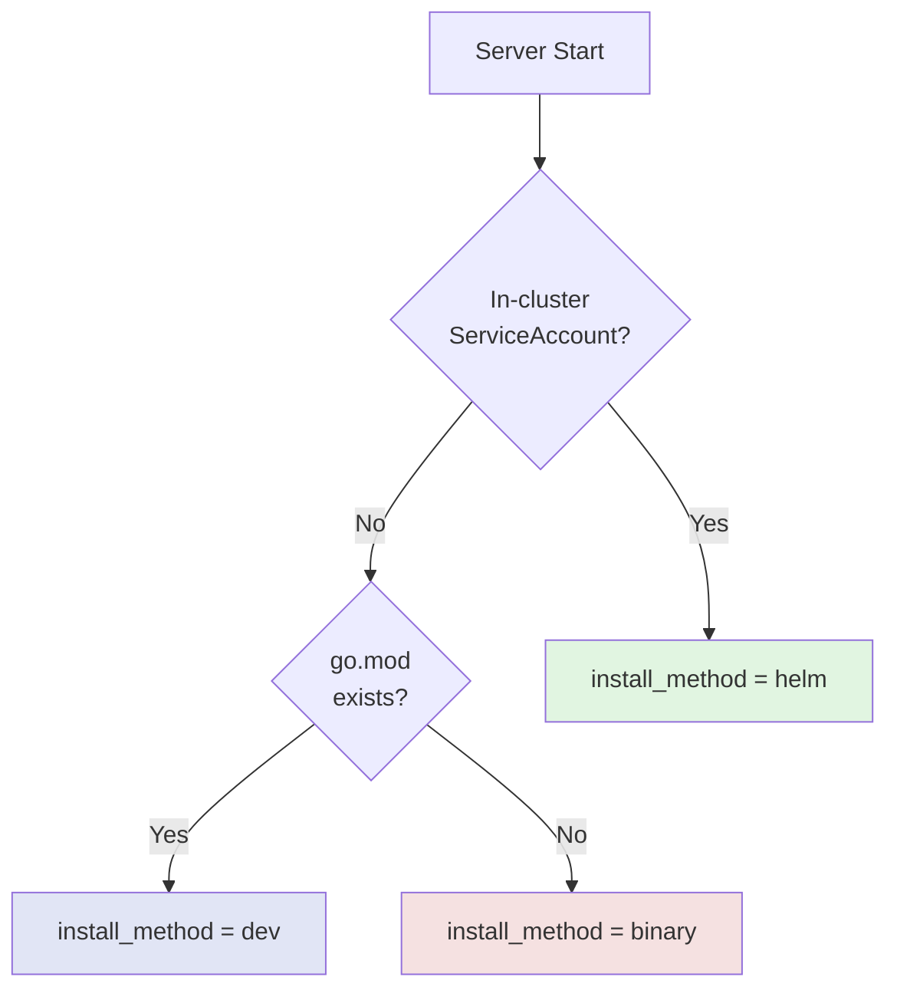
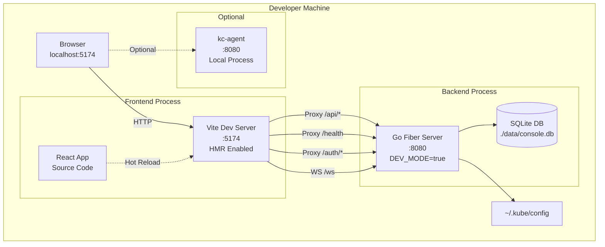
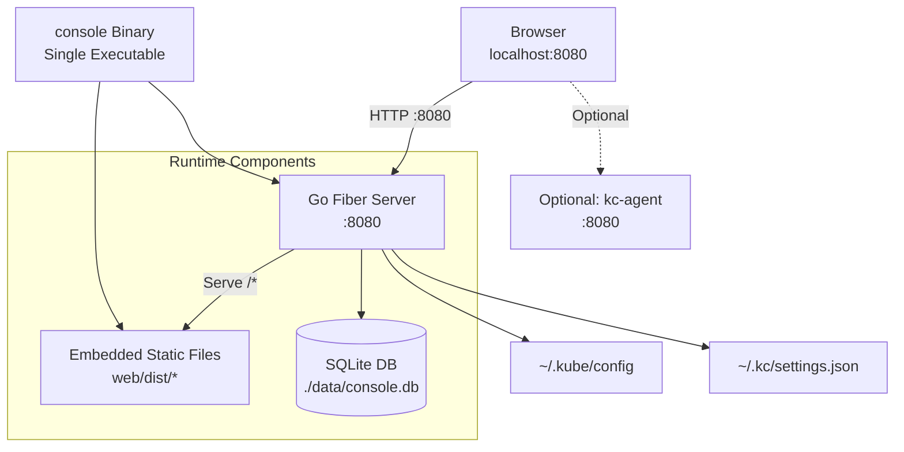
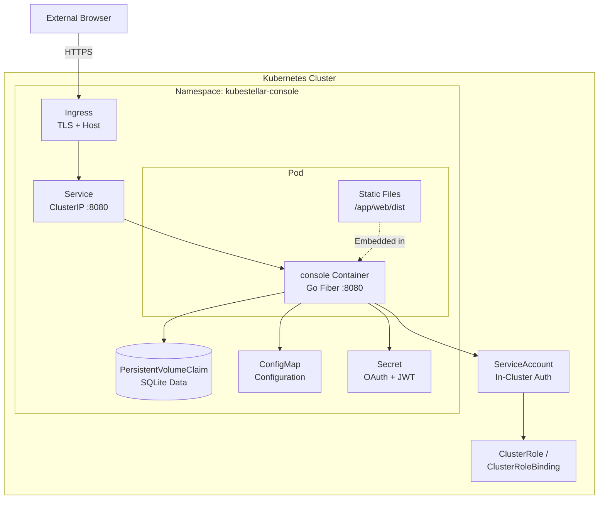
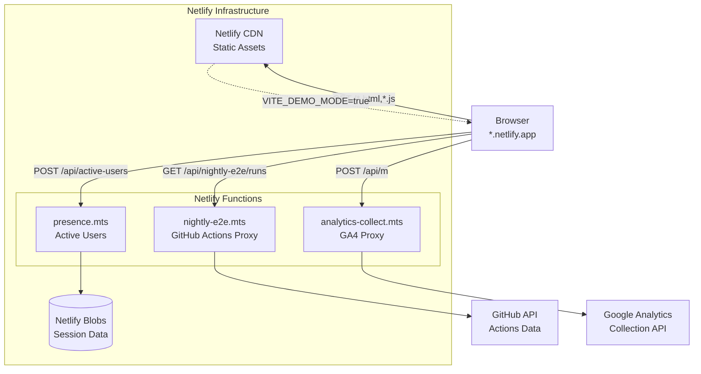
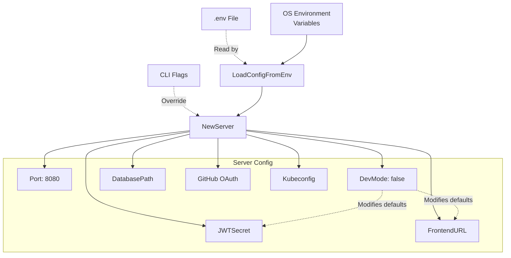
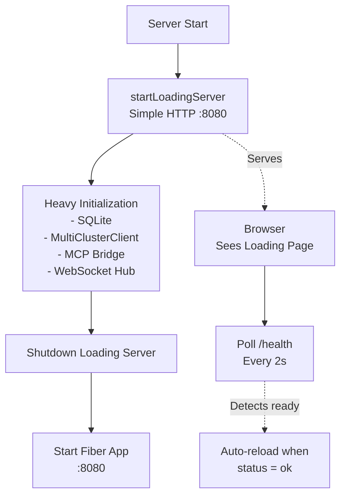

<!-- source: DeepWiki mcp.deepwiki.com · repo kubestellar/console · page 13.3 Deployment Options · fetched 2026-10-26 -->

# Deployment Options

<details>
<summary>Relevant source files</summary>

The following files were used as context for generating this wiki page:

- [.env.example](.env.example)
- [netlify.toml](netlify.toml)
- [pkg/api/handlers/analytics_proxy.go](pkg/api/handlers/analytics_proxy.go)
- [pkg/api/handlers/demo_data.go](pkg/api/handlers/demo_data.go)
- [pkg/api/handlers/gitops.go](pkg/api/handlers/gitops.go)
- [pkg/api/handlers/mcp.go](pkg/api/handlers/mcp.go)
- [pkg/api/handlers/sse.go](pkg/api/handlers/sse.go)
- [pkg/api/server.go](pkg/api/server.go)
- [pkg/k8s/client.go](pkg/k8s/client.go)
- [web/netlify/functions/analytics-collect.mts](web/netlify/functions/analytics-collect.mts)
- [web/package-lock.json](web/package-lock.json)
- [web/package.json](web/package.json)
- [web/src/components/agent/APIKeySettings.tsx](web/src/components/agent/APIKeySettings.tsx)
- [web/src/components/cards/ProactiveGPUNodeHealthMonitor.tsx](web/src/components/cards/ProactiveGPUNodeHealthMonitor.tsx)
- [web/src/config/cards/gpu-node-health.ts](web/src/config/cards/gpu-node-health.ts)
- [web/src/config/dashboards/gpu.ts](web/src/config/dashboards/gpu.ts)
- [web/src/hooks/mcp/types.ts](web/src/hooks/mcp/types.ts)
- [web/src/hooks/useLocalAgent.ts](web/src/hooks/useLocalAgent.ts)
- [web/src/lib/analytics.ts](web/src/lib/analytics.ts)
- [web/src/lib/sseClient.ts](web/src/lib/sseClient.ts)
- [web/vite.config.ts](web/vite.config.ts)

</details>


## Purpose and Scope

This document describes the available deployment options for KubeStellar Console and their respective configurations. It covers local development setup, binary installation, containerized deployment via Helm, and Netlify preview deployments for PR testing.

For information about the frontend build process, see [Frontend Build (Vite)](#13.1). For backend build details, see [Backend Build (Go)](#13.2). For demo mode configuration used in Netlify previews, see [Demo Mode](#13.4).

---

## Overview of Deployment Modes

KubeStellar Console supports four primary deployment modes, each optimized for different use cases:

| Mode | Use Case | Backend | Frontend | Agent Required |
|------|----------|---------|----------|----------------|
| **Local Development** | Active development | Go Fiber (`:8080`) | Vite Dev Server (`:5174`) | Optional |
| **Binary** | Quick local install | Embedded Go Fiber | Static files in `web/dist` | Optional |
| **Helm/Containerized** | Production clusters | Go Fiber in Pod | Static files in Pod | Optional |
| **Netlify Preview** | PR testing | Netlify Functions | Netlify CDN | Not available |

### Deployment Mode Detection



**Deployment Mode Detection**

Sources: [pkg/api/server.go:839-848]()

The server automatically detects its installation method at startup:
- **Helm**: In-cluster ServiceAccount configuration exists
- **Dev**: `go.mod` file present in working directory
- **Binary**: Neither of the above conditions met

---

## Local Development Deployment

Local development mode runs the backend and frontend as separate processes with live reload capabilities.

### Architecture



**Local Development Architecture**

Sources: [web/vite.config.ts:91-170](), [pkg/api/server.go:94-227]()

### Setup Steps

**1. Prerequisites**

```bash
# Backend requirements
go version  # Go 1.21+

# Frontend requirements
node --version  # Node 20+
npm --version
```

**2. Backend Setup**

```bash
# Install dependencies (none needed - uses Go modules)
go mod download

# Copy environment template
cp .env.example .env

# Edit .env with your configuration
# Minimum required: DEV_MODE=true
```

**3. Frontend Setup**

```bash
cd web
npm install
```

**4. Start Development Servers**

Terminal 1 (Backend):
```bash
# From project root
DEV_MODE=true go run cmd/server/main.go
```

Terminal 2 (Frontend):
```bash
# From web/ directory
npm run dev
```

Access the application at `http://localhost:5174`.

Sources: [pkg/api/server.go:769-825](), [web/package.json:6-7](), [.env.example:1-11]()

### Development Server Configuration

The frontend development server proxies API requests to the backend:

| Path | Target | Purpose |
|------|--------|---------|
| `/api/*` | `http://localhost:8080` | REST API endpoints |
| `/health` | `http://localhost:8080` | Health check |
| `/auth/*` | `http://localhost:8080` | OAuth callbacks |
| `/ws` | `ws://localhost:8080` | WebSocket connections |

Sources: [web/vite.config.ts:141-170]()

### Dev Mode Behavior

When `DEV_MODE=true`, the server exhibits special behaviors:

- **Default JWT Secret**: Generates insecure development secret (not for production)
- **Auto-login**: If GitHub OAuth not configured, uses `DEV_USER_LOGIN` from environment
- **CORS**: Allows `http://localhost:5174` origin
- **Frontend URL**: Defaults to `http://localhost:5174`
- **Static Files**: Not served (Vite serves them)

Sources: [pkg/api/server.go:96-113](), [pkg/api/server.go:254-271]()

### Hot Module Replacement

The Vite development server provides instant updates:

- **React Fast Refresh**: Component state preserved across edits
- **CSS Hot Reload**: Styles update without page refresh
- **Module Warmup**: Pre-transforms frequently used routes and cards

Sources: [web/vite.config.ts:94-140]()

Warmup targets include all route components and card registries to eliminate cold-start transform penalties on navigation.

---

## Binary Installation Deployment

Binary deployment packages the entire application (backend + frontend) into a single executable for easy local installation.

### Architecture



**Binary Deployment Architecture**

Sources: [pkg/api/server.go:699-705](), [pkg/api/server.go:839-848]()

### Build Steps

**1. Build Frontend**

```bash
cd web
npm ci
npm run build
# Output: web/dist/
```

**2. Build Backend with Embedded Assets**

```bash
# From project root
go build -o console cmd/server/main.go
```

The Go binary embeds the `web/dist` directory at compile time.

Sources: [web/package.json:9](), [web/vite.config.ts:68-90]()

### Installation

**Option 1: Direct Execution**

```bash
# Set required environment variables
export JWT_SECRET="your-secure-random-string-at-least-32-chars"

# Run the binary
./console
```

**Option 2: System Service**

Create `/etc/systemd/system/kubestellar-console.service`:

```ini
[Unit]
Description=KubeStellar Console
After=network.target

[Service]
Type=simple
User=console
WorkingDirectory=/opt/kubestellar-console
Environment="JWT_SECRET=your-secure-secret"
Environment="PORT=8080"
ExecStart=/opt/kubestellar-console/console
Restart=on-failure

[Install]
WantedBy=multi-user.target
```

Enable and start:
```bash
systemctl enable kubestellar-console
systemctl start kubestellar-console
```

Sources: [pkg/api/server.go:769-825]()

### Static File Serving

In production mode (binary/helm), the server serves static files from `web/dist`:

- Route `GET /*` → Serves from `./web/dist` directory
- SPA routing: All unmatched routes serve `index.html`
- Asset caching: JavaScript/CSS bundles have immutable cache headers

Sources: [pkg/api/server.go:699-705]()

---

## Containerized (Helm) Deployment

Containerized deployment runs KubeStellar Console as a Kubernetes workload using Helm charts.

### Architecture



**Helm Deployment Architecture**

Sources: [pkg/api/server.go:620-627](), [pkg/api/server.go:839-848]()

### In-Cluster Detection

When running inside Kubernetes, the server automatically detects in-cluster configuration:

1. Checks if `~/.kube/config` exists
2. If not found, attempts `rest.InClusterConfig()`
3. Reads ServiceAccount token from `/var/run/secrets/kubernetes.io/serviceaccount/token`
4. Sets `install_method = "helm"` in `/health` response

Sources: [pkg/api/server.go:620-627](), [pkg/api/server.go:317-324]()

### Helm Chart Structure

```
helm/
├── Chart.yaml
├── values.yaml
└── templates/
    ├── deployment.yaml
    ├── service.yaml
    ├── ingress.yaml
    ├── configmap.yaml
    ├── secret.yaml
    ├── serviceaccount.yaml
    ├── clusterrole.yaml
    └── clusterrolebinding.yaml
```

### Configuration Values

**Minimum `values.yaml`:**

```yaml
image:
  repository: ghcr.io/kubestellar/console
  tag: latest
  pullPolicy: IfNotPresent

service:
  type: ClusterIP
  port: 8080

ingress:
  enabled: true
  hosts:
    - host: console.example.com
      paths:
        - path: /
          pathType: Prefix

persistence:
  enabled: true
  size: 1Gi

config:
  jwtSecret: "generated-or-provided"
  githubClientId: ""
  githubClientSecret: ""
```

### RBAC Permissions

The ServiceAccount requires cluster-level read permissions:

| Resource | Verbs | Purpose |
|----------|-------|---------|
| `pods` | `get, list, watch` | Pod monitoring |
| `nodes` | `get, list, watch` | Node health |
| `deployments` | `get, list, watch` | Deployment status |
| `services` | `get, list, watch` | Service discovery |
| `events` | `get, list, watch` | Event tracking |
| `namespaces` | `get, list, watch` | Namespace enumeration |

Sources: [pkg/k8s/client.go:61-65]()

### Installation

```bash
# Add Helm repository (example)
helm repo add kubestellar https://kubestellar.github.io/console

# Install with custom values
helm install console kubestellar/console \
  --namespace kubestellar-console \
  --create-namespace \
  --set config.jwtSecret="your-secure-secret" \
  --set ingress.hosts[0].host="console.example.com"
```

### Resource Requirements

| Component | CPU Request | Memory Request | Storage |
|-----------|-------------|----------------|---------|
| Console Pod | 100m | 128Mi | - |
| SQLite PVC | - | - | 1Gi |

---

## Netlify Preview Deployment

Netlify preview deployments provide isolated test environments for pull requests using serverless functions and static hosting.

### Architecture



**Netlify Preview Architecture**

Sources: [netlify.toml:1-76](), [web/netlify/functions/analytics-collect.mts:1-124]()

### Demo Mode Enablement

Netlify previews automatically enable demo mode to provide a functional experience without backend infrastructure:

**Build Environment:**
```toml
[build.environment]
  VITE_DEMO_MODE = "true"
```

Sources: [netlify.toml:15-18]()

**Frontend Detection:**
```typescript
function getDeploymentType(): DeploymentType {
  const h = window.location.hostname
  if (h === 'console.kubestellar.io') return 'console.kubestellar.io'
  if (h.includes('netlify.app')) return 'netlify-preview'
  if (h === 'localhost' || h === '127.0.0.1') return 'localhost'
  return 'containerized'
}
```

Sources: [web/src/lib/analytics.ts:41-47]()

### Netlify Functions

#### 1. Nightly E2E Status (`nightly-e2e.mts`)

Proxies GitHub Actions workflow status for the nightly E2E monitoring dashboard:

- **Path**: `/api/nightly-e2e/runs`
- **Method**: `GET`
- **Authentication**: Uses `GITHUB_TOKEN` from Netlify environment
- **Purpose**: Fetches workflow run data without exposing token to browser

Sources: [netlify.toml:21-30]()

#### 2. Active Users Tracker (`presence.mts`)

Tracks concurrent preview deployment users using Netlify Blobs:

- **Path**: `/api/active-users`
- **Method**: `GET`, `POST`
- **Storage**: Netlify Blobs with TTL-based expiration
- **Purpose**: Shows live user count on demo deployments

Sources: [netlify.toml:33-36]()

#### 3. Analytics Collection Proxy (`analytics-collect.mts`)

First-party analytics proxy to bypass ad blockers:

- **Path**: `/api/m`
- **Method**: `POST`
- **Functionality**:
  - Decodes base64-encoded GA4 payloads
  - Rewrites measurement ID (decoy → real)
  - Forwards client IP for geolocation
  - Validates origin (only `*.netlify.app` allowed)

Sources: [web/netlify/functions/analytics-collect.mts:1-124](), [netlify.toml:38-40]()

### Redirect Rules

SPA routing redirect ensures all routes serve `index.html`:

```toml
[[redirects]]
  from = "/*"
  to = "/index.html"
  status = 200
  force = false
```

Sources: [netlify.toml:42-46]()

### Security Headers

```toml
[[headers]]
  for = "/*"
  [headers.values]
    X-Frame-Options = "DENY"
    X-Content-Type-Options = "nosniff"
    Referrer-Policy = "strict-origin-when-cross-origin"
```

Sources: [netlify.toml:48-54]()

### Cache Strategy

Static assets use aggressive caching:

```toml
[[headers]]
  for = "/assets/*"
  [headers.values]
    Cache-Control = "public, max-age=31536000, immutable"
```

Vite generates content-hashed filenames (e.g., `main.abc123.js`), enabling safe long-term caching.

Sources: [netlify.toml:56-59]()

---

## Configuration Flow

### Environment Variable Hierarchy



**Configuration Loading Flow**

Sources: [pkg/api/server.go:769-825](), [pkg/api/server.go:94-113]()

### Critical Environment Variables

| Variable | Default | Required | Purpose |
|----------|---------|----------|---------|
| `PORT` | `8080` | No | Server listen port |
| `DEV_MODE` | `false` | No | Enable development mode |
| `JWT_SECRET` | (generated in dev) | Yes (prod) | JWT signing key |
| `FRONTEND_URL` | (auto) | No | CORS and OAuth callback URL |
| `DATABASE_PATH` | `./data/console.db` | No | SQLite database location |
| `KUBECONFIG` | `~/.kube/config` | No | Kubernetes config file |
| `GITHUB_CLIENT_ID` | - | No | GitHub OAuth app ID |
| `GITHUB_CLIENT_SECRET` | - | No | GitHub OAuth secret |

Sources: [pkg/api/server.go:769-825](), [.env.example:1-70]()

### Frontend Environment Variables

Build-time variables injected via Vite:

```typescript
define: {
  __APP_VERSION__: JSON.stringify(process.env.VITE_APP_VERSION || getGitVersion()),
  __COMMIT_HASH__: JSON.stringify(process.env.VITE_COMMIT_HASH || getGitCommitHash()),
  __BUILD_TIME__: JSON.stringify(new Date().toISOString()),
  __DEV_MODE__: process.env.VITE_DEV_MODE !== undefined
    ? JSON.stringify(process.env.VITE_DEV_MODE === 'true')
    : JSON.stringify(mode === 'development'),
}
```

Sources: [web/vite.config.ts:40-49]()

---

## Health Check Endpoint

All deployment modes expose a unified health check at `GET /health`:

### Response Structure

```json
{
  "status": "ok",
  "version": "0.3.6",
  "oauth_configured": true,
  "in_cluster": false,
  "install_method": "dev"
}
```

Sources: [pkg/api/server.go:313-338]()

### Status Values

| Field | Values | Description |
|-------|--------|-------------|
| `status` | `ok`, `starting`, `shutting_down` | Server state |
| `version` | Semver string | Build version (from ldflags) |
| `oauth_configured` | Boolean | GitHub OAuth credentials present |
| `in_cluster` | Boolean | Running with ServiceAccount |
| `install_method` | `dev`, `binary`, `helm` | Detected installation type |

### Frontend Staleness Detection

The frontend polls `/health` to detect version mismatches:

1. Fetch `/health` on mount and every 60s
2. Compare `response.version` with `__APP_VERSION__` constant
3. If mismatch, show "Update Available" banner with reload button

This enables zero-downtime deployments where users can continue their session and manually refresh when ready.

Sources: [pkg/api/server.go:38-40](), [pkg/api/server.go:313-338]()

---

## Port Configuration

### Default Ports

| Service | Port | Protocol | Configurable |
|---------|------|----------|--------------|
| Backend API | 8080 | HTTP | Yes (`PORT` env) |
| Frontend Dev | 5174 | HTTP | Yes (vite.config.ts) |
| kc-agent | 8080 | HTTP | No |
| WebSocket | 8080 | WS | Shares backend port |

Sources: [pkg/api/server.go:771-774](), [web/vite.config.ts:92-93]()

### Port Conflict Resolution

**Frontend Dev Server:**
```typescript
server: {
  port: 5174,
  strictPort: true, // Fail if port already in use
}
```

Sources: [web/vite.config.ts:92-93]()

If port 5174 is occupied, Vite will exit with an error rather than silently using an alternative port.

**Backend Server:**

The backend uses `PORT` environment variable without fallback behavior. If the port is occupied, the OS will return a "bind: address already in use" error.

---

## Loading Screen During Initialization

The server implements a temporary loading page to provide immediate feedback during startup:

### Architecture



**Loading Screen Implementation**

Sources: [pkg/api/server.go:115-227](), [pkg/api/server.go:229-252]()

### Implementation Details

**1. Temporary HTTP Server**

```go
func startLoadingServer(addr string) *http.Server {
  mux := http.NewServeMux()
  mux.HandleFunc("/health", func(w http.ResponseWriter, r *http.Request) {
    w.Write([]byte(`{"status":"starting"}`))
  })
  mux.HandleFunc("/", func(w http.ResponseWriter, r *http.Request) {
    w.Write([]byte(startupLoadingHTML))
  })
  // ...
}
```

Sources: [pkg/api/server.go:229-252]()

**2. Self-Contained HTML**

The loading page is a self-contained HTML document with:
- Animated spinner
- Star field background
- JavaScript polling `/health` every 2s
- Auto-reload when `status: "ok"`

Sources: [pkg/api/server.go:275-308]()

**3. Graceful Transition**

```go
func (s *Server) Start() error {
  if s.loadingSrv != nil {
    ctx, cancel := context.WithTimeout(context.Background(), serverHealthTimeout)
    defer cancel()
    s.loadingSrv.Shutdown(ctx)
    s.loadingSrv = nil
    time.Sleep(serverStartupDelay) // Brief pause for port release
  }
  // Start real Fiber app on same port
}
```

Sources: [pkg/api/server.go:719-733]()

This prevents users from seeing "connection refused" errors during the 2-5 second initialization period when database, Kubernetes clients, and MCP bridge are being initialized.

---

## Summary

KubeStellar Console's flexible deployment architecture supports development velocity, production reliability, and PR testing workflows:

- **Local Development**: Fast iteration with hot reload
- **Binary**: Simple single-file installation
- **Helm**: Production-grade Kubernetes deployment
- **Netlify Preview**: Zero-infrastructure PR previews

Each mode automatically detects its environment and adjusts behavior accordingly, requiring minimal configuration changes between deployments.

Sources: [pkg/api/server.go:94-227](), [pkg/api/server.go:769-848](), [netlify.toml:1-76](), [web/vite.config.ts:34-191]()

---

