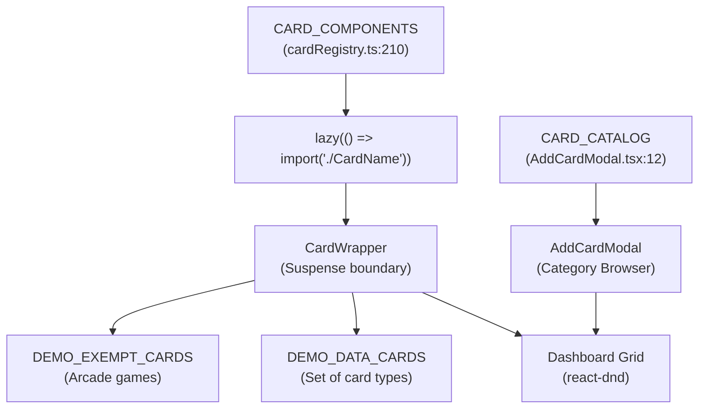
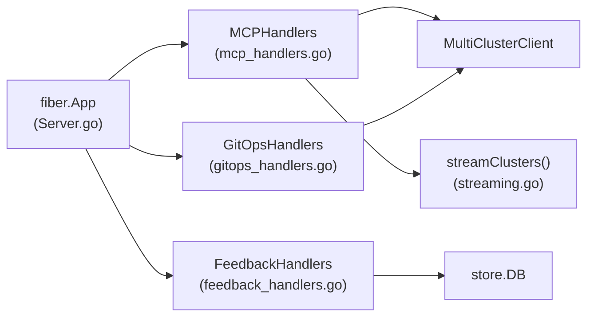
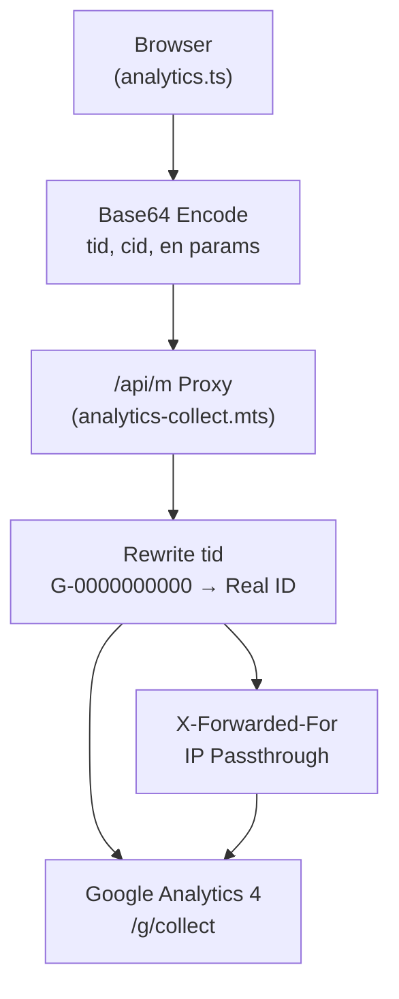
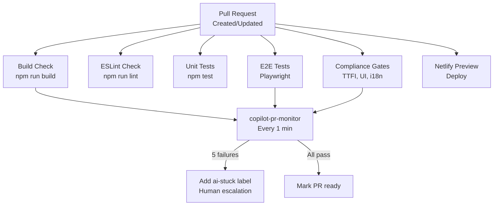
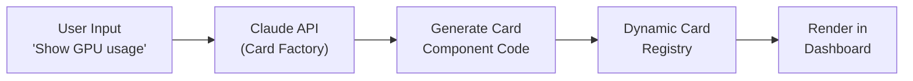
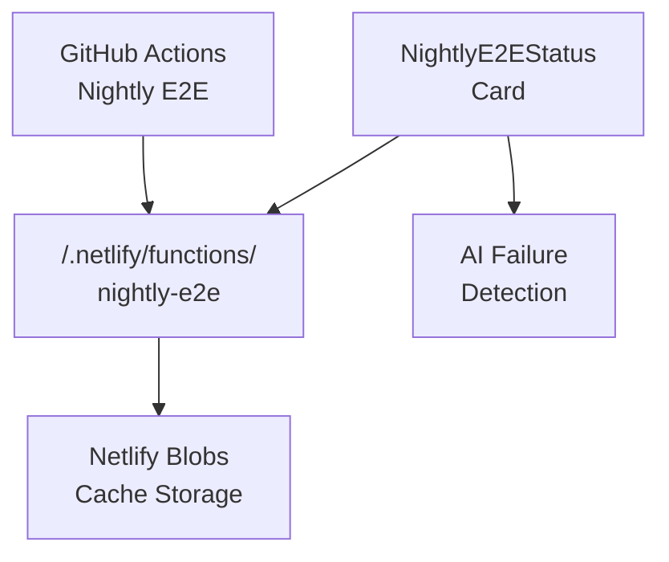

<!-- source: DeepWiki mcp.deepwiki.com · repo kubestellar/console · page 14 Developer Guide · fetched 2026-10-26 -->

# Developer Guide

<details>
<summary>Relevant source files</summary>

The following files were used as context for generating this wiki page:

- [.env.example](.env.example)
- [netlify.toml](netlify.toml)
- [pkg/api/handlers/analytics_proxy.go](pkg/api/handlers/analytics_proxy.go)
- [web/netlify/functions/analytics-collect.mts](web/netlify/functions/analytics-collect.mts)
- [web/package-lock.json](web/package-lock.json)
- [web/package.json](web/package.json)
- [web/src/components/agent/APIKeySettings.tsx](web/src/components/agent/APIKeySettings.tsx)
- [web/src/components/cards/cardRegistry.ts](web/src/components/cards/cardRegistry.ts)
- [web/src/components/cards/flatcar_status/demoData.ts](web/src/components/cards/flatcar_status/demoData.ts)
- [web/src/components/cards/flatcar_status/index.tsx](web/src/components/cards/flatcar_status/index.tsx)
- [web/src/components/cards/flatcar_status/useFlatcarStatus.ts](web/src/components/cards/flatcar_status/useFlatcarStatus.ts)
- [web/src/components/cards/flatcar_status/versionUtils.ts](web/src/components/cards/flatcar_status/versionUtils.ts)
- [web/src/components/cards/llmd/index.ts](web/src/components/cards/llmd/index.ts)
- [web/src/components/dashboard/AddCardModal.tsx](web/src/components/dashboard/AddCardModal.tsx)
- [web/src/components/dashboard/templates.ts](web/src/components/dashboard/templates.ts)
- [web/src/components/llmd-benchmarks/LLMdBenchmarks.tsx](web/src/components/llmd-benchmarks/LLMdBenchmarks.tsx)
- [web/src/hooks/useLocalAgent.ts](web/src/hooks/useLocalAgent.ts)
- [web/src/lib/analytics.ts](web/src/lib/analytics.ts)
- [web/src/locales/en/cards.json](web/src/locales/en/cards.json)
- [web/vite.config.ts](web/vite.config.ts)

</details>


This guide provides comprehensive instructions for developers contributing to the KubeStellar Console project. It covers local development setup, the card-based UI architecture, backend integration patterns, testing strategies, and contribution workflows.

For system architecture overview, see [Architecture](#2). For specific subsystem details, see [Card-Based UI System](#3), [Backend API Handlers](#5), and [CI/CD Automation](#7).

---

## Development Environment Setup

### Prerequisites

- **Node.js**: v20 or higher (specified in [netlify.toml:18]())
- **Go**: v1.21+ for backend development
- **Git**: For version control and CI/CD integration

### Local Installation

Clone the repository and install dependencies:

```bash
git clone https://github.com/kubestellar/console.git
cd console/web
npm ci
```

The `npm ci` command performs a clean install based on [web/package-lock.json](), ensuring reproducible builds. Dependencies are split into:

- **Production**: React 18.3.1, React Router 7.1.1, i18next 25.7.4, echarts 6.0, lucide-react 0.468.0
- **Development**: Vite 6.0.5, Vitest 4.0.18, Playwright 1.57.0, TypeScript 5.6.2, ESLint 9.17.0

Sources: [web/package.json:1-114]()

### Environment Configuration

Copy the example environment file and configure required variables:

```bash
cp .env.example .env
```

Key environment variables:

| Variable | Purpose | Required |
|----------|---------|----------|
| `GITHUB_CLIENT_ID` | GitHub OAuth authentication | Production only |
| `GITHUB_CLIENT_SECRET` | GitHub OAuth secret | Production only |
| `DEV_MODE` | Enables auto-login and dev features | Development only |
| `ANTHROPIC_API_KEY` | Claude API for AI features | Optional |
| `GA4_REAL_MEASUREMENT_ID` | Analytics tracking | Optional |
| `ENABLED_DASHBOARDS` | Filter sidebar dashboards | Optional |

Development mode (`DEV_MODE=true`) bypasses OAuth and enables hot module replacement.

Sources: [.env.example:1-71]()

### Running the Development Server

Start the frontend development server:

```bash
cd web
npm run dev
```

The Vite dev server runs on `http://localhost:5174` (port configured at [web/vite.config.ts:92]()). It includes:

- **API Proxy**: Routes `/api/*` requests to `http://localhost:8080` for the Go backend
- **Hot Module Replacement**: Automatic reload on file changes
- **Module Pre-warming**: Pre-transforms frequently-used route components and card bundles on server start to eliminate cold-start latency (configured at [web/vite.config.ts:94-139]())

For backend development, run the Go server in a separate terminal:

```bash
cd pkg
go run cmd/server/main.go
```

Sources: [web/vite.config.ts:34-191](), [web/package.json:6-7]()

---

## Card-Based UI Architecture

The console UI is built from 85+ modular card components registered in `CARD_COMPONENTS`. Each card is a lazy-loaded React component that can be added to any dashboard via drag-and-drop.

### Card Registry System



**Card Registry**

Cards are registered in `CARD_COMPONENTS` at [web/src/components/cards/cardRegistry.ts:210-452](). The registry maps card type strings to lazy-loaded components:

```typescript
const CARD_COMPONENTS: Record<string, CardComponent> = {
  cluster_health: ClusterHealth,
  gpu_inventory: GPUInventory,
  llmd_flow: LLMdFlow,
  // ... 85+ more cards
}
```

**Bundle Chunking Strategy**

Related cards share barrel imports to reduce HTTP requests and Vite transform overhead:

- **deploy-bundle**: 16 GitOps/deployment cards ([web/src/components/cards/cardRegistry.ts:14]())
- **llmd**: 15 LLM-d visualization and benchmark cards ([web/src/components/cards/cardRegistry.ts:143]())
- **workload-detection**: 7 Prow/ML workload cards ([web/src/components/cards/cardRegistry.ts:85]())
- **workload-monitor**: 5 monitoring cards ([web/src/components/cards/cardRegistry.ts:134]())
- **kagenti**: 8 AI agent platform cards ([web/src/components/cards/cardRegistry.ts:165]())
- **cluster-admin-bundle**: 12 cluster admin cards ([web/src/components/cards/cardRegistry.ts:180]())

Sources: [web/src/components/cards/cardRegistry.ts:1-1500]()

### Creating a New Card

#### Step 1: Create Card Component

Create a new card file in `web/src/components/cards/`:

```typescript
// web/src/components/cards/MyNewCard.tsx
import { useCache } from '../../lib/cache'
import { Skeleton } from '../ui/Skeleton'

export function MyNewCard() {
  const { data, isLoading } = useCache({
    key: 'my-new-card',
    category: 'default',
    initialData: [],
    demoData: DEMO_DATA,
    fetcher: fetchMyData,
  })

  if (isLoading) {
    return <Skeleton variant="rounded" height={200} />
  }

  return (
    <div className="h-full flex flex-col min-h-card">
      {/* Card content */}
    </div>
  )
}
```

**Card Component Pattern**:
- Use `useCache` hook for data fetching with automatic demo mode fallback
- Show `<Skeleton>` during initial load
- Use `min-h-card` class (240px minimum) for consistent card height
- Mark loaded state with `content-loaded` class to trigger fade-in animation

Sources: [web/src/components/cards/ClusterHealth.tsx:1-200](), [web/src/components/cards/GPUInventory.tsx:1-300]()

#### Step 2: Register in Card Registry

Add lazy import and registry entry:

```typescript
// web/src/components/cards/cardRegistry.ts

// Add lazy import at top
const MyNewCard = lazy(() => import('./MyNewCard').then(m => ({ default: m.MyNewCard })))

// Add to CARD_COMPONENTS object
const RAW_CARD_COMPONENTS: Record<string, CardComponent> = {
  // ... existing cards
  my_new_card: MyNewCard,
}

// Add to chunk preloaders for prefetching
const CARD_CHUNK_PRELOADERS: Record<string, () => Promise<unknown>> = {
  // ... existing preloaders
  my_new_card: () => import('./MyNewCard'),
}
```

If the card uses demo data exclusively (no live backend), add it to `DEMO_DATA_CARDS` set at [web/src/components/cards/cardRegistry.ts:473]().

Sources: [web/src/components/cards/cardRegistry.ts:1-210](), [web/src/components/cards/cardRegistry.ts:580-730]()

#### Step 3: Add to Card Catalog

Update the `CARD_CATALOG` in `AddCardModal.tsx` to make the card discoverable:

```typescript
// web/src/components/dashboard/AddCardModal.tsx

const CARD_CATALOG = {
  'My Category': [
    {
      type: 'my_new_card',
      title: 'My New Card',
      description: 'Description of what this card displays',
      visualization: 'table' | 'gauge' | 'status' | 'timeseries' | 'events' | 'donut' | 'bar',
    },
  ],
}
```

Available categories: `'Cluster Admin'`, `'Cluster Health'`, `'Workloads'`, `'Compute'`, `'Storage'`, `'Network'`, `'GitOps'`, `'Security & Events'`, `'GPU'`, `'AI Agents'`, `'Arcade'`, etc.

Sources: [web/src/components/dashboard/AddCardModal.tsx:12-215]()

#### Step 4: Add Translations

Add card title and description to all locale files:

```json
// web/src/locales/en/cards.json
{
  "titles": {
    "my_new_card": "My New Card"
  },
  "descriptions": {
    "my_new_card": "Displays real-time data from Kubernetes clusters"
  }
}
```

Repeat for all supported languages: `de`, `es`, `fr`, `it`, `ja`, `pt`, `ru`, `zh`.

Sources: [web/src/locales/en/cards.json:1-500]()

#### Step 5: Add to Dashboard Template (Optional)

To include the card in pre-configured dashboard templates:

```typescript
// web/src/components/dashboard/templates.ts

export const DASHBOARD_TEMPLATES: DashboardTemplate[] = [
  {
    id: 'my-template',
    name: 'My Template',
    description: 'Template description',
    icon: '🎯',
    category: 'custom',
    cards: [
      { 
        card_type: 'my_new_card', 
        position: { w: 6, h: 3 } // width=6 cols, height=3 rows
      },
    ],
  },
]
```

Grid layout uses 12-column system with drag-and-drop positioning via `@dnd-kit/core`.

Sources: [web/src/components/dashboard/templates.ts:1-500]()

### Demo Mode Support

Cards automatically fall back to demo data when:
1. `getDemoMode()` returns `true` (Netlify previews, forced demo mode)
2. `useCache` receives `demoData` parameter
3. Backend API returns errors or is unavailable

**Demo Data Pattern**:

```typescript
// web/src/components/cards/MyNewCard.tsx

const DEMO_DATA = {
  items: [
    { name: 'Demo Item 1', status: 'healthy' },
    { name: 'Demo Item 2', status: 'warning' },
  ],
}

const { data, isDemoFallback } = useCache({
  key: 'my-new-card',
  demoData: DEMO_DATA,
  fetcher: fetchLiveData,
})
```

The `isDemoFallback` flag indicates whether demo data is being shown. Cards in `DEMO_DATA_CARDS` set always show a yellow "DEMO" badge in the card header.

Sources: [web/src/components/cards/cardRegistry.ts:473-536](), [web/src/lib/demoMode.ts:1-50]()

---

## Backend API Integration

### API Endpoint Pattern

Backend API handlers are organized by domain in `pkg/api/handlers/`:



**Common Handler Patterns**:

1. **SSE Streaming** (for real-time multi-cluster data):
```go
// pkg/api/handlers/mcp_handlers.go
func (h *MCPHandlers) StreamPods(c *fiber.Ctx) error {
    return streamClusters(c, h.client, h.cache, "pods", func(ctx context.Context, client *k8s.Clientset) (interface{}, error) {
        pods, err := client.CoreV1().Pods("").List(ctx, metav1.ListOptions{})
        return pods.Items, err
    })
}
```

2. **REST Endpoint** (for configuration/settings):
```go
// pkg/api/handlers/settings_handlers.go
func (h *SettingsHandlers) GetSettings(c *fiber.Ctx) error {
    settings, err := h.settingsService.Load()
    if err != nil {
        return c.Status(500).JSON(fiber.Map{"error": err.Error()})
    }
    return c.JSON(settings)
}
```

3. **WebSocket** (for bidirectional updates):
```go
// pkg/api/handlers/websocket_handler.go
func HandleWebSocket(c *websocket.Conn) {
    for {
        var msg Message
        if err := c.ReadJSON(&msg); err != nil {
            break
        }
        // Process message and broadcast to clients
    }
}
```

Sources: [pkg/api/handlers/mcp_handlers.go:1-500](), [pkg/api/handlers/feedback_handlers.go:1-300]()

### Adding a New API Endpoint

#### Step 1: Create Handler Function

Add handler to appropriate domain file in `pkg/api/handlers/`:

```go
// pkg/api/handlers/my_handlers.go
package handlers

type MyHandlers struct {
    client *k8s.MultiClusterClient
}

func NewMyHandlers(client *k8s.MultiClusterClient) *MyHandlers {
    return &MyHandlers{client: client}
}

func (h *MyHandlers) GetMyData(c *fiber.Ctx) error {
    data, err := h.fetchData()
    if err != nil {
        return c.Status(500).JSON(fiber.Map{"error": err.Error()})
    }
    return c.JSON(data)
}
```

#### Step 2: Register Route

Register the endpoint in server initialization at `pkg/api/server.go`:

```go
// pkg/api/server.go
func SetupRoutes(app *fiber.App, handlers *Handlers) {
    api := app.Group("/api")
    
    myHandlers := NewMyHandlers(handlers.MCClient)
    api.Get("/my-endpoint", myHandlers.GetMyData)
}
```

#### Step 3: Create Frontend Hook

Create a React hook to consume the API:

```typescript
// web/src/hooks/useMyData.ts
import { useCache } from '../lib/cache'

export function useMyData() {
  return useCache({
    key: 'my-data',
    category: 'default',
    fetcher: async () => {
      const response = await fetch('/api/my-endpoint')
      if (!response.ok) throw new Error('Failed to fetch')
      return response.json()
    },
  })
}
```

The `useCache` hook provides:
- Automatic caching with TTL (10-30 minutes depending on category)
- localStorage persistence
- Demo mode fallback
- Stale-while-revalidate pattern

Sources: [web/src/hooks/useMCP.ts:1-500](), [web/src/lib/cache.ts:1-300]()

### SSE Streaming for Multi-Cluster Data

For real-time multi-cluster queries, use the `streamClusters` helper:

```go
// pkg/api/handlers/streaming.go
func streamClusters(
    c *fiber.Ctx,
    client *k8s.MultiClusterClient,
    cache *Cache,
    cacheKey string,
    fetcher func(context.Context, *k8s.Clientset) (interface{}, error),
) error {
    // 1. Check cache (15s TTL)
    if cached, ok := cache.Get(cacheKey); ok {
        return c.JSON(cached)
    }
    
    // 2. Query all healthy clusters in parallel
    results := client.ParallelQuery(fetcher)
    
    // 3. Cache results
    cache.Set(cacheKey, results, 15*time.Second)
    
    // 4. Stream to client
    return c.JSON(results)
}
```

The streaming pattern includes:
- **Health filtering**: Only queries healthy clusters via `HealthyClusters()`
- **Timeout handling**: Skips slow clusters (>5s response time)
- **Error resilience**: Individual cluster failures don't block other results
- **Backend caching**: 15s TTL prevents redundant queries

Sources: [pkg/api/handlers/mcp_handlers.go:1-500](), [pkg/kubernetes/multi_cluster_client.go:1-800]()

---

## Testing Strategy

### Unit Tests (Vitest)

Run unit tests:

```bash
npm test              # Run once
npm run test:ui       # Interactive UI
npm run test:coverage # Generate coverage report
```

**Test File Pattern**:

```typescript
// web/src/components/cards/__tests__/MyCard.test.tsx
import { render, screen } from '@testing-library/react'
import { MyCard } from '../MyCard'

describe('MyCard', () => {
  it('renders loading skeleton initially', () => {
    render(<MyCard />)
    expect(screen.getByTestId('skeleton')).toBeInTheDocument()
  })

  it('displays data after loading', async () => {
    render(<MyCard />)
    const data = await screen.findByText('Expected Content')
    expect(data).toBeInTheDocument()
  })
})
```

Test configuration at [web/vite.config.ts:172-190]() uses `jsdom` environment with `@testing-library/react` for component testing.

Sources: [web/package.json:12-14](), [web/vite.config.ts:172-190]()

### End-to-End Tests (Playwright)

Run E2E tests:

```bash
npm run test:e2e            # Headless mode
npm run test:e2e:ui         # Interactive UI
npm run test:e2e:headed     # Headed browser mode
npm run test:e2e:chromium   # Single browser
```

**Test Structure**:

```typescript
// web/e2e/dashboard.spec.ts
import { test, expect } from '@playwright/test'

test('dashboard loads and displays cards', async ({ page }) => {
  await page.goto('http://localhost:5174/')
  
  // Wait for dashboard to load
  await expect(page.locator('[data-testid="dashboard"]')).toBeVisible()
  
  // Check card rendering
  const cards = page.locator('.card-wrapper')
  await expect(cards).toHaveCount(5)
})
```

Sources: [web/package.json:15-22](), [web/e2e/dashboard.spec.ts:1-100]()

### Compliance Gates

The project enforces several compliance checks that must pass before PR merge:

#### UI Loading Compliance

Verifies all cards load without errors and meet performance thresholds:

```bash
npm run test:e2e:ui-compliance:gate
```

Checks:
- No JavaScript errors during card render
- All cards complete loading within 10s
- Skeleton states transition correctly to content
- No console errors or warnings

Configuration: [web/e2e/compliance/card-loading-compliance.spec.ts:1-200]()

#### Time-to-First-Interaction (TTFI) Gate

Measures and enforces performance budgets for card interactivity:

```bash
npm run test:e2e:perf:ttfi:gate
```

Thresholds:
- P50 < 500ms
- P95 < 1000ms
- P99 < 2000ms

Any card exceeding these budgets fails the gate. Historical baselines stored in `e2e/perf/ttfi-baseline.json`.

Configuration: [web/e2e/perf/all-cards-ttfi.spec.ts:1-150]()

#### Security Compliance

Validates security headers and CSP policies:

```bash
npm run test:e2e:security-compliance
```

Enforces:
- `X-Frame-Options: DENY`
- `X-Content-Type-Options: nosniff`
- `Referrer-Policy: strict-origin-when-cross-origin`
- No inline scripts without nonce
- No eval() usage in production builds

Configuration: [web/e2e/compliance/security-compliance.spec.ts:1-100]()

#### i18n Compliance

Ensures all UI strings are internationalized:

```bash
npm run test:e2e:i18n-compliance
```

Validates:
- No hardcoded English strings in components
- All translation keys exist in all locale files
- Pluralization rules correct for all languages
- No missing translations for new cards

Configuration: [web/e2e/compliance/i18n-compliance.spec.ts:1-150]()

Sources: [web/package.json:27-35](), [web/e2e/compliance/compliance.config.ts:1-50]()

---

## Analytics Integration

The console uses a stealth analytics implementation designed to bypass ad blockers while respecting user privacy.

### Analytics Architecture



**Three-Layer Anti-Blocking Strategy**:

1. **No External Scripts**: No `gtag.js` loaded (immune to script blockers)
2. **First-Party Proxy**: Events sent to `/api/m` (immune to domain-based filters)
3. **Base64 Encoding**: Payload encoded so network filters can't pattern-match GA4 parameters

Sources: [web/src/lib/analytics.ts:1-382](), [web/netlify/functions/analytics-collect.mts:1-124](), [pkg/api/handlers/analytics_proxy.go:1-156]()

### Emitting Custom Events

Use pre-defined analytics functions for consistent event naming:

```typescript
import { 
  emitPageView,
  emitCardAdded,
  emitMissionStarted,
  emitConversionStep,
} from '../lib/analytics'

// Page navigation
emitPageView('/clusters')

// User interactions
emitCardAdded('gpu_inventory', 'catalog')
emitMissionStarted('kubeconfig_audit', 'claude')

// Conversion funnel tracking
emitConversionStep(4, 'clusters', { cluster_count: '3' })
```

**Conversion Funnel Steps**:
1. `discovery` - User visited site
2. `login` - Authenticated via OAuth or demo
3. `agent` - kc-agent connected
4. `clusters` - Real clusters detected
5. `api_key` - AI API key configured
6. `github_token` - GitHub token configured

Sources: [web/src/lib/analytics.ts:220-381]()

### Privacy Controls

Users can opt out of analytics via Settings:

```typescript
import { setAnalyticsOptOut, isAnalyticsOptedOut } from '../lib/analytics'

// Check opt-out status
if (!isAnalyticsOptedOut()) {
  emitPageView('/dashboard')
}

// Toggle opt-out
setAnalyticsOptOut(true) // Clears all cookies and local storage
```

When opted out:
- All cookies starting with `_ga` or `_ksc` are deleted
- Client ID and session storage cleared
- No events sent to proxy
- Opt-out persisted in `localStorage`

Sources: [web/src/lib/analytics.ts:196-217]()

---

## Contributing Guidelines

### Code Style

The project uses ESLint and TypeScript strict mode. Run linting:

```bash
npm run lint
```

**Style Conventions**:
- **React Components**: PascalCase, functional components with hooks
- **Hooks**: camelCase starting with `use` prefix (e.g., `useMCP`, `useLocalAgent`)
- **Utilities**: camelCase for functions, PascalCase for classes
- **CSS**: Tailwind utility classes, avoid custom CSS files
- **Imports**: Relative imports for local files, absolute for `node_modules`

Example component structure:

```typescript
// web/src/components/cards/MyCard.tsx
import { useState } from 'react'
import { useTranslation } from 'react-i18next'
import { useCache } from '../../lib/cache'
import { Skeleton } from '../ui/Skeleton'

export function MyCard() {
  const { t } = useTranslation('cards')
  const [expanded, setExpanded] = useState(false)
  const { data, isLoading } = useCache({ ... })
  
  if (isLoading) return <Skeleton />
  
  return (
    <div className="h-full flex flex-col min-h-card">
      <h3>{t('titles.my_card')}</h3>
      {/* Component content */}
    </div>
  )
}
```

Sources: [web/eslint.config.js:1-50](), [web/src/components/cards/ClusterHealth.tsx:1-200]()

### Pull Request Workflow

#### 1. Fork and Branch

```bash
git checkout -b feature/my-new-feature
```

Branch naming conventions:
- `feature/` - New features
- `fix/` - Bug fixes
- `docs/` - Documentation updates
- `perf/` - Performance improvements
- `test/` - Test additions or fixes

#### 2. Commit Changes

Follow conventional commit format:

```
feat(cards): add GPU utilization trend card

- Implements stacked area chart with historical data
- Adds demo mode support with realistic test data
- Includes translations for all 9 languages
- Updates card catalog and registry

Closes #123
```

Commit types: `feat`, `fix`, `docs`, `style`, `refactor`, `test`, `chore`

#### 3. Run Pre-commit Checks

Before pushing, verify all gates pass locally:

```bash
npm run build                    # Verify build succeeds
npm run lint                     # Check code style
npm run test                     # Run unit tests
npm run test:e2e:ui-compliance   # Check UI compliance
npm run test:e2e:perf:ttfi:gate  # Verify performance budgets
```

#### 4. Push and Open PR

```bash
git push origin feature/my-new-feature
```

Open PR on GitHub with description including:
- **What**: Summary of changes
- **Why**: Motivation and context
- **How**: Implementation approach
- **Testing**: How changes were tested
- **Screenshots**: For UI changes

#### 5. CI/CD Pipeline

The PR triggers automated checks:



**Automated Recovery**:

If PR created by `copilot-swe-agent[bot]` fails checks, the `copilot-pr-monitor` workflow:
1. Runs every minute with 2 internal checks (30s apart)
2. Detects build/test failures
3. Posts detailed error reports as PR comments
4. After 5 consecutive failures, adds `ai-stuck` label and @mentions human maintainer

Sources: [.github/workflows/copilot-pr-monitor.yml:1-150](), [.github/workflows/copilot-build-check.yml:1-100]()

### DCO Sign-off

All commits must be signed off to pass the Developer Certificate of Origin (DCO) check:

```bash
git commit -s -m "feat: add new feature"
```

The `-s` flag adds:

```
Signed-off-by: Your Name <your.email@example.com>
```

PRs without sign-off will have the `dco-remediation` label automatically added. The `copilot-pr-monitor` workflow can override DCO failures for AI-generated PRs after human review.

Sources: [.github/workflows/copilot-pr-monitor.yml:60-80]()

### Review Process

PRs require:
- ✅ All CI checks passing
- ✅ At least one approving review from maintainer
- ✅ DCO sign-off on all commits
- ✅ No merge conflicts with main branch
- ✅ Updated documentation for new features
- ✅ Translation keys added for all UI strings

Maintainers will review within 1-2 business days.

---

## Advanced Development Topics

### Dynamic Card Factory

The console supports AI-powered card creation from natural language descriptions via the Card Factory:



Implementation at [web/src/components/dashboard/CardFactoryModal.tsx:1-500]() uses:
- **Prompt Engineering**: Generates React component from user description
- **Code Compilation**: Uses `sucrase` for runtime TypeScript transpilation
- **Registry Injection**: Dynamically registers generated card in `CARD_COMPONENTS`
- **Persistence**: Stores generated cards in localStorage for reuse

Sources: [web/src/components/dashboard/CardFactoryModal.tsx:1-500](), [web/src/lib/dynamic-cards/dynamicCardRegistry.ts:1-200]()

### MCP Bridge Integration

For advanced cluster operations, the console can integrate with the `kubestellar-ops` MCP bridge:

```typescript
// web/src/hooks/useMCP.ts
export function useMCPBridge() {
  return useCache({
    key: 'mcp-bridge',
    fetcher: async () => {
      const response = await fetch('/api/mcp/bridge/status')
      return response.json()
    },
  })
}
```

The MCP Bridge provides:
- **Tool Invocation**: Execute cluster operations via Model Context Protocol
- **AI Integration**: Claude can call tools directly for cluster management
- **Fallback**: Gracefully degrades to direct `MultiClusterClient` when unavailable

Sources: [web/src/hooks/useMCP.ts:1-500]()

### Nightly E2E Monitoring

The console monitors nightly end-to-end workflow health across multiple platforms:



Monitored workflows:
- OCP nightly (OpenShift clusters)
- GKE nightly (Google Kubernetes Engine)
- CKS nightly (Certified Kubernetes Service)

Failure classification:
- **GPU Unavailable**: Not a test failure, just resource unavailable
- **Test Failed**: Actual test failure requiring investigation
- **Workflow Error**: GitHub Actions infrastructure issue

Sources: [web/src/components/cards/llmd/NightlyE2EStatus.tsx:1-500](), [web/netlify/functions/nightly-e2e.mts:1-200]()

---

## Deployment Modes

The console supports three deployment modes:

| Mode | Frontend | Backend | Use Case |
|------|----------|---------|----------|
| **Local Development** | Vite dev server (port 5174) | Go server (port 8080) | Development, testing |
| **Containerized** | Nginx serving `dist/` | Go server in container | Production, Helm deployment |
| **Netlify Preview** | Static hosting | Netlify Functions (serverless) | PR previews, demo mode |

### Netlify Preview Configuration

Netlify deploys are configured in [netlify.toml:1-76](). Key features:

- **Base Directory**: `web/` (frontend subdirectory)
- **Build Command**: `npm ci && npm run build`
- **Publish Directory**: `dist/` (Vite output)
- **Functions**: Serverless functions in `web/netlify/functions/`
- **Redirects**: SPA routing, API proxying
- **Environment**: `VITE_DEMO_MODE=true` forces demo data

Netlify Functions replace Go backend for:
- `/api/nightly-e2e/runs` → `nightly-e2e.mts` (GitHub Actions data)
- `/api/active-users` → `presence.mts` (user presence tracking)
- `/api/m` → `analytics-collect.mts` (GA4 proxy)

Sources: [netlify.toml:1-76](), [web/netlify/functions/nightly-e2e.mts:1-200](), [web/netlify/functions/analytics-collect.mts:1-124]()

### Build Optimization

Production builds are optimized via Vite configuration:

- **Minification**: Terser with aggressive compression
- **Code Splitting**: Vendor chunk + per-route chunks
- **Tree Shaking**: Dead code elimination
- **Console Removal**: `drop_console: true` in production
- **Asset Hashing**: Cache-busting for static assets

Build command:

```bash
npm run build
```

Output directory: `web/dist/`

Sources: [web/vite.config.ts:68-90]()

---

This developer guide covers the essential workflows for contributing to KubeStellar Console. For deeper dives into specific subsystems, refer to the linked wiki pages for [Card-Based UI System](#3), [Multi-Cluster Kubernetes Management](#4), [Backend API Handlers](#5), [Feedback & Rewards System](#6), and [CI/CD Automation](#7).

---

