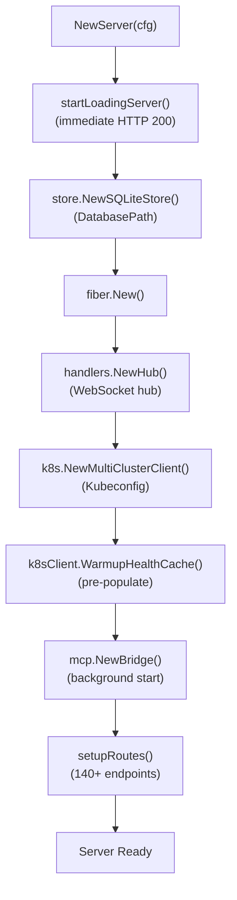
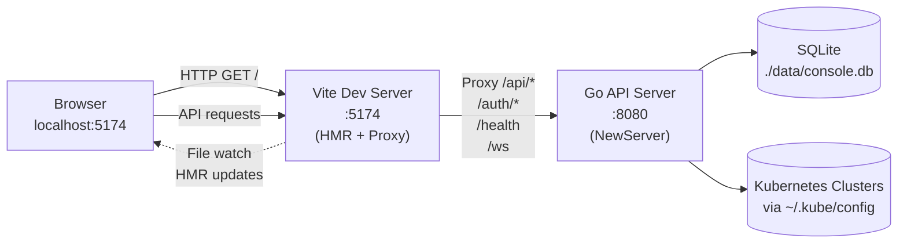
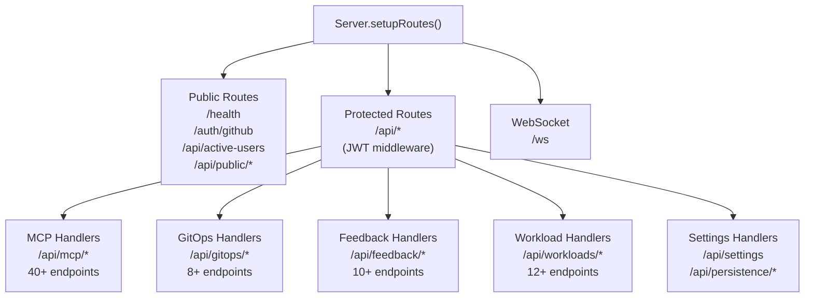
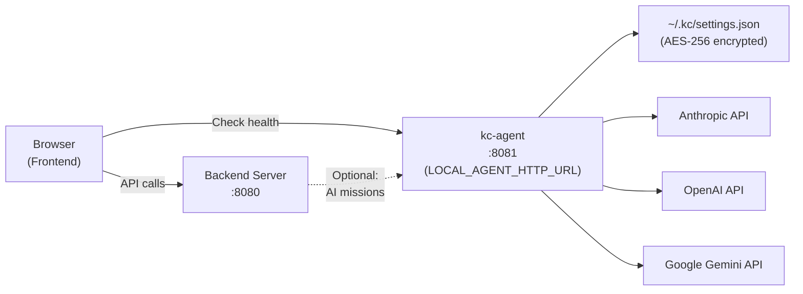
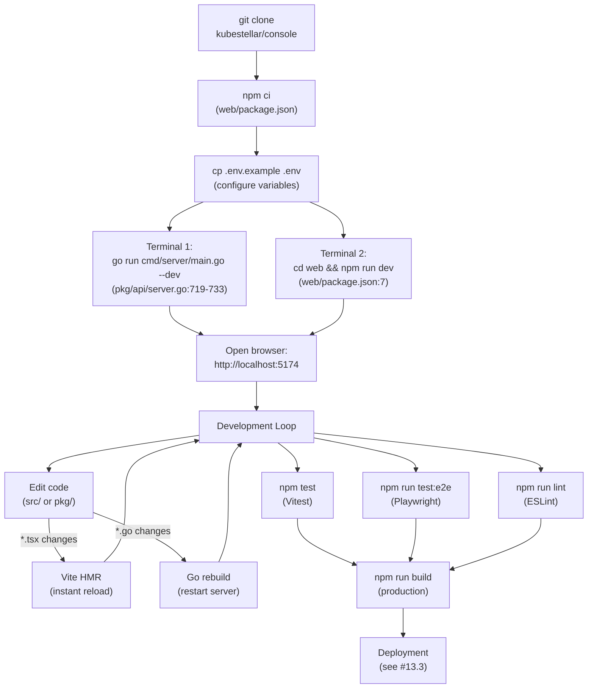

<!-- source: DeepWiki mcp.deepwiki.com · repo kubestellar/console · page 14.1 Development Setup · fetched 2026-10-26 -->

# Development Setup

<details>
<summary>Relevant source files</summary>

The following files were used as context for generating this wiki page:

- [.env.example](.env.example)
- [netlify.toml](netlify.toml)
- [pkg/api/handlers/analytics_proxy.go](pkg/api/handlers/analytics_proxy.go)
- [pkg/api/handlers/demo_data.go](pkg/api/handlers/demo_data.go)
- [pkg/api/handlers/gitops.go](pkg/api/handlers/gitops.go)
- [pkg/api/handlers/mcp.go](pkg/api/handlers/mcp.go)
- [pkg/api/handlers/sse.go](pkg/api/handlers/sse.go)
- [pkg/api/server.go](pkg/api/server.go)
- [pkg/k8s/client.go](pkg/k8s/client.go)
- [web/netlify/functions/analytics-collect.mts](web/netlify/functions/analytics-collect.mts)
- [web/package-lock.json](web/package-lock.json)
- [web/package.json](web/package.json)
- [web/src/components/agent/APIKeySettings.tsx](web/src/components/agent/APIKeySettings.tsx)
- [web/src/components/cards/ProactiveGPUNodeHealthMonitor.tsx](web/src/components/cards/ProactiveGPUNodeHealthMonitor.tsx)
- [web/src/config/cards/gpu-node-health.ts](web/src/config/cards/gpu-node-health.ts)
- [web/src/config/dashboards/gpu.ts](web/src/config/dashboards/gpu.ts)
- [web/src/hooks/mcp/types.ts](web/src/hooks/mcp/types.ts)
- [web/src/hooks/useLocalAgent.ts](web/src/hooks/useLocalAgent.ts)
- [web/src/lib/analytics.ts](web/src/lib/analytics.ts)
- [web/src/lib/sseClient.ts](web/src/lib/sseClient.ts)
- [web/vite.config.ts](web/vite.config.ts)

</details>


## Purpose and Scope

This document provides instructions for setting up a local development environment for the KubeStellar Console. It covers installation of dependencies, configuration of the frontend and backend services, environment variable setup, and running the development servers.

For information about adding new cards to the UI, see [Adding New Cards](#14.2). For backend API development, see [Adding API Endpoints](#14.3). For deployment options, see [Deployment Options](#13.3).

---

## Prerequisites

### Required Software

| Tool | Version | Purpose |
|------|---------|---------|
| Node.js | 20.x | Frontend build and development server |
| Go | 1.21+ | Backend API server |
| kubectl | Latest | Kubernetes cluster access (optional) |
| Docker | Latest | Containerized deployment (optional) |

### Optional Software

| Tool | Purpose |
|------|---------|
| Helm | Kubernetes deployment |
| kc-agent | Local AI provider integration |
| Git | Source code management |

**Sources:** [web/package.json:40-102](), [netlify.toml:17-18]()

---

## Repository Structure

```
kubestellar-console/
├── web/                    # Frontend (React + Vite)
│   ├── src/               # Source code
│   ├── public/            # Static assets
│   ├── package.json       # NPM dependencies
│   └── vite.config.ts     # Vite configuration
├── pkg/                    # Backend (Go)
│   ├── api/               # API server and handlers
│   ├── k8s/               # Kubernetes client
│   ├── mcp/               # MCP bridge
│   └── store/             # SQLite persistence
├── .env.example           # Environment variable template
└── netlify.toml           # Netlify deployment config
```

**Sources:** [web/vite.config.ts:1-191](), [pkg/api/server.go:1-849]()

---

## Quick Start

### 1. Clone Repository

```bash
git clone https://github.com/kubestellar/console.git
cd console
```

### 2. Install Frontend Dependencies

```bash
cd web
npm ci
```

### 3. Configure Environment

```bash
cp ../.env.example ../.env
# Edit .env with your configuration
```

### 4. Start Development Servers

**Terminal 1 - Backend:**
```bash
cd ..
go run cmd/server/main.go --dev
```

**Terminal 2 - Frontend:**
```bash
cd web
npm run dev
```

The console will be available at `http://localhost:5174`.

**Sources:** [web/package.json:6-11](), [pkg/api/server.go:781-794]()

---

## Frontend Development Setup

### Installation

```bash
cd web
npm ci  # Use 'ci' for reproducible builds, not 'install'
```

### Available Scripts

| Script | Command | Purpose |
|--------|---------|---------|
| `dev` | `vite` | Start Vite dev server on port 5174 |
| `build` | `tsc -b && vite build` | Production build with type checking |
| `lint` | `eslint .` | Run ESLint on all files |
| `test` | `vitest` | Run unit tests with Vitest |
| `test:e2e` | `playwright test` | Run E2E tests with Playwright |
| `preview` | `vite preview` | Preview production build locally |

**Sources:** [web/package.json:6-39]()

### Vite Configuration

The Vite dev server is configured with:

- **Port:** 5174 (strict mode - fails if port in use)
- **Proxy:** All `/api/*`, `/auth/*`, `/health`, `/ws` requests forward to `http://localhost:8080`
- **Module warmup:** Pre-transforms frequently accessed route components on server start
- **Hot Module Replacement (HMR):** Enabled by default

**Key configuration sections:**

```typescript
// web/vite.config.ts:91-170
server: {
  port: 5174,
  strictPort: true,
  proxy: {
    '/api': { target: 'http://localhost:8080', changeOrigin: true },
    '/health': { target: 'http://localhost:8080', changeOrigin: true },
    '/ws': { target: 'ws://localhost:8080', ws: true },
  }
}
```

**Sources:** [web/vite.config.ts:91-170]()

### Environment Variables (Frontend)

Frontend environment variables are prefixed with `VITE_` and injected at build time:

| Variable | Default | Purpose |
|----------|---------|---------|
| `VITE_DEMO_MODE` | `false` | Enable demo mode with mock data |
| `VITE_GA_MEASUREMENT_ID` | `G-0000000000` | Google Analytics measurement ID |
| `VITE_COVERAGE` | `false` | Enable Istanbul coverage instrumentation |

**Sources:** [web/vite.config.ts:40-48](), [netlify.toml:16-18]()

---

## Backend Development Setup

### Running the Backend

The backend server is implemented in [pkg/api/server.go]() with the main entry point at `cmd/server/main.go` (not shown in provided files).

**Development mode:**
```bash
go run cmd/server/main.go --dev
```

**Production mode:**
```bash
go build -o console cmd/server/main.go
./console
```

### Server Configuration

The `Config` struct in [pkg/api/server.go:43-74]() defines all server configuration options:

```go
type Config struct {
    Port             int
    DevMode          bool
    SkipOnboarding   bool
    DatabasePath     string
    GitHubClientID   string
    GitHubSecret     string
    JWTSecret        string
    FrontendURL      string
    Kubeconfig       string
    // ... additional fields
}
```

### Development Mode Behavior

When `DevMode` is enabled [pkg/api/server.go:781]():

1. **JWT Secret:** Auto-generated if not provided [pkg/api/server.go:106-108]()
2. **Frontend URL:** Defaults to `http://localhost:5174` [pkg/api/server.go:98]()
3. **Auto-login:** Uses `DevUserLogin`, `DevUserEmail`, `DevUserAvatar` from config [pkg/api/server.go:805-807]()
4. **CORS:** Configured for cross-origin requests from frontend [pkg/api/server.go:265-270]()

**Sources:** [pkg/api/server.go:43-74](), [pkg/api/server.go:781-825]()

### Server Initialization Sequence



**Key initialization steps:**

1. **Loading Page Server** [pkg/api/server.go:229-252](): Starts immediately on the configured port, serves a loading page while heavy initialization happens
2. **SQLite Database** [pkg/api/server.go:123-126](): Creates/opens database at `DatabasePath`
3. **WebSocket Hub** [pkg/api/server.go:135-137](): Initializes WebSocket connection manager for real-time updates
4. **Kubernetes Client** [pkg/api/server.go:140-163](): Loads kubeconfig and performs health cache warmup
5. **MCP Bridge** [pkg/api/server.go:172-188](): Optional background initialization for kubestellar-ops tools
6. **Route Setup** [pkg/api/server.go:310-706](): Registers 140+ API endpoints

**Sources:** [pkg/api/server.go:94-227](), [pkg/api/server.go:229-252]()

---

## Environment Configuration

### Creating the .env File

```bash
cp .env.example .env
```

### Essential Variables

| Variable | Required | Default | Description |
|----------|----------|---------|-------------|
| `DEV_MODE` | No | `true` | Enable development mode features |
| `JWT_SECRET` | Production only | Auto-generated | JWT signing secret (32+ chars) |
| `PORT` | No | `8080` | Backend server port |
| `DATABASE_PATH` | No | `./data/console.db` | SQLite database location |

### OAuth Configuration

Required for GitHub authentication in production:

| Variable | Description | How to Obtain |
|----------|-------------|---------------|
| `GITHUB_CLIENT_ID` | OAuth App client ID | Create at https://github.com/settings/apps |
| `GITHUB_CLIENT_SECRET` | OAuth App client secret | From GitHub OAuth App settings |

### Development User Configuration

When OAuth is not configured, dev mode uses these credentials:

| Variable | Default | Purpose |
|----------|---------|---------|
| `DEV_USER_LOGIN` | `dev-user` | Username displayed in UI |
| `DEV_USER_EMAIL` | `dev@localhost` | Email address |
| `DEV_USER_AVATAR` | Empty | Avatar URL |

**Sources:** [.env.example:1-71](), [pkg/api/server.go:770-825]()

### Kubernetes Access

The backend automatically detects kubeconfig from:

1. `KUBECONFIG` environment variable
2. `~/.kube/config` default location
3. In-cluster ServiceAccount (when running in a pod)

**Auto-detection logic:**

```go
// pkg/k8s/client.go:600-630
func NewMultiClusterClient(kubeconfig string) (*MultiClusterClient, error) {
    if kubeconfig == "" {
        kubeconfig = os.Getenv("KUBECONFIG")
        if kubeconfig == "" {
            home, _ := os.UserHomeDir()
            kubeconfig = filepath.Join(home, ".kube", "config")
        }
    }
    
    // Try in-cluster config if no kubeconfig file exists
    if _, err := os.Stat(kubeconfig); os.IsNotExist(err) {
        if inClusterConfig, err := rest.InClusterConfig(); err == nil {
            client.inClusterConfig = inClusterConfig
        }
    }
    
    return client, nil
}
```

**Sources:** [pkg/k8s/client.go:600-630](), [pkg/api/server.go:140-163]()

### Analytics Configuration

The console includes stealth analytics that bypasses ad blockers via a first-party proxy:

| Variable | Default | Purpose |
|----------|---------|---------|
| `GA4_REAL_MEASUREMENT_ID` | `G-PXWNVQ8D1T` | Real GA4 property ID (server-side only) |
| `VITE_GA_MEASUREMENT_ID` | `G-0000000000` | Decoy ID (visible in frontend) |

**Proxy rewrite mechanism:**

```typescript
// web/src/lib/analytics.ts:146
const encoded = btoa(p.toString())
const url = `/api/m?d=${encodeURIComponent(encoded)}`
```

```go
// pkg/api/handlers/analytics_proxy.go:62-72
decoded, err := base64.StdEncoding.DecodeString(d)
params, _ := url.ParseQuery(string(decoded))
params.Set("tid", realMeasurementID)  // Rewrite decoy -> real
```

**Sources:** [web/src/lib/analytics.ts:1-382](), [pkg/api/handlers/analytics_proxy.go:1-156]()

---

## Running the Development Server

### System Architecture - Development Mode



**Data flow:**

1. User navigates to `http://localhost:5174`
2. Vite serves React application with HMR enabled
3. API calls from frontend are proxied to Go server at `:8080`
4. Go server queries Kubernetes clusters and SQLite database
5. WebSocket connections at `/ws` provide real-time updates

**Sources:** [web/vite.config.ts:141-170](), [pkg/api/server.go:694-697]()

### Starting the Servers

**Option 1: Separate Terminals**

Terminal 1 - Backend:
```bash
go run cmd/server/main.go --dev
```

Output:
```
2024/01/24 10:15:30 Loading page available on :8080
2024/01/24 10:15:32 Kubernetes client initialized successfully
2024/01/24 10:15:33 Server initialization complete
2024/01/24 10:15:33 Starting server on :8080 (dev=true)
```

Terminal 2 - Frontend:
```bash
cd web
npm run dev
```

Output:
```
VITE v6.0.5  ready in 423 ms

  ➜  Local:   http://localhost:5174/
  ➜  Network: use --host to expose
  ➜  press h + enter to show help
```

**Option 2: Production Build Testing**

```bash
# Build frontend
cd web
npm run build

# Run backend (serves built frontend)
cd ..
go run cmd/server/main.go

# Access at http://localhost:8080
```

**Sources:** [pkg/api/server.go:719-733](), [web/package.json:7-9]()

### API Endpoint Structure

The backend registers 140+ API endpoints organized by domain:



**Key handler groups:**

| Path Prefix | Handler | Line Reference |
|-------------|---------|----------------|
| `/api/mcp/*` | MCPHandlers | [pkg/api/server.go:407-548]() |
| `/api/gitops/*` | GitOpsHandlers | [pkg/api/server.go:551-565]() |
| `/api/feedback/*` | FeedbackHandler | [pkg/api/server.go:613-631]() |
| `/api/workloads/*` | WorkloadHandlers | [pkg/api/server.go:589-610]() |
| `/api/settings` | SettingsHandler | [pkg/api/server.go:421-425]() |
| `/ws` | WebSocket Hub | [pkg/api/server.go:694-697]() |

**Sources:** [pkg/api/server.go:310-706]()

---

## Local Agent Setup (kc-agent)

The `kc-agent` is an optional local service that provides AI provider integration without storing API keys on the server.

### Installation

```bash
npm install -g kc-agent
```

Or via Homebrew:
```bash
brew install kc-agent
```

**Sources:** [web/src/components/agent/APIKeySettings.tsx:10-11]()

### Agent Architecture



**Agent responsibilities:**

1. **API Key Storage:** Encrypts and stores AI provider keys locally [web/src/components/agent/APIKeySettings.tsx:155-177]()
2. **Health Monitoring:** Exposes `/health` endpoint with connection status [web/src/hooks/useLocalAgent.ts:202-248]()
3. **AI Provider Integration:** Routes requests to Anthropic, OpenAI, or Gemini
4. **Token Usage Tracking:** Monitors input/output token consumption

**Sources:** [web/src/hooks/useLocalAgent.ts:1-426](), [web/src/components/agent/APIKeySettings.tsx:1-335]()

### Agent Connection Detection

The frontend uses a singleton `AgentManager` with hysteresis to prevent connection flicker:

```typescript
// web/src/hooks/useLocalAgent.ts:69-98
class AgentManager {
  private state: AgentState = {
    status: 'connecting',
    health: null,
    error: null,
  }
  
  private failureCount = 0
  private successCount = 0
  
  // Require 2 consecutive failures before disconnecting
  private FAILURE_THRESHOLD = 2
  // Require 2 consecutive successes before reconnecting
  private SUCCESS_THRESHOLD = 2
}
```

**Polling intervals:**

| State | Interval | Purpose |
|-------|----------|---------|
| Connected | 10s | Monitor agent health |
| Disconnected | 60s | Attempt reconnection |
| Aggressive detect | 1s | Rapid detection burst (10s duration) |

**Sources:** [web/src/hooks/useLocalAgent.ts:31-36](), [web/src/hooks/useLocalAgent.ts:99-130]()

### API Key Configuration UI

The `APIKeySettings` component provides a UI for configuring API keys:

**Available providers:**

| Provider | Placeholder | Docs URL |
|----------|-------------|----------|
| Claude (Anthropic) | `sk-ant-api03-...` | console.anthropic.com/settings/keys |
| OpenAI GPT | `sk-...` | platform.openai.com/api-keys |
| Google Gemini | `AIza...` | makersuite.google.com/app/apikey |
| Cursor | `cursor-...` | cursor.com |
| VS Code | `vscode-...` | code.visualstudio.com |
| Windsurf | `codeium-...` | codeium.com |

**Configuration flow:**

1. User opens Settings → API Keys
2. Frontend fetches key status from `${KC_AGENT_URL}/settings/keys`
3. User enters new API key
4. Key is encrypted and stored at `~/.kc/settings.json`
5. Analytics event `ksc_api_key_configured` emitted

**Sources:** [web/src/components/agent/APIKeySettings.tsx:33-82](), [web/src/components/agent/APIKeySettings.tsx:155-183]()

---

## Testing

### Unit Tests (Vitest)

```bash
cd web
npm test          # Run tests
npm run test:ui   # Run with UI
npm run test:coverage  # Generate coverage report
```

**Test configuration:**

- **Framework:** Vitest with jsdom environment
- **Setup:** [web/src/test/setup.ts]()
- **Coverage:** V8 provider with text/JSON/HTML reporters
- **Excluded:** `node_modules/`, `e2e/`, test files themselves

**Sources:** [web/vite.config.ts:172-190](), [web/package.json:12-14]()

### E2E Tests (Playwright)

```bash
cd web
npm run test:e2e           # Run all tests
npm run test:e2e:ui        # Run with UI
npm run test:e2e:chromium  # Chromium only
npm run test:e2e:firefox   # Firefox only
npm run test:e2e:webkit    # WebKit only
```

**Test categories:**

| Script | Purpose | Config File |
|--------|---------|-------------|
| `test:e2e` | Full E2E test suite | `e2e/playwright.config.ts` |
| `test:e2e:perf` | Performance benchmarks | `e2e/perf/perf.config.ts` |
| `test:e2e:ui-compliance` | UI loading compliance | `e2e/compliance/compliance.config.ts` |
| `test:e2e:a11y-compliance` | Accessibility checks | `e2e/compliance/compliance.config.ts` |

**Sources:** [web/package.json:15-36]()

### Coverage Collection

**E2E Coverage:**

```bash
cd web
./scripts/run-e2e-coverage.sh
```

This script:
1. Builds frontend with Istanbul instrumentation
2. Starts backend server
3. Runs Playwright tests
4. Collects coverage from `window.__coverage__`
5. Generates merged coverage report

**Coverage reporters:**

- **Text:** Console summary
- **JSON:** Machine-readable format
- **HTML:** Interactive browser view at `web/coverage/index.html`

**Sources:** [web/vite.config.ts:52-60](), [web/package.json:36-38]()

---

## Common Development Issues

### Port Already in Use

**Problem:** `Error: Port 5174 is already in use`

**Solution:**
```bash
# Find and kill process using port 5174
lsof -ti:5174 | xargs kill -9

# Or change port in vite.config.ts
```

**Sources:** [web/vite.config.ts:92-93]()

### Kubeconfig Not Found

**Problem:** `No kubeconfig found — connect clusters via Settings`

**Solution:**
1. Ensure `~/.kube/config` exists
2. Or set `KUBECONFIG` environment variable
3. Or run without clusters (demo mode)

**Sources:** [pkg/api/server.go:140-163]()

### CORS Errors in Development

**Problem:** `Access to fetch at 'http://localhost:8080' has been blocked by CORS policy`

**Solution:**
- Ensure backend is running with `--dev` flag
- Check `FRONTEND_URL` matches Vite dev server URL
- Verify CORS middleware configuration [pkg/api/server.go:265-270]()

### Module Not Found After npm install

**Problem:** Vite cannot resolve module despite installation

**Solution:**
```bash
# Clear node_modules and reinstall
rm -rf node_modules package-lock.json
npm ci

# Restart Vite dev server
npm run dev
```

### JWT Secret Warning

**Problem:** `WARNING: Using dev-mode JWT secret`

**Solution:**
- For development: Ignore warning (auto-generated secret is safe)
- For production: Set `JWT_SECRET` environment variable to a cryptographically secure random string (32+ characters)

**Sources:** [pkg/api/server.go:106-112]()

---

## Development Workflow Diagram



**Sources:** [web/package.json:6-11](), [pkg/api/server.go:719-733](), [web/vite.config.ts:91-170]()

---

## API Endpoint Reference

The backend exposes 140+ REST and SSE endpoints. Key endpoint groups:

### Cluster Management

| Method | Endpoint | Handler | Purpose |
|--------|----------|---------|---------|
| GET | `/api/mcp/clusters` | `mcpHandlers.ListClusters` | List all discovered clusters |
| GET | `/api/mcp/clusters/health` | `mcpHandlers.GetAllClusterHealth` | Aggregate cluster health |
| GET | `/api/mcp/clusters/:cluster/health` | `mcpHandlers.GetClusterHealth` | Single cluster health |

**Sources:** [pkg/api/server.go:498-501]()

### Resource Queries

| Method | Endpoint | Handler | Purpose |
|--------|----------|---------|---------|
| GET | `/api/mcp/pods` | `mcpHandlers.GetPods` | List pods (all clusters) |
| GET | `/api/mcp/pods/stream` | `mcpHandlers.GetPodsStream` | SSE stream of pods |
| GET | `/api/mcp/deployments` | `mcpHandlers.GetDeployments` | List deployments |
| GET | `/api/mcp/deployments/stream` | `mcpHandlers.GetDeploymentsStream` | SSE stream of deployments |
| GET | `/api/mcp/nodes` | `mcpHandlers.GetNodes` | List nodes |
| GET | `/api/mcp/gpu-nodes` | `mcpHandlers.GetGPUNodes` | List GPU-enabled nodes |

**Sources:** [pkg/api/server.go:501-548](), [pkg/api/server.go:533-548]()

### GitOps & Operators

| Method | Endpoint | Handler | Purpose |
|--------|----------|---------|---------|
| GET | `/api/gitops/helm-releases` | `gitopsHandlers.ListHelmReleases` | List Helm releases |
| GET | `/api/gitops/operators` | `gitopsHandlers.ListOperators` | List OLM operators (slow) |
| GET | `/api/gitops/operators/stream` | `gitopsHandlers.StreamOperators` | SSE stream of operators |

**Sources:** [pkg/api/server.go:551-565](), [pkg/api/handlers/gitops.go:373-383]()

### WebSocket Connection

| Endpoint | Protocol | Handler | Purpose |
|----------|----------|---------|---------|
| `/ws` | WebSocket | `hub.HandleConnection` | Real-time updates, missions |

**Sources:** [pkg/api/server.go:694-697]()

---

## Sources Summary

**Configuration Files:**
- [web/package.json:1-115]() - Frontend dependencies and scripts
- [web/vite.config.ts:1-191]() - Vite build and dev server config
- [.env.example:1-71]() - Environment variable template
- [netlify.toml:1-76]() - Netlify deployment configuration

**Backend Server:**
- [pkg/api/server.go:1-849]() - Main server implementation
- [pkg/api/server.go:94-227]() - Server initialization
- [pkg/api/server.go:310-706]() - Route setup
- [pkg/api/server.go:770-825]() - Configuration loading

**Kubernetes Client:**
- [pkg/k8s/client.go:600-630]() - Client initialization
- [pkg/k8s/client.go:665-692]() - Config file watching

**Local Agent:**
- [web/src/hooks/useLocalAgent.ts:1-426]() - Agent connection manager
- [web/src/components/agent/APIKeySettings.tsx:1-335]() - API key configuration UI

**Analytics:**
- [web/src/lib/analytics.ts:1-382]() - Frontend analytics client
- [pkg/api/handlers/analytics_proxy.go:1-156]() - Backend analytics proxy

**Testing:**
- [web/vite.config.ts:172-190]() - Vitest configuration
- [web/package.json:12-36]() - Test scripts

---

