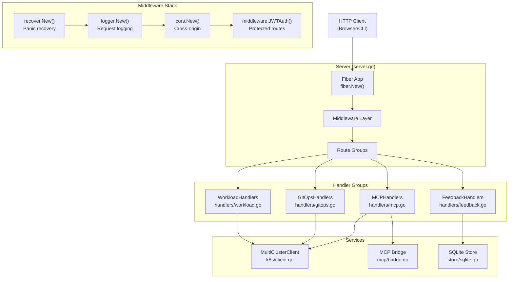
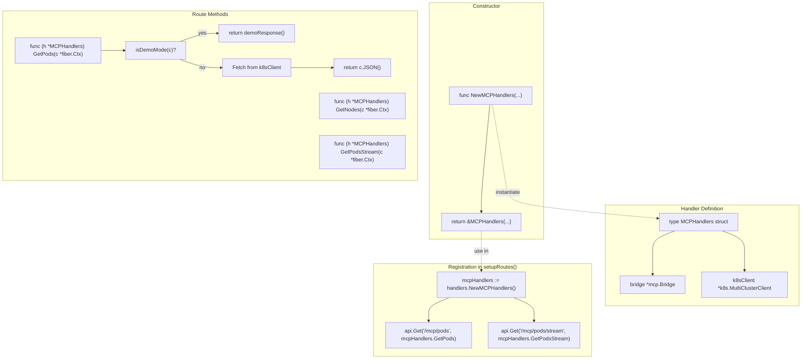
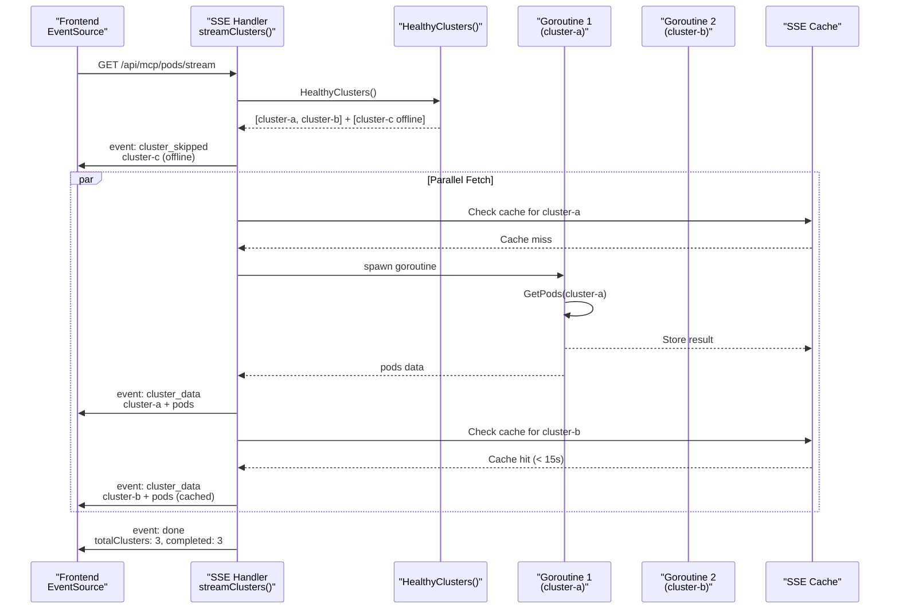
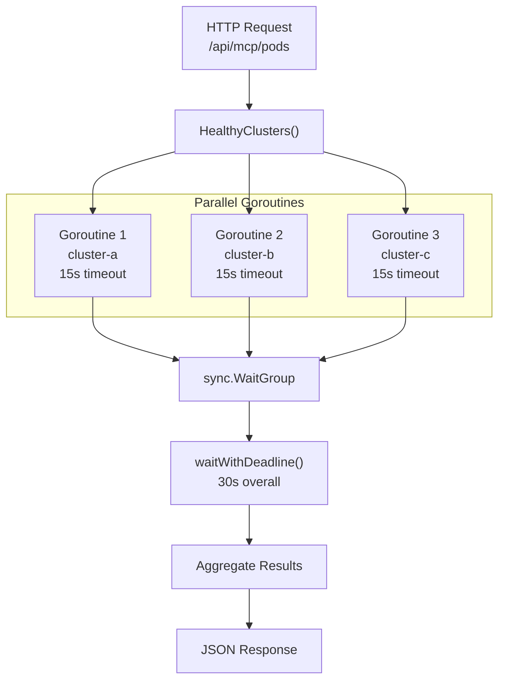

<!-- source: DeepWiki mcp.deepwiki.com · repo kubestellar/console · page 14.3 Adding API Endpoints · fetched 2026-10-26 -->

# Adding API Endpoints

<details>
<summary>Relevant source files</summary>

The following files were used as context for generating this wiki page:

- [pkg/api/handlers/demo_data.go](pkg/api/handlers/demo_data.go)
- [pkg/api/handlers/gitops.go](pkg/api/handlers/gitops.go)
- [pkg/api/handlers/mcp.go](pkg/api/handlers/mcp.go)
- [pkg/api/handlers/sse.go](pkg/api/handlers/sse.go)
- [pkg/api/server.go](pkg/api/server.go)
- [pkg/k8s/client.go](pkg/k8s/client.go)
- [web/src/components/cards/ProactiveGPUNodeHealthMonitor.tsx](web/src/components/cards/ProactiveGPUNodeHealthMonitor.tsx)
- [web/src/config/cards/gpu-node-health.ts](web/src/config/cards/gpu-node-health.ts)
- [web/src/config/dashboards/gpu.ts](web/src/config/dashboards/gpu.ts)
- [web/src/hooks/mcp/types.ts](web/src/hooks/mcp/types.ts)
- [web/src/lib/sseClient.ts](web/src/lib/sseClient.ts)

</details>


## Purpose and Scope

This guide explains how to add new backend API endpoints to the KubeStellar Console server. It covers the handler pattern, route registration, multi-cluster data fetching, SSE streaming, and demo mode support. For frontend integration of these endpoints, see [Testing](#14.4).

---

## API Server Architecture

The console uses a Go Fiber-based HTTP server with a layered architecture that separates routing, middleware, and business logic.



**Sources:** [pkg/api/server.go:1-271](), [pkg/api/server.go:310-706]()

---

## Handler Structure Pattern

Handlers follow a consistent pattern with dependency injection and method-based routing.



**Sources:** [pkg/api/handlers/mcp.go:50-62](), [pkg/api/server.go:406-548]()

---

## Adding a REST Endpoint

### Step 1: Define Handler Method

Create a new handler method in the appropriate handler file. For multi-cluster operations, use `MCPHandlers`.

```go
// Example: pkg/api/handlers/mcp.go
func (h *MCPHandlers) GetCustomResource(c *fiber.Ctx) error {
    // 1. Check demo mode
    if isDemoMode(c) {
        return demoResponse(c, "resources", getDemoCustomResources())
    }
    
    // 2. Parse query parameters
    cluster := c.Query("cluster")
    namespace := c.Query("namespace")
    
    // 3. Check k8s client availability
    if h.k8sClient == nil {
        return c.Status(503).JSON(fiber.Map{"error": "No cluster access"})
    }
    
    // 4. Multi-cluster logic
    if cluster == "" {
        // Query all healthy clusters in parallel
        clusters, _, err := h.k8sClient.HealthyClusters(c.Context())
        if err != nil {
            return c.Status(500).JSON(fiber.Map{"error": err.Error()})
        }
        
        var wg sync.WaitGroup
        var mu sync.Mutex
        var allResources []CustomResource
        
        for _, cl := range clusters {
            wg.Add(1)
            go func(clusterName string) {
                defer wg.Done()
                ctx, cancel := context.WithTimeout(c.Context(), mcpDefaultTimeout)
                defer cancel()
                
                resources, err := h.k8sClient.GetCustomResources(ctx, clusterName, namespace)
                if err == nil && len(resources) > 0 {
                    mu.Lock()
                    allResources = append(allResources, resources...)
                    mu.Unlock()
                }
            }(cl.Name)
        }
        
        waitWithDeadline(&wg, maxResponseDeadline)
        return c.JSON(fiber.Map{"resources": allResources, "source": "k8s"})
    }
    
    // 5. Single cluster query
    resources, err := h.k8sClient.GetCustomResources(c.Context(), cluster, namespace)
    if err != nil {
        return c.Status(500).JSON(fiber.Map{"error": err.Error()})
    }
    return c.JSON(fiber.Map{"resources": resources, "source": "k8s"})
}
```

**Sources:** [pkg/api/handlers/mcp.go:197-258](), [pkg/api/handlers/mcp.go:14-48]()

### Step 2: Register Route in `setupRoutes()`

Add the route registration in [pkg/api/server.go:310-706]().

```go
// In setupRoutes() method
api.Get("/mcp/custom-resources", mcpHandlers.GetCustomResource)
```

**Location:** [pkg/api/server.go:493-548]()

### Step 3: Add Demo Data Support

Create demo data function in [pkg/api/handlers/demo_data.go]().

```go
func getDemoCustomResources() []CustomResource {
    return []CustomResource{
        {Name: "demo-resource-1", Namespace: "default", Cluster: "eks-prod", Kind: "CustomKind"},
        {Name: "demo-resource-2", Namespace: "prod", Cluster: "gke-staging", Kind: "CustomKind"},
    }
}
```

**Sources:** [pkg/api/handlers/demo_data.go:56-70]()

---

## Adding an SSE Streaming Endpoint

SSE (Server-Sent Events) endpoints provide progressive rendering for multi-cluster queries.

### Step 1: Create Streaming Handler

Use the `streamClusters` helper for consistent SSE behavior.

```go
// In pkg/api/handlers/sse.go (or mcp.go)
func (h *MCPHandlers) GetCustomResourcesStream(c *fiber.Ctx) error {
    if isDemoMode(c) {
        return streamDemoSSE(c, "resources", getDemoCustomResources())
    }
    if h.k8sClient == nil {
        return c.Status(503).JSON(fiber.Map{"error": "No cluster access"})
    }
    
    namespace := c.Query("namespace")
    return streamClusters(c, h, sseClusterStreamConfig{
        demoKey:        "resources",
        clusterTimeout: ssePerClusterTimeout,
    }, func(ctx context.Context, cluster string) (interface{}, error) {
        return h.k8sClient.GetCustomResources(ctx, cluster, namespace)
    })
}
```

**Sources:** [pkg/api/handlers/sse.go:229-248](), [pkg/api/handlers/sse.go:85-202]()

### Step 2: Register SSE Route

```go
api.Get("/mcp/custom-resources/stream", mcpHandlers.GetCustomResourcesStream)
```

**Location:** [pkg/api/server.go:533-548]()

### SSE Event Flow



**Sources:** [pkg/api/handlers/sse.go:85-202](), [web/src/lib/sseClient.ts:42-151]()

---

## Multi-Cluster Data Fetching Patterns

### Pattern 1: Parallel Fan-Out with Timeout

Used by REST endpoints for aggregating data from all clusters.



**Implementation Details:**
- `HealthyClusters()` pre-filters offline clusters (instant skip)
- Per-cluster timeout: `mcpDefaultTimeout` (15s) or `mcpExtendedTimeout` (30s)
- Overall deadline: `maxResponseDeadline` (30s)
- Slow clusters get reduced timeout on subsequent requests

**Sources:** [pkg/api/handlers/mcp.go:14-48](), [pkg/api/handlers/mcp.go:219-248]()

### Pattern 2: SSE Progressive Streaming

Used by SSE endpoints for immediate per-cluster feedback.

**Key optimizations:**
- **15s cache:** Cached results served instantly without goroutines
- **Offline skip:** Clusters marked offline emit `cluster_skipped` events immediately
- **Slow cluster tracking:** Clusters exceeding 5s get reduced timeout (3s)

**Sources:** [pkg/api/handlers/sse.go:85-202](), [pkg/api/handlers/sse.go:36-71]()

### Pattern 3: Single Cluster Query

Simplest pattern for cluster-specific queries.

```go
cluster := c.Query("cluster")
if cluster == "" {
    return c.Status(400).JSON(fiber.Map{"error": "cluster parameter required"})
}

data, err := h.k8sClient.GetData(c.Context(), cluster)
if err != nil {
    return c.Status(500).JSON(fiber.Map{"error": err.Error()})
}
return c.JSON(fiber.Map{"data": data})
```

**Sources:** [pkg/api/handlers/mcp.go:148-176]()

---

## Demo Mode Support

Demo mode allows the frontend to work without cluster access (used in Netlify preview deployments).

### Implementing Demo Mode

**Step 1: Check demo mode header**

```go
if isDemoMode(c) {
    return demoResponse(c, "keyName", getDemoData())
}
```

**Step 2: Add demo data function**

```go
// In pkg/api/handlers/demo_data.go
func getDemoCustomResources() []CustomResource {
    return []CustomResource{
        {Name: "demo-1", Cluster: "kind-local", Status: "Active"},
        {Name: "demo-2", Cluster: "gke-staging", Status: "Active"},
    }
}
```

**Step 3: Frontend triggers demo mode**

The frontend sets `X-Demo-Mode: true` header when no cluster access is detected.

**Sources:** [pkg/api/handlers/demo_data.go:1-13](), [pkg/api/handlers/mcp.go:103-105]()

---

## Route Registration Reference

Routes are registered in `setupRoutes()` method. The server uses Fiber's group-based routing.

### Route Groups

| Group | Prefix | Auth Required | Purpose |
|-------|--------|---------------|---------|
| Public | `/health`, `/auth/*` | No | Health checks, OAuth callbacks |
| API | `/api/*` | Yes (JWT) | Protected REST endpoints |
| Webhooks | `/webhooks/*` | Signature | GitHub webhook handlers |
| WebSocket | `/ws` | Token in URL | Real-time updates |
| SSE | `/api/*/stream` | Yes (JWT) | Server-sent events streaming |

### Registration Pattern

```go
func (s *Server) setupRoutes() {
    // Public routes (no auth)
    s.app.Get("/health", func(c *fiber.Ctx) error { ... })
    s.app.Get("/auth/github", auth.GitHubLogin)
    
    // Protected API group (JWT required)
    api := s.app.Group("/api", middleware.JWTAuth(s.config.JWTSecret))
    
    // Handler instantiation
    mcpHandlers := handlers.NewMCPHandlers(s.bridge, s.k8sClient)
    gitopsHandlers := handlers.NewGitOpsHandlers(s.bridge, s.k8sClient)
    
    // REST endpoints
    api.Get("/mcp/clusters", mcpHandlers.ListClusters)
    api.Get("/mcp/pods", mcpHandlers.GetPods)
    
    // SSE streaming endpoints
    api.Get("/mcp/pods/stream", mcpHandlers.GetPodsStream)
    api.Get("/gitops/operators/stream", gitopsHandlers.StreamOperators)
    
    // WebSocket upgrade (custom middleware)
    s.app.Use("/ws", middleware.WebSocketUpgrade())
    s.app.Get("/ws", websocket.New(func(c *websocket.Conn) {
        s.hub.HandleConnection(c)
    }))
}
```

**Sources:** [pkg/api/server.go:310-706]()

---

## Complete Example: Adding GPU Metrics Endpoint

This example adds a new endpoint for GPU utilization metrics with REST and SSE variants.

### 1. Add Types in `pkg/k8s/client.go`

```go
type GPUMetrics struct {
    NodeName    string  `json:"nodeName"`
    Cluster     string  `json:"cluster"`
    GPUIndex    int     `json:"gpuIndex"`
    Utilization float64 `json:"utilization"`
    Memory      int64   `json:"memory"`
    Temperature int     `json:"temperature"`
}
```

### 2. Add Method to `MultiClusterClient`

```go
func (m *MultiClusterClient) GetGPUMetrics(ctx context.Context, cluster string) ([]GPUMetrics, error) {
    // Implementation using dynamic client to query DCGM metrics
    // ...
}
```

### 3. Add Handler Method

```go
// In pkg/api/handlers/mcp.go
func (h *MCPHandlers) GetGPUMetrics(c *fiber.Ctx) error {
    if isDemoMode(c) {
        return demoResponse(c, "metrics", getDemoGPUMetrics())
    }
    
    cluster := c.Query("cluster")
    if h.k8sClient == nil {
        return c.Status(503).JSON(fiber.Map{"error": "No cluster access"})
    }
    
    if cluster == "" {
        clusters, _, err := h.k8sClient.HealthyClusters(c.Context())
        if err != nil {
            return c.Status(500).JSON(fiber.Map{"error": err.Error()})
        }
        
        var wg sync.WaitGroup
        var mu sync.Mutex
        var allMetrics []k8s.GPUMetrics
        
        for _, cl := range clusters {
            wg.Add(1)
            go func(clusterName string) {
                defer wg.Done()
                ctx, cancel := context.WithTimeout(c.Context(), mcpExtendedTimeout)
                defer cancel()
                
                metrics, err := h.k8sClient.GetGPUMetrics(ctx, clusterName)
                if err == nil && len(metrics) > 0 {
                    mu.Lock()
                    allMetrics = append(allMetrics, metrics...)
                    mu.Unlock()
                }
            }(cl.Name)
        }
        
        waitWithDeadline(&wg, maxResponseDeadline)
        return c.JSON(fiber.Map{"metrics": allMetrics, "source": "k8s"})
    }
    
    metrics, err := h.k8sClient.GetGPUMetrics(c.Context(), cluster)
    if err != nil {
        return c.Status(500).JSON(fiber.Map{"error": err.Error()})
    }
    return c.JSON(fiber.Map{"metrics": metrics, "source": "k8s"})
}
```

### 4. Add SSE Streaming Handler

```go
// In pkg/api/handlers/sse.go
func (h *MCPHandlers) GetGPUMetricsStream(c *fiber.Ctx) error {
    if isDemoMode(c) {
        return streamDemoSSE(c, "metrics", getDemoGPUMetrics())
    }
    if h.k8sClient == nil {
        return c.Status(503).JSON(fiber.Map{"error": "No cluster access"})
    }
    
    return streamClusters(c, h, sseClusterStreamConfig{
        demoKey:        "metrics",
        clusterTimeout: ssePerClusterTimeout,
    }, func(ctx context.Context, cluster string) (interface{}, error) {
        return h.k8sClient.GetGPUMetrics(ctx, cluster)
    })
}
```

### 5. Add Demo Data

```go
// In pkg/api/handlers/demo_data.go
func getDemoGPUMetrics() []k8s.GPUMetrics {
    return []k8s.GPUMetrics{
        {NodeName: "gpu-node-1", Cluster: "vllm-gpu-cluster", GPUIndex: 0, Utilization: 85.5, Memory: 76800, Temperature: 72},
        {NodeName: "gpu-node-1", Cluster: "vllm-gpu-cluster", GPUIndex: 1, Utilization: 92.3, Memory: 78900, Temperature: 75},
        {NodeName: "gpu-node-2", Cluster: "vllm-gpu-cluster", GPUIndex: 0, Utilization: 45.2, Memory: 32100, Temperature: 58},
    }
}
```

### 6. Register Routes

```go
// In pkg/api/server.go setupRoutes()
api.Get("/mcp/gpu-metrics", mcpHandlers.GetGPUMetrics)
api.Get("/mcp/gpu-metrics/stream", mcpHandlers.GetGPUMetricsStream)
```

### 7. Frontend Integration

```typescript
// In web/src/hooks/mcp/useGPUMetrics.ts
export function useGPUMetrics(cluster?: string) {
  return useQuery({
    queryKey: ['gpu-metrics', cluster],
    queryFn: async () => {
      const params = new URLSearchParams()
      if (cluster) params.append('cluster', cluster)
      
      const res = await fetch(`/api/mcp/gpu-metrics?${params}`, {
        headers: { Authorization: `Bearer ${getToken()}` }
      })
      const data = await res.json()
      return data.metrics as GPUMetrics[]
    }
  })
}

// SSE streaming variant
export function useGPUMetricsStream(onData: (cluster: string, metrics: GPUMetrics[]) => void) {
  useEffect(() => {
    fetchSSE({
      url: '/api/mcp/gpu-metrics/stream',
      itemsKey: 'metrics',
      onClusterData: onData,
      onDone: (summary) => console.log('Streaming complete', summary)
    })
  }, [])
}
```

**Sources:** [pkg/api/handlers/mcp.go:324-374](), [pkg/api/handlers/sse.go:403-417](), [web/src/lib/sseClient.ts:42-151]()

---

## Testing Endpoints

### Manual Testing with curl

```bash
# Health check (public)
curl http://localhost:8080/health

# REST endpoint (requires JWT)
TOKEN="your-jwt-token"
curl -H "Authorization: Bearer $TOKEN" \
     http://localhost:8080/api/mcp/gpu-metrics?cluster=vllm-gpu-cluster

# SSE streaming
curl -H "Authorization: Bearer $TOKEN" \
     -H "Accept: text/event-stream" \
     http://localhost:8080/api/mcp/gpu-metrics/stream

# Demo mode
curl -H "X-Demo-Mode: true" \
     http://localhost:8080/api/mcp/gpu-metrics
```

### Integration Testing

Add tests in handler test files:

```go
// pkg/api/handlers/mcp_test.go
func TestGetGPUMetrics(t *testing.T) {
    app := fiber.New()
    mockClient := &mockMultiClusterClient{}
    handler := NewMCPHandlers(nil, mockClient)
    
    app.Get("/api/mcp/gpu-metrics", handler.GetGPUMetrics)
    
    req := httptest.NewRequest("GET", "/api/mcp/gpu-metrics?cluster=test", nil)
    resp, err := app.Test(req)
    
    assert.NoError(t, err)
    assert.Equal(t, 200, resp.StatusCode)
}
```

**Sources:** [pkg/api/handlers/mcp.go:197-258]()

---

## Error Handling Best Practices

### Standard Error Response Format

```go
// 400 Bad Request - client error
return c.Status(400).JSON(fiber.Map{
    "error": "cluster parameter required"
})

// 403 Forbidden - authorization error
return c.Status(403).JSON(fiber.Map{
    "error": "insufficient permissions"
})

// 500 Internal Server Error - server error
return c.Status(500).JSON(fiber.Map{
    "error": err.Error()
})

// 503 Service Unavailable - dependency unavailable
return c.Status(503).JSON(fiber.Map{
    "error": "No cluster access available"
})
```

### Timeout Handling

```go
ctx, cancel := context.WithTimeout(c.Context(), 15*time.Second)
defer cancel()

data, err := fetchData(ctx)
if err != nil {
    if ctx.Err() == context.DeadlineExceeded {
        return c.Status(504).JSON(fiber.Map{
            "error": "cluster query timeout"
        })
    }
    return c.Status(500).JSON(fiber.Map{"error": err.Error()})
}
```

**Sources:** [pkg/api/server.go:755-767](), [pkg/api/handlers/mcp.go:148-176]()

---

## Summary

**Key Steps to Add an Endpoint:**

1. Define data types in `pkg/k8s/client.go` or handler file
2. Implement Kubernetes client method if needed
3. Create handler method following the standard pattern
4. Add demo data function in `demo_data.go`
5. Register routes in `setupRoutes()`
6. Test with curl and frontend integration

**Performance Patterns:**
- Use `HealthyClusters()` to skip offline clusters
- Implement SSE streaming for progressive UX
- Add 15s response cache for SSE endpoints
- Use `waitWithDeadline()` for REST endpoints (30s max)
- Track slow clusters for reduced timeouts

**Sources:** [pkg/api/server.go:1-849](), [pkg/api/handlers/mcp.go:1-681](), [pkg/api/handlers/sse.go:1-531]()

---

