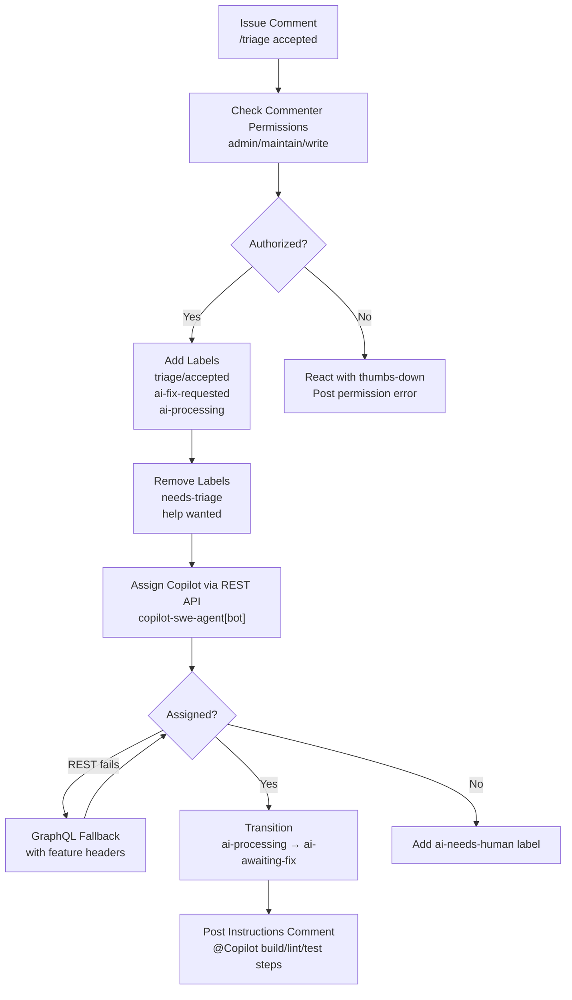
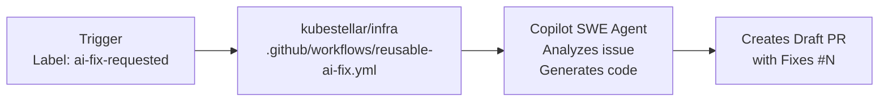
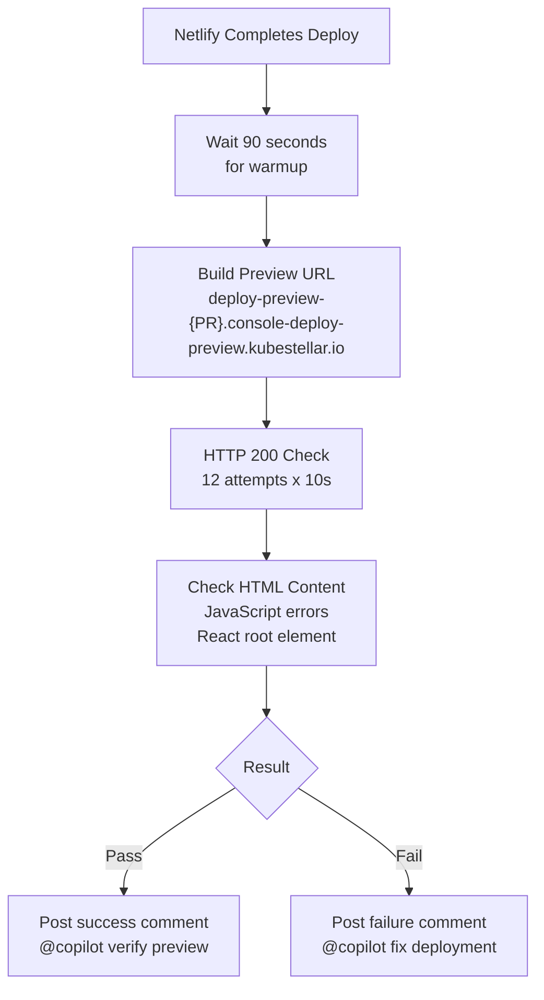
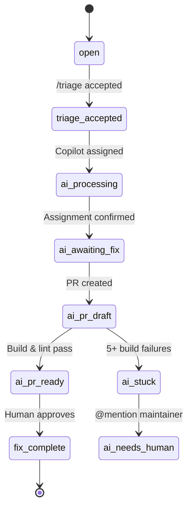
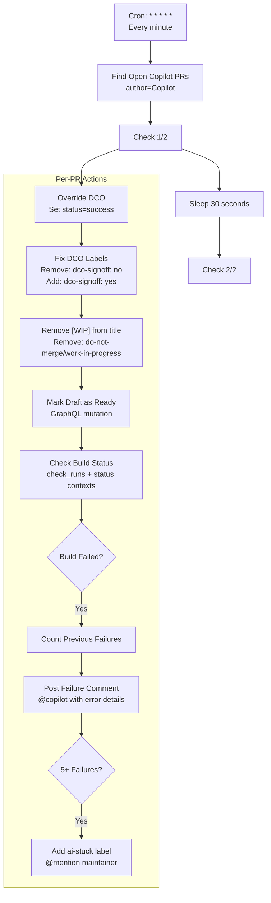
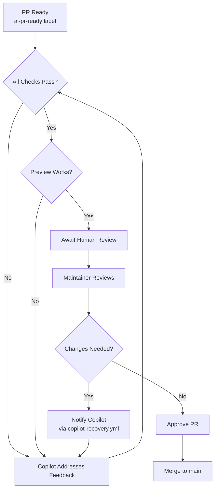
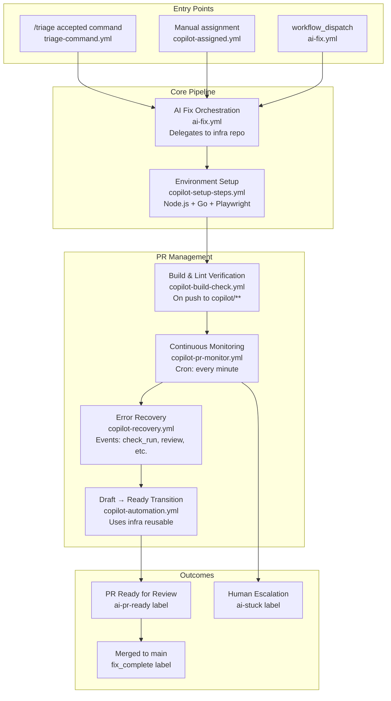

<!-- source: DeepWiki mcp.deepwiki.com · repo kubestellar/console · page 14.5 Contributing Guidelines · fetched 2026-10-26 -->

# Contributing Guidelines

<details>
<summary>Relevant source files</summary>

The following files were used as context for generating this wiki page:

- [.github/ISSUE_TEMPLATE/bug_report.yaml](.github/ISSUE_TEMPLATE/bug_report.yaml)
- [.github/workflows/ai-fix.yml](.github/workflows/ai-fix.yml)
- [.github/workflows/copilot-assigned.yml](.github/workflows/copilot-assigned.yml)
- [.github/workflows/copilot-automation.yml](.github/workflows/copilot-automation.yml)
- [.github/workflows/copilot-build-check.yml](.github/workflows/copilot-build-check.yml)
- [.github/workflows/copilot-pr-monitor.yml](.github/workflows/copilot-pr-monitor.yml)
- [.github/workflows/copilot-recovery.yml](.github/workflows/copilot-recovery.yml)
- [.github/workflows/copilot-setup-steps.yml](.github/workflows/copilot-setup-steps.yml)
- [.github/workflows/triage-command.yml](.github/workflows/triage-command.yml)

</details>


## Purpose and Scope

This document describes the contribution workflow for the KubeStellar Console repository, including issue submission, the AI-driven automated fix pipeline, pull request requirements, and code quality standards. The project uses an advanced CI/CD automation system that handles much of the contribution process automatically.

For information about setting up a local development environment, see [Development Setup](#14.1). For guides on implementing specific features, see [Adding New Cards](#14.2) and [Adding API Endpoints](#14.3).

---

## Issue Submission

### Bug Reports

Bug reports use a structured YAML template at [.github/ISSUE_TEMPLATE/bug_report.yaml:1-82](). The template requires:

| Field | Description | Required |
|-------|-------------|----------|
| Description | Clear description of the bug | Yes |
| Environment | Browser, OS, KC version, cluster type | Yes |
| Steps to Reproduce | Numbered reproduction steps | Yes |
| Expected Behavior | What should have happened | Yes |
| Logs | Browser console errors or backend logs | No |
| Additional Context | Screenshots, related issues | No |

**Example Issue Structure:**
- **Title:** `bug: Dashboard cards not loading on Firefox 121`
- **Labels:** Automatically assigned `kind/bug` by template
- **Backend Integration:** Issues created via the feedback system also receive `needs-triage` and `help wanted` labels

Sources: [.github/ISSUE_TEMPLATE/bug_report.yaml:1-82]()

---

## Issue Triage Process

Issues enter the automated contribution pipeline through two paths:

### Path A: Manual Triage Command

Maintainers or users with write access trigger automation by commenting `/triage accepted` on an issue. The [.github/workflows/triage-command.yml:1-225]() workflow handles this:



**Key Implementation Details:**
- Permission check at [.github/workflows/triage-command.yml:22-37]()
- REST API assignment at [.github/workflows/triage-command.yml:86-136]()
- GraphQL fallback with `GraphQL-Features` headers at [.github/workflows/triage-command.yml:113-135]()
- Instructions template at [.github/workflows/triage-command.yml:166-194]()

Sources: [.github/workflows/triage-command.yml:1-225]()

### Path B: Direct Copilot Assignment

Users can manually assign `copilot-swe-agent[bot]` via GitHub UI. The [.github/workflows/copilot-assigned.yml:1-92]() workflow detects this and adds required labels:

- Checks if already in pipeline (labels: `ai-processing`, `ai-awaiting-fix`, `ai-pr-draft`, `ai-pr-ready`)
- If new, adds `triage/accepted`, `ai-fix-requested`, `ai-awaiting-fix` labels
- Posts acknowledgment comment with pipeline overview

Sources: [.github/workflows/copilot-assigned.yml:1-92]()

---

## AI-Driven Contribution Pipeline

### Overview

The AI fix pipeline delegates to a reusable workflow in the `kubestellar/infra` repository. The [.github/workflows/ai-fix.yml:1-27]() workflow is triggered by:
- `/triage accepted` comment (via label addition)
- Manual Copilot assignment (via `issues.types: [labeled]`)
- Manual workflow dispatch with issue number



**Setup Environment:**
The [.github/workflows/copilot-setup-steps.yml:1-69]() workflow pre-configures the Copilot agent's Ubuntu VM:
- Node.js 20 with `npm ci` in `web/`
- Go 1.23 with module caching
- Playwright with Chromium browser
- Local preview server on `http://localhost:4173`
- C build tools for CGO/SQLite

Sources: [.github/workflows/ai-fix.yml:1-27](), [.github/workflows/copilot-setup-steps.yml:1-69]()

---

## Pull Request Requirements

### DCO Override for Bots

The Developer Certificate of Origin (DCO) is automatically overridden for bot-created PRs:

**Implementation:**
- PR Monitor sets DCO status to success at [.github/workflows/copilot-pr-monitor.yml:68-79]()
- Recovery workflow overrides on DCO check failure at [.github/workflows/copilot-recovery.yml:47-95]()
- Build check workflow sets status on every push at [.github/workflows/copilot-build-check.yml:57-78]()

**Label Management:**
```
Remove: dco-signoff: no
Add:    dco-signoff: yes
```

Sources: [.github/workflows/copilot-pr-monitor.yml:68-105](), [.github/workflows/copilot-recovery.yml:47-95]()

### Build & Lint Checks

Every push to `copilot/**` branches triggers [.github/workflows/copilot-build-check.yml:1-144]():

| Check | Command | Working Directory |
|-------|---------|-------------------|
| Build | `npm run build` | `web/` |
| Lint | `npm run lint` | `web/` |

**Failure Handling:**
- Captures last 30 lines of error output at [.github/workflows/copilot-build-check.yml:38-45]()
- Posts comment on PR with failure details at [.github/workflows/copilot-build-check.yml:80-109]()
- Includes @copilot mention with fix instructions

**Success Actions:**
- Marks draft PR as ready at [.github/workflows/copilot-build-check.yml:112-123]()
- Removes `[WIP]` from title at [.github/workflows/copilot-build-check.yml:126-131]()
- Removes `do-not-merge/work-in-progress` label

Sources: [.github/workflows/copilot-build-check.yml:1-144]()

### Preview Deployment Testing

Netlify preview deployments are tested by the recovery workflow at [.github/workflows/copilot-recovery.yml:259-301]():

**Test Strategy:**


**Checks Performed:**
1. **HTTP Accessibility:** 2-minute timeout with 10-second intervals
2. **JavaScript Errors:** Search for `chunk.*failed|module.*error|syntax.*error`
3. **App Rendering:** Look for `<div id="root">` and content length > 5000 bytes

Sources: [.github/workflows/copilot-recovery.yml:259-366]()

---

## PR Lifecycle & State Machine

### Label-Based State Machine

The contribution pipeline uses labels to track state:



| State | Label | Meaning |
|-------|-------|---------|
| Open | `kind/bug` | Issue created, awaiting triage |
| Triaged | `triage/accepted` | Accepted for processing |
| Processing | `ai-processing` | Copilot being assigned |
| Awaiting Fix | `ai-awaiting-fix` | Copilot assigned, working on fix |
| PR Draft | `ai-pr-draft` | Draft PR created |
| PR Ready | `ai-pr-ready` | Build passes, ready for review |
| Complete | `fix_complete` | PR merged |
| Stuck | `ai-stuck` | 5+ failures, needs human help |

Sources: [.github/workflows/triage-command.yml:48-75](), [.github/workflows/copilot-pr-monitor.yml:218-233]()

### Continuous PR Monitoring

The [.github/workflows/copilot-pr-monitor.yml:1-264]() workflow runs every minute and performs 2 checks with 30-second intervals:

**Idempotent Operations Performed:**



**Build Failure Detection:**
- Checks both `check_runs` and `status` contexts (Netlify uses status API)
- Looks for failure in checks containing "netlify" or "kubestellarconsole"
- Ignores DCO, Header rules, Redirect rules, Pages changed checks
- Implementation at [.github/workflows/copilot-pr-monitor.yml:154-180]()

**Escalation Logic:**
- Counts comments containing "Build Failed" and "@Copilot"
- After 5 failures, adds `ai-stuck` label
- @mentions `@clubanderson` (maintainer) for human intervention
- Implementation at [.github/workflows/copilot-pr-monitor.yml:218-233]()

Sources: [.github/workflows/copilot-pr-monitor.yml:1-264]()

### Error Recovery System

The [.github/workflows/copilot-recovery.yml:1-652]() workflow handles multiple recovery scenarios:

**Trigger Events:**
```
- check_run.completed
- workflow_run.completed
- pull_request_review.submitted
- pull_request_review_comment.created
- pull_request_target.synchronize
```

**Recovery Jobs:**

| Job | Trigger | Action |
|-----|---------|--------|
| `override-dco-for-bots` | DCO check fails | Set status to success, post `/override dco` |
| `handle-build-failure` | Non-DCO check fails | Post detailed error comment |
| `handle-build-success` | Netlify check succeeds | Test preview, auto-mark ready |
| `handle-review-feedback` | Code review received | Notify Copilot of feedback |
| `request-copilot-preview-test` | New commits pushed | Ask Copilot to verify preview |

**Deduplication:**
- Checks if comment already exists for specific commit SHA at [.github/workflows/copilot-recovery.yml:139-156]()
- Prevents duplicate notifications on same failure

Sources: [.github/workflows/copilot-recovery.yml:1-652]()

---

## Code Style & Standards

### TypeScript Conventions

Based on the build/lint enforcement in [.github/workflows/copilot-build-check.yml:36-45]():

**Build Requirements:**
- All TypeScript must compile without errors via `npm run build`
- No unused imports (remove them)
- Proper type definitions (avoid `any` types)
- Use `ReturnType<typeof setTimeout>` instead of `NodeJS.Timeout`

**Common Issues Mentioned in CI Comments:**
```typescript
// ❌ Wrong
let timer: NodeJS.Timeout;
import { unused } from './module';

// ✅ Correct
let timer: ReturnType<typeof setTimeout>;
// Remove unused imports entirely
```

Sources: [.github/workflows/copilot-recovery.yml:186-196](), [.github/workflows/copilot-build-check.yml:89-106]()

### Go Conventions

Build configuration from [.github/workflows/copilot-setup-steps.yml:52-68]():

**Build Settings:**
- Go version: 1.23
- CGO enabled for SQLite: `CGO_ENABLED=1`
- Build command: `go build -o console ./cmd/console`
- Requires GCC and musl-tools for static linking

Sources: [.github/workflows/copilot-setup-steps.yml:52-68]()

### Pattern Consistency

From instructions at [.github/workflows/triage-command.yml:189-193]():

**Guidelines:**
- Follow patterns in existing code
- Use TypeScript for frontend (`web/` directory)
- Use Go for backend (`cmd/`, `internal/`, `pkg/` directories)
- Maintain consistent naming conventions with existing files

Sources: [.github/workflows/triage-command.yml:166-194]()

---

## Human Review Process

### When Human Review is Required



**Human Review Triggers:**
1. **Automatic:** PR marked `ai-pr-ready` after build/lint pass
2. **Manual:** 5+ build failures add `ai-stuck` label and @mention maintainer
3. **Feedback Loop:** Review comments trigger notification at [.github/workflows/copilot-recovery.yml:440-496]()

### Responding to Code Review Feedback

When a reviewer submits feedback, the recovery workflow posts:

**Template at [.github/workflows/copilot-recovery.yml:478-496]():**
```
## 📝 Code Review Feedback Received

**Reviewer:** @{reviewer}
**Type:** {review|comment}

@copilot A reviewer has provided feedback on your PR. Please:

1. **Read and understand** the feedback above
2. **Address all requested changes**
3. **Push commits** with the fixes
4. **Reply** to confirm the changes have been made

If you disagree with any feedback, explain your reasoning in a reply.
```

Sources: [.github/workflows/copilot-recovery.yml:440-496]()

### Manual Preview Testing

Maintainers can manually trigger preview tests via workflow dispatch at [.github/workflows/copilot-recovery.yml:499-583]():

**Parameters:**
- `pr_number`: PR to test
- `test_preview`: Boolean to run preview test

**Results Posted:**
- HTTP accessibility status
- JavaScript error detection
- React app rendering confirmation

Sources: [.github/workflows/copilot-recovery.yml:499-583]()

---

## Copilot Automation Architecture

### System Component Mapping



Sources: All workflow files in [.github/workflows/]()

---

## Best Practices Summary

### For Issue Reporters

1. **Use Bug Report Template:** Provides all necessary context at [.github/ISSUE_TEMPLATE/bug_report.yaml:1-82]()
2. **Include Reproduction Steps:** Clear numbered steps help AI understand the problem
3. **Add Environment Details:** Browser, OS, KC version, cluster type
4. **Attach Logs:** Browser console errors or backend logs from `kubectl logs`

### For Maintainers

1. **Use `/triage accepted`:** Triggers full automation pipeline
2. **Monitor Stuck PRs:** Watch for `ai-stuck` label after 5+ failures
3. **Review Preview URLs:** Verify Netlify preview before approving
4. **Provide Clear Feedback:** AI responds to specific, actionable review comments

### For Contributors

1. **Follow Existing Patterns:** Match code style in nearby files
2. **Test Locally:** Run `npm run build` and `npm run lint` before pushing
3. **Check Preview:** Verify Netlify preview works end-to-end
4. **Respond to Reviews:** Address all feedback points explicitly

Sources: [.github/workflows/triage-command.yml:166-194](), [.github/ISSUE_TEMPLATE/bug_report.yaml:1-82]()