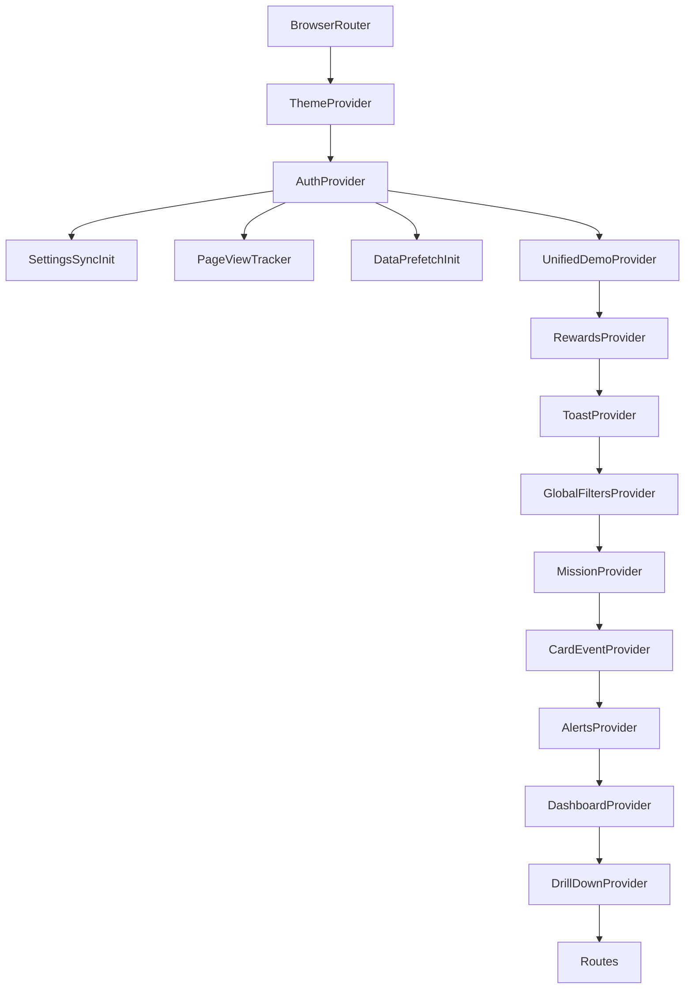
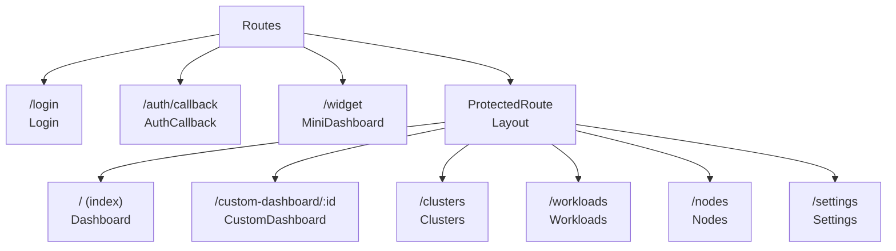
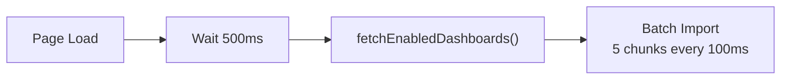
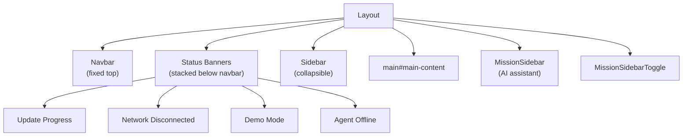
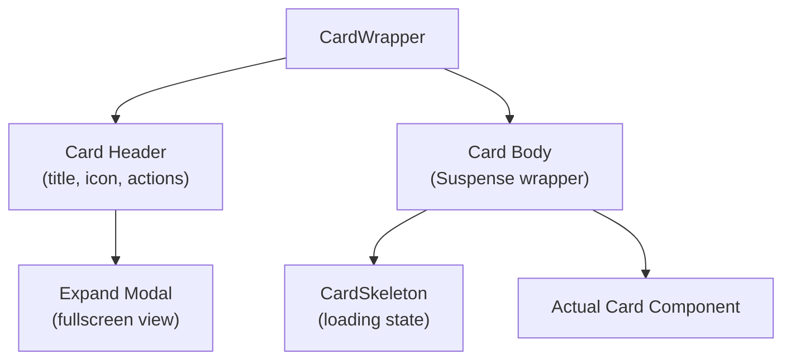

<!-- source: DeepWiki mcp.deepwiki.com · repo kubestellar/console · page 2.1 Frontend Architecture · fetched 2026-10-26 -->

# Frontend Architecture

<details>
<summary>Relevant source files</summary>

The following files were used as context for generating this wiki page:

- [.env.example](.env.example)
- [netlify.toml](netlify.toml)
- [pkg/api/handlers/analytics_proxy.go](pkg/api/handlers/analytics_proxy.go)
- [web/netlify/functions/analytics-collect.mts](web/netlify/functions/analytics-collect.mts)
- [web/package-lock.json](web/package-lock.json)
- [web/package.json](web/package.json)
- [web/src/App.tsx](web/src/App.tsx)
- [web/src/components/agent/APIKeySettings.tsx](web/src/components/agent/APIKeySettings.tsx)
- [web/src/components/cards/CardWrapper.tsx](web/src/components/cards/CardWrapper.tsx)
- [web/src/components/cards/cardRegistry.ts](web/src/components/cards/cardRegistry.ts)
- [web/src/components/cards/flatcar_status/demoData.ts](web/src/components/cards/flatcar_status/demoData.ts)
- [web/src/components/cards/flatcar_status/index.tsx](web/src/components/cards/flatcar_status/index.tsx)
- [web/src/components/cards/flatcar_status/useFlatcarStatus.ts](web/src/components/cards/flatcar_status/useFlatcarStatus.ts)
- [web/src/components/cards/flatcar_status/versionUtils.ts](web/src/components/cards/flatcar_status/versionUtils.ts)
- [web/src/components/cards/llmd/index.ts](web/src/components/cards/llmd/index.ts)
- [web/src/components/compute/ClusterComparisonPage.tsx](web/src/components/compute/ClusterComparisonPage.tsx)
- [web/src/components/dashboard/AddCardModal.tsx](web/src/components/dashboard/AddCardModal.tsx)
- [web/src/components/dashboard/CustomDashboard.tsx](web/src/components/dashboard/CustomDashboard.tsx)
- [web/src/components/dashboard/Dashboard.tsx](web/src/components/dashboard/Dashboard.tsx)
- [web/src/components/dashboard/templates.ts](web/src/components/dashboard/templates.ts)
- [web/src/components/layout/Layout.tsx](web/src/components/layout/Layout.tsx)
- [web/src/components/llmd-benchmarks/LLMdBenchmarks.tsx](web/src/components/llmd-benchmarks/LLMdBenchmarks.tsx)
- [web/src/hooks/useCertManager.ts](web/src/hooks/useCertManager.ts)
- [web/src/hooks/useLocalAgent.ts](web/src/hooks/useLocalAgent.ts)
- [web/src/lib/analytics.ts](web/src/lib/analytics.ts)
- [web/src/locales/en/cards.json](web/src/locales/en/cards.json)
- [web/vite.config.ts](web/vite.config.ts)

</details>


## Purpose and Scope

This document describes the React-based frontend architecture of the KubeStellar Console, including the component hierarchy, state management patterns, routing structure, and build system. It covers how the UI renders, manages state, and communicates with backend services.

For backend API architecture, see [Backend Architecture](#2.2). For the local agent system, see [Local Agent (kc-agent)](#2.3). For detailed card component documentation, see [Card Components & Registry](#3.1).

---

## Technology Stack

The frontend uses modern React patterns and build tooling:

| Technology | Version | Purpose |
|------------|---------|---------|
| **React** | 18.3.1 | UI framework with concurrent rendering |
| **React Router** | 7.1.1 | Client-side routing with code splitting |
| **Vite** | 6.0.5 | Build tool with HMR and optimized bundling |
| **TypeScript** | 5.6.2 | Type safety and developer tooling |
| **Tailwind CSS** | 3.4.17 | Utility-first styling |
| **i18next** | 25.7.4 | Internationalization (9 languages) |
| **@dnd-kit** | 6.3.1 / 8.0.0 | Drag-and-drop for cards and workloads |
| **Framer Motion** | 12.31.0 | Animations and transitions |

**Sources:** [web/package.json:1-115]()

---

## Application Entry Point and Provider Hierarchy

### Entry Point

The application initializes at [web/src/main.tsx](), which renders the root component with React Router's `BrowserRouter`:

```
main.tsx → BrowserRouter → App
```

### Provider Hierarchy

`App.tsx` establishes a 13-layer context provider hierarchy that wraps all routes. Providers are ordered from outermost (global) to innermost (route-specific):



**Key Providers:**

- **`ThemeProvider`**: Dark/light theme toggle with system preference detection
- **`AuthProvider`**: JWT authentication state, user profile, GitHub OAuth
- **`UnifiedDemoProvider`**: Demo mode state for Netlify previews
- **`GlobalFiltersProvider`**: Cluster/namespace filtering across dashboard
- **`DashboardProvider`**: Modal state for add/replace/configure card actions
- **`DrillDownProvider`**: Drilldown modal state for resource details
- **`MissionProvider`**: AI mission sidebar state

**Sources:** [web/src/App.tsx:318-407]()

---

## Routing Architecture

### Route Structure

The application uses React Router v7 with lazy-loaded route components for code splitting:



All dashboard routes share a single `Layout` instance that persists across navigations via `KeepAliveOutlet`, which prevents component unmount/remount cycles for instant "warm navigation."

**Route Lazy Loading:**

Each route component is wrapped in `React.lazy()`:

```typescript
const Dashboard = lazy(() => import('./components/dashboard/Dashboard'))
const Clusters = lazy(() => import('./components/clusters/Clusters'))
```

A `LoadingFallback` component with a 200ms delay prevents spinner flashing on fast navigation.

**Sources:** [web/src/App.tsx:27-70](), [web/src/App.tsx:160-185](), [web/src/App.tsx:336-390]()

### Route Prefetching

Dashboard route chunks are prefetched on initial page load to eliminate loading delays on subsequent navigation. Prefetching strategy:

1. Wait 500ms after initial render (or immediately in demo mode)
2. Fetch enabled dashboards list from `/health`
3. Batch-import route chunks (5 at a time, 100ms delay between batches)



**Sources:** [web/src/App.tsx:114-158]()

---

## Layout System

### Layout Component Structure

The `Layout` component ([web/src/components/layout/Layout.tsx]()) provides the shell for all dashboard pages:



**Responsive Behavior:**

- **Desktop**: Sidebar persists (collapsible), mission sidebar overlays from right
- **Mobile**: Sidebar overlays when open, full-width main content

**Banner Stacking:**

Banners stack vertically with calculated `top` offsets based on which banners are visible:

```
Navbar (64px)
  ↓
Update Progress (if active)
  ↓
Network Disconnected (if offline or reconnecting)
  ↓
Demo Mode (if enabled)
  ↓
Agent Offline (if disconnected and not in demo mode)
```

Main content area adjusts `paddingTop` dynamically to account for visible banners.

**Sources:** [web/src/components/layout/Layout.tsx:108-514]()

### Navigation Progress Indicator

A thin purple progress bar animates during route transitions to provide visual feedback:

```typescript
function NavigationProgress() {
  const [isNavigating, setIsNavigating] = useState(false)
  // ... triggers on location.pathname change
}
```

**Sources:** [web/src/components/layout/Layout.tsx:42-58]()

---

## Card-Based UI System

### Card Registry

The card system is built around a central registry (`CARD_COMPONENTS`) that maps card type strings to lazy-loaded React components:


**85+ Card Types** organized into bundles:

| Bundle | Cards | Purpose |
|--------|-------|---------|
| **Core** | `ClusterHealth`, `EventStream`, `PodIssues`, `TopPods` | Individual imports |
| **deploy-bundle** | 16 cards (Deployments, GitOps, Helm) | Shared chunk |
| **llmd** | 7 cards (LLM inference visualizations) | Shared chunk |
| **workload-detection** | PROW, LLM, ML cards | Shared chunk |
| **workload-monitor** | Stack monitoring cards | Shared chunk |
| **kagenti** | AI agent platform cards | Shared chunk |

**Card Aliases:**

The registry includes aliases for catalog compatibility:

```typescript
gpu_list: GPUInventory,
gpu_issues: GPUStatus,
memory_usage: ResourceUsage,
// etc.
```

**Sources:** [web/src/components/cards/cardRegistry.ts:1-455]()

### CardWrapper Component

`CardWrapper` provides standardized UI chrome for all cards:



**Header Actions:**

- **Expand** (Maximize2): Opens fullscreen modal
- **Configure** (Settings): Opens card configuration modal
- **Replace** (Replace): Swaps card type
- **Remove** (Trash2): Deletes card from dashboard
- **Refresh** (RefreshCw): Forces data refresh
- **Resize** (MoveHorizontal): Changes card width (3/4/6/8/12 columns)

**Demo Mode Indicators:**

Cards using mock data show a yellow "DEMO" badge and yellow border. Cards in `DEMO_DATA_CARDS` set are always marked as demo. Cards using real data dynamically report state via `useReportCardDataState()`.

**Flash Animations:**

When significant data changes occur, cards can flash:
- **Info**: Blue pulse
- **Warning**: Orange pulse
- **Error**: Red pulse

**Sources:** [web/src/components/cards/CardWrapper.tsx:1-1231]()

### Card Chunk Preloading

To eliminate skeleton flashes, card chunks are preloaded on demand:

```typescript
export function prefetchCardChunks(cardTypes: string[]) {
  const loaders = cardTypes
    .map(type => CARD_CHUNK_PRELOADERS[type])
    .filter(Boolean)
  
  loaders.forEach(load => load().catch(() => {}))
}
```

**Prefetch Timing:**

1. **Default Dashboard Cards**: Immediately on auth
2. **Demo Cards**: 15s delay in live mode, immediate in demo mode
3. **On-Demand**: When user opens add card modal

**Sources:** [web/src/components/cards/cardRegistry.ts:580-645]()

---

## State Management

### Context API Pattern

State is managed via React Context with custom hooks for each domain:

| Hook | Context | Purpose |
|------|---------|---------|
| `useAuth()` | `AuthProvider` | User authentication, JWT token |
| `useDashboardContext()` | `DashboardProvider` | Modal state, pending card restore |
| `useDrillDown()` | `DrillDownProvider` | Resource drilldown modal |
| `useMissions()` | `MissionProvider` | AI mission sidebar state |
| `useGlobalFilters()` | `GlobalFiltersProvider` | Cluster/namespace filters |
| `useClusters()` | N/A (SWR) | Cluster data from `/mcp/health` |
| `useLocalAgent()` | Singleton | Agent connection status |
| `useDemoMode()` | `UnifiedDemoProvider` | Demo mode toggle |

**Sources:** [web/src/App.tsx:318-407]()

### Local Storage Persistence

Dashboard layouts, user preferences, and cache are persisted to localStorage:

| Key | Purpose | TTL |
|-----|---------|-----|
| `kubestellar-main-dashboard-cards` | Main dashboard card layout | None |
| `kc-releases-cache` | GitHub releases | 30 min |
| `kc-dev-latest-sha` | Latest dev commit SHA | 10 min |
| `dashboard-auto-refresh` | Auto-refresh toggle | None |
| `STORAGE_KEY_ANALYTICS_OPT_OUT` | Analytics opt-out | None |

**Safe Access Helpers:**

```typescript
export function safeGetItem(key: string): string | null
export function safeSetItem(key: string, value: string): void
export function safeGetJSON<T>(key: string): T | null
export function safeSetJSON<T>(key: string, value: T): void
```

All localStorage access is wrapped in try-catch to handle quota exceeded errors and Safari private mode.

**Sources:** [web/src/lib/utils/localStorage.ts]()

### Module-Level Cache

Dashboard data is cached at module level to survive navigation:

```typescript
interface CachedDashboard {
  dashboard: DashboardData | null
  cards: Card[]
  timestamp: number
}
let dashboardCache: CachedDashboard | null = null
```

This enables instant dashboard restore when navigating back without showing skeletons.

**Sources:** [web/src/components/dashboard/Dashboard.tsx:60-73]()

---

## Build and Bundling Strategy

### Vite Configuration

Build is configured in [web/vite.config.ts]():

```typescript
export default defineConfig({
  build: {
    minify: 'terser',
    terserOptions: {
      compress: { drop_console: true }
    },
    rollupOptions: {
      output: {
        manualChunks: (id) => {
          // All node_modules → 'vendor' chunk
          if (id.includes('node_modules')) return 'vendor'
        }
      }
    }
  }
})
```

**Key Decisions:**

1. **Single Vendor Chunk**: All `node_modules` go into one chunk to avoid circular dependencies and React context errors
2. **Manual Card Bundles**: Related cards (deploy, llmd, kagenti) share chunks via barrel imports
3. **Terser Minification**: Drops console logs and debuggers in production

**Sources:** [web/vite.config.ts:34-90]()

### Server Warmup

Vite dev server pre-transforms frequently-used modules on startup to eliminate cold module transformation delays:

```typescript
warmup: {
  clientFiles: [
    './src/components/dashboard/Dashboard.tsx',
    './src/components/clusters/Clusters.tsx',
    './src/components/cards/cardRegistry.ts',
    './src/components/cards/deploy-bundle.ts',
    // ... 20+ more files
  ]
}
```

**Sources:** [web/vite.config.ts:94-140]()

---

## Performance Optimizations

### Lazy Mounting Strategy

**Historical Context:**

Cards originally used lazy mounting with `IntersectionObserver` to delay rendering until visible in viewport. This was removed because:

1. Cards are pre-populated from localStorage/cache
2. Only 4-8 cards visible at once (minimal performance impact)
3. Cached data should show instantly for good UX

**Current Behavior:**

All cards render immediately. The `useLazyMount` hook exists but always returns `isVisible=true`.

**Sources:** [web/src/components/cards/CardWrapper.tsx:99-119]()

### Suspense Boundaries

Each card is wrapped in `<Suspense>` with a `CardSkeleton` fallback:

```tsx
<Suspense fallback={<CardSkeleton type={skeletonType} />}>
  {children}
</Suspense>
```

This prevents lazy-loaded card chunks from causing the entire page to flash.

**Sources:** [web/src/components/cards/CardWrapper.tsx]()

### Keep-Alive Routing

The `KeepAliveOutlet` component caches rendered route components in memory:

```typescript
const cachedComponents = useRef<Map<string, ReactElement>>(new Map())
```

When navigating away from a route, its component tree stays mounted but hidden. When navigating back, the cached tree is revealed instantly.

**Sources:** [web/src/components/layout/KeepAliveOutlet.tsx]()

### Module-Level Constants

Components avoid re-computing static data on every render by using module-level constants:

```typescript
// Computed once at module parse time
const STAR_POSITIONS = Array.from({ length: 30 }, () => ({
  width: Math.random() * 2 + 1 + 'px',
  left: Math.random() * 100 + '%',
  // ...
}))
```

This prevents star field positions from flickering on Layout re-renders.

**Sources:** [web/src/components/layout/Layout.tsx:30-38]()

---

## Analytics and Tracking

### Stealth Analytics Architecture

The frontend uses a custom analytics implementation designed to bypass ad blockers:


**Anti-Blocking Techniques:**

1. **No External Scripts**: No `gtag.js` loaded (immune to script blockers)
2. **First-Party Proxy**: `/api/m` path (immune to domain blockers)
3. **Base64 Encoding**: Query parameters encoded to evade pattern filters
4. **Decoy Measurement ID**: Source code shows `G-0000000000`, real ID injected server-side

**Event Types:**

- Page views
- Card actions (add/remove/expand/configure)
- Mission starts/completions
- Feedback submissions
- Errors

**Opt-Out:**

Users can opt out via Settings. Opt-out state stored in `localStorage` and respected by all tracking calls.

**Sources:** [web/src/lib/analytics.ts:1-320](), [pkg/api/handlers/analytics_proxy.go:1-125](), [web/netlify/functions/analytics-collect.mts:1-103]()

---

## Internationalization (i18n)

### Translation System

The app supports 9 languages via `i18next`:

- English (en)
- Spanish (es)
- French (fr)
- German (de)
- Japanese (ja)
- Chinese (zh)
- Portuguese (pt)
- Korean (ko)
- Italian (it)

**Translation Files:**

Each language has a `cards.json` with 1000+ translation keys organized by domain:

```
web/src/locales/
├── en/
│   └── cards.json
├── es/
│   └── cards.json
└── ...
```

**Usage:**

```typescript
const { t } = useTranslation('cards')
return <span>{t('clusterHealth.healthyTooltip', { count: 5 })}</span>
```

**Pluralization:**

Translation keys support pluralization:

```json
{
  "healthyTooltip": "{{count}} cluster is healthy",
  "healthyTooltip_other": "{{count}} clusters are healthy"
}
```

**Sources:** [web/src/locales/en/cards.json:1-1000+]()

---

## Deployment Modes

The frontend supports three deployment configurations:

### 1. Local Development

- Frontend: `vite dev` on port 5174
- Backend: Go server on port 8080
- Agent: `kc-agent` on port 8080
- Proxy: Vite proxies `/api` → `localhost:8080`

### 2. Containerized

- Frontend: Static files served by Go `embed.FS`
- Backend: Go server (single binary)
- Agent: Installed via Homebrew/releases
- Auth: GitHub OAuth required

### 3. Netlify Preview

- Frontend: Static hosting + Netlify Functions
- Backend: None (serverless functions only)
- Agent: Not available
- Mode: Forced demo mode (`VITE_DEMO_MODE=true`)

**Netlify-Specific Features:**

- `/api/nightly-e2e/runs` → Netlify Function (live GitHub Actions data)
- `/api/active-users` → Netlify Function (presence tracking via Blobs)
- `/api/m` → Netlify Function (analytics proxy)

**Sources:** [netlify.toml:1-76](), [.env.example:1-75]()

---

