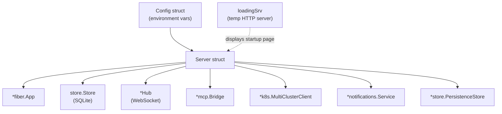
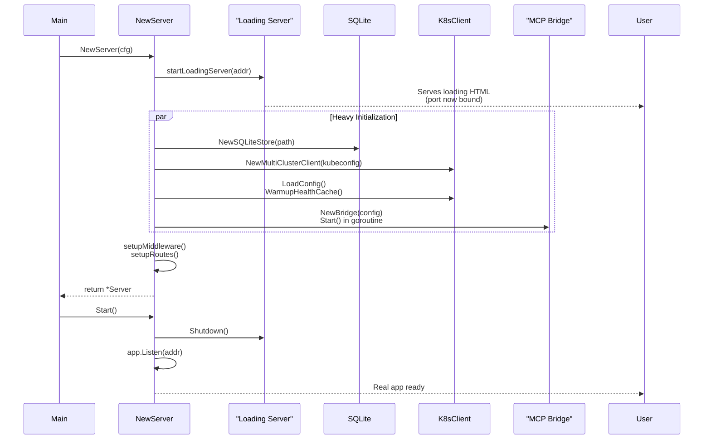
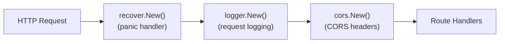
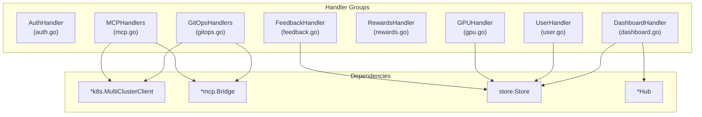
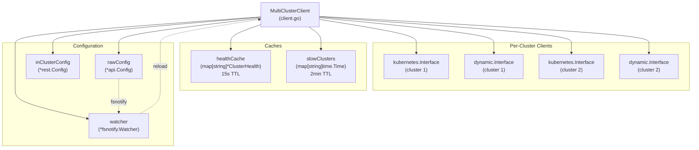
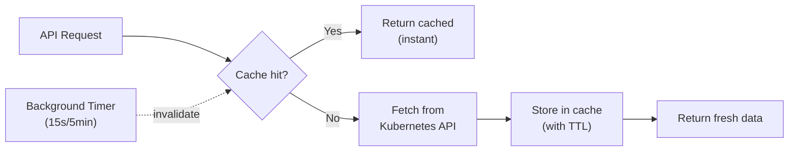
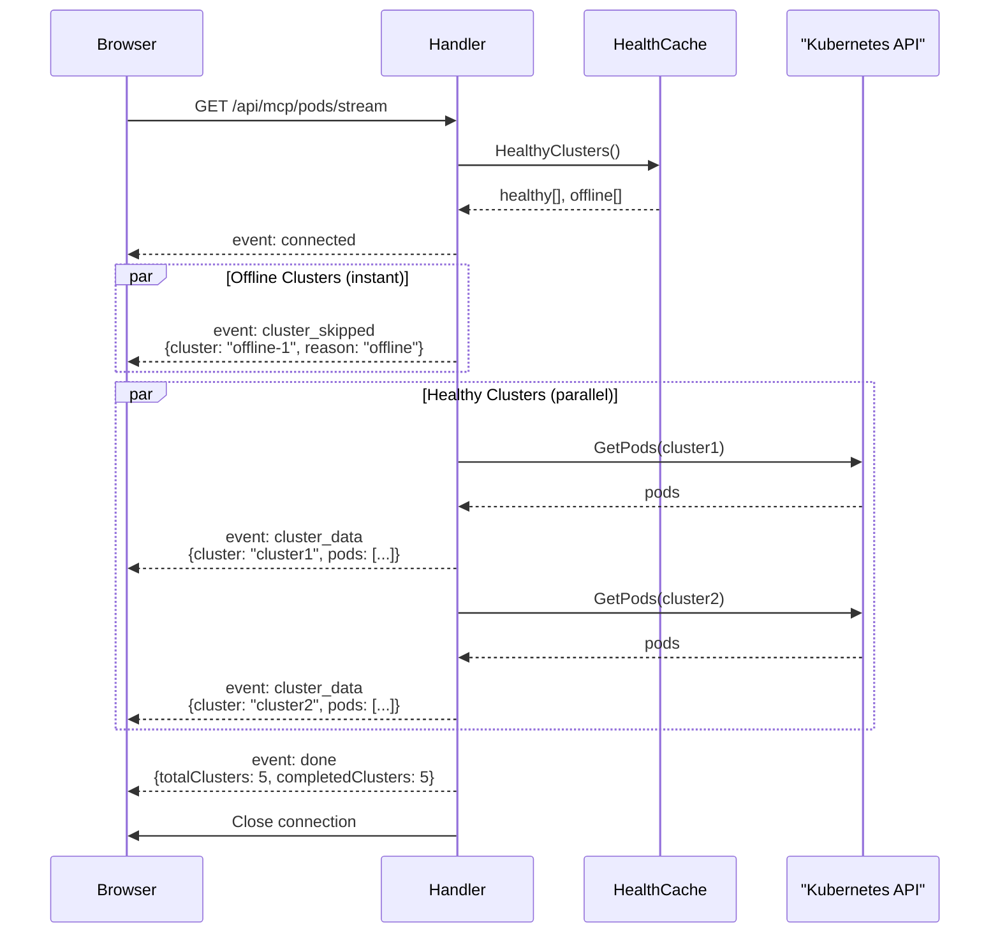
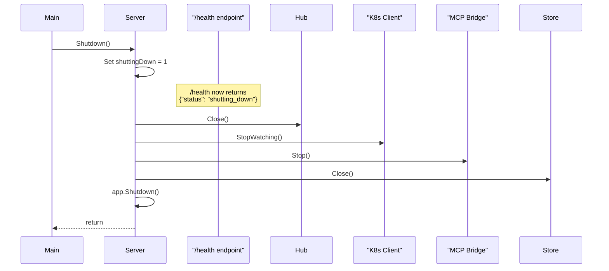

<!-- source: DeepWiki mcp.deepwiki.com · repo kubestellar/console · page 2.2 Backend Architecture · fetched 2026-10-26 -->

# Backend Architecture

<details>
<summary>Relevant source files</summary>

The following files were used as context for generating this wiki page:

- [pkg/api/handlers/demo_data.go](pkg/api/handlers/demo_data.go)
- [pkg/api/handlers/gitops.go](pkg/api/handlers/gitops.go)
- [pkg/api/handlers/mcp.go](pkg/api/handlers/mcp.go)
- [pkg/api/handlers/sse.go](pkg/api/handlers/sse.go)
- [pkg/api/server.go](pkg/api/server.go)
- [pkg/k8s/client.go](pkg/k8s/client.go)
- [web/src/components/cards/ProactiveGPUNodeHealthMonitor.tsx](web/src/components/cards/ProactiveGPUNodeHealthMonitor.tsx)
- [web/src/components/clusters/ClusterDetailModal.tsx](web/src/components/clusters/ClusterDetailModal.tsx)
- [web/src/components/clusters/Clusters.tsx](web/src/components/clusters/Clusters.tsx)
- [web/src/components/clusters/ResourceDetailModals.tsx](web/src/components/clusters/ResourceDetailModals.tsx)
- [web/src/components/clusters/components/ClusterGrid.tsx](web/src/components/clusters/components/ClusterGrid.tsx)
- [web/src/components/clusters/components/GPUDetailModal.tsx](web/src/components/clusters/components/GPUDetailModal.tsx)
- [web/src/components/ui/CloudProviderIcon.tsx](web/src/components/ui/CloudProviderIcon.tsx)
- [web/src/config/cards/gpu-node-health.ts](web/src/config/cards/gpu-node-health.ts)
- [web/src/config/dashboards/gpu.ts](web/src/config/dashboards/gpu.ts)
- [web/src/hooks/mcp/types.ts](web/src/hooks/mcp/types.ts)
- [web/src/hooks/useMCP.ts](web/src/hooks/useMCP.ts)
- [web/src/lib/sseClient.ts](web/src/lib/sseClient.ts)

</details>


## Purpose and Scope

This document describes the Go-based backend server architecture for the KubeStellar Console. It covers the HTTP server initialization, middleware stack, API route organization, handler structure, Kubernetes client abstraction, caching strategies, and real-time streaming mechanisms. For frontend architecture details, see [Frontend Architecture](#2.1). For specific API handler implementations, see [Backend API Handlers](#5).

---

## Server Structure and Initialization

The backend is built on the [Fiber](https://gofiber.io/) web framework and exposes HTTP/WebSocket endpoints for cluster management. The core server structure is defined in the `Server` struct.

### Server Components



**Diagram: Server Component Relationships**

The `Server` struct ([pkg/api/server.go:76-88]()) holds all backend dependencies:

| Field | Type | Purpose |
|-------|------|---------|
| `app` | `*fiber.App` | HTTP router and middleware |
| `store` | `store.Store` | SQLite database for feedback, rewards, users, cards |
| `hub` | `*Hub` | WebSocket connection manager for real-time updates |
| `bridge` | `*mcp.Bridge` | Optional MCP tool integration |
| `k8sClient` | `*k8s.MultiClusterClient` | Multi-cluster Kubernetes client |
| `notificationService` | `*notifications.Service` | Alert notification manager |
| `persistenceStore` | `*store.PersistenceStore` | CRD-based state persistence |
| `loadingSrv` | `*http.Server` | Temporary loading screen server |
| `shuttingDown` | `int32` | Atomic flag for graceful shutdown |

### Initialization Flow

The `NewServer` function ([pkg/api/server.go:94-227]()) performs initialization in a specific order to minimize startup latency:



**Diagram: Server Initialization Sequence**

The loading server pattern ([pkg/api/server.go:229-252]()) prevents "connection refused" errors during heavy initialization by serving a loading page immediately while the real server initializes in the background. The loading page polls `/health` and auto-reloads when `status` changes from `"starting"` to `"ok"`.

**Sources:** [pkg/api/server.go:76-252]()

---

## Middleware Stack

Middleware is registered in `setupMiddleware()` ([pkg/api/server.go:254-271]()) in the following order:



**Diagram: Middleware Execution Order**

| Middleware | Purpose | Configuration |
|------------|---------|---------------|
| `recover.New()` | Catches panics and returns 500 errors | Default Fiber recovery |
| `logger.New()` | Logs request method, path, status, latency | Format: `"${time} \| ${status} \| ${latency} \| ${method} ${path}"` |
| `cors.New()` | CORS headers for frontend access | `AllowOrigins: s.config.FrontendURL`<br/>`AllowCredentials: true` |

JWT authentication is applied selectively via `middleware.JWTAuth(secret)` ([pkg/api/server.go:413]()) on protected routes only. Public routes (health, auth callbacks, webhooks, GA4 proxy) bypass JWT validation.

**Sources:** [pkg/api/server.go:254-271](), [pkg/api/server.go:413]()

---

## Route Architecture

Routes are organized by access level and response type:

```mermaid
graph TB
    subgraph "Public Routes"
        Health["/health<br/>GET"]
        Auth["/auth/github/*<br/>GET/POST"]
        Webhook["/webhooks/github<br/>POST"]
        GA4["/api/m<br/>ALL (GA4 proxy)"]
        PublicE2E["/api/public/nightly-e2e/*<br/>GET"]
        ActiveUsers["/api/active-users<br/>GET/POST"]
    end
    
    subgraph "Protected Routes (/api)"
        User["/api/me<br/>GET/PUT"]
        Settings["/api/settings<br/>GET/PUT/POST"]
        Dashboards["/api/dashboards/*<br/>CRUD"]
        MCP["/api/mcp/*<br/>GET/POST/DELETE"]
        MCPStream["/api/mcp/*/stream<br/>SSE"]
        GitOps["/api/gitops/*<br/>GET/POST"]
        Feedback["/api/feedback/*<br/>GET/POST"]
        GPU["/api/gpu/*<br/>CRUD"]
    end
    
    subgraph "WebSocket"
        WS["/ws<br/>WebSocket upgrade"]
    end
    
    JWTAuth["middleware.JWTAuth(secret)"]
    
    Health -.no auth.-> Handler1[Handlers]
    Auth -.no auth.-> Handler2[Handlers]
    Webhook -.signature validation.-> Handler3[Handlers]
    GA4 -.origin validation.-> Handler4[Handlers]
    
    User --> JWTAuth
    Settings --> JWTAuth
    Dashboards --> JWTAuth
    MCP --> JWTAuth
    MCPStream --> JWTAuth
    GitOps --> JWTAuth
    Feedback --> JWTAuth
    GPU --> JWTAuth
    
    JWTAuth --> Handler5[Protected Handlers]
    WS --> Handler6[Hub.HandleConnection]
```



**Diagram: Route Groups and Authentication**

### Public Endpoints

| Route | Method | Purpose |
|-------|--------|---------|
| `/health` | GET | Server health check, returns `version`, `oauth_configured`, `in_cluster`, `install_method` |
| `/auth/github` | GET | Initiates GitHub OAuth flow |
| `/auth/github/callback` | GET | OAuth callback handler |
| `/auth/refresh` | POST | Refresh JWT token |
| `/webhooks/github` | POST | GitHub webhook receiver (HMAC signature validation) |
| `/api/m` | ALL | GA4 analytics proxy (origin validation) |
| `/api/public/nightly-e2e/runs` | GET | Nightly E2E workflow status (widget access) |
| `/api/active-users` | GET/POST | Active user count (GET) and heartbeat (POST) |

### Protected Endpoints

Protected routes require a valid JWT token in the `Authorization` header. The JWT is validated by `middleware.JWTAuth` which extracts claims (`user_id`, `github_login`, `email`, `role`, `exp`) and injects them into the request context.

| Route Pattern | Purpose | Handler Group |
|---------------|---------|---------------|
| `/api/me` | User profile CRUD | `UserHandler` |
| `/api/settings` | Persistent settings management | `SettingsHandler` |
| `/api/dashboards/*` | Dashboard CRUD, import/export | `DashboardHandler` |
| `/api/mcp/*` | Multi-cluster operations | `MCPHandlers` |
| `/api/mcp/*/stream` | SSE streaming variants | `MCPHandlers` |
| `/api/gitops/*` | GitOps drift detection, Helm, operators | `GitOpsHandlers` |
| `/api/feedback/*` | Feature requests, bug reports | `FeedbackHandler` |
| `/api/gpu/*` | GPU reservation CRUD | `GPUHandler` |
| `/api/rbac/*` | RBAC management | `RBACHandler` |
| `/api/namespaces/*` | Namespace management | `NamespaceHandler` |

**Sources:** [pkg/api/server.go:310-706]()

---

## Handler Structure

Handlers are organized into groups, each encapsulating a specific domain:



**Diagram: Handler Dependencies**

### MCPHandlers

The `MCPHandlers` struct ([pkg/api/handlers/mcp.go:50-62]()) provides multi-cluster Kubernetes operations:

```go
type MCPHandlers struct {
    bridge    *mcp.Bridge
    k8sClient *k8s.MultiClusterClient
}
```

Key responsibilities:
- **Cluster discovery**: `ListClusters()` ([pkg/api/handlers/mcp.go:100-146]())
- **Health checks**: `GetClusterHealth()`, `GetAllClusterHealth()` ([pkg/api/handlers/mcp.go:148-195]())
- **Resource queries**: `GetPods()`, `GetDeployments()`, `GetNodes()` ([pkg/api/handlers/mcp.go:197-259]())
- **Issue detection**: `FindPodIssues()`, `FindDeploymentIssues()` ([pkg/api/handlers/mcp.go:261-322]())
- **GPU operations**: `GetGPUNodes()`, `GetGPUNodeHealth()` ([pkg/api/handlers/mcp.go:324-427]())

All MCP handlers have SSE streaming variants (e.g., `GetPodsStream()`) that progressively deliver per-cluster results. See [Real-Time Data Streaming](#real-time-data-streaming-sse-websocket) for details.

### GitOpsHandlers

The `GitOpsHandlers` struct ([pkg/api/handlers/gitops.go:33-45]()) manages GitOps tooling:

```go
type GitOpsHandlers struct {
    bridge    *mcp.Bridge
    k8sClient *k8s.MultiClusterClient
}
```

Key responsibilities:
- **Helm releases**: `ListHelmReleases()`, `ListHelmHistory()` ([pkg/api/handlers/gitops.go:156-235]())
- **Flux Kustomizations**: `ListKustomizations()` ([pkg/api/handlers/gitops.go:238-356]())
- **OLM operators**: `ListOperators()`, `ListOperatorSubscriptions()` ([pkg/api/handlers/gitops.go:400-708]())
- **Drift detection**: `DetectDrift()`, `Sync()` (delegates to `kubectl diff`)

Operator queries are heavily optimized with a 5-minute in-memory cache ([pkg/api/handlers/gitops.go:378-397]()) because CSV queries can take 90-100 seconds on clusters with 1000+ operators.

**Sources:** [pkg/api/handlers/mcp.go:50-1167](), [pkg/api/handlers/gitops.go:33-901]()

---

## Kubernetes Client Layer

The `MultiClusterClient` provides a unified abstraction for multi-cluster Kubernetes access:



**Diagram: MultiClusterClient Structure**

### Key Methods

| Method | Purpose | Timeout |
|--------|---------|---------|
| `LoadConfig()` | Loads kubeconfig from disk | — |
| `ListClusters()` | Returns all contexts in kubeconfig | — |
| `GetClusterHealth()` | Health check for single cluster | 8s |
| `GetAllClusterHealth()` | Parallel health checks for all clusters | 60s |
| `HealthyClusters()` | Returns healthy clusters (uses cache) | — |
| `GetPods()` | Fetch pods from cluster | 45s |
| `GetGPUNodes()` | Fetch GPU nodes from cluster | 45s |
| `StartWatching()` | Start fsnotify watcher on kubeconfig | — |
| `WarmupHealthCache()` | Pre-populate health cache on startup | 60s |

### Health Cache Strategy

The health cache ([pkg/k8s/client.go:51]()) prevents blocking on slow/offline clusters:

1. **Cache population**: `WarmupHealthCache()` ([pkg/api/server.go:148]()) is called during server initialization to pre-populate the cache before serving requests.
2. **Cache lookup**: `GetCachedHealth()` returns cached values without blocking.
3. **Cache refresh**: Background goroutines refresh the cache every 15 seconds.
4. **Slow cluster tracking**: Clusters that timeout are marked "slow" ([pkg/k8s/client.go:58]()) and get reduced timeouts (3s instead of 8s) for 2 minutes.

### Kubeconfig Reload

The `fsnotify.Watcher` ([pkg/k8s/client.go:54]()) watches the kubeconfig file for changes. When modified:

1. `Reload()` is triggered ([pkg/k8s/client.go:115-124]())
2. New contexts are discovered
3. `onReload` callback ([pkg/k8s/client.go:56]()) broadcasts a `kubeconfig_changed` WebSocket message ([pkg/api/server.go:152-158]())
4. Frontend re-fetches cluster list

**Sources:** [pkg/k8s/client.go:43-600](), [pkg/api/server.go:139-163]()

---

## Caching Strategy

The backend implements a multi-tier caching strategy to minimize Kubernetes API load and improve response times:

### 1. Health Cache

- **Location**: `MultiClusterClient.healthCache` ([pkg/k8s/client.go:51]())
- **TTL**: 15 seconds
- **Key**: Cluster name
- **Value**: `*ClusterHealth` (node count, pod count, CPU/memory metrics, reachability)
- **Invalidation**: Time-based expiration, manual reload

### 2. SSE Response Cache

- **Location**: `sseCache` global map ([pkg/api/handlers/sse.go:48-56]())
- **TTL**: 15 seconds
- **Key**: `"<itemsKey>:<clusterName>"` (e.g., `"pods:eks-prod"`)
- **Value**: `interface{}` (marshalled response data)
- **Purpose**: Avoids redundant queries when user navigates away and back

### 3. Operator Cache

- **Location**: `operatorCacheData` global map ([pkg/api/handlers/gitops.go:391-397]())
- **TTL**: 5 minutes
- **Key**: Cluster name
- **Value**: `[]Operator` (CSV list)
- **Purpose**: Operator queries take 90-100s for large clusters, aggressive caching is essential



**Diagram: Cache Lookup Flow**

### Cache Warming

Critical caches are pre-populated during initialization to avoid first-load latency:

- **Health cache**: `WarmupHealthCache()` ([pkg/api/server.go:148]()) probes all clusters before serving requests
- **Operator cache**: Background goroutine refreshes operator cache asynchronously

**Sources:** [pkg/k8s/client.go:51](), [pkg/api/handlers/sse.go:48-71](), [pkg/api/handlers/gitops.go:391-588]()

---

## Real-Time Data Streaming (SSE + WebSocket)

The backend provides two real-time data mechanisms:

### Server-Sent Events (SSE)

SSE streaming endpoints progressively deliver per-cluster results as they arrive, avoiding blocking on slow clusters. The generic `streamClusters()` helper ([pkg/api/handlers/sse.go:73-202]()) implements this pattern:



**Diagram: SSE Streaming Sequence**

### SSE Event Types

| Event | Payload | Purpose |
|-------|---------|---------|
| `connected` | `{"status": "streaming"}` | Initial handshake |
| `cluster_skipped` | `{"cluster": "...", "reason": "offline"}` | Offline cluster notification |
| `cluster_data` | `{"cluster": "...", "<itemsKey>": [...], "source": "k8s"}` | Per-cluster results |
| `done` | `{"totalClusters": N, "completedClusters": M}` | Stream completion summary |

### SSE Optimizations

1. **HealthyClusters() pre-filter**: Offline clusters are skipped immediately without spawning goroutines
2. **Response cache** ([pkg/api/handlers/sse.go:48-71]()): Cached results (< 15s old) are served instantly
3. **Slow cluster timeout reduction**: Clusters with recent timeouts get 3s timeout instead of 10s
4. **Overall deadline**: 30s maximum wall-clock time ([pkg/api/handlers/sse.go:36]())

### WebSocket (Real-Time Updates)

The `Hub` struct manages WebSocket connections for bidirectional real-time updates:

```go
type Hub struct {
    connections map[*websocket.Conn]*Connection
    broadcast   chan Message
    register    chan *websocket.Conn
    unregister  chan *websocket.Conn
    jwtSecret   string
}
```

**Key operations:**
- `BroadcastAll(msg)`: Send message to all connected clients
- `HandleConnection(conn)`: WebSocket connection handler with JWT validation
- `Run()`: Main event loop (register, unregister, broadcast)

**Use cases:**
- Kubeconfig reload notifications ([pkg/api/server.go:153-156]())
- Mission progress updates
- Alert notifications

**Sources:** [pkg/api/handlers/sse.go:1-549](), [pkg/api/server.go:134-137]()

---

## Graceful Shutdown

The `Shutdown()` method ([pkg/api/server.go:738-753]()) performs graceful cleanup:



**Diagram: Graceful Shutdown Sequence**

The `shuttingDown` atomic flag ([pkg/api/server.go:87]()) allows the `/health` endpoint to signal shutdown status before tearing down services, giving the frontend time to detect the change and display a reconnection message.

**Sources:** [pkg/api/server.go:738-753](), [pkg/api/server.go:313-338]()

---

## Configuration

Server configuration is loaded from environment variables via `LoadConfigFromEnv()` ([pkg/api/server.go:770-825]()):

| Environment Variable | Default | Purpose |
|---------------------|---------|---------|
| `PORT` | `8080` | HTTP server port |
| `DATABASE_PATH` | `./data/console.db` | SQLite database path |
| `DEV_MODE` | `false` | Enable dev mode (auto-login, relaxed security) |
| `FRONTEND_URL` | Computed | CORS allowed origin |
| `JWT_SECRET` | Generated in dev | JWT signing secret |
| `GITHUB_CLIENT_ID` | — | GitHub OAuth client ID |
| `GITHUB_CLIENT_SECRET` | — | GitHub OAuth client secret |
| `KUBECONFIG` | `~/.kube/config` | Kubeconfig file path |
| `KUBESTELLAR_OPS_PATH` | `kubestellar-ops` | MCP ops tool path |
| `KUBESTELLAR_DEPLOY_PATH` | `kubestellar-deploy` | MCP deploy tool path |
| `FEEDBACK_GITHUB_TOKEN` | — | PAT for creating GitHub issues |
| `GITHUB_WEBHOOK_SECRET` | — | Webhook signature validation secret |
| `ENABLED_DASHBOARDS` | — | Comma-separated dashboard IDs to show in sidebar |

**Sources:** [pkg/api/server.go:770-825]()

---

