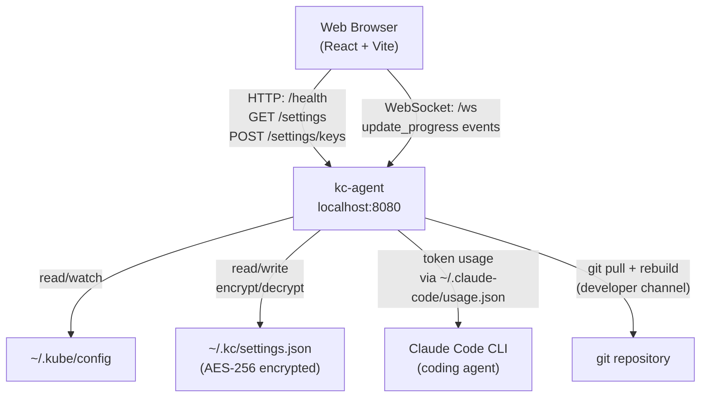
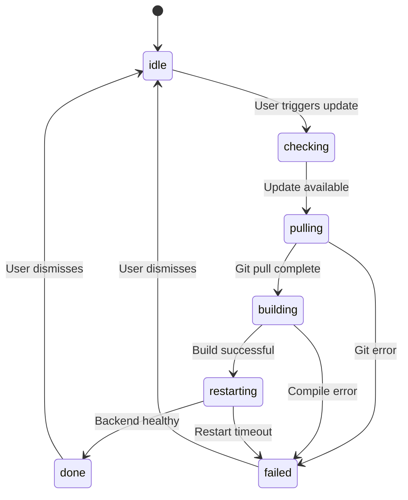
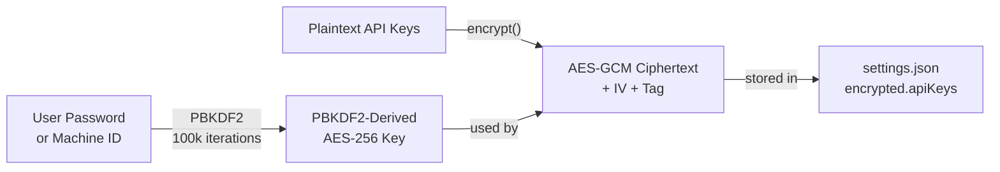
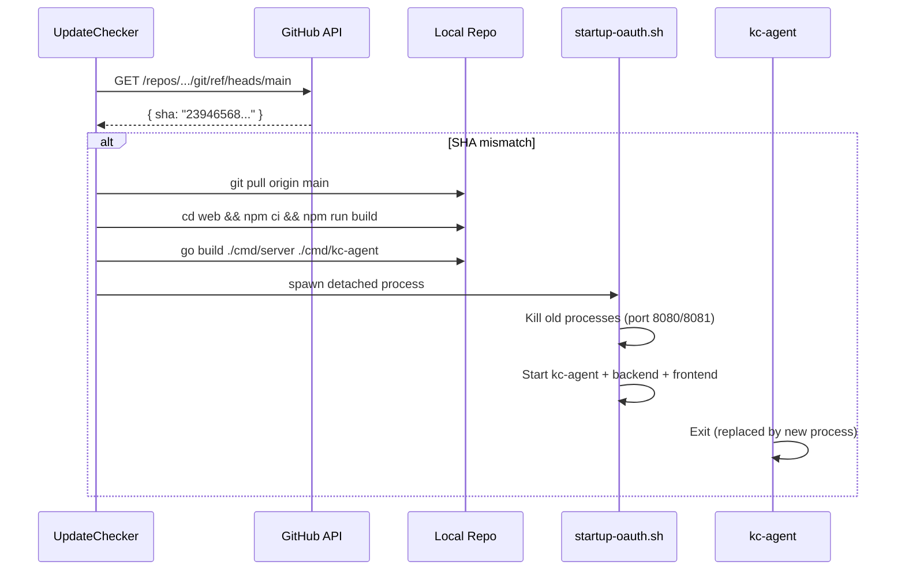
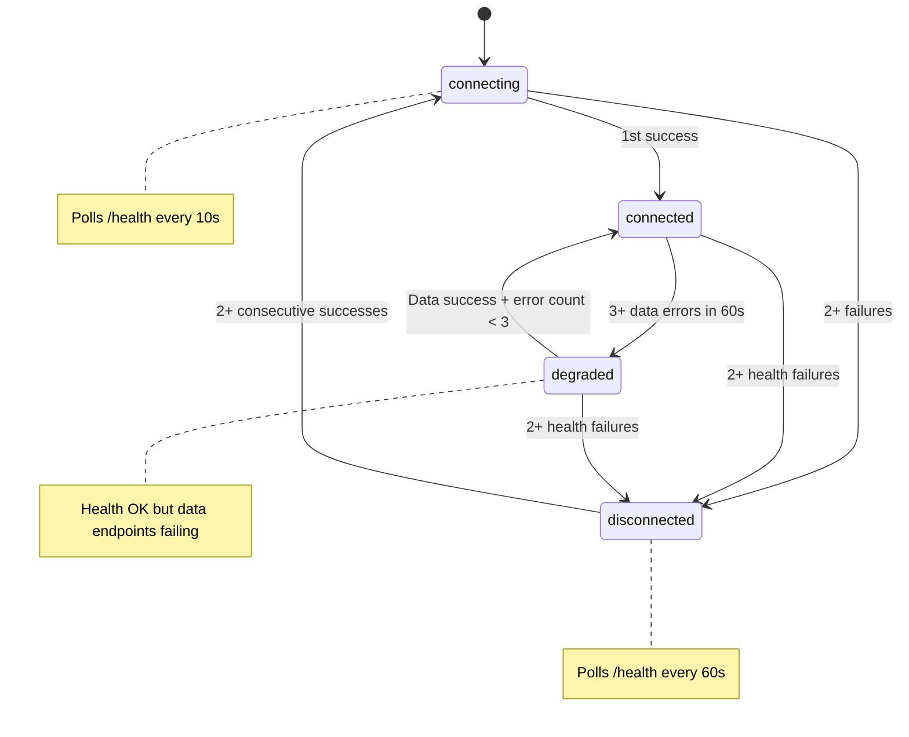

<!-- source: DeepWiki mcp.deepwiki.com · repo kubestellar/console · page 2.3 Local Agent (kc-agent) · fetched 2026-10-26 -->

# Local Agent (kc-agent)

<details>
<summary>Relevant source files</summary>

The following files were used as context for generating this wiki page:

- [.env.example](.env.example)
- [netlify.toml](netlify.toml)
- [pkg/agent/update_checker.go](pkg/agent/update_checker.go)
- [pkg/api/handlers/analytics_proxy.go](pkg/api/handlers/analytics_proxy.go)
- [pkg/settings/types.go](pkg/settings/types.go)
- [web/netlify/functions/analytics-collect.mts](web/netlify/functions/analytics-collect.mts)
- [web/package-lock.json](web/package-lock.json)
- [web/package.json](web/package.json)
- [web/src/components/agent/APIKeySettings.tsx](web/src/components/agent/APIKeySettings.tsx)
- [web/src/components/layout/navbar/UpdateIndicator.tsx](web/src/components/layout/navbar/UpdateIndicator.tsx)
- [web/src/components/settings/Settings.tsx](web/src/components/settings/Settings.tsx)
- [web/src/components/settings/UpdateSettings.tsx](web/src/components/settings/UpdateSettings.tsx)
- [web/src/components/settings/sections/AnalyticsSection.tsx](web/src/components/settings/sections/AnalyticsSection.tsx)
- [web/src/components/settings/sections/index.ts](web/src/components/settings/sections/index.ts)
- [web/src/components/updates/UpdateProgressBanner.tsx](web/src/components/updates/UpdateProgressBanner.tsx)
- [web/src/hooks/useLocalAgent.ts](web/src/hooks/useLocalAgent.ts)
- [web/src/hooks/useUpdateProgress.ts](web/src/hooks/useUpdateProgress.ts)
- [web/src/hooks/useVersionCheck.tsx](web/src/hooks/useVersionCheck.tsx)
- [web/src/lib/analytics.ts](web/src/lib/analytics.ts)
- [web/src/types/updates.ts](web/src/types/updates.ts)
- [web/vite.config.ts](web/vite.config.ts)

</details>


## Purpose and Scope

The local agent (`kc-agent`) is a lightweight HTTP/WebSocket server that runs on the user's machine (`127.0.0.1:8080`) to provide local-first capabilities for the KubeStellar Console. It bridges the browser-based frontend with local system resources including kubeconfig files, AI coding agents (Claude Code, Cursor, etc.), and encrypted settings storage.

The agent is **optional** — the console operates in demo mode without it, but loses access to real cluster data and AI features. This page covers the agent's architecture, API surface, settings management, and auto-update system.

For backend API handlers that run in the Go Fiber server, see [Backend Architecture](#2.2). For multi-cluster Kubernetes management, see [MultiClusterClient](#4.1).

---

## Architecture Overview

### Component Relationship



**Deployment Modes:**
- **Development**: User runs `kc-agent` manually from source or binary
- **Production (binary)**: Downloaded via Homebrew or `start.sh` script
- **Demo (Netlify)**: Agent unavailable, frontend uses `DEMO_DATA`

Sources: [web/src/hooks/useLocalAgent.ts:1-486](), [pkg/agent/update_checker.go:1-595](), [netlify.toml:1-76]()

---

## HTTP API Endpoints

The agent exposes a REST API on `http://127.0.0.1:8080`:

| Method | Path | Purpose | Response |
|--------|------|---------|----------|
| `GET` | `/health` | Agent health check | `AgentHealth` JSON |
| `GET` | `/settings` | Fetch all settings (decrypted) | `AllSettings` JSON |
| `POST` | `/settings` | Update settings | Updated `AllSettings` |
| `POST` | `/settings/keys` | Add/update API key | Success message |
| `DELETE` | `/settings/keys/{provider}` | Delete API key | Success message |
| `GET` | `/settings/keys` | List API key status | `KeysStatusResponse` |
| `GET` | `/auto-update/status` | Auto-update configuration | `AutoUpdateStatusResponse` |
| `POST` | `/auto-update/config` | Enable/disable auto-update | Success message |
| `POST` | `/auto-update/trigger` | Trigger immediate update | Async operation |

### AgentHealth Structure

The `/health` endpoint returns critical agent state:

```typescript
interface AgentHealth {
  status: string           // "ok" or error
  version: string          // Agent version (e.g., "0.3.11")
  clusters: number         // Count of kubeconfig contexts
  hasClaude: boolean       // Claude Code CLI detected
  claude?: {
    installed: boolean
    path?: string          // Path to claude-code binary
    version?: string
    tokenUsage: {
      session: { input: number; output: number }
      today: { input: number; output: number }
      thisMonth: { input: number; output: number }
    }
  }
}
```

Sources: [web/src/hooks/useLocalAgent.ts:6-21](), [pkg/agent/update_checker.go:60-72]()

---

## WebSocket Connection

The agent provides a WebSocket endpoint at `ws://127.0.0.1:8080/ws` for real-time events:

### Message Format

```json
{
  "type": "update_progress",
  "payload": {
    "status": "pulling",
    "message": "Pulling 23946568 from main...",
    "progress": 30,
    "error": null
  }
}
```

### Update Progress States



The frontend subscribes via `useUpdateProgress()` to display real-time update banners during auto-updates.

Sources: [web/src/hooks/useUpdateProgress.ts:1-100](), [pkg/agent/update_checker.go:52-58]()

---

## Settings Storage and Encryption

### File Structure

Settings are persisted to `~/.kc/settings.json` with this schema:

```typescript
interface SettingsFile {
  version: number
  lastModified: string
  settings: PlaintextSettings      // Non-sensitive preferences
  encrypted: EncryptedSettings     // AES-256-GCM encrypted fields
  keyFingerprint: string           // Derives encryption key
}
```

### Encryption Strategy



**Encrypted Fields:**
- `apiKeys`: Map of provider → API key (Anthropic, OpenAI, Gemini, etc.)
- `githubToken`: GitHub Personal Access Token
- `notifications`: Slack webhook URL, email SMTP credentials

**Plaintext Fields:**
- `aiMode`: AI assistance level (off/low/medium/high)
- `predictions`: Prediction engine configuration
- `tokenUsage`: Token limit thresholds
- `theme`: UI theme selection
- `accessibility`: Color-blind mode, reduce motion, high contrast
- `profile`: User email and Slack ID
- `widget`: Desktop widget preference

Sources: [pkg/settings/types.go:1-167](), [web/src/components/agent/APIKeySettings.tsx:1-388]()

---

## Auto-Update System

### Update Channels

The agent supports three update channels:

| Channel | Source | Check Interval | Update Mechanism |
|---------|--------|----------------|------------------|
| `stable` | GitHub releases (semver) | 60 min | Download binary + restart |
| `unstable` | GitHub releases (nightly) | 60 min | Download binary + restart |
| `developer` | `main` branch SHA | 5 min | `git pull` + rebuild |

### Developer Channel Flow



### Update Progress Broadcast

During updates, the agent broadcasts progress via WebSocket:

1. **Status: `pulling`** (10%) — `git pull origin main`
2. **Status: `building`** (30-60%) — `npm ci && npm run build && go build`
3. **Status: `restarting`** (80-90%) — Spawning `startup-oauth.sh`
4. **Status: `done`** (100%) — Backend health check passed

If any step fails, status changes to `failed` with error details, and the repo is rolled back to the previous SHA.

Sources: [pkg/agent/update_checker.go:221-428](), [web/src/components/settings/UpdateSettings.tsx:1-886]()

---

## Health Monitoring and Connection Management

### Connection State Machine

The frontend tracks agent connection status with hysteresis to prevent flicker:



### AgentManager Singleton

The frontend uses a global singleton `AgentManager` to coordinate polling across all components:

**Key Methods:**
- `checkAgent()`: Polls `/health`, updates connection state
- `reportDataError(endpoint, error)`: Transitions to degraded if threshold exceeded
- `reportDataSuccess()`: Recovers from degraded state
- `aggressiveDetect()`: 1-second polling for 10 seconds (used when toggling demo mode off)

**React Hook:**
```typescript
const { 
  status,        // 'connected' | 'disconnected' | 'connecting' | 'degraded'
  health,        // AgentHealth | null
  isConnected,   // boolean
  isDegraded,    // boolean
  refresh        // () => void
} = useLocalAgent()
```

Sources: [web/src/hooks/useLocalAgent.ts:54-486]()

---

## Installation and Deployment

### Homebrew Installation

```bash
brew install kubestellar/tap/kc-agent
kc-agent
```

### Build from Source

```bash
git clone https://github.com/kubestellar/console
cd console
go build -o kc-agent ./cmd/kc-agent
./kc-agent
```

### Environment Variables

The agent reads configuration from environment or `.env` file:

| Variable | Purpose | Default |
|----------|---------|---------|
| `ANTHROPIC_API_KEY` | Claude API key | (empty) |
| `OPENAI_API_KEY` | OpenAI API key | (empty) |
| `GOOGLE_API_KEY` | Gemini API key | (empty) |
| `GITHUB_CLIENT_ID` | OAuth app ID | (required for OAuth) |
| `GITHUB_CLIENT_SECRET` | OAuth app secret | (required for OAuth) |
| `DEV_MODE` | Skip OAuth in development | `false` |

API keys are migrated from env vars to encrypted `~/.kc/settings.json` on first run.

Sources: [.env.example:1-71](), [web/src/components/agent/APIKeySettings.tsx:104-388]()

---

## Analytics Integration

The agent connection status is tracked as a conversion funnel step:

```typescript
// Step 3: Agent connected
emitConversionStep(3, 'agent', { 
  agent_version: data.version,
  cluster_count: data.clusters
})

// Step 4: Real clusters detected (if > 0)
if (data.clusters > 0) {
  emitConversionStep(4, 'clusters', { 
    cluster_count: String(data.clusters) 
  })
}
```

This allows tracking what percentage of users successfully install the agent and connect real clusters vs. remaining in demo mode.

Sources: [web/src/hooks/useLocalAgent.ts:225-240](), [web/src/lib/analytics.ts:361-381]()

---

