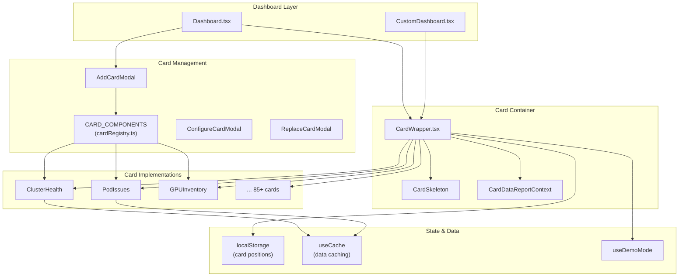
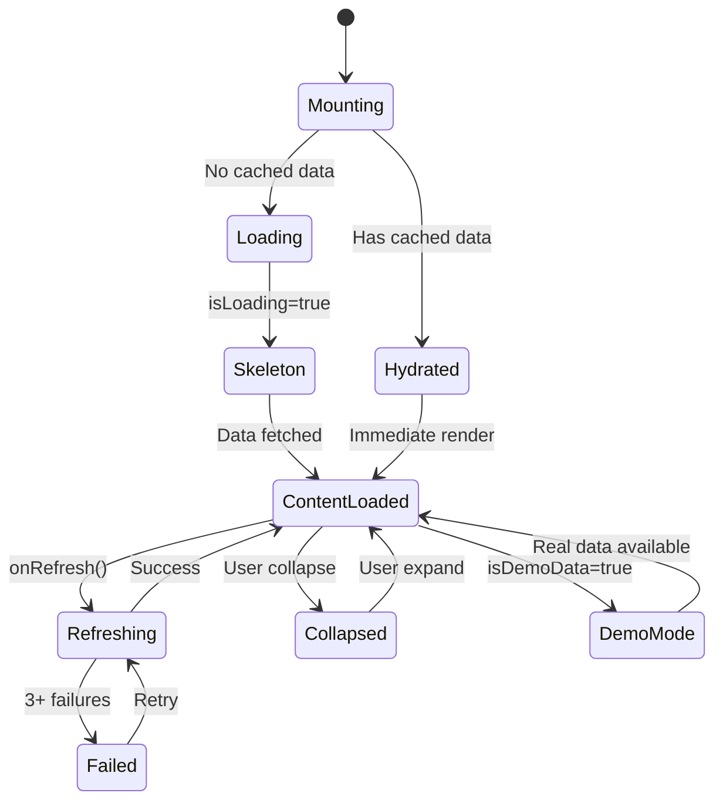
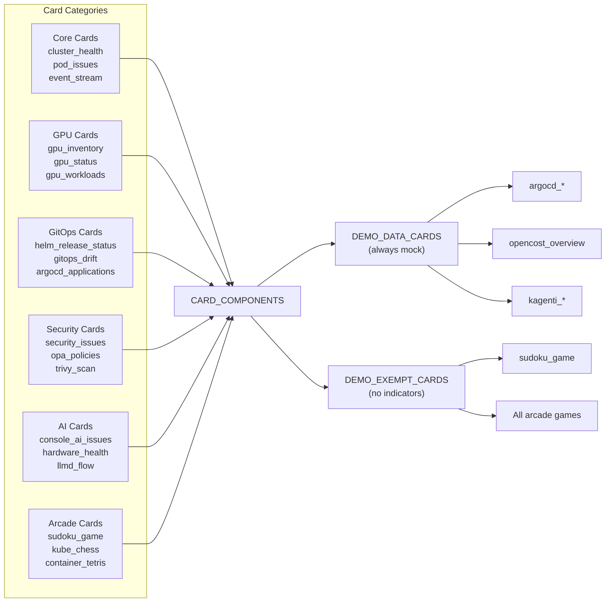
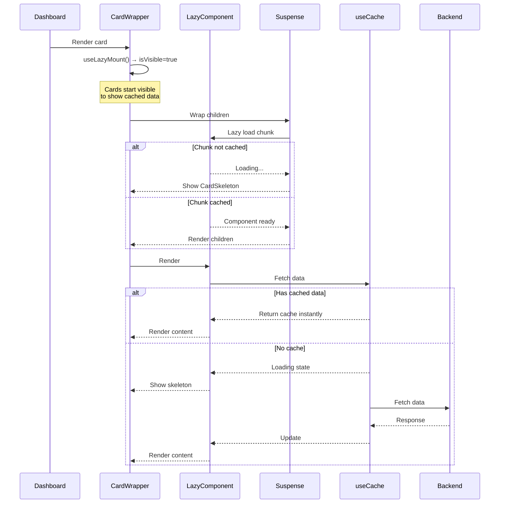
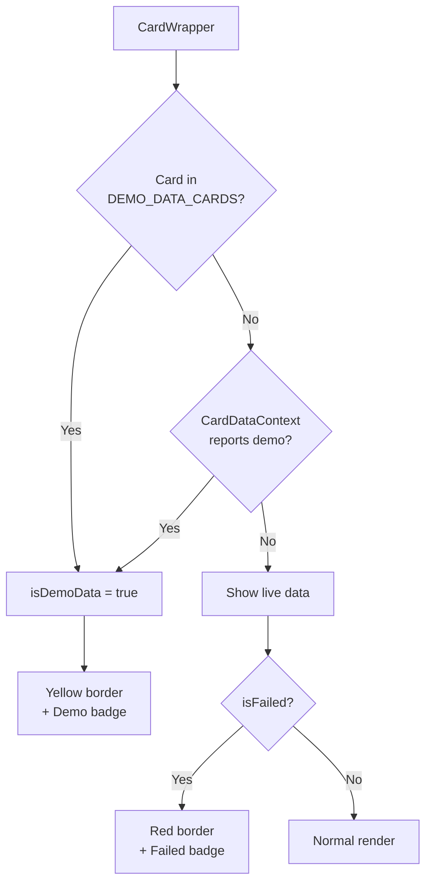
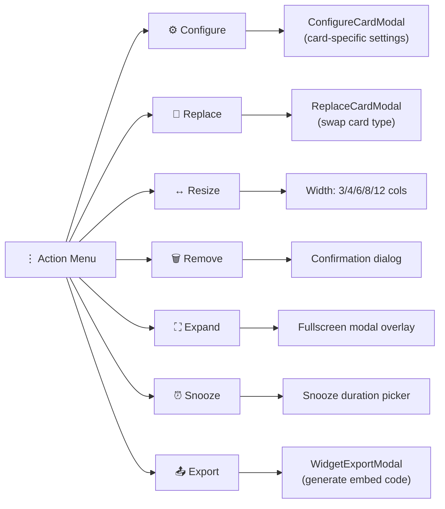
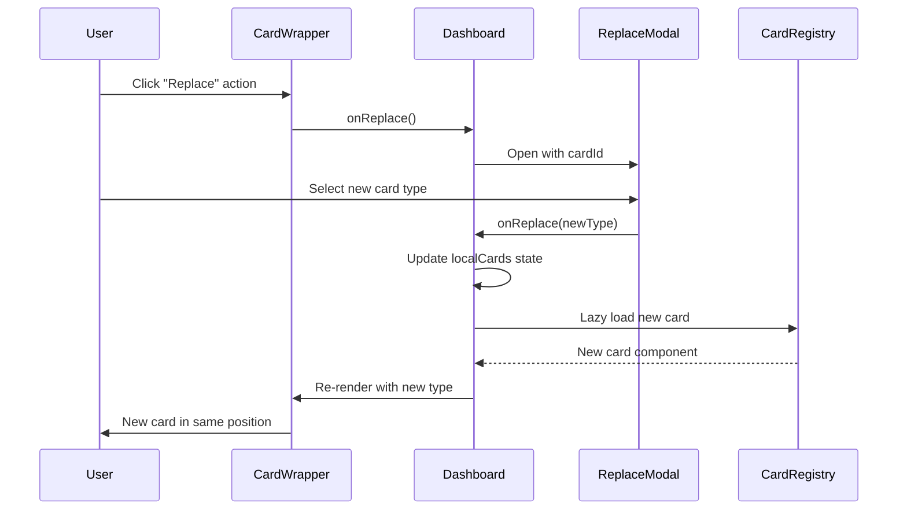
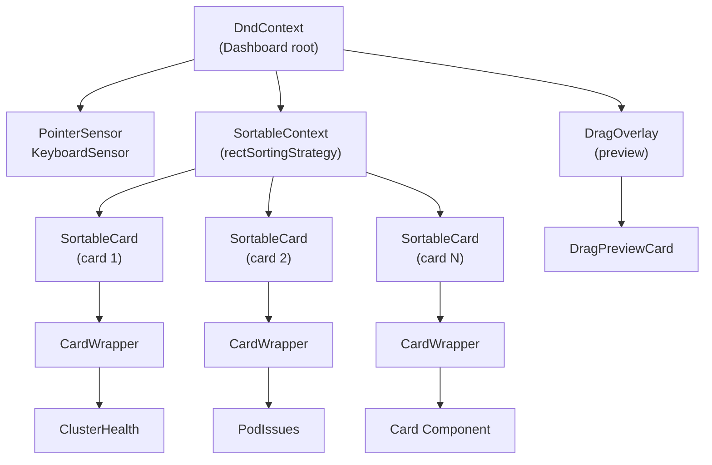
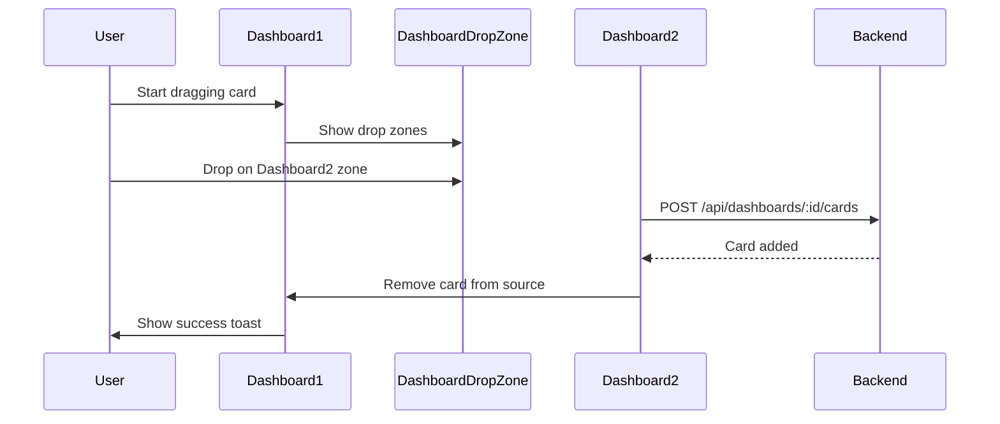
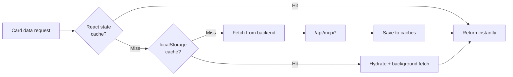

<!-- source: DeepWiki mcp.deepwiki.com · repo kubestellar/console · page 3 Card-Based UI System · fetched 2026-10-26 -->

# Card-Based UI System

<details>
<summary>Relevant source files</summary>

The following files were used as context for generating this wiki page:

- [web/src/App.tsx](web/src/App.tsx)
- [web/src/components/cards/CardWrapper.tsx](web/src/components/cards/CardWrapper.tsx)
- [web/src/components/cards/cardRegistry.ts](web/src/components/cards/cardRegistry.ts)
- [web/src/components/cards/flatcar_status/demoData.ts](web/src/components/cards/flatcar_status/demoData.ts)
- [web/src/components/cards/flatcar_status/index.tsx](web/src/components/cards/flatcar_status/index.tsx)
- [web/src/components/cards/flatcar_status/useFlatcarStatus.ts](web/src/components/cards/flatcar_status/useFlatcarStatus.ts)
- [web/src/components/cards/flatcar_status/versionUtils.ts](web/src/components/cards/flatcar_status/versionUtils.ts)
- [web/src/components/cards/llmd/index.ts](web/src/components/cards/llmd/index.ts)
- [web/src/components/compute/ClusterComparisonPage.tsx](web/src/components/compute/ClusterComparisonPage.tsx)
- [web/src/components/dashboard/AddCardModal.tsx](web/src/components/dashboard/AddCardModal.tsx)
- [web/src/components/dashboard/CustomDashboard.tsx](web/src/components/dashboard/CustomDashboard.tsx)
- [web/src/components/dashboard/Dashboard.tsx](web/src/components/dashboard/Dashboard.tsx)
- [web/src/components/dashboard/templates.ts](web/src/components/dashboard/templates.ts)
- [web/src/components/layout/Layout.tsx](web/src/components/layout/Layout.tsx)
- [web/src/components/llmd-benchmarks/LLMdBenchmarks.tsx](web/src/components/llmd-benchmarks/LLMdBenchmarks.tsx)
- [web/src/hooks/useCertManager.ts](web/src/hooks/useCertManager.ts)
- [web/src/locales/en/cards.json](web/src/locales/en/cards.json)

</details>


## Purpose and Scope

This document describes the modular card-based UI architecture that forms the foundation of the KubeStellar Console dashboard system. The card system enables users to compose custom dashboards by selecting from 85+ pre-built card types, each representing a specific Kubernetes resource view or monitoring function. Cards are lazy-loaded, support drag-and-drop repositioning, maintain independent state, and can display either live cluster data or demo/mock data depending on connectivity.

For information about specific card implementations and registry management, see [Card Components & Registry](#3.1). For dashboard-level operations like templates and persistence, see [Dashboard Management](#3.2). For AI-powered card creation, see [Card Factory & AI Creation](#3.4).

---

## System Architecture

### Component Hierarchy



**Sources:** [web/src/components/cards/CardWrapper.tsx:1-1463](), [web/src/components/cards/cardRegistry.ts:1-752](), [web/src/components/dashboard/Dashboard.tsx:1-676](), [web/src/components/dashboard/CustomDashboard.tsx:1-493]()

---

## CardWrapper Component

### Core Responsibilities

`CardWrapper` is the universal container for all card implementations. It provides:

- **Standard Chrome**: Title bar with icon, action menu (configure/replace/remove), expand/collapse toggle, resize controls
- **State Management**: Collapsed state, demo data indicators, refresh state, failure tracking
- **Lifecycle Hooks**: Lazy mounting, visibility detection, refresh triggers
- **Action Handlers**: `onConfigure`, `onRemove`, `onReplace`, `onRefresh`, `onWidthChange`, `onSwap`
- **Data Reporting**: Integrates with `CardDataReportContext` to report data state (loading/failed/demo) to parent

### CardWrapper Props

| Prop | Type | Purpose |
|------|------|---------|
| `cardId` | `string?` | Unique identifier for state persistence |
| `cardType` | `string` | Card type from registry (e.g., `cluster_health`) |
| `title` | `string?` | Override default title from `CARD_TITLES` |
| `icon` | `ComponentType?` | Override default icon from `CARD_ICONS` |
| `isRefreshing` | `boolean?` | Show refresh spinner |
| `lastUpdated` | `Date?` | Display last update timestamp |
| `isDemoData` | `boolean?` | Show demo mode badge |
| `isLive` | `boolean?` | Indicate live/real-time data |
| `isFailed` | `boolean?` | Show failure state |
| `consecutiveFailures` | `number?` | Track failure count |
| `cardWidth` | `number?` | Grid columns (1-12) |
| `isCollapsed` | `boolean?` | Collapsed state |
| `flashType` | `CardFlashType?` | Flash animation on data change |
| `onCollapsedChange` | `(collapsed: boolean) => void` | Callback |
| `onSwap` | `(newType: string) => void` | Initiate card swap |
| `onConfigure` | `() => void` | Open configuration modal |
| `onReplace` | `() => void` | Open replacement modal |
| `onRemove` | `() => void` | Remove card from dashboard |
| `onRefresh` | `() => void` | Trigger data refresh |
| `onWidthChange` | `(newWidth: number) => void` | Resize handler |
| `skeletonType` | `CardSkeletonProps['type']?` | Skeleton variant |
| `children` | `ReactNode` | Card content |

**Sources:** [web/src/components/cards/CardWrapper.tsx:124-173]()

### Card States and Indicators



**Card Visual States:**

| State | Visual Indicator | Condition |
|-------|-----------------|-----------|
| Loading | Skeleton animation | `isLoading && !hasCache` |
| Demo Data | Yellow border + badge | `isDemoData=true` |
| Live Data | Green pulse dot | `isLive=true` |
| Failed | Red border + badge | `isFailed=true` |
| Refreshing | Spinner in title bar | `isRefreshing=true` |
| Collapsed | Minimized header only | `isCollapsed=true` |
| Expanded | Full modal overlay | User expands card |

**Sources:** [web/src/components/cards/CardWrapper.tsx:417-476](), [web/src/components/cards/CardWrapper.tsx:817-847]()

---

## Card Registry and Lazy Loading

### Registry Structure

The `CARD_COMPONENTS` registry maps card type strings to lazy-loaded React components:

```typescript
// From cardRegistry.ts
const CARD_COMPONENTS: Record<string, CardComponent> = {
  cluster_health: ClusterHealth,
  pod_issues: PodIssues,
  gpu_inventory: GPUInventory,
  // ... 85+ card types
}
```

**Lazy Loading Strategy:**

1. **Imports**: All cards use `lazy(() => import('./CardName'))` for code splitting
2. **Bundle Chunking**: Related cards share barrel imports (e.g., `deploy-bundle`, `llmd-bundle`) to reduce HTTP requests
3. **Prefetching**: High-priority cards prefetch chunks immediately after login via `prefetchCardChunks()`
4. **Demo Cards**: Demo-only cards prefetch with 15s delay in live mode

**Sources:** [web/src/components/cards/cardRegistry.ts:4-161](), [web/src/components/cards/cardRegistry.ts:210-455]()

### Card Type Classification



**Card Classification Sets:**

| Set | Purpose | Example Cards |
|-----|---------|---------------|
| `DEMO_DATA_CARDS` | Always use mock data (no backend exists) | `argocd_applications`, `opencost_overview`, `kagenti_status` |
| `DEMO_EXEMPT_CARDS` | Never show demo indicators (games/utilities) | `sudoku_game`, `kube_chess`, `dynamic_card` |
| `LARGE_EXPANDED_CARDS` | Use 95vh height when expanded | `cluster_comparison`, `llmd_flow` |
| `FULLSCREEN_EXPANDED_CARDS` | Use 98vh height when expanded | `cluster_locations`, all arcade games |

**Sources:** [web/src/components/cards/cardRegistry.ts:473-536](), [web/src/components/cards/cardRegistry.ts:542-571](), [web/src/components/cards/CardWrapper.tsx:61-82]()

---

## Card Lifecycle

### Mounting and Visibility



**Key Lifecycle Concepts:**

1. **Eager Visibility**: Cards render immediately on page load to display cached data. No lazy mounting delay. [web/src/components/cards/CardWrapper.tsx:106-119]()

2. **Progressive Disclosure**: Cached data appears instantly → background refresh → update if changed. No skeleton flash on navigation.

3. **Suspense Boundaries**: Each card has its own `<Suspense>` boundary with `<CardSkeleton>` fallback. [web/src/components/cards/CardWrapper.tsx:817-847]()

4. **Chunk Preloading**: Dashboard prefetches visible card chunks immediately after login. [web/src/App.tsx:299-315]()

**Sources:** [web/src/components/cards/CardWrapper.tsx:96-119](), [web/src/components/dashboard/Dashboard.tsx:429-431]()

---

## Card Data States

### Demo Mode Detection

Cards report their data state via `CardDataReportContext`:

```typescript
// Inside a card component
import { useReportCardDataState } from './CardDataContext'

const { isDemoFallback } = useCache({ 
  key: 'my-card-data',
  fetcher: fetchRealData,
  demoData: MOCK_DATA 
})

useReportCardDataState({
  isDemoData: isDemoFallback,
  isLoading: loading,
  isFailed: error,
  consecutiveFailures: 0
})
```

**Demo Data Flow:**



**Sources:** [web/src/components/cards/CardWrapper.tsx:765-816](), [web/src/components/cards/CardDataContext.tsx:1-120]()

### Data Refresh Patterns

| Pattern | Implementation | Use Case |
|---------|---------------|----------|
| **Automatic** | `setInterval(refetch, 30000)` in Dashboard | Background refresh every 30s |
| **Manual** | User clicks refresh button → `onRefresh()` | Force immediate update |
| **On Navigation** | `useEffect(() => loadDashboard(), [location.key])` | Refresh when navigating back |
| **Cache First** | `useCache()` returns cache → background fetch | Instant render, no skeleton flash |

**Sources:** [web/src/components/dashboard/Dashboard.tsx:196-210](), [web/src/components/cards/CardWrapper.tsx:638-671]()

---

## Card Actions

### Action Menu

CardWrapper provides a dropdown menu with these actions:



**Sources:** [web/src/components/cards/CardWrapper.tsx:1072-1329]()

### Resize Options

Cards support 5 width options:

| Label (i18n) | Columns | Description (i18n) | Percentage |
|--------------|---------|-------------------|------------|
| `resizeSmall` | 3 | `resizeSmallDesc` | 25% |
| `resizeMedium` | 4 | `resizeMediumDesc` | 33% |
| `resizeLarge` | 6 | `resizeLargeDesc` | 50% |
| `resizeWide` | 8 | `resizeWideDesc` | 66% |
| `resizeFull` | 12 | `resizeFullDesc` | 100% |

**Implementation:**

```typescript
// CardWrapper.tsx:51-57
const WIDTH_OPTIONS = [
  { value: 3, labelKey: 'cardWrapper.resizeSmall', descKey: 'cardWrapper.resizeSmallDesc' },
  { value: 4, labelKey: 'cardWrapper.resizeMedium', descKey: 'cardWrapper.resizeMediumDesc' },
  { value: 6, labelKey: 'cardWrapper.resizeLarge', descKey: 'cardWrapper.resizeLargeDesc' },
  { value: 8, labelKey: 'cardWrapper.resizeWide', descKey: 'cardWrapper.resizeWideDesc' },
  { value: 12, labelKey: 'cardWrapper.resizeFull', descKey: 'cardWrapper.resizeFullDesc' },
]
```

**Sources:** [web/src/components/cards/CardWrapper.tsx:51-57](), [web/src/components/cards/CardWrapper.tsx:1209-1230]()

### Card Swap System

Cards can be swapped (replaced) with a different card type while preserving position and config:



**Pending Swap State:**

Cards can have a `pendingSwap` prop that shows a countdown timer before the swap executes:

```typescript
interface PendingSwap {
  newType: string
  newTitle?: string
  reason: string
  swapAt: Date
}
```

**Sources:** [web/src/components/cards/CardWrapper.tsx:42-47](), [web/src/components/dashboard/Dashboard.tsx:617-634]()

---

## Dashboard Integration

### Card Persistence

Cards are persisted to `localStorage` using these keys:

| Storage Key | Dashboard | Default Cards Source |
|-------------|-----------|---------------------|
| `kubestellar-main-dashboard-cards` | Main dashboard | `getDefaultCardsForDashboard('main')` |
| `kubestellar-${dashboardId}-cards` | Custom dashboard | User-added or template cards |

**Card Data Structure:**

```typescript
interface Card {
  id: string                    // Unique ID (e.g., "card-1234567890")
  card_type: string             // Registry key (e.g., "cluster_health")
  config: Record<string, unknown> // Card-specific settings
  position: {
    x: number                   // Grid X position (unused in CSS Grid)
    y: number                   // Grid Y position (unused in CSS Grid)
    w: number                   // Width in columns (1-12)
    h: number                   // Height in rows (unused, auto-sized)
  }
  title?: string                // Override default title
}
```

**Sources:** [web/src/components/dashboard/Dashboard.tsx:61-73](), [web/src/components/dashboard/CustomDashboard.tsx:49-55]()

### Drag and Drop

Dashboards use `@dnd-kit` for drag-and-drop reordering:



**Drag Events:**

1. **DragStart**: Sets `activeId`, shows preview overlay
2. **DragOver**: Detects drop zones (other dashboards, cluster groups)
3. **DragEnd**: Reorders cards via `arrayMove()` or moves to target dashboard
4. **DragCancel**: Resets state

**Sources:** [web/src/components/dashboard/Dashboard.tsx:222-232](), [web/src/components/dashboard/Dashboard.tsx:234-320](), [web/src/components/dashboard/SharedSortableCard.tsx:1-150]()

### Cross-Dashboard Dragging

Cards can be dragged from one dashboard to another via drop zones:



**Sources:** [web/src/components/dashboard/Dashboard.tsx:286-303](), [web/src/components/dashboard/DashboardDropZone.tsx:1-120]()

---

## Card Metadata

### Titles and Descriptions

Card titles and descriptions are defined in `CardWrapper.tsx`:

```typescript
// Default titles
export const CARD_TITLES: Record<string, string> = {
  cluster_health: 'Cluster Health',
  pod_issues: 'Pod Issues',
  gpu_inventory: 'GPU Inventory',
  // ... 85+ cards
}

// Info tooltip descriptions
export const CARD_DESCRIPTIONS: Record<string, string> = {
  cluster_health: 'Overall health status of all connected Kubernetes clusters.',
  pod_issues: 'Pods with errors, restarts, or scheduling problems.',
  gpu_inventory: 'Inventory of GPU nodes with model, memory, and driver info.',
  // ... 85+ cards
}
```

**Localization**: All titles/descriptions have i18n keys in `cards.json`:

```json
{
  "titles": {
    "cluster_health": "Cluster Health",
    "pod_issues": "Pod Issues"
  },
  "descriptions": {
    "cluster_health": "Overall health status of all connected Kubernetes clusters.",
    "pod_issues": "Pods with errors, restarts, or scheduling problems."
  }
}
```

**Sources:** [web/src/components/cards/CardWrapper.tsx:175-378](), [web/src/components/cards/CardWrapper.tsx:381-531](), [web/src/locales/en/cards.json:97-256]()

### Icons and Colors

Each card has an associated icon and color:

```typescript
const CARD_ICONS: Record<string, { icon: ComponentType, color: string }> = {
  cluster_health: { icon: Activity, color: 'text-green-400' },
  pod_issues: { icon: AlertTriangle, color: 'text-red-400' },
  gpu_inventory: { icon: Cpu, color: 'text-green-400' },
  // ... 85+ cards
}
```

**Icon Display**: Icons appear in the card header next to the title, using the specified color class. [web/src/components/cards/CardWrapper.tsx:851-866]()

**Sources:** [web/src/components/cards/CardWrapper.tsx:534-731]()

---

## Card Catalog

### Category Organization

The `AddCardModal` organizes cards into categories for easy browsing:

| Category | Card Count | Examples |
|----------|-----------|----------|
| Cluster Admin | 12 | `control_plane_health`, `predictive_health`, `node_debug` |
| Cluster Health | 8 | `cluster_health`, `cluster_metrics`, `cluster_locations` |
| Workloads | 13 | `deployment_status`, `pod_issues`, `workload_monitor` |
| Compute | 7 | `compute_overview`, `gpu_overview`, `gpu_inventory` |
| Storage | 2 | `storage_overview`, `pvc_status` |
| Network | 8 | `network_overview`, `service_status`, `service_topology` |
| GitOps | 8 | `helm_release_status`, `gitops_drift`, `kustomization_status` |
| ArgoCD | 3 | `argocd_applications`, `argocd_sync_status`, `argocd_health` |
| Operators | 3 | `operator_status`, `operator_subscriptions`, `crd_health` |
| Namespaces | 5 | `namespace_overview`, `namespace_quotas`, `namespace_rbac` |
| Security & Events | 6 | `security_issues`, `event_stream`, `warning_events` |
| Live Trends | 4 | `events_timeline`, `pod_health_trend`, `resource_trend` |
| AI Agents | 7 | `kagenti_status`, `kagenti_agent_fleet`, `kagenti_topology` |
| AI Assistant | 5 | `console_ai_issues`, `hardware_health`, `console_ai_offline_detection` |
| Alerting | 2 | `active_alerts`, `alert_rules` |
| Cost Management | 3 | `cluster_costs`, `opencost_overview`, `kubecost_overview` |
| Security Posture | 7 | `opa_policies`, `falco_alerts`, `trivy_scan` |
| Data Compliance | 3 | `vault_secrets`, `external_secrets`, `cert_manager` |
| Games | 23+ | `sudoku_game`, `kube_chess`, `container_tetris` |

**Sources:** [web/src/components/dashboard/AddCardModal.tsx:12-287]()

### Visualization Types

Each card has a visualization type indicator:

| Type | Description | Examples |
|------|-------------|----------|
| `status` | Health badges, summary stats | `cluster_health`, `gpu_overview` |
| `table` | Tabular data lists | `pod_issues`, `gpu_inventory`, `helm_releases` |
| `donut` | Pie/donut charts | `deployment_status`, `gpu_status` |
| `gauge` | Progress/capacity gauges | `resource_usage`, `gpu_utilization` |
| `bar` | Bar charts | `cluster_comparison`, `cluster_costs` |
| `timeseries` | Line/area charts over time | `cluster_metrics`, `pod_health_trend` |
| `events` | Event stream/timeline | `event_stream`, `warning_events` |

**Sources:** [web/src/components/dashboard/AddCardModal.tsx:14-24]()

---

## Performance Optimizations

### Bundle Chunking Strategy

Related cards share bundle imports to reduce HTTP requests:

```typescript
// Deploy dashboard cards — single chunk for 16 cards
const _deployBundle = import('./deploy-bundle')
const DeploymentStatus = lazy(() => _deployBundle.then(m => ({ default: m.DeploymentStatus })))
const GitOpsDrift = lazy(() => _deployBundle.then(m => ({ default: m.GitOpsDrift })))
// ... 14 more cards

// LLM-d visualization cards — single chunk for 8 cards
const _llmdBundle = import('./llmd')
const LLMdFlow = lazy(() => _llmdBundle.then(m => ({ default: m.LLMdFlow })))
const KVCacheMonitor = lazy(() => _llmdBundle.then(m => ({ default: m.KVCacheMonitor })))
// ... 6 more cards
```

**Prefetch Priority:**

1. **Immediate**: Default dashboard cards (8 cards) prefetched on login
2. **Deferred 500ms**: Enabled dashboard page chunks prefetched after first render
3. **Deferred 15s**: Demo-only cards prefetched in background (live mode only)

**Sources:** [web/src/components/cards/cardRegistry.ts:12-161](), [web/src/App.tsx:291-315]()

### Cache Strategy

Cards use multi-tier caching:



**Cache Keys:**

- Pattern: `kc-${dataType}-cache` (e.g., `kc-clusters-cache`, `kc-nodes-cache`)
- TTL: Varies by data type (10-30 minutes)
- Strategy: Stale-while-revalidate

**Sources:** [web/src/lib/cache.ts:1-300](), [web/src/components/cards/CardWrapper.tsx:96-119]()

---

## Summary

The card-based UI system provides:

- **Modularity**: 85+ independent card components with lazy loading
- **Flexibility**: Drag-and-drop arrangement, resize, configure per card
- **Performance**: Bundle chunking, prefetching, multi-tier caching
- **Resilience**: Demo mode fallback, failure tracking, graceful degradation
- **Customization**: Templates, custom dashboards, AI-powered card creation

Cards are the atomic building blocks of the console UI. Each card encapsulates a specific view of Kubernetes resources, maintains its own state, and integrates seamlessly with the dashboard framework through standardized `CardWrapper` chrome and lifecycle hooks.

**Key Files:**
- [web/src/components/cards/CardWrapper.tsx:1-1463]() - Universal card container
- [web/src/components/cards/cardRegistry.ts:1-752]() - Card registry and lazy loading
- [web/src/components/dashboard/Dashboard.tsx:1-676]() - Main dashboard implementation
- [web/src/components/dashboard/AddCardModal.tsx:1-650]() - Card selection UI
- [web/src/components/cards/CardDataContext.tsx:1-120]() - Data state reporting

---

