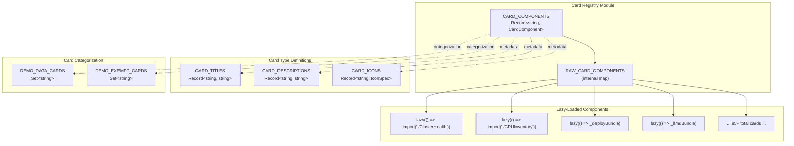
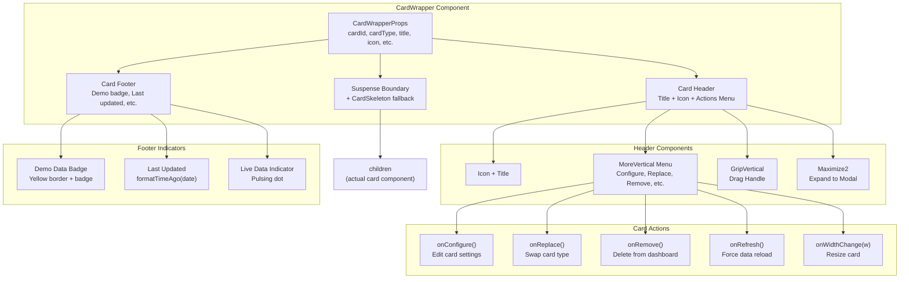
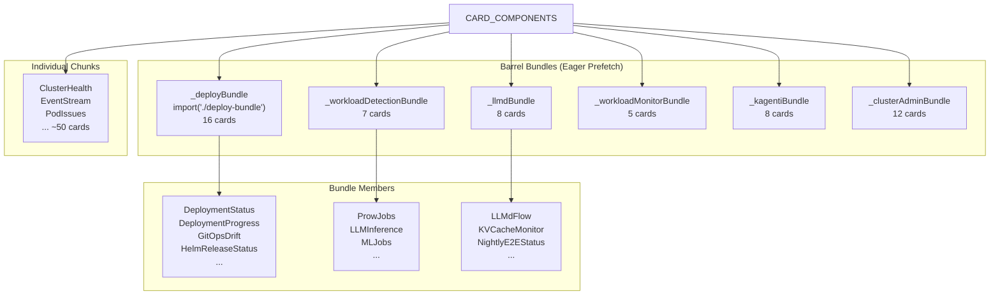
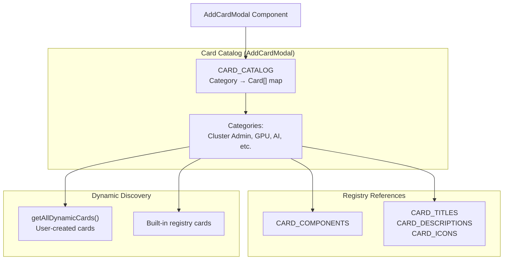

<!-- source: DeepWiki mcp.deepwiki.com · repo kubestellar/console · page 3.1 Card Components & Registry · fetched 2026-10-26 -->

# Card Components & Registry

<details>
<summary>Relevant source files</summary>

The following files were used as context for generating this wiki page:

- [web/src/App.tsx](web/src/App.tsx)
- [web/src/components/cards/CardWrapper.tsx](web/src/components/cards/CardWrapper.tsx)
- [web/src/components/cards/cardRegistry.ts](web/src/components/cards/cardRegistry.ts)
- [web/src/components/cards/flatcar_status/demoData.ts](web/src/components/cards/flatcar_status/demoData.ts)
- [web/src/components/cards/flatcar_status/index.tsx](web/src/components/cards/flatcar_status/index.tsx)
- [web/src/components/cards/flatcar_status/useFlatcarStatus.ts](web/src/components/cards/flatcar_status/useFlatcarStatus.ts)
- [web/src/components/cards/flatcar_status/versionUtils.ts](web/src/components/cards/flatcar_status/versionUtils.ts)
- [web/src/components/cards/llmd/index.ts](web/src/components/cards/llmd/index.ts)
- [web/src/components/compute/ClusterComparisonPage.tsx](web/src/components/compute/ClusterComparisonPage.tsx)
- [web/src/components/dashboard/AddCardModal.tsx](web/src/components/dashboard/AddCardModal.tsx)
- [web/src/components/dashboard/CustomDashboard.tsx](web/src/components/dashboard/CustomDashboard.tsx)
- [web/src/components/dashboard/Dashboard.tsx](web/src/components/dashboard/Dashboard.tsx)
- [web/src/components/dashboard/templates.ts](web/src/components/dashboard/templates.ts)
- [web/src/components/layout/Layout.tsx](web/src/components/layout/Layout.tsx)
- [web/src/components/llmd-benchmarks/LLMdBenchmarks.tsx](web/src/components/llmd-benchmarks/LLMdBenchmarks.tsx)
- [web/src/hooks/useCertManager.ts](web/src/hooks/useCertManager.ts)
- [web/src/locales/en/cards.json](web/src/locales/en/cards.json)

</details>


**Purpose**: This page documents the card component system that forms the foundation of the dashboard UI. It covers the `CardWrapper` container component, the central `CARD_COMPONENTS` registry with 85+ card types, lazy loading mechanisms, and bundle chunking strategies used to optimize initial page load performance.

For information about how cards are arranged and managed in dashboards, see [Dashboard Management](#3.2). For AI-powered card creation, see [Card Factory & AI Creation](#3.4).

---

## Card Registry Architecture

The card registry is the central mapping of card type strings to their React components. All cards in the system are registered in `CARD_COMPONENTS`, which enables dynamic card loading, catalog discovery, and type-safe card instantiation.

### Registry Structure



**Key Registry Maps**:
- `CARD_COMPONENTS`: [web/src/components/cards/cardRegistry.ts:210-455]() — Exported registry mapping card types to lazy-loaded components
- `RAW_CARD_COMPONENTS`: [web/src/components/cards/cardRegistry.ts:210]() — Internal map before Suspense wrapping (now directly exported)
- `CARD_TITLES`: [web/src/components/cards/CardWrapper.tsx:175-378]() — Human-readable card titles
- `CARD_DESCRIPTIONS`: [web/src/components/cards/CardWrapper.tsx:381-531]() — Short descriptions for info tooltips
- `CARD_ICONS`: [web/src/components/cards/CardWrapper.tsx:534-731]() — Icon components with color classes

Sources: [web/src/components/cards/cardRegistry.ts:1-571](), [web/src/components/cards/CardWrapper.tsx:175-731]()

### Card Type Interface

All cards implement a standardized interface:

```typescript
export type CardComponentProps = { config?: Record<string, unknown> }
export type CardComponent = ComponentType<CardComponentProps>
```

Cards receive an optional `config` object for customization. The `CardWrapper` component provides all standard UI chrome (title, icons, actions) so individual cards only render their content area.

Sources: [web/src/components/cards/cardRegistry.ts:194-198]()

---

## CardWrapper Component

`CardWrapper` is the universal container that wraps every card instance. It provides standardized UI chrome, actions menu, drag handle, and data state reporting.

### CardWrapper Architecture



**Key Props**: [web/src/components/cards/CardWrapper.tsx:124-173]()
- `cardId`, `cardType`, `title` — Card identity
- `icon`, `iconColor` — Header icon customization
- `isRefreshing`, `lastUpdated` — Data state indicators
- `isDemoData`, `isLive`, `isFailed` — Content type badges
- `cardWidth` — Grid column span (1-12)
- `isCollapsed`, `onCollapsedChange` — Collapse state
- Callback props: `onConfigure`, `onReplace`, `onRemove`, `onRefresh`, `onWidthChange`

Sources: [web/src/components/cards/CardWrapper.tsx:124-173]()

### Card Width Options

Cards support 5 preset widths using a 12-column grid system:

| Width Option | Grid Columns | Label Key | Typical Use Case |
|--------------|--------------|-----------|------------------|
| Small | 3 | `cardWrapper.resizeSmall` | Simple metrics, status indicators |
| Medium | 4 | `cardWrapper.resizeMedium` | Default size, most cards |
| Large | 6 | `cardWrapper.resizeLarge` | Tables, detailed views |
| Wide | 8 | `cardWrapper.resizeWide` | Complex visualizations |
| Full | 12 | `cardWrapper.resizeFull` | Full-width cards, timelines |

Sources: [web/src/components/cards/CardWrapper.tsx:49-57]()

### Expanded Modal Sizes

When cards are expanded to modals, they use one of three size categories:

**Default Size**: `max-w-4xl h-[80vh]` — Most cards

**Large Size**: `max-w-7xl h-[95vh]` — Cards in `LARGE_EXPANDED_CARDS` set
- `cluster_comparison`, `cluster_resource_tree`, `kvcache_monitor`, `pd_disaggregation`, `llmd_ai_insights`

**Fullscreen Size**: `w-screen h-screen` — Cards in `FULLSCREEN_EXPANDED_CARDS` set
- All arcade games (`sudoku_game`, `container_tetris`, etc.)
- Map visualizations (`cluster_locations`, `mobile_browser`)
- Flow diagrams (`llmd_flow`, `epp_routing`)

Sources: [web/src/components/cards/CardWrapper.tsx:59-82]()

---

## Lazy Loading Mechanism

All cards are lazy-loaded using React's `lazy()` to enable code splitting. Cards only download when they appear in a dashboard.

### Lazy Loading Pattern

```typescript
// Standard lazy import
const ClusterHealth = lazy(() => import('./ClusterHealth').then(m => ({ default: m.ClusterHealth })))

// Barrel import with eager prefetch
const _deployBundle = import('./deploy-bundle')
const DeploymentStatus = lazy(() => _deployBundle.then(m => ({ default: m.DeploymentStatus })))
const GitOpsDrift = lazy(() => _deployBundle.then(m => ({ default: m.GitOpsDrift })))
```

The barrel import pattern (`_deployBundle`) triggers module download at parse time, so all cards in the bundle share a single HTTP request rather than 16 separate requests.

Sources: [web/src/components/cards/cardRegistry.ts:5-162]()

### Suspense Boundaries

Each card is wrapped in a `Suspense` boundary by `CardWrapper`, showing a skeleton while the lazy chunk loads:


**Note**: The previous "eager mount" optimization that delayed initial render has been removed. Cards now render immediately to show cached data without delay. See [web/src/components/cards/CardWrapper.tsx:95-119]().

Sources: [web/src/components/cards/CardWrapper.tsx:95-119](), [web/src/components/cards/cardRegistry.ts:200-204]()

---

## Bundle Chunking Strategies

Cards are grouped into shared bundles to minimize HTTP requests and optimize download parallelism. The system uses **barrel imports** with **eager prefetch** to preload bundles before cards render.

### Bundle Strategy Map



### Barrel Import Example

**Deploy Bundle** ([web/src/components/cards/deploy-bundle.ts]()): Contains 16 GitOps/deployment cards that are frequently used together:

```typescript
// Eager prefetch at module parse time
const _deployBundle = import('./deploy-bundle')

// All cards share the same chunk download
const DeploymentStatus = lazy(() => _deployBundle.then(m => ({ default: m.DeploymentStatus })))
const DeploymentProgress = lazy(() => _deployBundle.then(m => ({ default: m.DeploymentProgress })))
const DeploymentIssues = lazy(() => _deployBundle.then(m => ({ default: m.DeploymentIssues })))
const GitOpsDrift = lazy(() => _deployBundle.then(m => ({ default: m.GitOpsDrift })))
// ... 12 more cards from same bundle
```

Sources: [web/src/components/cards/cardRegistry.ts:12-18]()

### Chunk Preloading

Card chunks are preloaded after authentication to avoid skeleton flashes:

```typescript
// In App.tsx - prefetch default dashboard cards immediately
useEffect(() => {
  if (!isAuthenticated) return
  prefetchCardData() // Prefetch cluster/pod/node data
  prefetchCardChunks(DEFAULT_MAIN_CARD_TYPES) // Prefetch card components
  
  if (isDemoMode()) {
    prefetchDemoCardChunks() // Prefetch demo-only cards immediately
  } else {
    setTimeout(prefetchDemoCardChunks, 15_000) // Defer 15s in live mode
  }
}, [isAuthenticated])
```

Sources: [web/src/App.tsx:291-315]()

### Card Chunk Preloader Map

The `CARD_CHUNK_PRELOADERS` map provides fine-grained control over chunk warming:

```typescript
const CARD_CHUNK_PRELOADERS: Record<string, () => Promise<unknown>> = {
  cluster_health: () => import('./ClusterHealth'),
  deployment_status: () => import('./deploy-bundle'),
  llmd_flow: () => import('./llmd'),
  // ... mappings for all 85+ cards
}
```

Individual cards or dashboards can trigger preloads selectively:

```typescript
export function prefetchCardChunks(cardTypes: string[]) {
  for (const type of cardTypes) {
    CARD_CHUNK_PRELOADERS[type]?.().catch(() => {})
  }
}
```

Sources: [web/src/components/cards/cardRegistry.ts:580-687]()

---

## Card Metadata System

Three maps provide standardized metadata for all cards in the registry.

### Metadata Maps

**CARD_TITLES**: [web/src/components/cards/CardWrapper.tsx:175-378]()
- Human-readable titles displayed in card headers
- Used in catalog, search, and drilldowns
- Example: `'cluster_health': 'Cluster Health'`

**CARD_DESCRIPTIONS**: [web/src/components/cards/CardWrapper.tsx:381-531]()
- Short descriptions shown in info icon tooltips
- Used in catalog to explain card purpose
- Example: `'cluster_health': 'Overall health status of all connected Kubernetes clusters.'`

**CARD_ICONS**: [web/src/components/cards/CardWrapper.tsx:534-731]()
- Lucide icons with color classes for visual identification
- Example: `'cluster_health': { icon: Activity, color: 'text-green-400' }`

### Icon Color Conventions

| Color Class | Meaning | Example Card Types |
|-------------|---------|-------------------|
| `text-green-400` | Health/Success | `cluster_health`, `gpu_status` |
| `text-purple-400` | Core Resources | `cluster_focus`, `deployment_status` |
| `text-blue-400` | Networking | `cluster_network`, `service_status` |
| `text-red-400` | Errors/Security | `security_issues`, `pod_issues` |
| `text-yellow-400` | Warnings/RBAC | `namespace_rbac`, `alert_rules` |
| `text-cyan-400` | AI/ML | `llmd_flow`, `kvcache_monitor` |

Sources: [web/src/components/cards/CardWrapper.tsx:534-731]()

---

## Demo Data Classification

Cards are categorized into two special sets that control demo mode behavior.

### DEMO_DATA_CARDS Set

Contains card types that **always show demo/mock data** until their backend data source is available:

```typescript
export const DEMO_DATA_CARDS = new Set([
  'service_exports',        // MCS cards - demo until MCS is installed
  'service_imports',
  'gateway_status',         // Gateway API - demo until installed
  'argocd_applications',    // ArgoCD - all use mock data
  'argocd_health',
  'argocd_sync_status',
  'opencost_overview',      // Cost management - demo until connected
  'kubecost_overview',
  'kyverno_policies',       // Policy management
  'falco_alerts',           // Security posture - demo until tools detected
  'trivy_scan',
  // ... ~30 total card types
])
```

These cards get `isDemoData={true}` passed to `CardWrapper`, which displays a yellow border and "Demo Data" badge.

**Important**: When adding live data support to a card, you **must** remove it from this set and have the card call `useReportCardDataState()` to dynamically report demo state.

Sources: [web/src/components/cards/cardRegistry.ts:473-536]()

### DEMO_EXEMPT_CARDS Set

Contains card types that **never show demo indicators** because they don't have a "demo vs live" concept:

```typescript
export const DEMO_EXEMPT_CARDS = new Set([
  // All arcade games - always just games, not data views
  'sudoku_game',
  'container_tetris',
  'kube_kong',
  'pod_crosser',
  // ... all 25 game cards
  
  // Dynamic cards
  'dynamic_card',
  
  // Admin tools without demo/live concept
  'maintenance_windows',
  'node_debug',
])
```

These cards render without skeleton delays or demo badges, even in demo mode.

Sources: [web/src/components/cards/cardRegistry.ts:542-570]()

---

## Card Catalog Integration

The card registry integrates with the `AddCardModal` catalog system, which organizes cards by category for discovery:



The catalog at [web/src/components/dashboard/AddCardModal.tsx:12-271]() provides a searchable, categorized view of all available cards. Each catalog entry includes:
- `type`: Card type string (matches registry key)
- `title`: Display name
- `description`: Short explanation
- `visualization`: Type hint (table, gauge, timeseries, etc.)

Sources: [web/src/components/dashboard/AddCardModal.tsx:12-271](), [web/src/components/cards/cardRegistry.ts:210-455]()

---

## Usage Patterns

### Adding a Card to a Dashboard

```typescript
// Dashboard.tsx
const handleAddCard = (cardType: string, config?: Record<string, unknown>) => {
  const size = getDefaultCardSize(cardType)
  const newCard: Card = {
    id: `card-${Date.now()}`,
    card_type: cardType,
    config: config || {},
    position: { x: 0, y: 0, ...size },
    title: CARD_TITLES[cardType],
  }
  setLocalCards((prev) => [newCard, ...prev])
}
```

### Rendering a Card

```typescript
// SortableCard component
const CardComponent = CARD_COMPONENTS[card.card_type]

return (
  <CardWrapper
    cardId={card.id}
    cardType={card.card_type}
    title={card.title || formatCardTitle(card.card_type)}
    onConfigure={() => handleConfigure(card)}
    onRemove={() => handleRemove(card)}
    cardWidth={card.position.w}
  >
    <CardComponent config={card.config} />
  </CardWrapper>
)
```

Sources: [web/src/components/dashboard/Dashboard.tsx:523-542](), [web/src/components/dashboard/CustomDashboard.tsx:105-129]()

---

## Performance Optimizations

### Module-Level Cache for Dashboard State

Dashboard data is cached at module level to survive navigation:

```typescript
// Module-level cache (survives navigation)
interface CachedDashboard {
  dashboard: DashboardData | null
  cards: Card[]
  timestamp: number
}
let dashboardCache: CachedDashboard | null = null
```

This enables instant rendering when returning to a dashboard — cards render with cached data immediately, then refresh in the background.

Sources: [web/src/components/dashboard/Dashboard.tsx:60-67]()

### Batch Prefetch Strategy

Route chunks are prefetched in batches to avoid saturating the dev server:

```typescript
// In App.tsx - batch imports to avoid server saturation
const PREFETCH_BATCH_SIZE = 5
const PREFETCH_BATCH_DELAY = 100

let offset = 0
const loadBatch = () => {
  const batch = chunks.slice(offset, offset + PREFETCH_BATCH_SIZE)
  if (batch.length === 0) return
  Promise.allSettled(batch.map(load => load().catch(() => {}))).then(() => {
    offset += PREFETCH_BATCH_SIZE
    setTimeout(loadBatch, PREFETCH_BATCH_DELAY)
  })
}
```

Sources: [web/src/App.tsx:115-148]()

### Eager Bundle Loading

Barrel bundles trigger download at module parse time (before any card renders):

```typescript
// Eager prefetch - starts downloading immediately
const _llmdBundle = import('./llmd')

// Later lazy() calls resolve instantly from cache
const LLMdFlow = lazy(() => _llmdBundle.then(m => ({ default: m.LLMdFlow })))
const KVCacheMonitor = lazy(() => _llmdBundle.then(m => ({ default: m.KVCacheMonitor })))
```

This ensures heavy visualization bundles (LLMd: 194KB source) are pre-warmed before the AI/ML dashboard renders.

Sources: [web/src/components/cards/cardRegistry.ts:141-158]()

---

