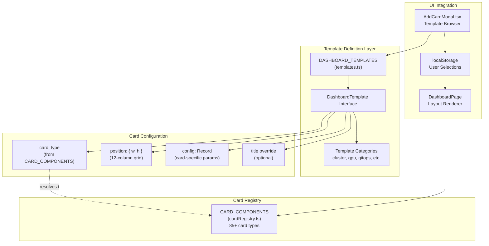
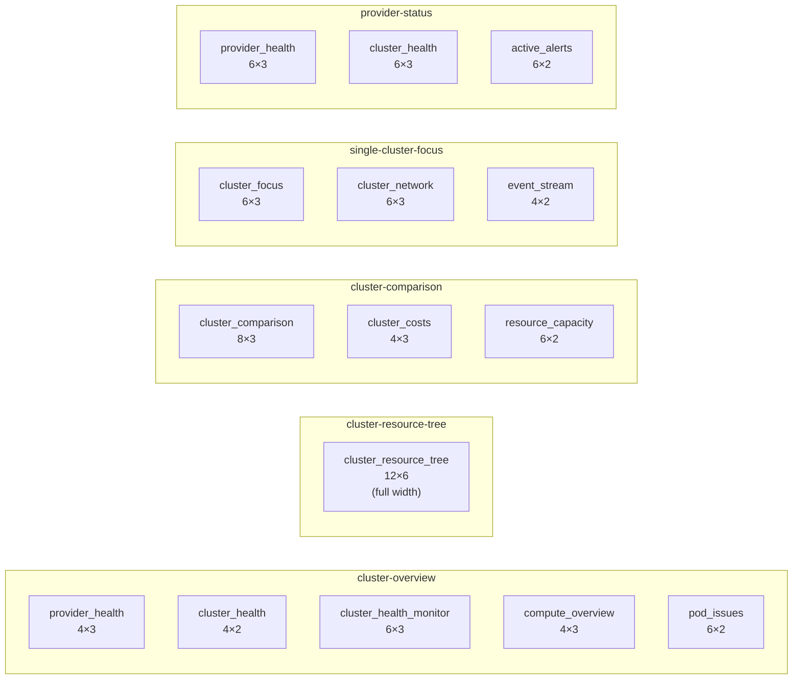
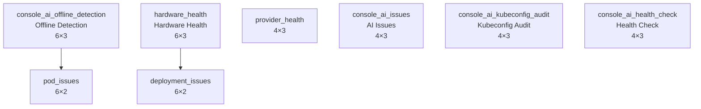
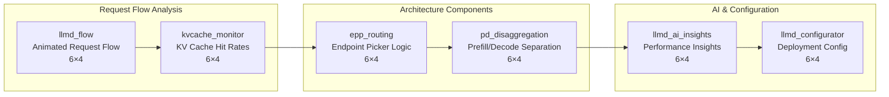
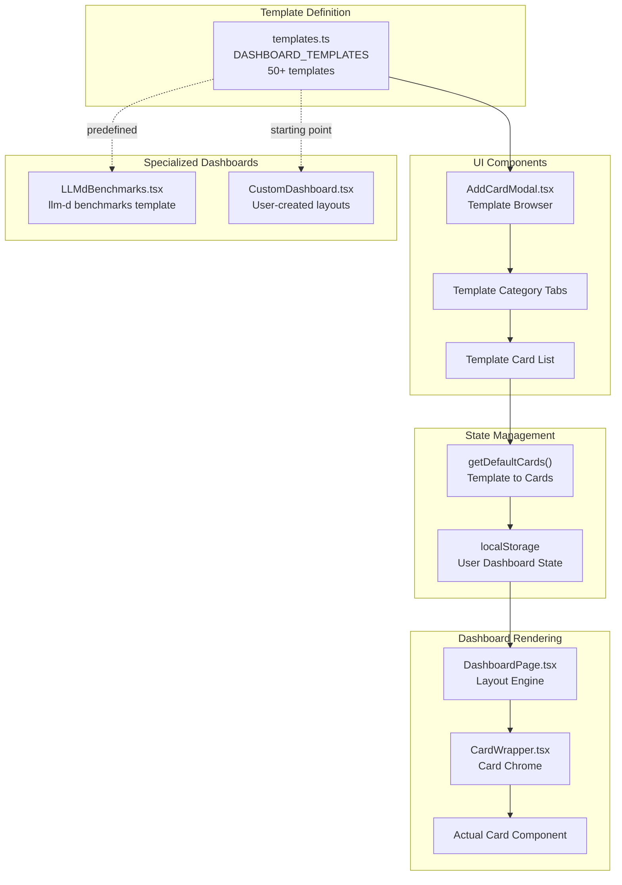

<!-- source: DeepWiki mcp.deepwiki.com · repo kubestellar/console · page 3.3 Dashboard Templates · fetched 2026-10-26 -->

# Dashboard Templates

<details>
<summary>Relevant source files</summary>

The following files were used as context for generating this wiki page:

- [web/src/components/cards/cardRegistry.ts](web/src/components/cards/cardRegistry.ts)
- [web/src/components/cards/flatcar_status/demoData.ts](web/src/components/cards/flatcar_status/demoData.ts)
- [web/src/components/cards/flatcar_status/index.tsx](web/src/components/cards/flatcar_status/index.tsx)
- [web/src/components/cards/flatcar_status/useFlatcarStatus.ts](web/src/components/cards/flatcar_status/useFlatcarStatus.ts)
- [web/src/components/cards/flatcar_status/versionUtils.ts](web/src/components/cards/flatcar_status/versionUtils.ts)
- [web/src/components/cards/llmd/index.ts](web/src/components/cards/llmd/index.ts)
- [web/src/components/dashboard/AddCardModal.tsx](web/src/components/dashboard/AddCardModal.tsx)
- [web/src/components/dashboard/templates.ts](web/src/components/dashboard/templates.ts)
- [web/src/components/llmd-benchmarks/LLMdBenchmarks.tsx](web/src/components/llmd-benchmarks/LLMdBenchmarks.tsx)
- [web/src/locales/en/cards.json](web/src/locales/en/cards.json)

</details>


## Purpose and Scope

Dashboard Templates provide pre-configured card layouts for common Kubernetes management workflows. Each template includes a curated collection of cards with optimized positioning and configuration for specific use cases such as GPU monitoring, GitOps management, security posture, cluster administration, and workload deployment.

This document covers the template data structure, available template categories, and the complete catalog of 50+ pre-built templates. For information about individual card components, see [Card Components & Registry](#3.1). For drag-and-drop dashboard customization and persistence, see [Dashboard Management](#3.2).

Sources: [web/src/components/dashboard/templates.ts:1-17]()

---

## Template Data Structure

### DashboardTemplate Interface

Templates are defined by the `DashboardTemplate` interface which specifies template metadata and card layout:

```typescript
interface DashboardTemplate {
  id: string                    // Unique template identifier
  name: string                  // Display name
  description: string           // User-facing description
  icon: string                  // Emoji icon for UI
  category: TemplateCategory    // Grouping category
  cards: CardConfig[]           // Card layout specification
}

interface CardConfig {
  card_type: string             // Card type from CARD_COMPONENTS registry
  title?: string                // Optional custom title override
  config?: Record<string, unknown>  // Card-specific configuration
  position: { w: number; h: number }  // Grid dimensions (width × height)
}
```

**Grid System**: Cards are positioned on a 12-column grid. Width (`w`) ranges from 1-12 columns, height (`h`) specifies vertical units. The dashboard layout engine automatically arranges cards based on these dimensions.

Sources: [web/src/components/dashboard/templates.ts:3-15]()

---

## Template Categories

Templates are organized into 12 distinct categories:

| Category | Key | Use Case |
|----------|-----|----------|
| `cluster` | Cluster-focused | Multi-cluster health, comparison, resource exploration |
| `namespace` | Namespace-scoped | Quota management, RBAC, resource monitoring per namespace |
| `workloads` | Application workloads | Deployment monitoring, Prow CI, LLM inference, ML platforms |
| `gitops` | GitOps workflows | Helm releases, Kustomizations, ArgoCD, drift detection |
| `security` | Security posture | Security issues, RBAC, event filtering |
| `gpu` | GPU infrastructure | GPU inventory, utilization, workload placement |
| `storage` | Storage resources | PVCs, storage classes, capacity planning |
| `compute` | Compute resources | CPU/memory utilization, node status, capacity |
| `network` | Network infrastructure | Services, ingress, multi-cluster service mesh |
| `ai` | AI-powered monitoring | Offline detection, hardware health, predictive alerts |
| `alerting` | Alert management | Active alerts, alert rules, AI diagnostics |
| `cost` | Cost management | Resource costs, OpenCost, Kubecost integrations |
| `compliance` | Compliance & policy | OPA/Kyverno policies, vulnerability scanning, audit readiness |
| `arcade` | Games & utilities | Kubernetes-themed arcade games, utilities |
| `custom` | Miscellaneous | Weather, GitHub activity, troubleshooting, live trends |
| `deploy` | Deployment workflows | Multi-cluster workload deployment (specialized) |

Sources: [web/src/components/dashboard/templates.ts:8]()

---

## Template Architecture



**Template Resolution Flow**:
1. User selects template from `AddCardModal`
2. Template's `cards` array defines layout
3. Each `card_type` resolves to a component via `CARD_COMPONENTS` registry
4. `DashboardPage` renders cards with specified `position` and `config`
5. Layout persists to `localStorage` for user customization

Sources: [web/src/components/dashboard/templates.ts:1-17](), [web/src/components/dashboard/AddCardModal.tsx:11-215]()

---

## Complete Template Catalog

### Cluster-Focused Templates (5 templates)



| Template ID | Name | Description | Key Cards |
|-------------|------|-------------|-----------|
| `cluster-overview` | Cluster Overview | Health, resources, issues across all clusters | provider_health, cluster_health, compute_overview, storage_overview, network_overview, pod_issues, deployment_issues, cluster_locations |
| `cluster-resource-tree` | Resource Explorer | Hierarchical tree view of all cluster resources | cluster_resource_tree (full-width) |
| `cluster-comparison` | Cluster Comparison | Compare metrics and resources across clusters | cluster_comparison, cluster_costs, resource_capacity, cluster_network |
| `single-cluster-focus` | Single Cluster Focus | Deep dive into a specific cluster | cluster_focus, cluster_network, event_stream, deployment_status, upgrade_status |
| `provider-status` | Provider Status | Health and connectivity status of AI and cloud providers | provider_health, cluster_health, active_alerts, event_stream |

Sources: [web/src/components/dashboard/templates.ts:18-87]()

---

### Namespace-Focused Templates (1 template)

| Template ID | Name | Description | Card Layout |
|-------------|------|-------------|-------------|
| `namespace-dashboard` | Namespace Dashboard | Quotas, RBAC, and events for a namespace | namespace_overview (6×2), namespace_quotas (6×2), namespace_rbac (6×3), namespace_events (6×3), namespace_monitor (6×3) |

Sources: [web/src/components/dashboard/templates.ts:90-103]()

---

### GitOps Templates (4 templates)

| Template ID | Name | Description | Focus |
|-------------|------|-------------|-------|
| `gitops-overview` | GitOps Overview | Helm releases, Kustomizations, drift detection | Multi-tool GitOps monitoring |
| `helm-management` | Helm Management | Complete Helm releases management | Helm-specific: releases, versions, history, values diff |
| `flux-dashboard` | Flux Dashboard | Kustomizations and overlay management | Flux CD with kustomization_status, overlay_comparison |
| `argocd-dashboard` | ArgoCD Dashboard | Monitor ArgoCD applications, sync status, health | ArgoCD-specific: applications, sync_status, health, drift |

**Example: Helm Management Template Configuration**
```typescript
{
  id: 'helm-management',
  cards: [
    { card_type: 'helm_release_status', position: { w: 6, h: 3 } },
    { card_type: 'chart_versions', position: { w: 6, h: 3 } },
    { card_type: 'helm_history', position: { w: 6, h: 3 } },
    { card_type: 'helm_values_diff', position: { w: 6, h: 3 } }
  ]
}
```

Sources: [web/src/components/dashboard/templates.ts:106-158]()

---

### Security Templates (1 template)

| Template ID | Name | Card Configuration |
|-------------|------|-------------------|
| `security-overview` | Security Overview | security_issues (6×3), namespace_rbac (6×3), event_stream with filter:'security' (12×2) |

Sources: [web/src/components/dashboard/templates.ts:161-172]()

---

### Operator Management Templates (1 template)

| Template ID | Name | Cards |
|-------------|------|-------|
| `operator-management` | Operator Management | operator_status (4×3), operator_subscriptions (4×3), crd_health (4×3) |

Sources: [web/src/components/dashboard/templates.ts:175-186]()

---

### GPU Templates (1 template)

**`gpu-dashboard`** - Comprehensive GPU monitoring with 7 cards:

| Card | Dimensions | Purpose |
|------|-----------|---------|
| `hardware_health` | 6×3 | Track GPU/NIC/NVMe/InfiniBand disappearances |
| `gpu_overview` | 3×2 | Total GPU count and allocation |
| `gpu_status` | 3×2 | GPU distribution by state |
| `gpu_usage_trend` | 4×2 | Historical GPU utilization timeline |
| `gpu_inventory` | 6×3 | Detailed GPU list with models and drivers |
| `gpu_workloads` | 6×3 | Pods running on GPU nodes |
| `gpu_utilization` | 6×3 | Real-time GPU utilization percentage |

Sources: [web/src/components/dashboard/templates.ts:189-204]()

---

### Application Templates (2 templates)

| Template ID | Name | Key Cards | Use Case |
|-------------|------|-----------|----------|
| `app-monitoring` | Application Monitoring | app_status, deployment_status, deployment_progress, workload_monitor, pod_issues, deployment_issues | End-to-end application health monitoring |
| `troubleshooting` | Troubleshooting | event_stream, pod_issues, deployment_issues, security_issues, namespace_events | Rapid issue diagnosis and event correlation |

Sources: [web/src/components/dashboard/templates.ts:207-237]()

---

### Storage Templates (1 template)

```typescript
{
  id: 'storage-overview',
  name: 'Storage Overview',
  cards: [
    { card_type: 'storage_overview', position: { w: 4, h: 3 } },
    { card_type: 'pvc_status', position: { w: 8, h: 3 } },
    { 
      card_type: 'event_stream', 
      title: 'Storage Events',
      config: { filter: 'storage' },
      position: { w: 12, h: 2 }
    }
  ]
}
```

**Config Override Example**: The `event_stream` card uses `config: { filter: 'storage' }` to show only storage-related events.

Sources: [web/src/components/dashboard/templates.ts:240-251]()

---

### Compute Templates (1 template)

| Template | Layout Strategy |
|----------|----------------|
| `compute-overview` | compute_overview (4×3), resource_usage (4×2), resource_capacity (4×2), cluster_metrics (4×2), top_pods "Top CPU Consumers" (6×3), top_pods "Top Memory Consumers" (6×3) |

**Title Override Example**: Same `top_pods` card type used twice with different custom titles to show CPU vs Memory rankings.

Sources: [web/src/components/dashboard/templates.ts:254-268]()

---

### Network Templates (1 template)

**`network-overview`** - 8 cards covering network stack:
- Network overview dashboard
- Service status table
- Cluster network info
- Multi-cluster service exports/imports (MCS)
- Gateway API status
- Service topology visualization
- Network events stream (filtered)

Sources: [web/src/components/dashboard/templates.ts:271-287]()

---

### AI Templates (1 template)

**`ai-dashboard`** - AI-powered monitoring with predictive health:



Sources: [web/src/components/dashboard/templates.ts:290-306]()

---

### Alerting Templates (1 template)

| Template ID | Cards | Purpose |
|-------------|-------|---------|
| `alerting-dashboard` | active_alerts (6×3), alert_rules (6×3), pod_issues (4×2), deployment_issues (4×2), security_issues (4×2) | Centralized alert monitoring with issue correlation |

Sources: [web/src/components/dashboard/templates.ts:309-322]()

---

### Cost Management Templates (1 template)

**`cost-management`** - Resource cost tracking:
- cluster_costs (6×4)
- opencost_overview (6×4)
- kubecost_overview (6×4)
- resource_usage (3×2)
- resource_capacity (3×2)

Sources: [web/src/components/dashboard/templates.ts:325-338]()

---

### Weather Template (1 template)

| Template | Card | Dimensions |
|----------|------|-----------|
| `weather-dashboard` | weather | 6×4 (single card) |

Sources: [web/src/components/dashboard/templates.ts:341-350]()

---

### Compliance Templates (4 templates)

| Template ID | Name | Focus | Key Cards |
|-------------|------|-------|-----------|
| `compliance-overview` | Compliance Overview | Policy enforcement, security compliance, audit | compliance_score, opa_policies, kyverno_policies, kubescape_scan, policy_violations |
| `policy-enforcement` | Policy Enforcement | OPA Gatekeeper, Kyverno, Kubescape violations | opa_policies, kyverno_policies, kubescape_scan, policy_violations |
| `security-scanning` | Security Scanning | Vulnerability scanning with Trivy and runtime Falco | trivy_scan, falco_alerts, security_issues, event_stream (security filter) |
| `audit-readiness` | Audit Readiness | CIS, NSA, PCI-DSS compliance frameworks | compliance_score, kubescape_scan (CIS/NSA configs), namespace_rbac, user_management |

**Framework-Specific Configuration Example**:
```typescript
{
  card_type: 'kubescape_scan',
  title: 'CIS Benchmark',
  config: { framework: 'cis' },
  position: { w: 4, h: 3 }
}
```

Sources: [web/src/components/dashboard/templates.ts:352-406]()

---

### Workload-Specific Templates (3 templates)

#### Prow CI Dashboard

Monitors Kubernetes Prow CI/CD infrastructure:

| Card | Config Override | Purpose |
|------|----------------|---------|
| `prow_ci_monitor` | None | Main Prow monitoring dashboard |
| `prow_jobs` | None | ProwJob CRD status table |
| `prow_status` | None | Prow controller health |
| `prow_history` | None | Recent job history |
| `pod_issues` | `namespace: 'prow'` | Namespace-filtered pod issues |
| `event_stream` | `namespace: 'prow'` | Namespace-filtered events |

#### LLM Inference Dashboard

Monitors llm-d and vLLM inference workloads:

| Card | Config | Purpose |
|------|--------|---------|
| `llmd_stack_monitor` | None | Full llm-d stack health monitor |
| `llm_inference` | None | Inference server status |
| `llm_models` | None | Deployed model registry |
| `gpu_workloads` | None | GPU pod allocation |
| `gpu_usage_trend` | None | GPU utilization timeline |
| `pod_issues` | `labelSelector: 'app.kubernetes.io/name=vllm'` | vLLM-specific pod issues |
| `resource_usage` | Title: "Inference Resource Usage" | Custom title override |

#### ML Platform Dashboard

Monitors ML training and notebook infrastructure:
- ml_jobs, ml_notebooks, llm_models
- gpu_overview, gpu_status, resource_capacity

Sources: [web/src/components/dashboard/templates.ts:408-454]()

---

### Arcade Templates (4 templates)

Templates for Kubernetes-themed arcade games:

| Template ID | Name | Game Count | Featured Games |
|-------------|------|-----------|----------------|
| `arcade-classics` | Arcade Classics | 5 | Checkers, Tetris, 2048, Pod Sweeper, Solitaire |
| `arcade-action` | Arcade Action | 7 | Flappy Pod, Node Invaders, Kube Kong, Kube Doom, Pod Crosser |
| `arcade-puzzle` | Arcade Puzzles | 3 | Kubedle, Match Game, 2048 |
| `arcade-all` | Full Arcade | 23 | All available games including Chess, Sudoku, Snake, Galaga, KubeCraft |

**Standard Card Dimensions**: All arcade game cards use 4×4 positioning for consistent gameplay area.

Sources: [web/src/components/dashboard/templates.ts:457-530]()

---

### Live Trends Templates (1 template)

**`live-trends`** - Real-time timeseries monitoring:
- events_timeline (6×3) - Warning vs normal events over time
- pod_health_trend (6×3) - Healthy/unhealthy/pending pods
- resource_trend (6×3) - CPU, memory, nodes
- gpu_utilization (6×3) - GPU allocation trends

Sources: [web/src/components/dashboard/templates.ts:533-545]()

---

### Events Dashboard Template (1 template)

**`events-dashboard`** - Comprehensive event monitoring with 6 cards focused on event analysis, warnings, timelines, and summaries.

Sources: [web/src/components/dashboard/templates.ts:548-562]()

---

### llm-d Visualization Templates (2 templates)

#### llm-d Flow Visualization

7 advanced visualization cards for llm-d inference stack monitoring:



#### llm-d Benchmarks

8 performance tracking cards showing benchmark results across cloud providers and accelerator types:

| Card | Visualization Type | Purpose |
|------|-------------------|---------|
| `nightly_e2e_status` | Status grid | Nightly test pass/fail across platforms |
| `benchmark_hero` | Metric highlight | Latest benchmark key metrics |
| `pareto_frontier` | Scatter plot | Performance vs cost tradeoffs |
| `hardware_leaderboard` | Ranked table | Hardware performance rankings |
| `latency_breakdown` | Stacked bar | Latency by component (P50/P95/P99) |
| `throughput_comparison` | Bar chart | Throughput across models and hardware |
| `performance_timeline` | Line chart | Performance metrics over time |
| `resource_utilization` | Gauge grid | GPU/CPU/memory utilization |

Sources: [web/src/components/dashboard/templates.ts:565-623]()

---

### Kagenti AI Agent Platform Templates (1 template)

**`kagenti-dashboard`** - AI agent orchestration monitoring:
- kagenti_status (6×3) - Agent platform overview
- kagenti_agent_fleet (6×3) - Agent management table
- kagenti_build_pipeline (4×2) - Build status tracking
- kagenti_tool_registry (4×2) - MCP tool registry
- kagenti_agent_discovery (6×3) - A2A discovery via AgentCard
- kagenti_security (3×2) - SPIFFE identity coverage
- kagenti_topology (6×3) - Agent relationship graph

Sources: [web/src/components/dashboard/templates.ts:626-642]()

---

### Cluster Admin Templates (1 template)

**`cluster-admin`** - Advanced cluster administration with 12 specialized cards covering control plane health, node diagnostics, webhook management, DNS/etcd status, network policies, RBAC analysis, maintenance windows, audit trails, and quota heatmaps.

Sources: [web/src/components/dashboard/templates.ts:645-662]()

---

## Template Usage Patterns

### 1. Card Type Resolution

Templates reference cards by `card_type` string which resolves to components via `CARD_COMPONENTS` registry:

```typescript
// Template definition
{ card_type: 'gpu_overview', position: { w: 3, h: 2 } }

// Resolves to component via cardRegistry.ts
CARD_COMPONENTS['gpu_overview'] = GPUOverview
```

Sources: [web/src/components/cards/cardRegistry.ts:210-452]()

---

### 2. Custom Card Configuration

Templates can override default card behavior via `config` object:

**Example: Namespace Filtering**
```typescript
{
  card_type: 'pod_issues',
  title: 'CI Pod Issues',
  config: { namespace: 'prow' },
  position: { w: 6, h: 3 }
}
```

**Example: Label Selector**
```typescript
{
  card_type: 'pod_issues',
  config: { labelSelector: 'app.kubernetes.io/name=vllm' },
  position: { w: 6, h: 2 }
}
```

**Example: Event Filtering**
```typescript
{
  card_type: 'event_stream',
  title: 'Security Events',
  config: { filter: 'security' },
  position: { w: 12, h: 2 }
}
```

Sources: [web/src/components/dashboard/templates.ts:420-437]()

---

### 3. Grid Layout Strategy

The 12-column grid system supports flexible layouts:

| Pattern | Example | Use Case |
|---------|---------|----------|
| **Full Width** | w: 12 | Single card focus (cluster_resource_tree) |
| **Half Width** | w: 6 | Side-by-side comparison |
| **Third Width** | w: 4 | Triple column layout |
| **Quarter Width** | w: 3 | Quad metric tiles |
| **Responsive** | w: 8 + w: 4 | Primary + sidebar layout |

**Height Guidelines**:
- h: 2 - Compact metric cards
- h: 3 - Standard card height
- h: 4 - Expanded visualizations
- h: 6+ - Full-screen explorers

Sources: [web/src/components/dashboard/templates.ts:3-15]()

---

## Template Integration Points



**Key Integration Functions**:

1. **`getDefaultCards(templateId)`** - Converts template to card configuration array
2. **Template Browser** - `AddCardModal` component displays templates grouped by category
3. **Dashboard Persistence** - Selected templates initialize dashboard state in `localStorage`
4. **Specialized Pages** - Components like `LLMdBenchmarks.tsx` reference templates directly

Sources: [web/src/components/dashboard/AddCardModal.tsx:11-215](), [web/src/components/llmd-benchmarks/LLMdBenchmarks.tsx:1-22]()

---

## Template Localization

Template metadata (names, descriptions) use English strings directly in `templates.ts`. Card titles and descriptions support internationalization through the `cards.json` translation files:

**Translation Keys**:
- `cards.titles.{card_type}` - Card display title
- `cards.descriptions.{card_type}` - Card description text
- `cards.categories.{category_key}` - Category names

**Category Locale Mapping**:
```typescript
const CATEGORY_LOCALE_KEYS: Record<string, string> = {
  'Cluster Admin': 'clusterAdmin',
  'Cluster Health': 'clusterHealth',
  'Workloads': 'workloads',
  'GPU': 'gpu',
  // ... etc
}
```

Sources: [web/src/components/dashboard/AddCardModal.tsx:218-241](), [web/src/locales/en/cards.json:97-255]()

---

## Creating Custom Templates

To add a new dashboard template:

1. **Define Template Object** in `DASHBOARD_TEMPLATES` array:

```typescript
{
  id: 'my-custom-dashboard',
  name: 'My Custom Dashboard',
  description: 'Brief description of purpose',
  icon: '🔥',
  category: 'custom',
  cards: [
    { 
      card_type: 'cluster_health', 
      position: { w: 6, h: 3 } 
    },
    { 
      card_type: 'gpu_overview',
      title: 'GPU Status',  // Optional override
      config: { metric: 'utilization' },  // Optional config
      position: { w: 6, h: 3 }
    }
  ]
}
```

2. **Verify Card Types** - Ensure all `card_type` values exist in `CARD_COMPONENTS` registry

3. **Test Layout** - Use grid dimensions that sum appropriately for desired visual layout

4. **Add Translations** (optional) - Add category/title keys to `cards.json` if using i18n

Sources: [web/src/components/dashboard/templates.ts:1-662]()

---

## Template Summary Statistics

| Metric | Count |
|--------|-------|
| **Total Templates** | 50+ |
| **Template Categories** | 12 |
| **Most Common Card** | `cluster_health` (appears in 8 templates) |
| **Largest Template** | `arcade-all` (23 cards) |
| **Smallest Template** | `weather-dashboard`, `cluster-resource-tree` (1 card each) |
| **Average Cards per Template** | ~5.8 |
| **Most Used Dimensions** | 6×3 (standard half-width card) |

Sources: [web/src/components/dashboard/templates.ts:17-662]()

---

