<!-- source: DeepWiki mcp.deepwiki.com · repo kubestellar/console · page 4 Multi-Cluster Kubernetes Management · fetched 2026-10-26 -->

# Multi-Cluster Kubernetes Management

<details>
<summary>Relevant source files</summary>

The following files were used as context for generating this wiki page:

- [pkg/api/handlers/demo_data.go](pkg/api/handlers/demo_data.go)
- [pkg/api/handlers/gitops.go](pkg/api/handlers/gitops.go)
- [pkg/api/handlers/mcp.go](pkg/api/handlers/mcp.go)
- [pkg/api/handlers/sse.go](pkg/api/handlers/sse.go)
- [pkg/api/server.go](pkg/api/server.go)
- [pkg/k8s/client.go](pkg/k8s/client.go)
- [web/src/components/cards/ProactiveGPUNodeHealthMonitor.tsx](web/src/components/cards/ProactiveGPUNodeHealthMonitor.tsx)
- [web/src/components/clusters/ClusterDetailModal.tsx](web/src/components/clusters/ClusterDetailModal.tsx)
- [web/src/components/clusters/Clusters.tsx](web/src/components/clusters/Clusters.tsx)
- [web/src/components/clusters/ResourceDetailModals.tsx](web/src/components/clusters/ResourceDetailModals.tsx)
- [web/src/components/clusters/components/ClusterGrid.tsx](web/src/components/clusters/components/ClusterGrid.tsx)
- [web/src/components/clusters/components/GPUDetailModal.tsx](web/src/components/clusters/components/GPUDetailModal.tsx)
- [web/src/components/ui/CloudProviderIcon.tsx](web/src/components/ui/CloudProviderIcon.tsx)
- [web/src/config/cards/gpu-node-health.ts](web/src/config/cards/gpu-node-health.ts)
- [web/src/config/dashboards/gpu.ts](web/src/config/dashboards/gpu.ts)
- [web/src/hooks/mcp/types.ts](web/src/hooks/mcp/types.ts)
- [web/src/hooks/useMCP.ts](web/src/hooks/useMCP.ts)
- [web/src/lib/sseClient.ts](web/src/lib/sseClient.ts)

</details>


## Purpose and Scope

This document describes the core multi-cluster Kubernetes management system that enables the KubeStellar Console to connect to, monitor, and aggregate data from multiple Kubernetes clusters simultaneously. This includes cluster discovery, health monitoring, real-time data streaming, and cloud provider detection.

For detailed information about specific cluster resources (pods, deployments, nodes, etc.), see [4.1](#4.1). For SSE streaming implementation details, see [4.2](#4.2). For the cluster UI components, see [4.3](#4.3).

---

## Core Architecture

The multi-cluster system is built around three main components:

1. **MultiClusterClient** (`pkg/k8s/client.go`) - Backend Kubernetes client that manages connections to N clusters
2. **MCP Handlers** (`pkg/api/handlers/mcp.go`) - REST/SSE API endpoints for cluster operations
3. **Frontend Hooks** (`web/src/hooks/useMCP.ts`) - React hooks for consuming cluster data

### System Component Interaction

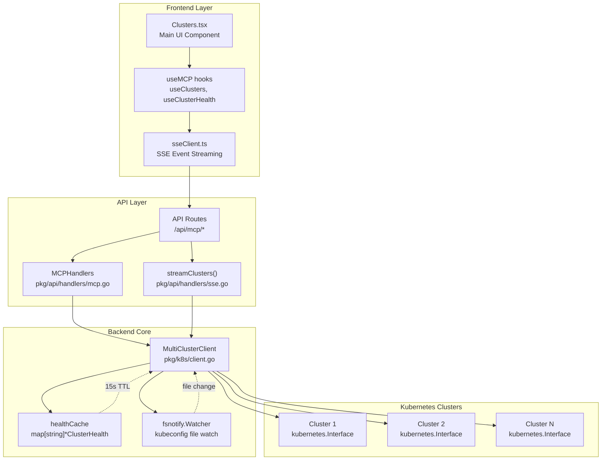

**Sources:** [pkg/api/server.go:492-530](), [pkg/api/handlers/mcp.go:50-62](), [pkg/k8s/client.go:43-59](), [web/src/components/clusters/Clusters.tsx:1-53]()

---

## MultiClusterClient Implementation

The `MultiClusterClient` is the core backend component that manages connections to multiple Kubernetes clusters. It maintains separate `kubernetes.Interface` and `dynamic.Interface` clients for each cluster context found in the kubeconfig file.

### Key Data Structures

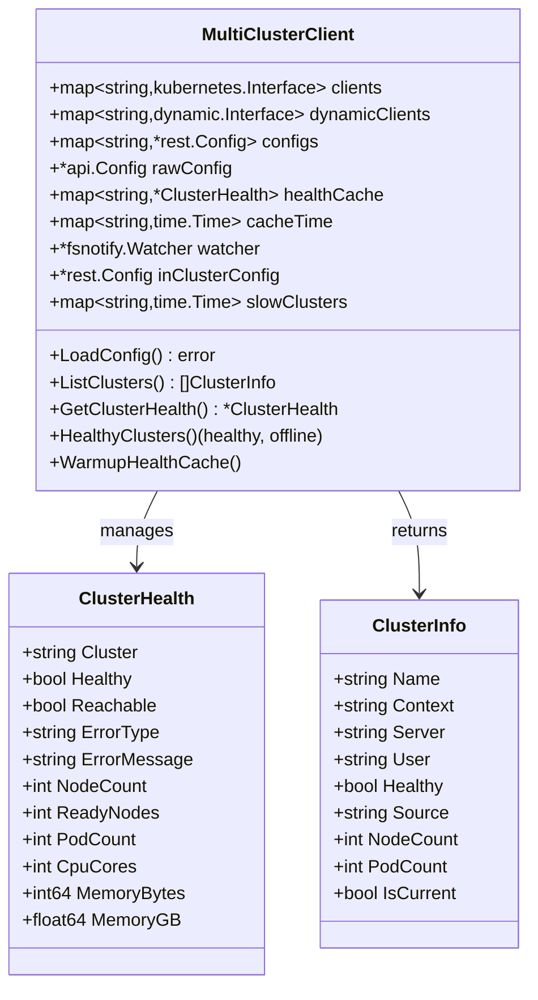

**Sources:** [pkg/k8s/client.go:43-59](), [pkg/k8s/client.go:126-138](), [pkg/k8s/client.go:140-169]()

### Initialization and Configuration Loading

The `MultiClusterClient` initialization happens in the server startup sequence:

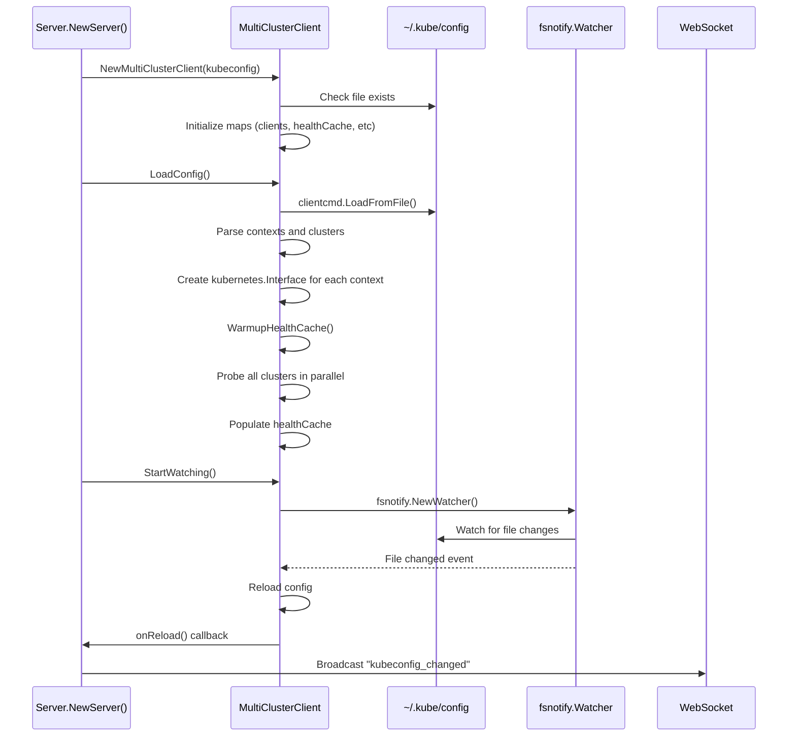

**Sources:** [pkg/api/server.go:139-163](), [pkg/k8s/client.go:599-699](), [pkg/k8s/client.go:737-800]()

### Cluster Discovery

The `ListClusters()` method reads all contexts from the kubeconfig and returns a `ClusterInfo` for each:

| Field | Source | Purpose |
|-------|--------|---------|
| `Name` | kubeconfig context name | Primary identifier |
| `Context` | kubeconfig context name | Display name |
| `Server` | cluster.server field | API server URL (used for cloud detection) |
| `User` | context.user field | Auth user (used for cloud detection) |
| `Healthy` | `healthCache` | Cached health status |
| `Source` | "kubeconfig" or "in-cluster" | How cluster was discovered |
| `IsCurrent` | kubeconfig current-context | Whether this is the active context |

**Sources:** [pkg/k8s/client.go:701-735](), [pkg/k8s/client.go:126-138]()

---

## Cluster Health Monitoring

### Health Check Strategy

The health checking system uses a multi-tier caching strategy to avoid blocking on slow/offline clusters:

```mermaid
graph TB
    subgraph "Health Check Flow"
        Request["API Request<br/>/api/mcp/clusters"]
        CacheCheck{"Cache Valid?<br/>TTL < 60s"}
        ReturnCache["Return Cached Health<br/>Immediate Response"]
        Background["Background Refresh<br/>go routine"]
        CheckCluster["GetClusterHealth()<br/>8s timeout per cluster"]
        UpdateCache["Update healthCache<br/>with timestamp"]
        SlowCheck{"Cluster Slow?<br/>consecutively timed out"}
        ReducedTimeout["Use 3s timeout<br/>instead of 15s"]
        NormalTimeout["Use 15s timeout"]
        
        Request --> CacheCheck
        CacheCheck -->|Yes| ReturnCache
        CacheCheck -->|No| Background
        ReturnCache --> Background
        Background --> SlowCheck
        SlowCheck -->|Yes| ReducedTimeout
        SlowCheck -->|No| NormalTimeout
        ReducedTimeout --> CheckCluster
        NormalTimeout --> CheckCluster
        CheckCluster --> UpdateCache
    end
    
    subgraph "Health Cache Structure"
        HC["healthCache map"]
        Entry1["cluster1: {healthy:true, nodeCount:5, cachedAt:...}"]
        Entry2["cluster2: {healthy:false, errorType:timeout}"]
        HC --> Entry1
        HC --> Entry2
    end
```

**Sources:** [pkg/k8s/client.go:838-912](), [pkg/api/handlers/mcp.go:100-146](), [pkg/k8s/client.go:31-41]()

### Timeout Configuration

The system uses different timeouts depending on operation type and cluster history:

| Constant | Value | Usage |
|----------|-------|-------|
| `clusterHealthCheckTimeout` | 8s | Initial health probe per cluster |
| `clusterProbeTimeout` | 5s | Quick liveness check |
| `k8sClientTimeout` | 45s | General Kubernetes API operations |
| `ssePerClusterTimeout` | 10s | SSE streaming data fetch |
| `sseSlowClusterTimeout` | 3s | SSE fetch for clusters marked slow |
| `clusterCacheTTL` | 60s | Health cache validity period |
| `slowClusterTTL` | 2 minutes | How long to mark cluster as slow |

**Sources:** [pkg/k8s/client.go:31-41](), [pkg/api/handlers/sse.go:36-46]()

### HealthyClusters() Filtering

The `HealthyClusters()` method splits clusters into two groups based on cached health data:

```go
// Pseudocode representation
func HealthyClusters() (healthy, offline []ClusterInfo) {
    for _, cluster := range allClusters {
        health := healthCache[cluster.Name]
        
        if health.Reachable == false || 
           health.ErrorType in ["timeout", "network", "certificate"] ||
           health.NodeCount == 0 {
            offline = append(offline, cluster)
        } else {
            healthy = append(healthy, cluster)
        }
    }
    return
}
```

This filtering is critical for the SSE streaming architecture, which skips offline clusters immediately to avoid blocking.

**Sources:** [pkg/k8s/client.go:838-912]()

---

## SSE Streaming Architecture

Server-Sent Events (SSE) provide real-time streaming of multi-cluster data without blocking on slow clusters. Results are sent as they arrive from each cluster.

### Generic Streaming Pattern

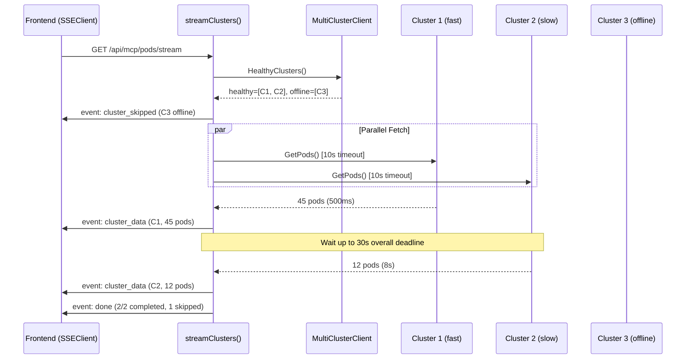

**Sources:** [pkg/api/handlers/sse.go:73-202](), [web/src/lib/sseClient.ts:11-151]()

### SSE Cache Strategy

The SSE system implements two levels of caching:

#### Backend SSE Cache (15s TTL)

```go
// pkg/api/handlers/sse.go
var sseCache = map[string]*sseCacheEntry{}

type sseCacheEntry struct {
    data      interface{}
    fetchedAt time.Time
}

func sseCacheGet(key string) interface{} {
    if entry, ok := sseCache[key]; ok && 
       time.Since(entry.fetchedAt) < 15*time.Second {
        return entry.data
    }
    return nil
}
```

#### Frontend Result Cache (10s TTL)

```typescript
// web/src/lib/sseClient.ts
const resultCache = new Map<string, { data: unknown[]; at: number }>()
const RESULT_CACHE_TTL = 10_000

// Check cache before opening SSE connection
const cached = resultCache.get(fullUrl)
if (cached && Date.now() - cached.at < RESULT_CACHE_TTL) {
    // Replay cached data via callbacks
    return Promise.resolve(cached.data)
}
```

**Sources:** [pkg/api/handlers/sse.go:44-71](), [web/src/lib/sseClient.ts:33-73]()

### SSE Endpoint Implementations

All SSE endpoints follow the same pattern using `streamClusters()`:

| Endpoint | Data Key | Purpose |
|----------|----------|---------|
| `/api/mcp/pods/stream` | `pods` | Stream pods per cluster |
| `/api/mcp/pod-issues/stream` | `issues` | Stream pod issues per cluster |
| `/api/mcp/deployments/stream` | `deployments` | Stream deployments per cluster |
| `/api/mcp/events/stream` | `events` | Stream events per cluster |
| `/api/mcp/gpu-nodes/stream` | `nodes` | Stream GPU nodes per cluster |
| `/api/mcp/services/stream` | `services` | Stream services per cluster |

**Sources:** [pkg/api/handlers/sse.go:225-364](), [pkg/api/server.go:531-547]()

---

## Frontend Integration

### React Hook Architecture

The frontend uses a layered hook architecture for data fetching:

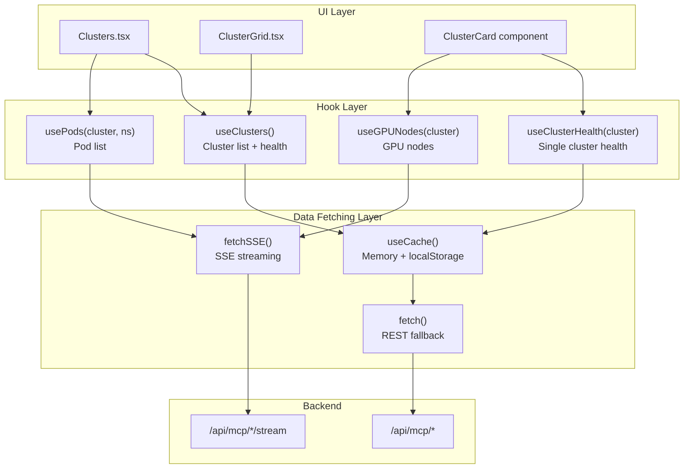

**Sources:** [web/src/components/clusters/Clusters.tsx:1-53](), [web/src/hooks/useMCP.ts:1-4](), [web/src/lib/sseClient.ts:1-151]()

### useClusters() Hook

The primary hook for cluster management:

```typescript
// web/src/hooks/mcp/useClusters.ts
export function useClusters() {
  const { data, isLoading, error, refetch } = useCache(
    ['clusters'],
    async () => {
      const res = await fetch('/api/mcp/clusters')
      const json = await res.json()
      return json.clusters || []
    },
    { enabled: !isDemoMode, staleTime: 30000 }
  )

  // Deduplicate clusters by server URL
  const deduplicatedClusters = useMemo(() => {
    const serverMap = new Map<string, ClusterInfo>()
    data.forEach(cluster => {
      if (!serverMap.has(cluster.server)) {
        serverMap.set(cluster.server, cluster)
      } else {
        // Merge aliases
        const existing = serverMap.get(cluster.server)
        existing.aliases = [...(existing.aliases || []), cluster.name]
      }
    })
    return Array.from(serverMap.values())
  }, [data])

  return { clusters: data, deduplicatedClusters, isLoading, error, refetch }
}
```

**Sources:** [web/src/hooks/mcp/types.ts:1-44]()

### Progressive Data Loading

The UI implements progressive enhancement with multiple data sources:

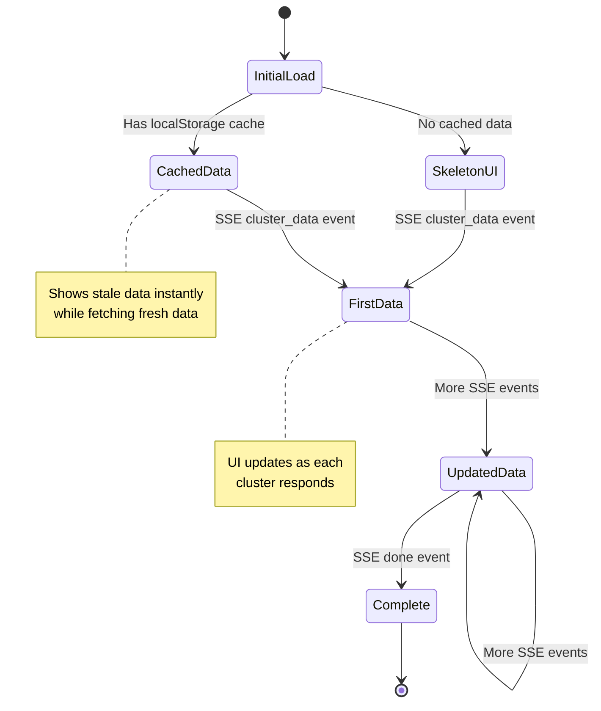

**Sources:** [web/src/components/clusters/Clusters.tsx:1-53](), [web/src/lib/sseClient.ts:42-151]()

---

## Cloud Provider Detection

The system automatically detects cloud provider and distribution based on cluster metadata:

### Detection Logic

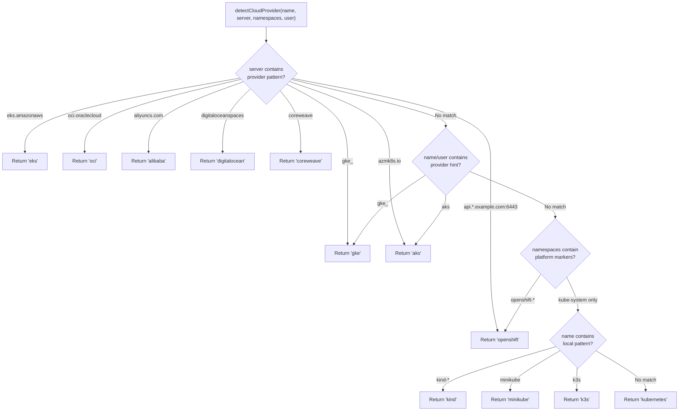

**Sources:** [web/src/components/ui/CloudProviderIcon.tsx:124-200]()

### Provider-Specific Features

Each detected provider enables specific features:

| Provider | Console URL Pattern | Icon | Special Handling |
|----------|---------------------|------|------------------|
| `eks` | `https://{region}.console.aws.amazon.com/eks/...` | AWS hexagon | Region extraction from server URL |
| `gke` | `https://console.cloud.google.com/kubernetes/...` | GCP cube | Project/location/cluster parsing |
| `aks` | `https://portal.azure.com/#view/...` | Azure blocks | Generic Azure portal link |
| `openshift` | `https://console-openshift-console.apps.{domain}` | Red Hat logo | API→Console URL transformation |
| `oci` | `https://cloud.oracle.com/containers/...` | OCI logo | Region from server URL |
| `kind` | None | Local icon | No external console |
| `minikube` | None | Local icon | No external console |

**Sources:** [web/src/components/ui/CloudProviderIcon.tsx:1-200](), [web/src/components/clusters/ClusterDetailModal.tsx:19-63]()

---

## Multi-Cluster Query Patterns

### Parallel Query Pattern (REST)

For REST endpoints, all healthy clusters are queried in parallel with a global deadline:

```go
// pkg/api/handlers/mcp.go
func (h *MCPHandlers) GetPods(c *fiber.Ctx) error {
    cluster := c.Query("cluster")
    namespace := c.Query("namespace")

    if cluster == "" {
        // Multi-cluster query
        clusters, _, _ := h.k8sClient.HealthyClusters(c.Context())
        
        var wg sync.WaitGroup
        var mu sync.Mutex
        var allPods []k8s.PodInfo
        
        for _, cl := range clusters {
            wg.Add(1)
            go func(clusterName string) {
                defer wg.Done()
                ctx, cancel := context.WithTimeout(c.Context(), 15*time.Second)
                defer cancel()
                
                pods, err := h.k8sClient.GetPods(ctx, clusterName, namespace)
                if err == nil {
                    mu.Lock()
                    allPods = append(allPods, pods...)
                    mu.Unlock()
                }
            }(cl.Name)
        }
        
        // Wait max 30s for all goroutines
        waitWithDeadline(&wg, 30*time.Second)
        return c.JSON(fiber.Map{"pods": allPods})
    }
    
    // Single cluster query
    pods, _ := h.k8sClient.GetPods(c.Context(), cluster, namespace)
    return c.JSON(fiber.Map{"pods": pods})
}
```

**Sources:** [pkg/api/handlers/mcp.go:197-259](), [pkg/api/handlers/mcp.go:15-48]()

### Progressive Query Pattern (SSE)

For SSE endpoints, results stream immediately as they arrive:

```go
// pkg/api/handlers/sse.go
func streamClusters(c *fiber.Ctx, h *MCPHandlers, ...) error {
    healthy, offline, _ := h.k8sClient.HealthyClusters(c.Context())
    
    c.Context().SetBodyStreamWriter(func(w *bufio.Writer) {
        // Immediately skip offline clusters
        for _, cl := range offline {
            writeSSEEvent(w, "cluster_skipped", fiber.Map{
                "cluster": cl.Name,
                "reason": "offline",
            })
        }
        
        // Spawn goroutines for healthy clusters
        var wg sync.WaitGroup
        for _, cl := range healthy {
            wg.Add(1)
            go func(clusterName string) {
                defer wg.Done()
                data, err := fetchFn(ctx, clusterName)
                if err == nil {
                    // Stream result immediately
                    writeSSEEvent(w, "cluster_data", fiber.Map{
                        "cluster": clusterName,
                        "items": data,
                    })
                }
            }(cl.Name)
        }
        
        // Wait with deadline
        select {
        case <-done:
        case <-time.After(30*time.Second):
        }
        
        writeSSEEvent(w, "done", fiber.Map{})
    })
}
```

**Sources:** [pkg/api/handlers/sse.go:73-202]()

---

## Cluster Refresh and Hot Reload

### Kubeconfig File Watching

The system watches the kubeconfig file for changes and automatically reloads:

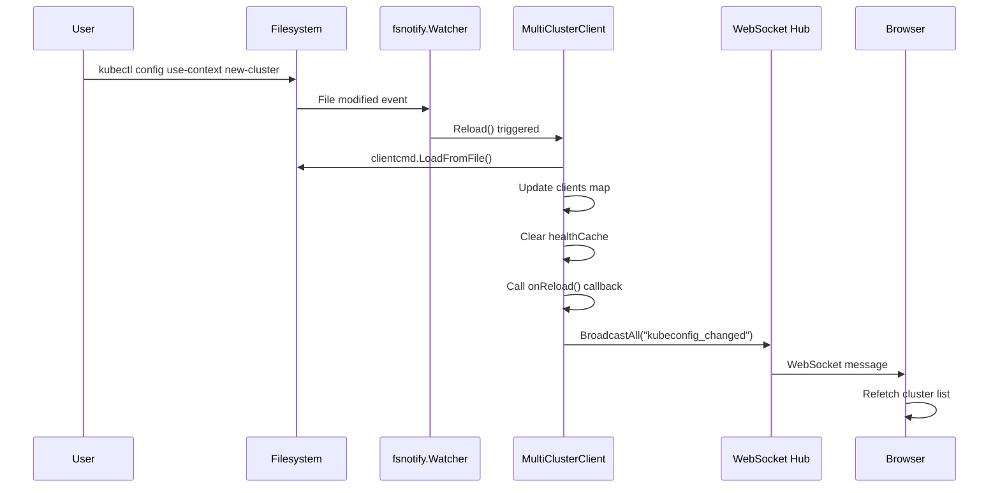

**Sources:** [pkg/k8s/client.go:737-800](), [pkg/api/server.go:152-158]()

### Manual Cluster Refresh

The UI provides a refresh button for individual clusters:

```typescript
// web/src/components/clusters/Clusters.tsx
async function refreshSingleCluster(clusterName: string) {
  // Mark cluster as refreshing in UI
  setClusters(prev => prev.map(c => 
    c.name === clusterName 
      ? { ...c, refreshing: true } 
      : c
  ))
  
  try {
    // Force health check
    const res = await fetch(`/api/mcp/clusters/${clusterName}/health`)
    const health = await res.json()
    
    // Update cluster data
    setClusters(prev => prev.map(c =>
      c.name === clusterName
        ? { ...c, ...health, refreshing: false }
        : c
    ))
  } finally {
    // Ensure refreshing flag is cleared
    setTimeout(() => {
      setClusters(prev => prev.map(c =>
        c.name === clusterName
          ? { ...c, refreshing: false }
          : c
      ))
    }, 1000) // Minimum 1s spin for visual feedback
  }
}
```

**Sources:** [web/src/components/clusters/Clusters.tsx:1-53](), [web/src/hooks/useMCP.ts:1-4]()

---

## Error Handling and Resilience

### Error Type Classification

The system categorizes cluster errors for appropriate handling:

| Error Type | Cause | UI Treatment | Cache Strategy |
|------------|-------|--------------|----------------|
| `timeout` | Cluster took >8s to respond | Yellow "Offline" badge | Mark as slow, use 3s timeout next time |
| `auth` | Token expired or invalid credentials | Red "Token Expired" badge | Don't cache, prompt for reauth |
| `network` | DNS failure, connection refused | Yellow "Offline" badge | Mark as offline, skip in SSE |
| `certificate` | TLS cert validation failed | Yellow "Offline" badge | Mark as offline, skip in SSE |
| `unknown` | Generic error | Orange "Unhealthy" badge | Cache for 60s to avoid retry storm |

**Sources:** [pkg/k8s/client.go:140-169](), [web/src/components/clusters/components/ClusterGrid.tsx:44-65]()

### Slow Cluster Tracking

Clusters that consistently timeout are tracked and given reduced timeouts:

```go
// pkg/k8s/client.go
type MultiClusterClient struct {
    slowClusters map[string]time.Time  // cluster -> last timeout
}

func (m *MultiClusterClient) IsSlow(cluster string) bool {
    m.mu.RLock()
    defer m.mu.RUnlock()
    if lastTimeout, ok := m.slowClusters[cluster]; ok {
        return time.Since(lastTimeout) < slowClusterTTL  // 2 minutes
    }
    return false
}

func (m *MultiClusterClient) MarkSlow(cluster string) {
    m.mu.Lock()
    defer m.mu.Unlock()
    m.slowClusters[cluster] = time.Now()
}
```

This prevents a single slow cluster from blocking all other clusters in multi-cluster queries.

**Sources:** [pkg/k8s/client.go:43-59](), [pkg/api/handlers/sse.go:135-166]()

### Graceful Degradation

The UI implements progressive enhancement with multiple fallback levels:

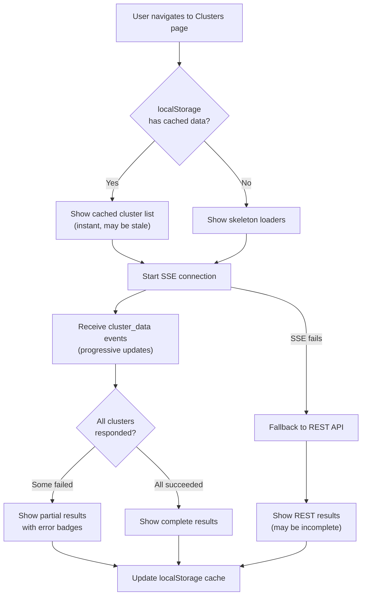

**Sources:** [web/src/components/clusters/Clusters.tsx:1-53](), [web/src/lib/sseClient.ts:117-136]()

---

## Performance Optimizations

### Summary of Optimization Techniques

| Technique | Location | Benefit | Trade-off |
|-----------|----------|---------|-----------|
| Health cache (60s TTL) | `MultiClusterClient.healthCache` | Instant cluster list responses | Health data may be stale |
| SSE cache (15s TTL) | `pkg/api/handlers/sse.go` | Avoid redundant cluster queries | Cache invalidation complexity |
| Frontend cache (10s TTL) | `web/src/lib/sseClient.ts` | Instant navigation without server round-trip | Memory usage |
| Slow cluster tracking | `MultiClusterClient.slowClusters` | Prevent slow clusters from blocking fast ones | Requires timeout tuning |
| HealthyClusters() filtering | `MultiClusterClient.HealthyClusters()` | Skip offline clusters immediately | Requires accurate health cache |
| Parallel goroutines | All MCP handlers | Query N clusters simultaneously | Increased memory/goroutine usage |
| waitWithDeadline() | `pkg/api/handlers/mcp.go` | Never block beyond 30s | May return partial results |

**Sources:** [pkg/k8s/client.go:31-41](), [pkg/api/handlers/sse.go:44-71](), [pkg/api/handlers/mcp.go:15-48]()

### Warmup Strategy

On server startup, the system proactively warms the health cache:

```go
// pkg/api/server.go
k8sClient.LoadConfig()
log.Println("Kubernetes client initialized successfully")

// Warmup: probe all clusters to populate health cache before serving.
// Without this, first load hits ALL clusters (including offline) = 30s+ load.
k8sClient.WarmupHealthCache()
```

This ensures the first user request gets cached health data instead of blocking for 30+ seconds.

**Sources:** [pkg/api/server.go:143-151](), [pkg/k8s/client.go:914-938]()

---

## Demo Mode Support

The system supports a demo mode for preview deployments without real cluster access:

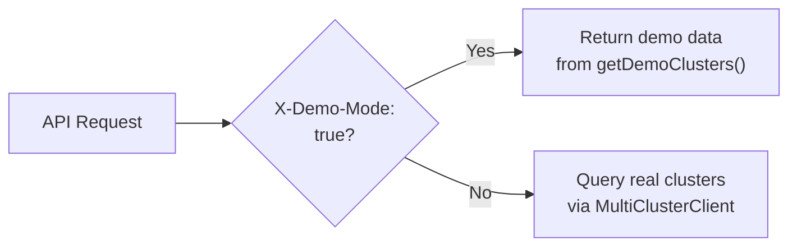

Demo data is defined in `pkg/api/handlers/demo_data.go` and includes realistic cluster names, health statuses, and resource counts for various cloud providers.

**Sources:** [pkg/api/handlers/demo_data.go:1-46](), [pkg/api/handlers/mcp.go:100-146]()

---

