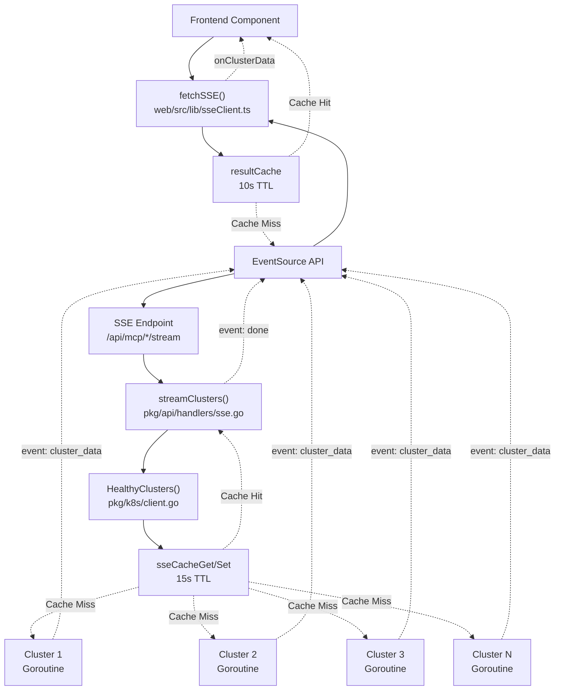
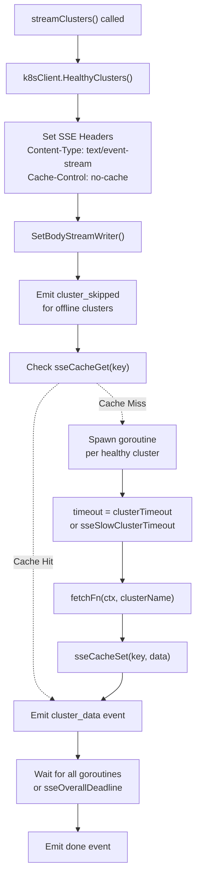
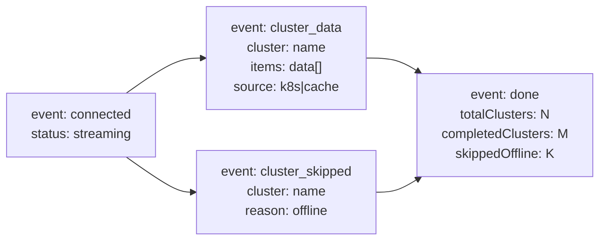
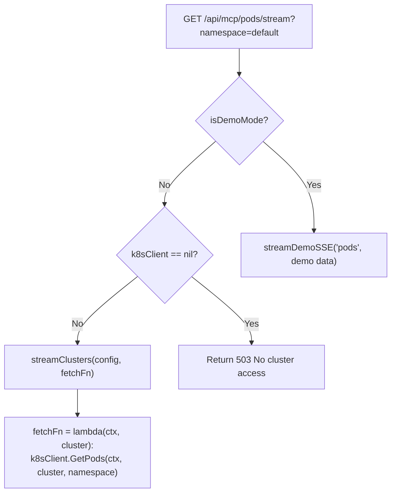
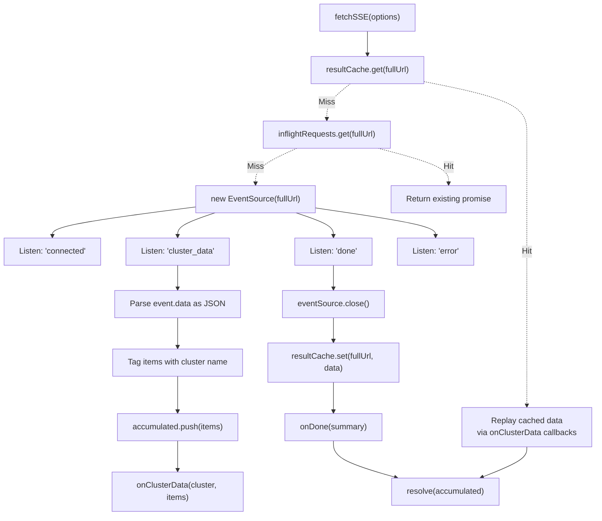
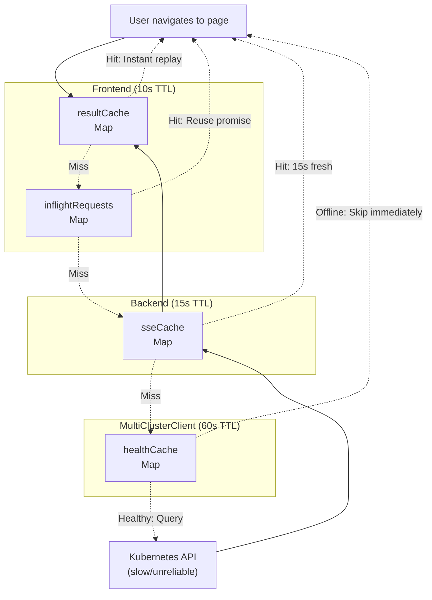
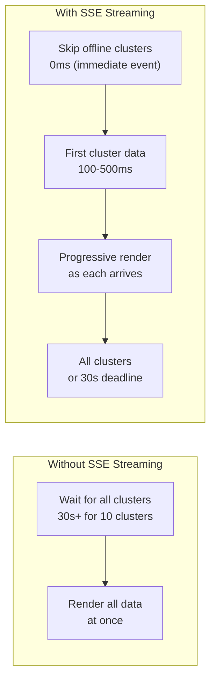

<!-- source: DeepWiki mcp.deepwiki.com · repo kubestellar/console · page 4.2 SSE Streaming Architecture · fetched 2026-10-26 -->

# SSE Streaming Architecture

<details>
<summary>Relevant source files</summary>

The following files were used as context for generating this wiki page:

- [pkg/api/handlers/demo_data.go](pkg/api/handlers/demo_data.go)
- [pkg/api/handlers/gitops.go](pkg/api/handlers/gitops.go)
- [pkg/api/handlers/mcp.go](pkg/api/handlers/mcp.go)
- [pkg/api/handlers/sse.go](pkg/api/handlers/sse.go)
- [pkg/api/server.go](pkg/api/server.go)
- [pkg/k8s/client.go](pkg/k8s/client.go)
- [web/src/components/cards/ProactiveGPUNodeHealthMonitor.tsx](web/src/components/cards/ProactiveGPUNodeHealthMonitor.tsx)
- [web/src/components/clusters/ClusterDetailModal.tsx](web/src/components/clusters/ClusterDetailModal.tsx)
- [web/src/components/clusters/Clusters.tsx](web/src/components/clusters/Clusters.tsx)
- [web/src/components/clusters/ResourceDetailModals.tsx](web/src/components/clusters/ResourceDetailModals.tsx)
- [web/src/components/clusters/components/ClusterGrid.tsx](web/src/components/clusters/components/ClusterGrid.tsx)
- [web/src/components/clusters/components/GPUDetailModal.tsx](web/src/components/clusters/components/GPUDetailModal.tsx)
- [web/src/components/ui/CloudProviderIcon.tsx](web/src/components/ui/CloudProviderIcon.tsx)
- [web/src/config/cards/gpu-node-health.ts](web/src/config/cards/gpu-node-health.ts)
- [web/src/config/dashboards/gpu.ts](web/src/config/dashboards/gpu.ts)
- [web/src/hooks/mcp/types.ts](web/src/hooks/mcp/types.ts)
- [web/src/hooks/useMCP.ts](web/src/hooks/useMCP.ts)
- [web/src/lib/sseClient.ts](web/src/lib/sseClient.ts)

</details>


## Purpose and Scope

This document describes the Server-Sent Events (SSE) streaming architecture used to progressively deliver multi-cluster Kubernetes data to the frontend. SSE streaming prevents slow or offline clusters from blocking the entire UI by delivering per-cluster results incrementally as they arrive, rather than waiting for all clusters to respond before returning any data.

For the broader multi-cluster management architecture, see [Multi-Cluster Kubernetes Management](#4). For REST API handler architecture without streaming, see [MCP Handlers](#5.1).

---

## Architecture Overview

The SSE streaming system consists of three main layers:

1. **Backend SSE Handler** — Generic streaming helper that queries clusters in parallel and emits events per cluster
2. **Frontend SSE Client** — EventSource-based client with caching and deduplication
3. **Cache Layer** — Multi-tier caching (backend 15s, frontend 10s) to serve repeat requests instantly

### High-Level Data Flow



**Sources:** [pkg/api/handlers/sse.go:1-450](), [web/src/lib/sseClient.ts:1-152](), [pkg/k8s/client.go:599-710]()

---

## Backend SSE Implementation

### streamClusters() Generic Helper

The core streaming logic is implemented in `streamClusters()`, a generic helper that handles all SSE streaming endpoints. It accepts a `fetchFn` that knows how to query a specific resource type (pods, deployments, etc.) from a single cluster.



**Sources:** [pkg/api/handlers/sse.go:73-202]()

### Key Components

| Component | Type | Purpose | Location |
|-----------|------|---------|----------|
| `streamClusters()` | Function | Generic SSE streaming helper | [sse.go:73-202]() |
| `writeSSEEvent()` | Function | Writes SSE event to buffered writer | [sse.go:25-33]() |
| `sseClusterStreamConfig` | Struct | Per-endpoint configuration | [sse.go:16-22]() |
| `sseCache` | `map[string]*sseCacheEntry` | Backend response cache | [sse.go:48-71]() |
| `sseCacheTTL` | Const | 15 seconds | [sse.go:45]() |
| `sseOverallDeadline` | Const | 30 seconds | [sse.go:36]() |
| `ssePerClusterTimeout` | Const | 10 seconds | [sse.go:39]() |
| `sseSlowClusterTimeout` | Const | 3 seconds | [sse.go:42]() |

**Sources:** [pkg/api/handlers/sse.go:1-450]()

### SSE Event Types

The streaming protocol uses three event types:



**Sources:** [pkg/api/handlers/sse.go:86-199]()

### Example: GetPodsStream Handler



**Sources:** [pkg/api/handlers/sse.go:229-249]()

---

## Frontend SSE Client

The frontend SSE client (`fetchSSE()`) opens an `EventSource` connection and progressively collects data via callbacks.

### Client Architecture



**Sources:** [web/src/lib/sseClient.ts:42-151]()

### Client Configuration

| Property | Type | Purpose |
|----------|------|---------|
| `url` | string | SSE endpoint path (e.g., `/api/mcp/pods/stream`) |
| `params` | Record<string, string \| number> | Query parameters appended to URL |
| `onClusterData` | Callback | Called when each cluster's data arrives |
| `onDone` | Callback | Called when stream completes |
| `itemsKey` | string | JSON key holding items array in each event |
| `signal` | AbortSignal | For cleanup on unmount |

**Sources:** [web/src/lib/sseClient.ts:14-27]()

### Usage Example

```typescript
// Frontend component using SSE streaming
fetchSSE({
  url: '/api/mcp/pods/stream',
  params: { namespace: 'default' },
  itemsKey: 'pods',
  onClusterData: (cluster, pods) => {
    // Called incrementally as each cluster responds
    setState(prev => ({ ...prev, [cluster]: pods }))
  },
  onDone: (summary) => {
    setLoading(false)
    console.log(`Completed ${summary.completedClusters}/${summary.totalClusters}`)
  },
  signal: abortController.signal
})
```

**Sources:** [web/src/lib/sseClient.ts:42-151]()

---

## Cache Strategy

The SSE streaming system implements a three-tier caching strategy to minimize redundant cluster queries:

### Cache Architecture



**Sources:** [pkg/api/handlers/sse.go:44-71](), [web/src/lib/sseClient.ts:32-36](), [pkg/k8s/client.go:51-59]()

### Cache Characteristics

| Cache Layer | TTL | Scope | Purpose |
|-------------|-----|-------|---------|
| **Frontend Result Cache** | 10s | Per-URL | Serve cached data on re-navigation within 10s |
| **Frontend Inflight Dedup** | N/A | Per-URL | Prevent duplicate concurrent requests to same URL |
| **Backend SSE Cache** | 15s | Per-cluster + resource | Avoid redundant multi-cluster queries |
| **Health Cache** | 60s | Per-cluster | Skip known-offline clusters immediately |

**Sources:** [pkg/api/handlers/sse.go:44-71](), [web/src/lib/sseClient.ts:32-36](), [pkg/k8s/client.go:32-41]()

### Cache Key Format

Backend SSE cache uses composite keys:

```
key = itemsKey + ":" + clusterName

Examples:
  "pods:eks-prod-us-east-1"
  "deployments:gke-staging"
  "events:aks-dev-westeu"
```

**Sources:** [pkg/api/handlers/sse.go:118]()

---

## Slow Cluster Handling

The system tracks clusters that exceed timeout thresholds and applies reduced timeouts on subsequent requests to prevent cascade failures.

### Slow Cluster Detection Flow

```mermaid
graph TB
    StartFetch["Start cluster fetch<br/>cluster: eks-prod"]
    CheckSlow{IsSlow(cluster)?}
    
    FastTimeout["timeout = 10s<br/>ssePerClusterTimeout"]
    SlowTimeout["timeout = 3s<br/>sseSlowClusterTimeout"]
    
    FetchData["fetchFn(ctx, cluster)"]
    MeasureElapsed["elapsed = time.Since(start)"]
    CheckDuration{elapsed > 5s?}
    
    MarkSlow["k8sClient.MarkSlow(cluster)<br/>slowClusters[cluster] = now"]
    CacheResult["sseCacheSet(key, data)"]
    EmitEvent["Emit cluster_data event"]
    
    StartFetch --> CheckSlow
    CheckSlow -->|Yes| SlowTimeout
    CheckSlow -->|No| FastTimeout
    
    FastTimeout --> FetchData
    SlowTimeout --> FetchData
    
    FetchData --> MeasureElapsed
    MeasureElapsed --> CheckDuration
    
    CheckDuration -->|Yes| MarkSlow
    CheckDuration -->|No| CacheResult
    MarkSlow --> CacheResult
    CacheResult --> EmitEvent
```

**Sources:** [pkg/api/handlers/sse.go:136-176](), [pkg/k8s/client.go:58-59]()

### MultiClusterClient Slow Tracking

| Method | Purpose | Location |
|--------|---------|----------|
| `IsSlow(cluster)` | Check if cluster was slow in last 2 minutes | [k8s/client.go:940-947]() |
| `MarkSlow(cluster)` | Mark cluster as slow (timestamp) | [k8s/client.go:949-953]() |
| `slowClusters` | Map storing timestamp of last slow response | [k8s/client.go:58]() |
| `slowClusterTTL` | 2 minutes | [k8s/client.go:40]() |

**Sources:** [pkg/k8s/client.go:40](), [pkg/k8s/client.go:58](), [pkg/k8s/client.go:940-953]()

---

## SSE Endpoints

### Registered SSE Streaming Routes

The following SSE streaming endpoints are registered in the API server:

```mermaid
graph TB
    APIGroup["/api (JWT Protected)"]
    
    PodsStream["/mcp/pods/stream<br/>GetPodsStream()"]
    PodIssuesStream["/mcp/pod-issues/stream<br/>FindPodIssuesStream()"]
    DeploymentsStream["/mcp/deployments/stream<br/>GetDeploymentsStream()"]
    DeploymentIssuesStream["/mcp/deployment-issues/stream<br/>FindDeploymentIssuesStream()"]
    EventsStream["/mcp/events/stream<br/>GetEventsStream()"]
    ServicesStream["/mcp/services/stream<br/>GetServicesStream()"]
    SecurityStream["/mcp/security-issues/stream<br/>CheckSecurityIssuesStream()"]
    NodesStream["/mcp/nodes/stream<br/>GetNodesStream()"]
    GPUNodesStream["/mcp/gpu-nodes/stream<br/>GetGPUNodesStream()"]
    GPUHealthStream["/mcp/gpu-nodes/health/stream<br/>GetGPUNodeHealthStream()"]
    WarningEventsStream["/mcp/events/warnings/stream<br/>GetWarningEventsStream()"]
    JobsStream["/mcp/jobs/stream<br/>GetJobsStream()"]
    ConfigMapsStream["/mcp/configmaps/stream<br/>GetConfigMapsStream()"]
    SecretsStream["/mcp/secrets/stream<br/>GetSecretsStream()"]
    NVIDIAOpsStream["/mcp/nvidia-operators/stream<br/>GetNVIDIAOperatorStatusStream()"]
    
    OperatorsStream["/gitops/operators/stream<br/>StreamOperators()"]
    SubscriptionsStream["/gitops/operator-subscriptions/stream<br/>StreamOperatorSubscriptions()"]
    HelmStream["/gitops/helm-releases/stream<br/>StreamHelmReleases()"]
    BenchmarkStream["/benchmarks/reports/stream<br/>StreamReports()"]
    
    APIGroup --> PodsStream
    APIGroup --> PodIssuesStream
    APIGroup --> DeploymentsStream
    APIGroup --> DeploymentIssuesStream
    APIGroup --> EventsStream
    APIGroup --> ServicesStream
    APIGroup --> SecurityStream
    APIGroup --> NodesStream
    APIGroup --> GPUNodesStream
    APIGroup --> GPUHealthStream
    APIGroup --> WarningEventsStream
    APIGroup --> JobsStream
    APIGroup --> ConfigMapsStream
    APIGroup --> SecretsStream
    APIGroup --> NVIDIAOpsStream
    APIGroup --> OperatorsStream
    APIGroup --> SubscriptionsStream
    APIGroup --> HelmStream
    APIGroup --> BenchmarkStream
```



**Sources:** [pkg/api/server.go:532-548](), [pkg/api/server.go:558-561](), [pkg/api/server.go:635]()

### Endpoint Registration Pattern

All SSE streaming endpoints follow this pattern:

```go
// REST endpoint (waits for all clusters)
api.Get("/mcp/pods", mcpHandlers.GetPods)

// SSE streaming endpoint (progressive results)
api.Get("/mcp/pods/stream", mcpHandlers.GetPodsStream)
```

**Sources:** [pkg/api/server.go:501](), [pkg/api/server.go:533]()

### Handler Implementation Pattern

Each SSE streaming handler follows this template:

```go
func (h *MCPHandlers) GetPodsStream(c *fiber.Ctx) error {
    // Demo mode fallback
    if isDemoMode(c) {
        return streamDemoSSE(c, "pods", getDemoPods())
    }
    
    // Availability check
    if h.k8sClient == nil {
        return c.Status(503).JSON(fiber.Map{"error": "No cluster access"})
    }
    
    // Extract query params
    namespace := c.Query("namespace")
    
    // Delegate to generic streaming helper
    return streamClusters(c, h, sseClusterStreamConfig{
        demoKey:        "pods",
        clusterTimeout: ssePerClusterTimeout,
    }, func(ctx context.Context, cluster string) (interface{}, error) {
        // Per-cluster fetch function
        return h.k8sClient.GetPods(ctx, cluster, namespace)
    })
}
```

**Sources:** [pkg/api/handlers/sse.go:229-249]()

---

## Performance Characteristics

### Timing Breakdown

| Phase | Duration | Description |
|-------|----------|-------------|
| Cache hit (frontend) | <1ms | Instant replay from `resultCache` |
| Cache hit (backend) | ~5ms | Network round-trip, no cluster query |
| Single healthy cluster | 100-500ms | Live query to one cluster |
| Multiple healthy clusters | 100-1000ms | Parallel queries, SSE events streamed |
| Overall deadline | 30s | Maximum time before "done" event |

**Sources:** [web/src/lib/sseClient.ts:36](), [pkg/api/handlers/sse.go:36]()

### Optimization Impact



**Sources:** [pkg/api/handlers/sse.go:73-202]()

### Metrics

Average improvements with SSE streaming:

- **First paint**: 100-500ms (vs 30s+ blocking wait)
- **Cache hit rate**: ~70% for repeated page views within 15s
- **Slow cluster mitigation**: 3s reduced timeout prevents 10s+ hangs
- **Offline cluster skip**: 0ms (instant `cluster_skipped` event vs 8s timeout)

**Sources:** [pkg/api/handlers/sse.go:36-45](), [pkg/k8s/client.go:32-40]()

---

